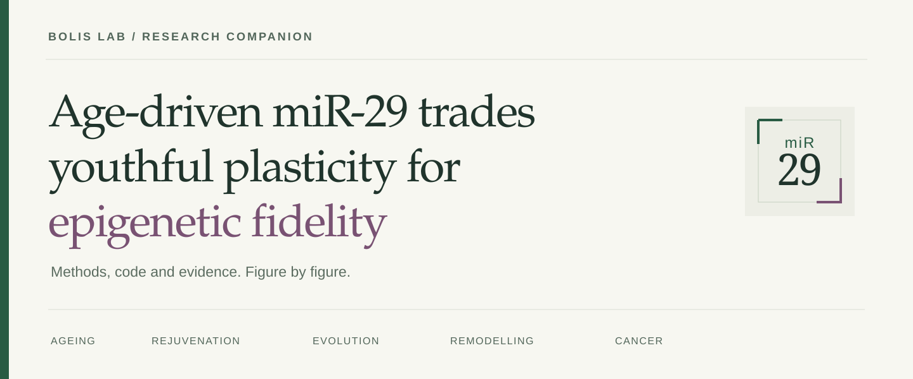

<p align="center"></p>

# miR-29 trades youthful plasticity for epigenetic fidelity

**The analysis companion · Bolis Lab**

An integrated study of physiological ageing, rejuvenation, evolutionary conservation,
fibroblast perturbation and cancer. Explore the evidence figure by figure, inspect
the analysis code, and trace each result to its inputs and statistical comparison.

[Explore the five chapters](#explore-the-study) · [Reproduction guide](docs/reproduce.qmd) · [Data catalogue](data/README.md) · [Authors & citation](docs/about.qmd)

> **Private working version.** This repository is being prepared for release.
> Code and reading materials are here; the five input packages have been uploaded
> to an **unpublished, restricted Zenodo draft**. The reserved DOI is
> [10.5281/zenodo.23266285](https://doi.org/10.5281/zenodo.23266285) and will become
> active when the deposit is published. Reviewer access is provided separately.
> A documentation build does not certify a raw-data-to-figure run. No website is currently published.

## Analysis inputs on Zenodo

Download the figure-specific ZIPs from the Zenodo deposit once you have access:
`MIR29_Figure1_S1_inputs_v1.zip` through `MIR29_Figure5_S5_inputs_v1.zip`.
The five packages contain 136 RDS objects and required supporting inputs
(913.4 MB compressed in total). **While the record remains a draft, the DOI is
not a public download link.** Editors and reviewers need separately granted
draft-preview access; private access links are never stored in this repository.

Extract the ZIPs into the **repository root**, preserving their
`analyses/FigureN_and_SN/` paths. See the [data and installation guide](data/README.md),
[file manifest](data/zenodo-manifest.json) and [checksums](data/zenodo-SHA256SUMS.txt).
Individual GTEx donor ages are excluded; the guide explains the remaining
controlled-access execution boundaries. No code archive is part of this data deposit.

## Explore the study

| Chapter | Question | Read | Inspect the source |
|:--|:--|:--|:--|
| **01 · Convergence** | Where do ageing and two rejuvenation-associated transitions meet? | [Figure 1 + S1](analyses/Figure1_and_S1/READABLE.md) | [R Markdown](analyses/Figure1_and_S1/Figure1_and_S1.Rmd) |
| **02 · Conservation** | How does the miR-29 signal extend across evolution? | [Figure 2 + S2](analyses/Figure2_and_S2/READABLE.md) | [R Markdown](analyses/Figure2_and_S2/Figure2_and_S2.Rmd) |
| **03 · Transcription** | How do opposing perturbations reshape transcriptional ageing? | [Figure 3 + S3](analyses/Figure3_and_S3/READABLE.md) | [R Markdown](analyses/Figure3_and_S3/Figure3_and_S3.Rmd) |
| **04 · The methylome** | How do remodelling, molecular age and reference distance relate? | [Figure 4 + S4](analyses/Figure4_and_S4/READABLE.md) | [R Markdown](analyses/Figure4_and_S4/Figure4_and_S4.Rmd) |
| **05 · Cancer** | Does the relationship extend to tumours and cancer cell lines? | [Figure 5 + S5](analyses/Figure5_and_S5/READABLE.md) | [R Markdown](analyses/Figure5_and_S5/Figure5_and_S5.Rmd) |

The chapter documents contain panel-level headings, methods, figures and code.
The website source in `docs/` presents the same material with search and chapter navigation.

## Start here

**To read:** open a chapter above. No R installation is needed.

**To preview the documentation locally:** install Python 3 and Quarto, then run
from the repository root:

```sh
python3 scripts/build_docs.py
quarto render docs
quarto preview docs --host 127.0.0.1
```

The documentation build uses existing rendered results. It does not execute
biological analyses, fetch datasets or publish a website.

**To rerun an analysis:** start with the [reproduction guide](docs/reproduce.qmd)
and the corresponding chapter README. Input availability is tracked in the
[data catalogue](data/input-catalogue.json). Do not run the chapter renderers
until their required data and software have been restored.

## What is in this repository?

```text
analyses/       Five figure-based analysis modules and readable records
docs/           Quarto documentation, navigation and visual assets
data/           Input catalogue and data-access boundaries
environments/   Software requirements and environment-restoration guidance
scripts/        Documentation builder and repository checks
CITATION.cff    Study authors and software citation metadata
```

Large raw data, binary checkpoints, controlled-access phenotypes and internal
editorial files are not committed here. Processed inputs are kept in the Zenodo
data deposit above; new raw-data accessions will be added when assigned.

## Statistical reading guide

- The current fibroblast methylation reference contains **123 CpGs**.
- A global mean displacement is not a treatment-by-time interaction or a slope.
- Main and supplementary panels distinguish **pooled** and **matched** controls.
- The hTERT final-cycle endpoint and whole-series mean are different tests.
- Sample sizes and multiple-testing families belong to each comparison, not to
  the total number of probes or repeated measurements.

For the current Figure 4/S4 labels, consult the
[statistical comparison map](analyses/Figure4_and_S4/CURRENT_STATISTICAL_LABELS.tsv).
The [release checklist](RELEASE_CHECKLIST.md) identifies outstanding packaging
and reconciliation tasks before a public release.

## Citation, licence and contact

Use [CITATION.cff](CITATION.cff) for the author list and study title. Publication
and archived-release identifiers will be added when available.

An open-source licence has **not yet been selected**. See [LICENSING.md](LICENSING.md);
third-party materials retain their original terms.

Correspondence: **Marco Bolis** — [Mario Negri](mailto:marco.bolis@marionegri.it)
or [IOR](mailto:marco.bolis@ior.usi.ch).
