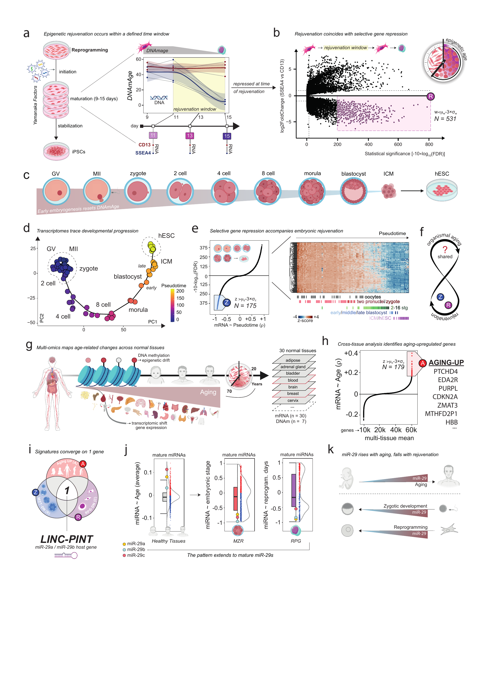
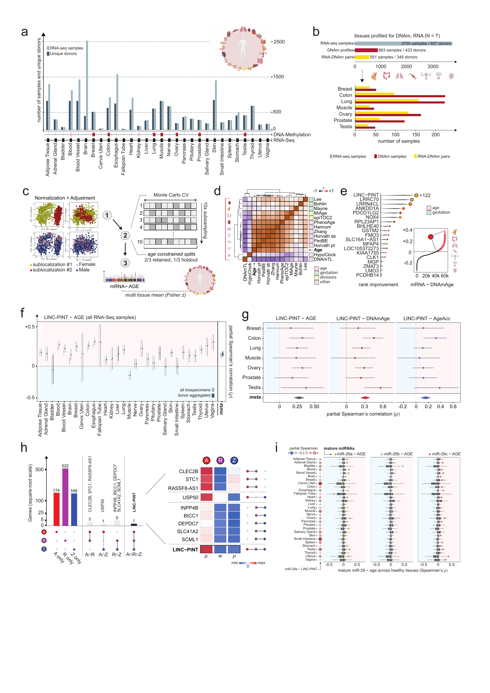

> **External inputs — restricted Zenodo draft.** The five input packages were last confirmed in an unpublished, restricted Zenodo draft on 9 October 2026, with reserved DOI [10.5281/zenodo.23266285](https://doi.org/10.5281/zenodo.23266285). The DOI becomes active on publication; draft access is granted separately. Extract the matching ZIP into the repository root. Individual GTEx donor ages are withheld, and full-notebook execution boundaries remain documented in the [module instructions](README.md). Scientific code and recorded results below are unchanged.

```{r setup, include=FALSE}
knitr::opts_chunk$set(
  echo = TRUE,
  message = FALSE,
  warning = FALSE,
  fig.align = "center",
  fig.retina = 1,
  dev = "svglite",
  cache.path = "cache/figure1-",
  out.width = "100%"
)

options(width = 100, scipen = 4)
set.seed(params$seed)
```

# Prepare and import the data

The notebook is self-contained: the compact count matrices and aligned metadata
are stored in `data/`. For full provenance, the folded block below contains the
complete script used to rebuild those inputs from the original STAR files. It is
shown for inspection and is not executed during a normal knit.

## Build the compact inputs

```{r prepare-inputs-source, eval=FALSE, class.source='fold-hide', code=readLines('scripts/prepare_inputs.R', warn=FALSE)}
```

## Load the analysis-ready inputs

The prepared objects are imported once and then used consistently by every
panel. Open the code block to inspect the package and data-loading step.

```{r packages-and-inputs, class.source='fold-hide'}
suppressPackageStartupMessages({
  library(DESeq2)
  library(limma)
  library(org.Hs.eg.db)
  library(SingleCellExperiment)
  library(scater)
  library(slingshot)
  library(ggplot2)
  library(ggrastr)
  library(dplyr)
  library(cowplot)
  library(ComplexHeatmap)
  library(circlize)
  library(dendextend)
  library(scico)
  library(ggplotify)
  library(grid)
  library(edgeR)
  library(gghalves)
  library(readxl)
  library(tidyr)
  library(forcats)
  library(ggrepel)
})

ipsc_input <- readRDS("data/figure1_ipsc_inputs.rds")
zga_input <- readRDS("data/figure1_zga_inputs.rds")

# Cross-tissue objects are precomputed analysis outputs. This is necessary for
# GTEx because exact donor ages are controlled-access and cannot be redistributed.
gene_annotations <- readRDS("data/hs_gene_annotations.RDS")
age_coefficients <- readRDS("data/coefficients.age.RDS")
age_sub7_coefficients <- readRDS("data/coefficients.age.sub7.RDS")
clock_coefficients <- readRDS("data/coefficients.clock.RDS")
epiclock_input <- readRDS("data/epiclock_preds_GTEX.RDS")
clock_map <- read.csv("data/clock_labels_classes.csv", stringsAsFactors = FALSE)
mirna_coefficients <- readRDS("data/coefficients.mirnanew.RDS")
```

```{r figure-settings, include=FALSE}
# The generic sans family resolves to Helvetica on macOS and remains portable
# when the document is rendered on another machine.
figure_font <- "sans"

figure_colors <- c(
  ssea4 = "#282F65",
  cd13 = "#7F241A",
  signature_r = "#6F385F",
  signature_r_badge = "#A45192",
  signature_z = "#2B8AFC",
  signature_z_badge = "#375099",
  rejuvenation_window = "#FCFAE1",
  aging = "#E96C6C",
  aging_light = "#F8C6CB",
  clock = "#F05C68",
  clock_light = "#FFD2D5",
  gestation = "#BBD8B7",
  mir29a = "#F8C62A",
  mir29b = "#9FD4E3",
  mir29c = "#EF7580"
)

theme_figure1 <- function(base_size = 11) {
  theme_classic(base_size = base_size, base_family = figure_font) +
    theme(
      axis.title = element_text(color = "black"),
      axis.text = element_text(color = "black"),
      axis.ticks = element_line(color = "black", linewidth = 0.35),
      plot.tag = element_text(size = 20, face = "plain", color = "black"),
      plot.background = element_rect(fill = "white", color = NA),
      panel.background = element_rect(fill = "white", color = NA),
      legend.background = element_rect(fill = "white", color = NA)
    )
}
```

<div class="figure-lead">
This document follows the Figure 1 and Supplementary Figure S1 layouts finalized on 2 October 2026. Figure 1 contains panels a–k: the seven analytical panels a, b, d, e, h, i, and j are reconstructed in R; c, f, g, and k are editorial schematics preserved from the final artwork. Supplementary Figure S1 contains panels a–i, including the normalization/cross-validation workflow (c), clock correlations (d), and DNAm-age rank improvement (e) relocated from the main figure. Code, statistical definitions, numerical checks, and the original notebook styling are retained.
</div>

```{r input-summary, echo=FALSE}
input_summary <- data.frame(
  Analysis = c(
    "iPSC reprogramming",
    "Zygotic development",
    "DNAm age",
    "Healthy-tissue aging",
    "Epigenetic clocks",
    "Mature miRNAs"
  ),
  Accession = c(
    "GSE165176",
    "Five GEO cohorts",
    "GSE165176",
    "GTEx-derived",
    "GTEx-derived",
    "Three source datasets"
  ),
  Samples = c(
    ncol(ipsc_input$counts),
    ncol(zga_input$counts),
    nrow(ipsc_input$methylation),
    sum(colnames(age_coefficients$RNA$method4) != ".MEAN"),
    length(epiclock_input),
    nrow(mirna_coefficients$miRNA$method4)
  ),
  Readout = c(
    "RNA-seq",
    "RNA-seq",
    "Horvath DNAm age",
    "Cross-tissue coefficients",
    "Clock predictions",
    "miRNA expression"
  )
)

knitr::kable(
  input_summary,
  align = c("l", "l", "r", "l"),
  caption = "Inputs retained in this self-contained project."
)
```

# Final manuscript layout

The two reference images below are copied from the current Illustrator PDFs.
They preserve the new message headings and the exact editorial assembly;
the following sections provide the corresponding executable analysis.
Moving panels does not change any input, model, gene set, coefficient, or test.

```{r final-main-reference, echo=FALSE, out.width='100%', fig.cap="Final Figure 1 (2 October 2026): panels a–k, including the message headings and editorial artwork."}

```

```{r final-s1-reference, echo=FALSE, out.width='100%', fig.cap="Final Supplementary Figure S1 (2 October 2026): panels a–i, with the relocated workflow, clock, and rank-improvement panels in the second row."}

```

The current main-figure sequence is **normal-tissue resources (g) → age-associated
gene ranking (h) → signature intersection (i) → mature miRNAs (j) → synthesis (k)**.
The shared cross-tissue calculations are defined before panel h and reused in
S1c–e. The complete renumbering is:

| Previous panel | Current panel | Content |
|:--|:--|:--|
| 1a–g | 1a–g | Unchanged panel identities |
| 1i | S1c | Normalization, adjustment, and age-constrained cross-validation |
| 1h | S1d | Relationships among chronological age and epigenetic clocks |
| 1k | S1e | Rank improvement with DNAm age |
| 1j | 1h | Multi-tissue aging-up gene ranking |
| 1l | 1i | Three-way signature intersection |
| 1m | 1j | Mature miR-29 dynamics |
| 1n | 1k | Conceptual synthesis |
| S1a–b | S1a–b | RNA atlas and paired-modality availability |
| S1c–d | S1f–g | LINC-PINT age and paired multi-omic associations |
| S1e–f | S1h–i | Fixed-set intersections and mature-miRNA context |

# Panel a — Epigenetic rejuvenation occurs within a defined time window

Successful SSEA4-positive reprogramming enters a sharp DNAm-age decline after day 11, whereas the CD13-positive, unsuccessful trajectory retains an adult epigenetic age.

## Prepare the clock data

The grey lines connect measurements from the same donor and cell-fate branch. Day 13 is retained as an axis landmark even though the methylation dataset contains observations only at days 9, 11, and 15.

```{r panel-a-data}
clock_data <- ipsc_input$methylation

clock_data$day <- as.numeric(sub("day", "", clock_data$DAY, fixed = TRUE))
clock_data$DNAm_age <- as.numeric(clock_data$clock_horvath)
clock_data$GROUP <- factor(clock_data$GROUP, levels = c("CD13", "SSEA4"))
clock_data$trajectory <- interaction(
  clock_data$AGE_GROUP,
  clock_data$GROUP,
  drop = TRUE
)

table(clock_data$day, clock_data$GROUP)
```

## Draw panel a

```{r panel-a-plot, fig.width=6.1, fig.height=4.0, fig.cap="Panel a. Horvath DNAm age during successful (SSEA4) and unsuccessful (CD13) reprogramming."}
panel_a <- ggplot(clock_data, aes(x = day, y = DNAm_age)) +
  annotate(
    "rect",
    xmin = 10.7,
    xmax = 15.25,
    ymin = -Inf,
    ymax = Inf,
    fill = figure_colors["rejuvenation_window"]
  ) +
  geom_line(
    aes(group = trajectory),
    color = "grey62",
    linewidth = 0.42,
    alpha = 0.80
  ) +
  geom_smooth(
    aes(color = GROUP, fill = GROUP),
    method = "loess",
    formula = y ~ x,
    span = 1.05,
    se = TRUE,
    level = 0.90,
    linewidth = 1.0,
    alpha = 0.18
  ) +
  geom_point(
    aes(fill = GROUP),
    shape = 21,
    size = 2.2,
    stroke = 0.55,
    color = "white"
  ) +
  annotate(
    "text",
    x = 12.95,
    y = -5.8,
    label = "rejuvenation window",
    family = figure_font,
    fontface = "italic",
    size = 3.35
  ) +
  scale_color_manual(
    values = c(
      CD13 = unname(figure_colors["cd13"]),
      SSEA4 = unname(figure_colors["ssea4"])
    )
  ) +
  scale_fill_manual(
    values = c(
      CD13 = unname(figure_colors["cd13"]),
      SSEA4 = unname(figure_colors["ssea4"])
    )
  ) +
  scale_x_continuous(
    breaks = c(9, 11, 13, 15),
    limits = c(8.75, 15.25),
    expand = c(0, 0)
  ) +
  scale_y_continuous(
    breaks = c(0, 20, 40, 60),
    limits = c(-8, 62),
    expand = c(0, 0)
  ) +
  labs(
    tag = "a",
    x = NULL,
    y = expression(DNAm[age])
  ) +
  theme_figure1(base_size = 11) +
  theme(
    legend.position = "none",
    panel.border = element_rect(color = "black", fill = NA, linewidth = 0.45),
    axis.line = element_blank(),
    plot.tag.position = c(0.01, 0.99),
    plot.tag = element_text(hjust = 0, vjust = 1),
    plot.margin = margin(12, 12, 10, 20)
  )

panel_a
```

# Panel b — Rejuvenation coincides with selective gene repression

The RNA-seq comparison contrasts SSEA4-positive and CD13-positive cells across days 11, 13, and 15. Donor and numeric time are included in the DESeq2 design, leaving the group coefficient to capture the shared reprogramming outcome.

## Differential-expression model

```{r ipsc-deseq2, cache=TRUE, cache.lazy=FALSE}
ipsc_counts <- ipsc_input$counts
ipsc_annotation <- ipsc_input$annotation

ipsc_annotation$GROUP <- factor(
  ipsc_annotation$GROUP,
  levels = c("CD13", "SSEA4")
)
ipsc_annotation$DONOR <- factor(ipsc_annotation$DONOR)
ipsc_annotation$TP <- as.numeric(ipsc_annotation$TP)

stopifnot(identical(colnames(ipsc_counts), rownames(ipsc_annotation)))

ipsc_dds <- DESeqDataSetFromMatrix(
  countData = ipsc_counts,
  colData = ipsc_annotation,
  design = ~ GROUP + DONOR + TP
)

ipsc_dds <- DESeq(ipsc_dds, quiet = TRUE)

ipsc_result <- results(
  ipsc_dds,
  name = "GROUP_SSEA4_vs_CD13",
  independentFiltering = FALSE
)

ipsc_result <- as.data.frame(ipsc_result)

ipsc_result$SYMBOL <- unname(mapIds(
  org.Hs.eg.db,
  keys = rownames(ipsc_result),
  column = "SYMBOL",
  keytype = "ENSEMBL",
  multiVals = "first"
))
```

## Define the extreme repressed tail

The signature is selected on the DESeq2 Wald statistic, not on the visual rectangle. The same three-standard-deviation rule used in the manuscript must recover 531 genes.

```{r ipsc-tail-definition}
wald_mean <- mean(ipsc_result$stat, na.rm = TRUE)
wald_sd <- sd(ipsc_result$stat, na.rm = TRUE)
wald_threshold <- wald_mean - params$tail_z * wald_sd

ipsc_result$signature_R <- !is.na(ipsc_result$stat) &
  ipsc_result$stat < wald_threshold

n_signature_R <- sum(ipsc_result$signature_R)

# A hard check protects the final figure from silently reverting to one of the
# historical 32-sample or categorical-time models.
stopifnot(n_signature_R == 531L)

padj_for_plot <- ipsc_result$padj
padj_for_plot[is.na(padj_for_plot)] <- 1
padj_for_plot <- pmax(padj_for_plot, .Machine$double.xmin)
ipsc_result$significance <- -10 * log10(padj_for_plot)

data.frame(
  samples = ncol(ipsc_counts),
  finite_statistics = sum(is.finite(ipsc_result$stat)),
  mean_Wald = wald_mean,
  sd_Wald = wald_sd,
  threshold = wald_threshold,
  selected_genes = n_signature_R
)
```

## Draw panel b

```{r panel-b-plot, fig.width=8.4, fig.height=5.0, fig.cap="Panel b. Rotated volcano plot of SSEA4 versus CD13 differential expression during the rejuvenation window."}
panel_b <- ggplot(ipsc_result, aes(x = significance, y = log2FoldChange)) +
  annotate(
    "rect",
    xmin = 200,
    xmax = 800,
    ymin = -6.8,
    ymax = -0.15,
    fill = "#F7EDF5",
    color = "#B94AA0",
    linewidth = 0.55,
    linetype = "22"
  ) +
  geom_point_rast(
    data = subset(ipsc_result, !signature_R),
    color = "black",
    size = 0.48,
    alpha = 0.92,
    raster.dpi = params$raster_dpi,
    dev = "ragg"
  ) +
  geom_point_rast(
    data = subset(ipsc_result, signature_R),
    color = figure_colors["signature_r"],
    size = 0.68,
    alpha = 0.82,
    raster.dpi = params$raster_dpi,
    dev = "ragg"
  ) +
  geom_vline(
    xintercept = -10 * log10(0.05),
    color = "grey35",
    linewidth = 0.42,
    linetype = "22"
  ) +
  geom_hline(
    yintercept = 1,
    color = "#597FF7",
    linewidth = 0.52,
    linetype = "22"
  ) +
  geom_hline(
    yintercept = -1,
    color = "grey35",
    linewidth = 0.52,
    linetype = "22"
  ) +
  geom_hline(yintercept = 0, color = "black", linewidth = 0.80) +
  annotate(
    "point",
    x = 800,
    y = -0.15,
    shape = 21,
    size = 6.2,
    stroke = 0.65,
    fill = figure_colors["signature_r_badge"],
    color = "black"
  ) +
  annotate(
    "text",
    x = 800,
    y = -0.15,
    label = "R",
    family = figure_font,
    fontface = "bold",
    color = "white",
    size = 3.6
  ) +
  annotate(
    "text",
    x = 830,
    y = -2.15,
    label = "w[i] < mu[w] - 3*sigma[w]",
    parse = TRUE,
    hjust = 0,
    family = figure_font,
    size = 3.15
  ) +
  annotate(
    "text",
    x = 830,
    y = -3.30,
    label = paste0("italic(N) == ", n_signature_R),
    parse = TRUE,
    hjust = 0,
    family = figure_font,
    size = 3.7
  ) +
  annotate(
    "segment",
    x = 0,
    xend = 835,
    y = -8,
    yend = -8,
    linewidth = 0.55,
    arrow = arrow(type = "closed", length = unit(0.085, "in"))
  ) +
  annotate(
    "segment",
    x = 0,
    xend = 0,
    y = -8,
    yend = 9.1,
    linewidth = 0.55,
    arrow = arrow(type = "closed", length = unit(0.085, "in"))
  ) +
  scale_x_continuous(breaks = c(0, 200, 400, 600, 800)) +
  scale_y_continuous(breaks = c(-5, 0, 5)) +
  coord_cartesian(
    xlim = c(0, 820),
    ylim = c(-8, 9),
    clip = "off",
    expand = FALSE
  ) +
  labs(
    tag = "b",
    x = expression("Statistical significance  [" * -10 %*% log[10] * "(FDR)]"),
    y = expression(log[2] * "FoldChange  (SSEA4 vs CD13)")
  ) +
  theme_figure1(base_size = 10.5) +
  theme(
    axis.line = element_blank(),
    legend.position = "none",
    plot.tag.position = c(0.01, 0.99),
    plot.tag = element_text(hjust = 0, vjust = 1),
    plot.margin = margin(16, 92, 12, 18)
  )

panel_b
```

# Panel c — Early embryogenesis resets DNAmAge

The schematic places the epigenetic-age reset in the early embryonic interval and introduces the developmental RNA analysis in panels d–e. This is editorial artwork, not a separate fitted analysis.
Its exact appearance is preserved in the final Figure 1 reference above.

# Zygotic-development integration

Five public RNA-seq cohorts are integrated while preserving developmental stage. The GEO batch effect is removed after variance stabilization, and the resulting expression space is used consistently for PCA, pseudotime, gene ranking, and the heatmap.

## Normalize and remove the cohort effect

```{r zga-integration, cache=TRUE, cache.lazy=FALSE}
zga_counts <- zga_input$counts
zga_annotation <- zga_input$annotation

stage_order <- c(
  "GV",
  "MII",
  "stage_2PN",
  "zygote",
  "stage_2cell",
  "stage_4cell",
  "stage_8cell",
  "stage_morula",
  "stage_blasto_early",
  "stage_blasto_middle",
  "stage_blasto_late",
  "stage_ICM",
  "hESC"
)

# DESeq2 receives the same alphabetical factor coding used in the original
# analysis. Developmental order is kept separately in `stage_order` for labels
# and annotation tracks.
zga_annotation$GROUP <- factor(as.character(zga_annotation$GROUP))
zga_annotation$GEO <- factor(zga_annotation$GEO)
zga_annotation$TP <- as.numeric(zga_annotation$TP)

stopifnot(identical(colnames(zga_counts), rownames(zga_annotation)))

zga_dds <- DESeqDataSetFromMatrix(
  countData = zga_counts,
  colData = zga_annotation,
  design = ~ 0 + GROUP + GEO
)

zga_vst <- vst(zga_dds, blind = FALSE)

group_design <- model.matrix(
  ~ 0 + GROUP,
  data = zga_annotation
)

zga_expression <- removeBatchEffect(
  assay(zga_vst),
  batch = zga_annotation$GEO,
  design = group_design
)

dim(zga_expression)
```

## Estimate the developmental trajectory

The PCA and k-means seed are fixed. Slingshot then infers the single lineage from the cluster graph; its direction is checked against developmental stage and reversed only if necessary. This preserves the trajectory used in the manuscript while making its biological orientation explicit.

```{r zga-pseudotime, cache=TRUE, cache.lazy=FALSE}
zga_sce <- SingleCellExperiment(
  assays = list(vst = zga_expression),
  colData = zga_annotation
)

set.seed(params$seed)
zga_sce <- runPCA(
  zga_sce,
  ncomponents = 20,
  exprs_values = "vst"
)

set.seed(params$seed)
zga_clusters <- kmeans(
  reducedDim(zga_sce, "PCA"),
  centers = 4
)$cluster

zga_sce$cluster <- factor(zga_clusters)

zga_sce <- slingshot(
  zga_sce,
  clusterLabels = "cluster",
  reducedDim = "PCA"
)

zga_pseudotime <- slingPseudotime(zga_sce)[, 1]

if (cor(zga_annotation$TP, zga_pseudotime, method = "spearman") < 0) {
  zga_pseudotime <- max(zga_pseudotime) - zga_pseudotime
}

zga_sce$pseudotime <- zga_pseudotime

stopifnot(all(is.finite(zga_pseudotime)))

data.frame(
  samples = length(zga_pseudotime),
  lineages = length(slingLineages(zga_sce)),
  stage_pseudotime_rho = cor(
    zga_annotation$TP,
    zga_pseudotime,
    method = "spearman"
  )
)
```

# Panel d — Transcriptomes trace developmental progression

The trajectory connects oocytes, cleavage-stage embryos, blastocysts, ICM, and hESCs. PCA signs are mathematically arbitrary, so they are oriented explicitly to place oocytes at the left, cleavage stages below, and hESCs at the upper right, matching the manuscript layout.

## Prepare coordinates and labels

```{r panel-d-data}
pca_coordinates <- as.data.frame(reducedDim(zga_sce, "PCA")[, 1:2])
pca_coordinates$sample_id <- rownames(pca_coordinates)
pca_coordinates$GROUP <- zga_annotation[pca_coordinates$sample_id, "GROUP"]
pca_coordinates$pseudotime <- zga_pseudotime[pca_coordinates$sample_id]

main_curve <- slingCurves(zga_sce)[[1]]
curve_coordinates <- as.data.frame(main_curve$s[main_curve$ord, 1:2])
colnames(curve_coordinates) <- c("PC1", "PC2")

# Orient PC1 from oocyte to hESC.
oocyte_pc1 <- median(
  pca_coordinates$PC1[pca_coordinates$GROUP %in% c("GV", "MII")]
)
hesc_pc1 <- median(pca_coordinates$PC1[pca_coordinates$GROUP == "hESC"])
pc1_multiplier <- if (hesc_pc1 > oocyte_pc1) 1 else -1

# Orient PC2 so that hESC lies above cleavage-stage embryos.
cleavage_pc2 <- median(
  pca_coordinates$PC2[
    pca_coordinates$GROUP %in% c("stage_4cell", "stage_8cell", "stage_morula")
  ]
)
hesc_pc2 <- median(pca_coordinates$PC2[pca_coordinates$GROUP == "hESC"])
pc2_multiplier <- if (hesc_pc2 > cleavage_pc2) 1 else -1

pca_coordinates$PC1_plot <- pca_coordinates$PC1 * pc1_multiplier
pca_coordinates$PC2_plot <- pca_coordinates$PC2 * pc2_multiplier
curve_coordinates$PC1_plot <- curve_coordinates$PC1 * pc1_multiplier
curve_coordinates$PC2_plot <- curve_coordinates$PC2 * pc2_multiplier

stage_centroids <- pca_coordinates %>%
  group_by(GROUP) %>%
  summarise(
    PC1_plot = median(PC1_plot),
    PC2_plot = median(PC2_plot),
    .groups = "drop"
  )

label_offsets <- data.frame(
  GROUP = factor(
    c(
      "GV", "MII", "zygote", "stage_2cell", "stage_4cell",
      "stage_8cell", "stage_morula", "stage_blasto_middle",
      "stage_ICM", "hESC"
    ),
    levels = stage_order
  ),
  label = c(
    "GV", "MII", "zygote", "2 cell", "4 cell",
    "8 cell", "morula", "blastocyst", "ICM", "hESC"
  ),
  dx = c(-17, 18, 18, -18, -13, 1, 2, -16, 5, 8),
  dy = c(14, 16, 3, -11, -10, 7, -9, 12, -10, 8)
)

stage_labels <- left_join(stage_centroids, label_offsets, by = "GROUP")
stage_labels <- stage_labels[!is.na(stage_labels$label), ]
stage_labels$x <- stage_labels$PC1_plot + stage_labels$dx
stage_labels$y <- stage_labels$PC2_plot + stage_labels$dy

blastocyst_labels <- stage_centroids %>%
  filter(GROUP %in% c("stage_blasto_early", "stage_blasto_late")) %>%
  mutate(
    label = c("early", "late"),
    x = PC1_plot + c(2, -7),
    y = PC2_plot + c(-8, 8)
  )

theta <- seq(0, 2 * pi, length.out = 200)

early_ellipse <- data.frame(
  x = -26 + 19 * cos(theta),
  y = 5 + 14 * sin(theta),
  ellipse = "oocyte"
)

hesc_center <- stage_centroids[stage_centroids$GROUP == "hESC", ]
hesc_ellipse <- data.frame(
  x = hesc_center$PC1_plot + 12 * cos(theta),
  y = hesc_center$PC2_plot + 13 * sin(theta),
  ellipse = "hESC"
)

ellipse_coordinates <- rbind(early_ellipse, hesc_ellipse)
```

## Draw panel d

```{r panel-d-plot, fig.width=6.8, fig.height=4.8, fig.cap="Panel d. PCA projection and Slingshot pseudotime across human zygotic development."}
panel_d <- ggplot(pca_coordinates, aes(x = PC1_plot, y = PC2_plot)) +
  geom_path(
    data = curve_coordinates,
    color = "black",
    linewidth = 0.72,
    lineend = "round"
  ) +
  geom_path(
    data = ellipse_coordinates,
    aes(x = x, y = y, group = ellipse),
    inherit.aes = FALSE,
    color = "grey45",
    linewidth = 0.45,
    linetype = "22"
  ) +
  geom_point(
    aes(fill = pseudotime),
    shape = 21,
    size = 3.4,
    stroke = 0.35,
    color = "black"
  ) +
  geom_text(
    data = stage_labels,
    aes(x = x, y = y, label = label),
    inherit.aes = FALSE,
    family = figure_font,
    size = 3.35
  ) +
  geom_text(
    data = blastocyst_labels,
    aes(x = x, y = y, label = label),
    inherit.aes = FALSE,
    family = figure_font,
    fontface = "italic",
    size = 2.8
  ) +
  annotate(
    "segment",
    x = -58,
    xend = 105,
    y = -54,
    yend = -54,
    linewidth = 0.55,
    arrow = arrow(type = "closed", length = unit(0.085, "in"))
  ) +
  annotate(
    "segment",
    x = -58,
    xend = -58,
    y = -54,
    yend = 39,
    linewidth = 0.55,
    arrow = arrow(type = "closed", length = unit(0.085, "in"))
  ) +
  scale_fill_viridis_c(
    option = "plasma",
    direction = 1,
    name = "Ptime",
    breaks = c(0, 50, 100, 150, 200),
    limits = c(0, 225),
    guide = guide_colorbar(
      barheight = unit(29, "mm"),
      barwidth = unit(3.0, "mm"),
      title.position = "top"
    )
  ) +
  scale_x_continuous(breaks = c(0, 50, 100)) +
  scale_y_continuous(breaks = c(-50, -25, 0, 25)) +
  coord_cartesian(
    xlim = c(-58, 105),
    ylim = c(-54, 39),
    clip = "off",
    expand = FALSE
  ) +
  labs(tag = "d", x = "PC1", y = "PC2") +
  theme_figure1(base_size = 10.5) +
  theme(
    axis.line = element_blank(),
    legend.position = "right",
    legend.title = element_text(size = 9),
    legend.text = element_text(size = 8),
    plot.tag.position = c(0.01, 0.99),
    plot.tag = element_text(hjust = 0, vjust = 1),
    plot.margin = margin(16, 16, 12, 20)
  )

panel_d
```

# Panel e — Selective gene repression accompanies embryonic rejuvenation

Every gene is correlated with Slingshot pseudotime. The y-axis reports signed FDR significance, while the extreme negative program is defined independently on Fisher-transformed Spearman coefficients.

## Correlate expression with pseudotime

```{r zga-correlations, cache=TRUE, cache.lazy=FALSE, dependson='zga-pseudotime'}
correlation_tests <- apply(
  zga_expression,
  1,
  function(expression_values) {
    test <- suppressWarnings(cor.test(
      expression_values,
      zga_pseudotime,
      method = "spearman",
      exact = FALSE
    ))

    c(
      rho = unname(test$estimate),
      p_value = test$p.value
    )
  }
)

zga_gene_results <- data.frame(
  rho = correlation_tests["rho", ],
  p_value = correlation_tests["p_value", ],
  row.names = colnames(correlation_tests)
)

zga_gene_results$fdr <- p.adjust(zga_gene_results$p_value, method = "BH")

fdr_for_plot <- pmax(zga_gene_results$fdr, .Machine$double.xmin)
zga_gene_results$signed_significance <-
  -10 * log10(fdr_for_plot) * sign(zga_gene_results$rho)

rho_clipped <- pmax(
  pmin(zga_gene_results$rho, 1 - 1e-12),
  -1 + 1e-12
)
zga_gene_results$fisher_z <- atanh(rho_clipped)

zga_gene_results <- zga_gene_results[
  is.finite(zga_gene_results$fisher_z),
  ,
  drop = FALSE
]
```

## Define the extreme negative Fisher-z tail

```{r zga-tail-definition, cache=TRUE, dependson='zga-correlations'}
fisher_mean <- mean(zga_gene_results$fisher_z)
fisher_sd <- sd(zga_gene_results$fisher_z)
fisher_threshold <- fisher_mean - params$tail_z * fisher_sd

zga_gene_results$signature_Z <-
  zga_gene_results$fisher_z < fisher_threshold

signature_Z_ids <- rownames(zga_gene_results)[zga_gene_results$signature_Z]
n_signature_Z <- length(signature_Z_ids)

# This check also catches accidental selection on signed p value or signed FDR,
# which would produce 497 or 495 genes rather than the 175 shown in Figure 1.
stopifnot(n_signature_Z == 175L)

data.frame(
  finite_correlations = nrow(zga_gene_results),
  mean_Fisher_z = fisher_mean,
  sd_Fisher_z = fisher_sd,
  threshold = fisher_threshold,
  equivalent_rho = tanh(fisher_threshold),
  selected_genes = n_signature_Z
)
```

## Draw the ranking

```{r panel-e-ranking}
panel_e_rank <- ggplot(
  zga_gene_results,
  aes(x = rho, y = signed_significance)
) +
  annotate(
    "rect",
    xmin = -1,
    xmax = -0.50,
    ymin = -470,
    ymax = 0,
    fill = "#E8EFFA",
    color = "#7196CE",
    linewidth = 0.45
  ) +
  geom_point_rast(
    data = subset(zga_gene_results, !signature_Z),
    color = "black",
    size = 0.36,
    alpha = 0.90,
    raster.dpi = params$raster_dpi,
    dev = "ragg"
  ) +
  geom_point_rast(
    data = subset(zga_gene_results, signature_Z),
    color = figure_colors["signature_z"],
    size = 0.62,
    alpha = 0.92,
    raster.dpi = params$raster_dpi,
    dev = "ragg"
  ) +
  geom_hline(yintercept = 0, color = "black", linewidth = 0.72) +
  annotate(
    "point",
    x = -0.79,
    y = -303,
    shape = 21,
    size = 6.0,
    stroke = 0.65,
    fill = figure_colors["signature_z_badge"],
    color = "black"
  ) +
  annotate(
    "text",
    x = -0.79,
    y = -303,
    label = "Z",
    family = figure_font,
    fontface = "bold",
    color = "white",
    size = 3.5
  ) +
  annotate(
    "text",
    x = -0.43,
    y = -330,
    label = "z[i] < mu[z] - 3*sigma[z]",
    parse = TRUE,
    hjust = 0,
    family = figure_font,
    size = 3.0
  ) +
  annotate(
    "text",
    x = -0.43,
    y = -390,
    label = paste0("italic(N) == ", n_signature_Z),
    parse = TRUE,
    hjust = 0,
    family = figure_font,
    size = 3.5
  ) +
  scale_x_continuous(
    breaks = c(-1, -0.5, 0, 0.5, 1),
    labels = c("-1", "-0.5", "0", "+0.5", "+1")
  ) +
  scale_y_continuous(
    breaks = c(-375, 0, 375),
    labels = c("375", "0", "375")
  ) +
  coord_cartesian(
    xlim = c(-1, 1),
    ylim = c(-470, 450),
    expand = FALSE
  ) +
  labs(
    tag = "e",
    x = expression("mRNA ~ Pseudotime  (" * rho * ")"),
    y = expression(sign(rho) %*% "[" * -10 * log[10] * "(FDR)]")
  ) +
  theme_figure1(base_size = 9.5) +
  theme(
    panel.border = element_rect(color = "grey35", fill = NA, linewidth = 0.42),
    axis.line = element_blank(),
    plot.tag.position = c(0.01, 0.99),
    plot.tag = element_text(hjust = 0, vjust = 1),
    plot.margin = margin(14, 6, 10, 20)
  )
```

## Build the annotated heatmap

Columns are ordered by pseudotime and never clustered. Rows contain all 175 selected genes, are standardized independently, clipped to ±4, and hierarchically clustered. The five annotation tracks reconstruct the stage bands shown beneath the manuscript heatmap.

```{r panel-e-heatmap, cache=TRUE, cache.lazy=FALSE, dependson=c('zga-integration','zga-pseudotime','zga-tail-definition')}
pseudotime_order <- order(zga_pseudotime)
ordered_samples <- names(zga_pseudotime)[pseudotime_order]
ordered_groups <- as.character(zga_annotation[ordered_samples, "GROUP"])

heatmap_matrix <- zga_expression[
  signature_Z_ids,
  ordered_samples,
  drop = FALSE
]

heatmap_matrix <- t(scale(t(heatmap_matrix)))
heatmap_matrix[heatmap_matrix < -4] <- -4
heatmap_matrix[heatmap_matrix > 4] <- 4

stage_tracks <- data.frame(
  `oocytes` = factor(
    ifelse(ordered_groups %in% c("GV", "MII"), ordered_groups, NA),
    levels = c("GV", "MII")
  ),
  `two pronuclei/zygote` = factor(
    ifelse(ordered_groups %in% c("stage_2PN", "zygote"), ordered_groups, NA),
    levels = c("stage_2PN", "zygote")
  ),
  `2–16 stg` = factor(
    ifelse(
      ordered_groups %in% c("stage_2cell", "stage_4cell", "stage_8cell", "stage_morula"),
      ordered_groups,
      NA
    ),
    levels = c("stage_2cell", "stage_4cell", "stage_8cell", "stage_morula")
  ),
  `early/middle/late blastocyst` = factor(
    ifelse(
      ordered_groups %in% c(
        "stage_blasto_early",
        "stage_blasto_middle",
        "stage_blasto_late"
      ),
      ordered_groups,
      NA
    ),
    levels = c(
      "stage_blasto_early",
      "stage_blasto_middle",
      "stage_blasto_late"
    )
  ),
  `ICM/hESC` = factor(
    ifelse(ordered_groups %in% c("stage_ICM", "hESC"), ordered_groups, NA),
    levels = c("stage_ICM", "hESC")
  ),
  check.names = FALSE
)

rownames(stage_tracks) <- ordered_samples

stage_colors <- list(
  `oocytes` = c(GV = "#A7A7A7", MII = "#666666"),
  `two pronuclei/zygote` = c(stage_2PN = "#F4A6A6", zygote = "#D75B62"),
  `2–16 stg` = c(
    stage_2cell = "#BCE7A7",
    stage_4cell = "#82C878",
    stage_8cell = "#4FA85A",
    stage_morula = "#258542"
  ),
  `early/middle/late blastocyst` = c(
    stage_blasto_early = "#AFC7EE",
    stage_blasto_middle = "#719FD5",
    stage_blasto_late = "#3B72B5"
  ),
  `ICM/hESC` = c(stage_ICM = "#D5B3DF", hESC = "#9761AB")
)

bottom_tracks <- HeatmapAnnotation(
  df = stage_tracks,
  col = stage_colors,
  which = "column",
  na_col = "white",
  show_legend = FALSE,
  show_annotation_name = TRUE,
  annotation_name_side = "right",
  annotation_name_rot = 0,
  annotation_name_gp = gpar(fontfamily = figure_font, fontsize = 7.5),
  simple_anno_size = unit(1.7, "mm"),
  gap = unit(0.35, "mm"),
  border = FALSE
)

vik_colors <- scico(3, palette = "vik", direction = 1)
heatmap_colors <- colorRamp2(c(-4, 0, 4), vik_colors)

zga_heatmap <- Heatmap(
  heatmap_matrix,
  name = "Z-score",
  col = heatmap_colors,
  cluster_rows = TRUE,
  cluster_columns = FALSE,
  show_row_names = FALSE,
  show_column_names = FALSE,
  row_dend_side = "left",
  row_dend_width = unit(8, "mm"),
  column_title = "Pseudotime (Zygotic development)  ⟶",
  column_title_gp = gpar(fontfamily = figure_font, fontsize = 10, fontface = "plain"),
  bottom_annotation = bottom_tracks,
  use_raster = TRUE,
  raster_quality = 4,
  border = FALSE,
  heatmap_legend_param = list(
    direction = "horizontal",
    at = c(-4, 0, 4),
    labels = c("−4", "0", "+4"),
    title_position = "leftcenter",
    legend_width = unit(25, "mm"),
    title_gp = gpar(fontfamily = figure_font, fontsize = 8),
    labels_gp = gpar(fontfamily = figure_font, fontsize = 7.5)
  )
)

heatmap_grob <- grid.grabExpr(
  draw(
    zga_heatmap,
    heatmap_legend_side = "bottom",
    padding = unit(c(2, 21, 2, 2), "mm")
  )
)

panel_e_heatmap <- as.ggplot(heatmap_grob) +
  theme(plot.background = element_rect(fill = "white", color = NA))
```

## Draw panel e

```{r panel-e-composite, fig.width=11.0, fig.height=4.5, fig.cap="Panel e. Fisher-z-selected negative pseudotime program and its expression dynamics across zygotic development."}
panel_e <- cowplot::plot_grid(
  panel_e_rank,
  panel_e_heatmap,
  nrow = 1,
  rel_widths = c(1.0, 2.15),
  align = "h",
  axis = "tb"
)

panel_e
```

# Panel f — Shared processes in aging and rejuvenation

The conceptual bridge asks which transcriptional changes are shared between the two rejuvenation settings and organismal aging. This is editorial artwork, not a separate fitted analysis.
Its exact appearance is preserved in the final Figure 1 reference above.

# Panel g — Multi-omics maps age-related changes across normal tissues

The resource overview distinguishes 30 broad tissue categories profiled by RNA-seq from the seven tissues used for the strictly paired RNA–DNAm comparison (sample availability is detailed in S1a–b). It introduces the gene–chronological-age ranking in panel h; it does not imply that every RNA specimen has a matched DNAm profile. This is editorial artwork, not a separate fitted analysis.
Its exact appearance is preserved in the final Figure 1 reference above.

# Shared cross-tissue calculations

Figure 1h directly asks which transcripts are positively associated with
chronological age across normal tissues. The corresponding analytical workflow
is documented in S1c; clock concordance and rank improvement with DNAm age are
shown in S1d and S1e. These panels reuse the same frozen inputs and Fisher-z
aggregation code as the preceding notebook version.

## Prepare the frozen coefficient summaries

The coefficient objects contain one gene-by-tissue matrix for each analytical
method. For every gene, correlations are transformed to Fisher z, averaged
across tissues, and transformed back to rho for display. The extreme upper tail
is defined in z-space as the complete-gene mean plus three standard deviations.

**Frozen-input detail.** The historical all-tissue Method-4 table contains
30 named tissue columns plus a stored `.MEAN` summary column. The code below
retains the historical table and its existing aggregation exactly, including
that column; it is not a 31st tissue cohort. The seven-tissue chronological-age
and DNAm-age tables each contain seven named tissue columns. This presentation
update does not redefine the historical ranking or the 179-gene signature.

```{r aging-shared-calculations, cache=TRUE, cache.lazy=FALSE}
summarize_cross_tissue_coefficients <- function(coefficient_object,
                                                annotation,
                                                tail_z = 3,
                                                eps = 1e-6) {
  coefficient_matrix <- as.matrix(coefficient_object$RNA$method4)
  storage.mode(coefficient_matrix) <- "numeric"

  clipped_matrix <- pmax(
    pmin(coefficient_matrix, 1 - eps),
    -1 + eps
  )

  fisher_matrix <- atanh(clipped_matrix)
  mean_fisher_z <- rowMeans(fisher_matrix, na.rm = TRUE)
  mean_rho <- tanh(mean_fisher_z)
  complete_gene <- rowSums(is.na(coefficient_matrix)) == 0
  n_non_missing <- rowSums(!is.na(coefficient_matrix))

  complete_z <- mean_fisher_z[complete_gene & is.finite(mean_fisher_z)]
  threshold_z <- mean(complete_z) + tail_z * sd(complete_z)
  threshold_rho <- tanh(threshold_z)

  gene_ids <- rownames(coefficient_matrix)
  annotation_index <- match(gene_ids, rownames(annotation))

  if (anyNA(annotation_index)) {
    stop("Some coefficient rows are absent from the gene annotation object.")
  }

  results <- data.frame(
    gene_id = gene_ids,
    symbol = as.character(annotation[annotation_index, "SYMBOL"]),
    mean_fisher_z = mean_fisher_z,
    mean_rho = mean_rho,
    complete = complete_gene,
    n_non_missing = n_non_missing,
    upper_tail = mean_fisher_z > threshold_z,
    stringsAsFactors = FALSE,
    row.names = gene_ids
  )

  list(
    results = results,
    selected_ids = gene_ids[results$upper_tail],
    threshold_z = threshold_z,
    threshold_rho = threshold_rho,
    n_tissues = ncol(coefficient_matrix)
  )
}

age_analysis <- summarize_cross_tissue_coefficients(
  age_coefficients,
  gene_annotations,
  tail_z = params$tail_z
)

age_sub7_analysis <- summarize_cross_tissue_coefficients(
  age_sub7_coefficients,
  gene_annotations,
  tail_z = params$tail_z
)

clock_analysis <- summarize_cross_tissue_coefficients(
  clock_coefficients,
  gene_annotations,
  tail_z = params$tail_z
)

age_rank <- age_analysis$results %>%
  arrange(mean_rho) %>%
  mutate(rank = row_number())

age_sub7_rank <- age_sub7_analysis$results %>%
  arrange(mean_rho) %>%
  mutate(rank = row_number())

clock_rank <- clock_analysis$results %>%
  arrange(mean_rho) %>%
  mutate(rank = row_number())

stopifnot(length(age_analysis$selected_ids) == 179L)
stopifnot(length(age_sub7_analysis$selected_ids) == 177L)
stopifnot(length(clock_analysis$selected_ids) == 140L)
```

# Panel h — Cross-tissue analysis identifies aging-upregulated genes

The complete cross-tissue coefficient distribution is ranked on the rho scale,
while selection remains in Fisher-z space. The 179 genes beyond the upper
three-standard-deviation boundary define the `AGING-UP` program. The adjacent
list reports its seven most strongly age-associated annotated transcripts; the
ellipsis indicates the remainder of the 179-gene program.

```{r panel-h-data}
aging_up_genes <- age_rank %>%
  filter(upper_tail)

aging_up_labels <- aging_up_genes %>%
  filter(!is.na(symbol), symbol != "") %>%
  arrange(desc(mean_rho)) %>%
  distinct(symbol, .keep_all = TRUE) %>%
  slice_head(n = 7) %>%
  mutate(label_y = seq(0.70, 0.22, length.out = n()))

stopifnot(nrow(aging_up_genes) == 179L)
stopifnot(
  identical(
    aging_up_labels$symbol,
    c("PTCHD4", "EDA2R", "PURPL", "CDKN2A", "ZMAT3", "MTHFD2P1", "HBB")
  )
)
```

```{r panel-h-plot, fig.width=8.2, fig.height=5.0, fig.cap="Panel h. Multi-tissue aging rank and the 179-gene AGING-UP tail."}
panel_h_curve <- ggplot(age_rank, aes(rank, mean_rho)) +
  geom_hline(yintercept = 0, linewidth = 0.35, color = "grey25") +
  geom_line(linewidth = 0.72, color = "black", lineend = "round") +
  annotate(
    "rect",
    xmin = 55600, xmax = 58988,
    ymin = age_analysis$threshold_rho, ymax = 0.405,
    fill = "#FDE8E8", color = "grey20", linewidth = 0.35
  ) +
  annotate(
    "polygon",
    x = c(58988, 60800, 58988),
    y = c(0.405, 0.31, age_analysis$threshold_rho),
    fill = "#FDE8E8", color = "grey20", linewidth = 0.35
  ) +
  geom_point_rast(
    data = aging_up_genes,
    color = "#EF2B2D",
    size = 1.05,
    raster.dpi = params$raster_dpi
  ) +
  annotate(
    "text",
    x = 46500,
    y = 0.305,
    label = "z > mu[z] + 3*sigma[z]",
    parse = TRUE,
    hjust = 0.5,
    size = 3.65,
    family = figure_font
  ) +
  annotate(
    "text",
    x = 46500,
    y = 0.255,
    label = paste0("N = ", nrow(aging_up_genes)),
    hjust = 0.5,
    fontface = "italic",
    size = 4.0,
    family = figure_font
  ) +
  annotate(
    "point",
    x = 60800, y = 0.31,
    shape = 21, size = 7.8, stroke = 0.8,
    color = "grey15", fill = "#EF2B2D"
  ) +
  annotate(
    "text",
    x = 60800, y = 0.31,
    label = "A", color = "white", fontface = "bold",
    size = 3.9,
    family = figure_font
  ) +
  scale_x_continuous(
    breaks = c(10000, 20000, 40000, 60000),
    labels = c("10k", "20k", "40k", "60k"),
    limits = c(0, 61500),
    expand = c(0, 0)
  ) +
  scale_y_continuous(
    breaks = c(-0.2, 0, 0.2, 0.4),
    labels = c("−0.2", "0", "+0.2", "+0.4"),
    limits = c(-0.28, 0.42),
    expand = c(0, 0)
  ) +
  labs(
    x = "multi-tissue mean",
    y = expression("mRNA ~ Age"~(rho))
  ) +
  coord_cartesian(clip = "off") +
  theme_figure1(base_size = 11) +
  theme(
    axis.line = element_line(linewidth = 0.35),
    axis.title.x = element_text(margin = margin(t = 7)),
    axis.title.y = element_text(margin = margin(r = 7)),
    plot.margin = margin(7, 10, 5, 7)
  )

panel_h_gene_list <- ggplot(aging_up_labels, aes(x = 0.82, y = label_y)) +
  geom_text(
    aes(label = symbol),
    hjust = 1,
    size = 4.45,
    family = figure_font
  ) +
  annotate(
    "text",
    x = 0.50, y = 0.89,
    label = "AGING-UP", hjust = 0.5,
    fontface = "bold", size = 4.9, family = figure_font
  ) +
  annotate(
    "segment",
    x = 0.18, xend = 0.82, y = 0.855, yend = 0.855,
    linewidth = 0.62, color = "grey20"
  ) +
  annotate(
    "text",
    x = 0.82, y = 0.10,
    label = "...", hjust = 1,
    size = 4.8, family = figure_font
  ) +
  coord_cartesian(xlim = c(0, 1), ylim = c(0, 1), clip = "off") +
  theme_void(base_family = figure_font) +
  theme(plot.margin = margin(10, 5, 8, 0))

panel_h_core <- plot_grid(
  panel_h_curve,
  panel_h_gene_list,
  nrow = 1,
  rel_widths = c(1.00, 0.72),
  align = "h",
  axis = "tb"
)

panel_h <- ggdraw(panel_h_core) +
  draw_label("h", x = 0.005, y = 0.995, hjust = 0, vjust = 1,
             size = 20, fontfamily = figure_font)

panel_h
```

# Panel i — Signatures converge on 1 gene

The three programs are intersected using Ensembl identifiers: chronological
aging up (`A`), zygotic-development down (`Z`), and reprogramming down (`R`).
Only one gene occurs in all three tails. The diagram is intentionally schematic
rather than area-proportional, matching the editorial panel in the manuscript.

```{r panel-i-data}
geneset_A <- unique(age_analysis$selected_ids)
geneset_Z <- unique(signature_Z_ids)
geneset_R <- unique(rownames(ipsc_result)[ipsc_result$signature_R])

triple_intersection <- Reduce(
  intersect,
  list(geneset_A, geneset_Z, geneset_R)
)

triple_symbol <- gene_annotations[
  match(triple_intersection, rownames(gene_annotations)),
  "SYMBOL"
]

stopifnot(length(triple_intersection) == 1L)
stopifnot(identical(as.character(triple_symbol), "LINC-PINT"))

circle_points <- function(center_x, center_y, radius, set_name, n = 360) {
  angle <- seq(0, 2 * pi, length.out = n)
  data.frame(
    x = center_x + radius * cos(angle),
    y = center_y + radius * sin(angle),
    set = set_name
  )
}

venn_geometry <- bind_rows(
  circle_points(0, 0.62, 1.18, "AGING-UP"),
  circle_points(-0.68, -0.46, 1.18, "MZR-DN"),
  circle_points(0.68, -0.46, 1.18, "RPG-DN")
)
```

```{r panel-i-plot, fig.width=5.8, fig.height=5.8, fig.cap="Panel i. LINC-PINT is the sole intersection of AGING-UP, MZR-DN, and RPG-DN."}
venn_fill_colors <- c(
  "AGING-UP" = "#F3A4AC",
  "MZR-DN" = "#8EB8E8",
  "RPG-DN" = "#C9A2DB"
)

panel_i_core <- ggplot(venn_geometry, aes(x, y, group = set, fill = set)) +
  geom_polygon(alpha = 0.62, color = "black", linewidth = 0.75) +
  annotate(
    "point", x = 0, y = 2.08,
    shape = 21, size = 6.2, stroke = 0.65,
    fill = unname(figure_colors["aging"]), color = "black"
  ) +
  annotate(
    "text", x = 0, y = 2.08,
    label = "A", color = "white", fontface = "bold",
    size = 3.4, family = figure_font
  ) +
  annotate(
    "point", x = -1.52, y = -1.42,
    shape = 21, size = 6.2, stroke = 0.65,
    fill = unname(figure_colors["signature_z_badge"]), color = "black"
  ) +
  annotate(
    "text", x = -1.52, y = -1.42,
    label = "Z", color = "white", fontface = "bold",
    size = 3.4, family = figure_font
  ) +
  annotate(
    "point", x = 1.52, y = -1.42,
    shape = 21, size = 6.2, stroke = 0.65,
    fill = unname(figure_colors["signature_r_badge"]), color = "black"
  ) +
  annotate(
    "text", x = 1.52, y = -1.42,
    label = "R", color = "white", fontface = "bold",
    size = 3.4, family = figure_font
  ) +
  annotate(
    "text", x = 0, y = 0.01,
    label = length(triple_intersection),
    fontface = "bold", size = 7.2, family = figure_font
  ) +
  annotate(
    "text", x = 0, y = 1.62,
    label = "Aging UP", fontface = "italic",
    size = 3.2, family = figure_font
  ) +
  annotate(
    "text", x = -1.11, y = -0.96,
    label = "MZR-DN", fontface = "italic", angle = 48,
    size = 3.1, family = figure_font
  ) +
  annotate(
    "text", x = 1.11, y = -0.96,
    label = "RPG-DN", fontface = "italic", angle = -48,
    size = 3.1, family = figure_font
  ) +
  annotate(
    "segment", x = 0, xend = 0, y = -0.12, yend = -2.00,
    linewidth = 0.45, color = "black"
  ) +
  annotate(
    "text", x = 0, y = -2.18,
    label = "LINC-PINT", fontface = "bold.italic",
    size = 6.0, family = figure_font
  ) +
  annotate(
    "text", x = 0, y = -2.48,
    label = "miR-29a / miR-29b host gene",
    fontface = "italic", size = 3.1, family = figure_font
  ) +
  scale_fill_manual(values = venn_fill_colors) +
  coord_equal(xlim = c(-2.0, 2.0), ylim = c(-2.65, 2.35), clip = "off") +
  theme_void(base_family = figure_font) +
  theme(
    legend.position = "none",
    plot.margin = margin(8, 8, 8, 8)
  )

panel_i <- ggdraw(panel_i_core) +
  draw_label("i", x = 0.005, y = 0.995, hjust = 0, vjust = 1,
             size = 20, fontfamily = figure_font)

panel_i
```

# Panel j — The pattern extends to mature miR-29s

The host-gene intersection is followed back to mature miRNAs. The same visual
grammar is used for healthy tissues, zygotic development (`MZR`), and somatic
reprogramming (`RPG`): the full mature-miRNA distribution is shown beside the
three highlighted miR-29 family members.

```{r panel-j-helpers}
strip_leading_zero <- function(values) {
  labels <- format(values, trim = TRUE, scientific = FALSE)
  sub("^(-?)0\\.", "\\1.", labels)
}

select_mirna_highlight <- function(data, pattern, label) {
  matching_rows <- grep(pattern, data$id, ignore.case = TRUE)

  if (length(matching_rows) == 0) {
    stop("Could not identify ", label, " using pattern: ", pattern)
  }

  selected <- data[matching_rows[1], , drop = FALSE]
  selected$mir29 <- label
  selected
}

make_mirna_half_panel <- function(data,
                                  panel_label,
                                  y_label,
                                  box_fill,
                                  highlights,
                                  y_limits,
                                  y_breaks) {
  point_x <- 0.008

  data <- data %>%
    mutate(
      x = 0,
      direction = ifelse(coefficient >= 0, "positive", "negative")
    )

  highlights$x <- 0

  ggplot(data, aes(x, coefficient)) +
    geom_vline(
      xintercept = 0,
      linetype = "dotted",
      linewidth = 0.42,
      color = "black"
    ) +
    gghalves::geom_half_boxplot(
      side = "l",
      width = 0.045,
      outlier.shape = NA,
      fill = box_fill,
      color = "black",
      linewidth = 0.78
    ) +
    gghalves::geom_half_violin(
      side = "r",
      trim = TRUE,
      width = 0.085,
      fill = NA,
      color = "black",
      linetype = "dotted",
      linewidth = 0.42,
      adjust = 1.05
    ) +
    geom_point(
      data = filter(data, direction == "negative"),
      aes(x = point_x, y = coefficient),
      inherit.aes = FALSE,
      color = "#174CBE",
      size = 0.68,
      position = position_jitter(width = 0.003, height = 0, seed = params$seed)
    ) +
    geom_point(
      data = filter(data, direction == "positive"),
      aes(x = point_x, y = coefficient),
      inherit.aes = FALSE,
      color = "#E1262F",
      size = 0.68,
      position = position_jitter(width = 0.003, height = 0, seed = params$seed)
    ) +
    geom_point(
      data = highlights,
      aes(x = 0, y = coefficient, fill = mir29),
      inherit.aes = FALSE,
      shape = 21,
      color = "black",
      stroke = 0.65,
      size = 3.7
    ) +
    scale_fill_manual(
      values = c(
        "miR-29a" = unname(figure_colors["mir29a"]),
        "miR-29b" = unname(figure_colors["mir29b"]),
        "miR-29c" = unname(figure_colors["mir29c"])
      ),
      limits = c("miR-29a", "miR-29b", "miR-29c"),
      drop = FALSE,
      guide = guide_legend(
        nrow = 1,
        override.aes = list(shape = 21, size = 3.2, color = "black")
      )
    ) +
    scale_x_continuous(
      breaks = 0,
      labels = panel_label,
      limits = c(-0.055, 0.055),
      expand = c(0, 0)
    ) +
    scale_y_continuous(
      breaks = y_breaks,
      labels = strip_leading_zero,
      limits = y_limits,
      expand = expansion(mult = c(0.035, 0.035))
    ) +
    labs(title = "mature miRNAs", x = NULL, y = y_label, fill = NULL) +
    theme_bw(base_size = 10.2, base_family = figure_font) +
    theme(
      panel.grid = element_blank(),
      panel.border = element_rect(color = "black", linewidth = 0.78),
      axis.text.x = element_text(face = "italic", size = 9.2),
      axis.ticks.x = element_blank(),
      axis.title.y = element_text(size = 10.2),
      plot.title = element_text(hjust = 0.5, size = 9.4, face = "plain"),
      legend.position = "bottom",
      legend.text = element_text(size = 8.5),
      plot.margin = margin(5, 5, 5, 5)
    )
}
```

### Healthy tissues

```{r panel-j-healthy-data}
healthy_mirna_average <- rowMeans(
  as.matrix(mirna_coefficients$miRNA$method4),
  na.rm = TRUE
)

healthy_mirna <- data.frame(
  id = names(healthy_mirna_average),
  coefficient = as.numeric(healthy_mirna_average),
  stringsAsFactors = FALSE
) %>%
  filter(is.finite(coefficient))

healthy_highlights <- bind_rows(
  select_mirna_highlight(healthy_mirna, "URS00002F4D78", "miR-29a"),
  select_mirna_highlight(healthy_mirna, "URS0000EFC521", "miR-29b"),
  select_mirna_highlight(healthy_mirna, "URS0000272A3D", "miR-29c")
)
```

### MZR — zygotic development

```{r panel-j-mzr-data}
mzr_source <- read_excel(
  "data/41467_2024_52943_MOESM6_ESM.xlsx",
  sheet = 1
)

mzr_source <- as.data.frame(mzr_source, check.names = FALSE)
rownames(mzr_source) <- mzr_source[[1]]
mzr_source <- mzr_source[, -1, drop = FALSE]

mzr_expression <- mzr_source[
  grep("hsa-miR", rownames(mzr_source)),
  ,
  drop = FALSE
]
mzr_expression <- as.matrix(mzr_expression)
storage.mode(mzr_expression) <- "numeric"
mzr_expression <- log1p(mzr_expression)

mzr_stage <- c(1, 2, 3, 4, 5, 6, 4, 5, 6)
stopifnot(ncol(mzr_expression) == length(mzr_stage))

mzr_coefficients <- apply(
  mzr_expression,
  1,
  function(expression_values) {
    cor(expression_values, mzr_stage, method = "pearson")
  }
)

mzr_mirna <- data.frame(
  id = names(mzr_coefficients),
  coefficient = as.numeric(mzr_coefficients),
  stringsAsFactors = FALSE
) %>%
  filter(is.finite(coefficient))

mzr_highlights <- bind_rows(
  select_mirna_highlight(mzr_mirna, "miR-29a-3p", "miR-29a"),
  select_mirna_highlight(mzr_mirna, "miR-29b-3p", "miR-29b"),
  select_mirna_highlight(mzr_mirna, "miR-29c-3p", "miR-29c")
)
```

### RPG — somatic-cell reprogramming

```{r panel-j-rpg-data}
rpg_source <- read.table(
  "data/GSE62776_all_smallRNA_reprogramming.counts_tracking.txt",
  header = TRUE,
  row.names = 1,
  check.names = TRUE
)

rpg_source <- rpg_source[!duplicated(rpg_source$gene_short_name), , drop = FALSE]
rownames(rpg_source) <- rpg_source$gene_short_name
rpg_source <- rpg_source[, 3:ncol(rpg_source), drop = FALSE]

rpg_columns <- c(
  "hiF.T_P14",
  "X2dd_DOX_plus",
  "X5dd_DOX_plus",
  "X8dd_DOX_plus",
  "X10dd_DOX_plus_SSEA3_pos",
  "X14dd_DOX_plus_SSEA3_pos",
  "X20dd_DOX_plus_TRA_plus",
  "X24dd_TRA_pos_DOX_plus",
  "hIPSC.T_P10"
)

missing_rpg_columns <- setdiff(rpg_columns, colnames(rpg_source))
if (length(missing_rpg_columns) > 0) {
  stop("RPG columns missing: ", paste(missing_rpg_columns, collapse = ", "))
}

rpg_expression <- rpg_source[, rpg_columns, drop = FALSE]
rpg_mir29b12 <- colSums(
  rpg_expression[grep("MIR29B.", rownames(rpg_expression)), , drop = FALSE]
)
rpg_expression <- rbind(rpg_expression, mir29b12 = rpg_mir29b12)

rpg_days <- c(0, 2, 5, 8, 10, 14, 20, 24, 25)
stopifnot(ncol(rpg_expression) == length(rpg_days))

rpg_expression <- edgeR::cpm(
  rpg_expression,
  log = TRUE,
  normalized.lib.sizes = TRUE
)

rpg_coefficients <- apply(
  rpg_expression,
  1,
  function(expression_values) {
    cor(expression_values, rpg_days, method = "pearson")
  }
)

rpg_mirna <- data.frame(
  id = names(rpg_coefficients),
  coefficient = as.numeric(rpg_coefficients),
  stringsAsFactors = FALSE
) %>%
  filter(is.finite(coefficient))

rpg_highlights <- bind_rows(
  select_mirna_highlight(rpg_mirna, "MIR29A", "miR-29a"),
  select_mirna_highlight(rpg_mirna, "^mir29b12$", "miR-29b"),
  select_mirna_highlight(rpg_mirna, "MIR29C", "miR-29c")
)
```

```{r panel-j-plot, fig.width=10.8, fig.height=5.0, fig.cap="Panel j. Mature miRNA associations with healthy-tissue aging, zygotic development, and somatic-cell reprogramming."}
panel_j_healthy <- make_mirna_half_panel(
  healthy_mirna,
  panel_label = "Healthy Tissues",
  y_label = "miRNA ~ Age (average)",
  box_fill = "#D7D7D7",
  highlights = healthy_highlights,
  y_limits = c(-0.15, 0.15),
  y_breaks = c(-0.1, 0, 0.1)
)

panel_j_mzr <- make_mirna_half_panel(
  mzr_mirna,
  panel_label = "MZR",
  y_label = "miRNA ~ embryonic stage",
  box_fill = "#D56568",
  highlights = mzr_highlights,
  y_limits = c(-1.05, 1.05),
  y_breaks = c(-1, -0.5, 0, 0.5, 1)
)

panel_j_rpg <- make_mirna_half_panel(
  rpg_mirna,
  panel_label = "RPG",
  y_label = "miRNA ~ reprogram. days",
  box_fill = "#8B68A6",
  highlights = rpg_highlights,
  y_limits = c(-1.05, 1.05),
  y_breaks = c(-1, -0.5, 0, 0.5, 1)
)

mirna_legend_source <- panel_j_healthy +
  theme(
    legend.position = "bottom",
    legend.justification = "left",
    legend.box.just = "left"
  )

# ggplot2 >= 3.5 stores a separate guide box for each possible position.
# Selecting the bottom component explicitly prevents cowplot::get_legend()
# from returning an empty placeholder instead of the miR-29 key.
mirna_legend <- cowplot::get_plot_component(
  mirna_legend_source,
  "guide-box-bottom"
)

mirna_panel_row <- plot_grid(
  panel_j_healthy + theme(legend.position = "none"),
  panel_j_mzr + theme(legend.position = "none"),
  panel_j_rpg + theme(legend.position = "none"),
  nrow = 1,
  rel_widths = c(1, 1, 1),
  align = "hv",
  axis = "tb"
)

panel_j_core <- plot_grid(
  mirna_panel_row,
  mirna_legend,
  ncol = 1,
  rel_heights = c(1, 0.12)
)

panel_j <- ggdraw(panel_j_core) +
  draw_label("j", x = 0.005, y = 0.995, hjust = 0, vjust = 1,
             size = 20, fontfamily = figure_font)

panel_j
```

# Panel k — miR-29 rises with aging, falls with rejuvenation

The concluding schematic summarizes the opposing mature-miR-29 directions observed in panel j; it is not an additional statistical test. This is editorial artwork, not a separate fitted analysis.
Its exact appearance is preserved in the final Figure 1 reference above.

# Analytical Figure 1

The analytical composition follows the current main-figure order and contains
only panels a, b, d, e, h, i, and j. The workflow, clock heatmap, and DNAm-age
rank improvement now appear exclusively in the Supplementary Figure S1
composition. Editorial panels c, f, g, and k are visible in the final reference
image rather than recreated as new analyses.

```{r figure1-composite, fig.width=15.0, fig.height=16.5, fig.cap="Figure 1 analytical reconstruction in the current panel order: a, b, d, e, h, i, and j."}
# Add letters at the outer layout to keep them aligned across panels.
panel_a_assembled <- panel_a + theme(plot.tag = element_blank())
panel_b_assembled <- panel_b + theme(plot.tag = element_blank())
panel_d_assembled <- panel_d + theme(plot.tag = element_blank())
panel_e_assembled <- cowplot::plot_grid(
  panel_e_rank + theme(plot.tag = element_blank()),
  panel_e_heatmap, nrow = 1, rel_widths = c(1.0, 2.15),
  align = "h", axis = "tb"
)
figure1_top <- cowplot::plot_grid(
  panel_a_assembled, panel_b_assembled,
  nrow = 1, rel_widths = c(0.78, 1.42), align = "h", axis = "tb",
  labels = c("a", "b"), label_size = 20,
  label_fontfamily = figure_font, label_fontface = "plain",
  label_x = c(0.005, 0.005), label_y = c(0.995, 0.995),
  hjust = 0, vjust = 1
)
figure1_bottom <- cowplot::plot_grid(
  panel_d_assembled, panel_e_assembled,
  nrow = 1, rel_widths = c(0.82, 1.68), align = "h", axis = "tb",
  labels = c("d", "e"), label_size = 20,
  label_fontfamily = figure_font, label_fontface = "plain",
  label_x = c(0.005, 0.005), label_y = c(0.995, 0.995),
  hjust = 0, vjust = 1
)
figure1_rejuvenation <- cowplot::plot_grid(
  figure1_top, figure1_bottom, ncol = 1,
  rel_heights = c(0.92, 1.08)
)
figure1_aging_top <- cowplot::plot_grid(
  panel_h_core, nrow = 1, labels = "h", label_size = 20,
  label_fontfamily = figure_font, label_fontface = "plain",
  label_x = 0.005, label_y = 0.995, hjust = 0, vjust = 1
)
figure1_aging_bottom <- cowplot::plot_grid(
  panel_i_core, panel_j_core, nrow = 1,
  rel_widths = c(0.72, 1.28), labels = c("i", "j"),
  label_size = 20, label_fontfamily = figure_font,
  label_fontface = "plain", label_x = c(0.005, 0.005),
  label_y = c(0.995, 0.995), hjust = 0, vjust = 1
)
figure1_aging <- cowplot::plot_grid(
  figure1_aging_top, figure1_aging_bottom,
  ncol = 1, rel_heights = c(0.75, 1.0)
)
figure1_analytical <- cowplot::plot_grid(
  figure1_rejuvenation, figure1_aging,
  ncol = 1, rel_heights = c(0.56, 0.44)
)
figure1_analytical
```

# Supplementary Figure S1

This section reconstructs all nine panels in the final Supplementary
Figure S1. The normal knit reads compact, frozen result tables from
`data/figure1_s1/`; it does not reload the multi-gigabyte raw GTEx matrices or
rerun the donor-cluster bootstraps. This keeps the document portable while
preserving the exact estimates, confidence intervals, sample counts, set
memberships, and Method-4 miRNA coefficients used for the final figure.

The folded block below (`scripts/build_figure1_s1.R`) rebuilds the six
original data-driven panels, now labeled a, b, f, g, h, and i. The relocated
panels c, d, and e retain their complete calculation and plotting code in the
corresponding sections below. All nine are then assembled and exported by
`scripts/assemble_figure1_s1.R`. Knit this complete notebook (or run
`render_figure1_and_s1.R`) to build the full current S1; the six-panel helper
alone is not the complete figure. The exports include nine editable SVGs,
300-dpi PNG previews, an A4 analytical PDF, and reusable panel grobs.

```{r s1-complete-source, cache=FALSE, fig.show='hide', results='hide', code=readLines('scripts/build_figure1_s1.R', warn=FALSE)}
```

## S1a-b - GTEx coverage and paired-sample availability

Panel S1a counts all eligible RNA-seq sample rows and unique donors in each of
30 broad GTEx tissues. Tissues are alphabetical from Adipose Tissue to Vagina.
The two lower tracks distinguish the complete RNA age-screen atlas, all tissues
with DNAm clock profiles, and the seven tissues retained for strict paired
RNA-DNAm analysis. The Brain bar contains 3,234 RNA-seq sample rows; therefore
the highest labelled guide at 2,500 is not used as an axis limit.

Panel S1b first reports modality-specific availability in the seven selected
tissues: 3,750 RNA-seq records from 927 donors, 883 DNAm profiles from 423
donors, and 551 strict same-biospecimen pairs from 348 donors. These are
availability pools, not three nested experimental stages. In the tissue-level
plot, the grey bars are RNA-seq sample-core matches to a DNAm core in any
tissue, the red bars are DNAm profiles, and the yellow bars are strict
same-tissue RNA-DNAm pairs. The precise grey label avoids conflating those
sample-core matches with all 3,750 RNA-seq records.

```{r s1-panels-a-b, cache=FALSE, echo=FALSE, fig.width=14.2, fig.height=5.8, fig.cap="Supplementary Figure S1a-b. Complete 30-tissue RNA sample/donor atlas and seven-tissue multi-omic availability."}
plot_grid(
  s1_panel_a, s1_panel_b,
  nrow = 1, rel_widths = c(1.30, 0.95),
  labels = c("a", "b"), label_size = 18,
  label_fontface = "plain", label_x = c(0.005, 0.005), hjust = 0, vjust = 1.20
)
```

## S1c — Normalization and age-constrained cross-validation

S1c is a methodological schematic. The miniature projections and split map
are redrawn in R to document the analysis flow; they are not additional
sample-level results. The colored strip at the foot of the panel is different:
it is calculated directly from the distributed 58,988-gene by seven-tissue
coefficient matrix. Exact GTEx donor ages remain controlled-access, so the
notebook begins at those precomputed coefficients and keeps the boundary between
executable analysis and explanatory artwork explicit.

```{r s1-panel-c-schematic-data}
set.seed(params$seed + 101)

# The coordinates below create compact before/after projection thumbnails. They
# are deliberately schematic and are never used in the coefficient analysis.
make_projection_cloud <- function(x_origin,
                                  y_origin,
                                  group_labels,
                                  adjusted = FALSE) {
  n_points <- 46
  projection_group <- rep(group_labels, each = n_points / 2)

  if (adjusted) {
    raw_x <- rnorm(n_points, mean = 0, sd = 0.30)
    raw_y <- 0.50 * raw_x + rnorm(n_points, mean = 0, sd = 0.26)
  } else {
    group_shift <- ifelse(projection_group == group_labels[1], -0.55, 0.55)
    raw_x <- rnorm(n_points, mean = group_shift, sd = 0.27)
    raw_y <- 0.45 * raw_x + 0.45 * group_shift +
      rnorm(n_points, mean = 0, sd = 0.22)
  }

  data.frame(
    x = x_origin + scales::rescale(raw_x, to = c(0.12, 0.88)),
    y = y_origin + scales::rescale(raw_y, to = c(0.12, 0.88)),
    group = projection_group,
    adjusted = adjusted
  )
}

schematic_projection <- bind_rows(
  make_projection_cloud(
    0.15, 2.85,
    group_labels = c("Sublocalization 1", "Sublocalization 2"),
    adjusted = FALSE
  ),
  make_projection_cloud(
    1.35, 2.85,
    group_labels = c("Sublocalization 1", "Sublocalization 2"),
    adjusted = TRUE
  ),
  make_projection_cloud(
    0.15, 1.35,
    group_labels = c("Female", "Male"),
    adjusted = FALSE
  ),
  make_projection_cloud(
    1.35, 1.35,
    group_labels = c("Female", "Male"),
    adjusted = TRUE
  )
)

# The split map displays rows 1-4 and 10, with an ellipsis for the omitted rows.
# Nine abstract sample blocks make the stated 2/3-retained, 1/3-holdout ratio
# visible without implying unavailable sample-level data.
shown_splits <- c(1, 2, 3, 4, 10)
split_tiles <- expand.grid(split = shown_splits, sample_block = seq_len(9))
split_tiles$held_out <- with(
  split_tiles,
  ((sample_block + split - 2) %% 3) == 0
)
split_tiles$tile_fill <- ifelse(split_tiles$held_out, "white", "#C9C9C9")

split_row_y <- c(`1` = 3.53, `2` = 3.19, `3` = 2.85, `4` = 2.51, `10` = 1.62)
split_tiles$xmin <- 4.05 + (split_tiles$sample_block - 1) * 0.34
split_tiles$xmax <- split_tiles$xmin + 0.34
split_tiles$ymin <- unname(split_row_y[as.character(split_tiles$split)])
split_tiles$ymax <- split_tiles$ymin + 0.21

# This is the computed component of panel S1c. Each gene's seven tissue-specific
# correlations has already been summarized in Fisher-z space above. Ordering and
# binning retain all 58,988 genes while producing a compact vector strip.
s1_panel_c_coefficient_matrix <- as.matrix(age_sub7_coefficients$RNA$method4)
stopifnot(
  nrow(s1_panel_c_coefficient_matrix) == 58988L,
  ncol(s1_panel_c_coefficient_matrix) == 7L
)

ordered_sub7_z <- age_sub7_analysis$results$mean_fisher_z
ordered_sub7_z <- sort(ordered_sub7_z[is.finite(ordered_sub7_z)])
stopifnot(length(ordered_sub7_z) == nrow(s1_panel_c_coefficient_matrix))

rank_bins <- cut(
  seq_along(ordered_sub7_z),
  breaks = 120,
  labels = FALSE,
  include.lowest = TRUE
)

rank_profile <- aggregate(
  ordered_sub7_z,
  by = list(bin = rank_bins),
  FUN = mean
)
names(rank_profile)[2] <- "mean_fisher_z"
rank_profile$xmin <- 2.10 + (rank_profile$bin - 1) * 0.038
rank_profile$xmax <- rank_profile$xmin + 0.040
rank_profile$ymin <- 0.22
rank_profile$ymax <- 0.50

tissue_angles <- seq(
  0,
  2 * pi,
  length.out = ncol(s1_panel_c_coefficient_matrix) + 1
)[-1]

tissue_nodes <- data.frame(
  x = 8.75 + cos(tissue_angles) * 0.46,
  y = 0.63 + sin(tissue_angles) * 0.46
)
```

```{r s1-panel-c-plot, fig.width=9.5, fig.height=4.8, fig.cap="S1c. The upper normalization and cross-validation workflow is schematic; the lower strip is calculated from the precomputed 58,988-gene by seven-tissue coefficient matrix."}
s1_panel_c_core <- ggplot() +
  # Before/after adjustment thumbnails.
  geom_rect(
    data = data.frame(
      xmin = c(0.15, 1.35, 0.15, 1.35),
      xmax = c(1.03, 2.23, 1.03, 2.23),
      ymin = c(2.85, 2.85, 1.35, 1.35),
      ymax = c(3.73, 3.73, 2.23, 2.23)
    ),
    aes(xmin = xmin, xmax = xmax, ymin = ymin, ymax = ymax),
    fill = "white",
    color = "#6B6B6B",
    linewidth = 0.32
  ) +
  geom_point(
    data = schematic_projection,
    aes(x = x, y = y, color = group),
    size = 0.60,
    alpha = 0.82
  ) +
  annotate(
    "segment", x = 1.07, xend = 1.29, y = 3.29, yend = 3.29,
    arrow = arrow(length = unit(1.2, "mm")), linewidth = 0.35
  ) +
  annotate(
    "segment", x = 1.07, xend = 1.29, y = 1.79, yend = 1.79,
    arrow = arrow(length = unit(1.2, "mm")), linewidth = 0.35
  ) +
  annotate(
    "text", x = 1.20, y = 4.12, label = "Normalization + adjustment",
    size = 3.25, family = figure_font
  ) +
  annotate(
    "text", x = 0.58, y = 2.66, label = "sublocalization",
    size = 2.45, family = figure_font, color = "#8A6F00"
  ) +
  annotate(
    "text", x = 0.58, y = 1.16, label = "sex",
    size = 2.45, family = figure_font, color = "#315A98"
  ) +
  annotate(
    "text", x = 1.80, y = c(2.66, 1.16), label = "adjusted",
    size = 2.45, family = figure_font, color = "#555555"
  ) +
  # Three numbered transitions connect adjustment, repeated splitting, and meta-analysis.
  annotate(
    "segment", x = 2.30, xend = 2.72, y = 2.58, yend = 2.58,
    arrow = arrow(length = unit(1.5, "mm")), linewidth = 0.44
  ) +
  annotate(
    "point", x = 2.90, y = 2.58, shape = 21, size = 4.8,
    fill = "white", color = "#555555", stroke = 0.55
  ) +
  annotate(
    "text", x = 2.90, y = 2.58, label = "1",
    size = 2.65, family = figure_font
  ) +
  annotate(
    "segment", x = 3.03, xend = 3.32, y = 2.45, yend = 2.15,
    arrow = arrow(length = unit(1.5, "mm")), linewidth = 0.44
  ) +
  annotate(
    "point", x = 3.48, y = 1.96, shape = 21, size = 4.8,
    fill = "white", color = "#555555", stroke = 0.55
  ) +
  annotate(
    "text", x = 3.48, y = 1.96, label = "2",
    size = 2.65, family = figure_font
  ) +
  annotate(
    "segment", x = 3.48, xend = 3.48, y = 1.78, yend = 1.28,
    arrow = arrow(length = unit(1.5, "mm")), linewidth = 0.44
  ) +
  annotate(
    "point", x = 3.48, y = 1.08, shape = 21, size = 4.8,
    fill = "white", color = "#555555", stroke = 0.55
  ) +
  annotate(
    "text", x = 3.48, y = 1.08, label = "3",
    size = 2.65, family = figure_font
  ) +
  annotate(
    "segment", x = 3.10, xend = 3.88, y = 2.58, yend = 3.06,
    arrow = arrow(length = unit(1.5, "mm")), linewidth = 0.44
  ) +
  # Repeated age-constrained splitting.
  geom_rect(
    data = split_tiles,
    aes(xmin = xmin, xmax = xmax, ymin = ymin, ymax = ymax),
    fill = split_tiles$tile_fill,
    color = "#303030",
    linewidth = 0.22
  ) +
  annotate(
    "text", x = 5.58, y = 4.13, label = "Monte Carlo CV",
    size = 3.25, family = figure_font
  ) +
  annotate(
    "text", x = 3.90, y = c(3.64, 3.30, 2.96, 2.62, 1.73),
    label = c("1", "2", "3", "4", "10"), hjust = 1,
    size = 2.45, family = figure_font
  ) +
  annotate(
    "text", x = 5.58, y = 2.18, label = "...",
    size = 3.0, family = figure_font
  ) +
  annotate(
    "text", x = 5.58, y = 1.35,
    label = "age-constrained splits\n2/3 retained, 1/3 holdout",
    size = 2.55, lineheight = 0.92, family = figure_font,
    fontface = "italic"
  ) +
  annotate(
    "segment", x = 7.34, xend = 7.34, y = 3.84, yend = 1.67,
    arrow = arrow(ends = "both", length = unit(1.3, "mm")),
    linewidth = 0.35
  ) +
  annotate(
    "text", x = 7.56, y = 2.77, label = "10x subsampling",
    angle = -90, size = 2.35, family = figure_font
  ) +
  # Observed seven-tissue cross-tissue result.
  geom_rect(
    data = rank_profile,
    aes(
      xmin = xmin,
      xmax = xmax,
      ymin = ymin,
      ymax = ymax,
      fill = mean_fisher_z
    ),
    color = NA
  ) +
  annotate(
    "rect", xmin = 2.10, xmax = 6.68, ymin = 0.22, ymax = 0.50,
    fill = NA, color = "#777777", linewidth = 0.28
  ) +
  annotate(
    "segment", x = 3.48, xend = 3.48, y = 0.91, yend = 0.57,
    arrow = arrow(length = unit(1.5, "mm")), linewidth = 0.44
  ) +
  annotate(
    "text", x = 5.48, y = 0.66,
    label = "precomputed cross-tissue estimates",
    size = 2.35, family = figure_font, color = "#6F385F"
  ) +
  annotate(
    "text", x = 4.39, y = 0.06, label = "mRNA ~ AGE",
    size = 2.85, family = figure_font
  ) +
  annotate(
    "text", x = 5.02, y = -0.20,
    label = "multi-tissue mean (Fisher z)",
    size = 2.75, family = figure_font, fontface = "italic"
  ) +
  # Seven nodes identify the seven tissue columns in the precomputed matrix.
  geom_segment(
    data = tissue_nodes,
    aes(x = x, y = y, xend = 8.75, yend = 0.63),
    linewidth = 0.30,
    color = "#9A9A9A"
  ) +
  geom_point(
    data = tissue_nodes,
    aes(x = x, y = y),
    shape = 21,
    size = 3.3,
    stroke = 0.35,
    fill = "#C98282",
    color = "white"
  ) +
  annotate(
    "point", x = 8.75, y = 0.63, shape = 21, size = 5.2,
    fill = "#EFE7E4", color = "#6B6B6B", stroke = 0.45
  ) +
  annotate(
    "text", x = 8.75, y = 0.63, label = "z",
    size = 3.0, family = figure_font, fontface = "italic"
  ) +
  annotate(
    "text", x = 8.75, y = 1.28,
    label = "58,988 genes | 7 tissues",
    size = 2.45, family = figure_font, color = "#555555"
  ) +
  annotate(
    "text", x = 8.75, y = 2.98, label = "workflow schematic",
    size = 2.35, family = figure_font, color = "#777777"
  ) +
  scale_color_manual(
    values = c(
      "Sublocalization 1" = "#D1A500",
      "Sublocalization 2" = "#B93A45",
      Female = "#D0849D",
      Male = "#315A98"
    ),
    guide = "none"
  ) +
  scale_fill_gradient2(
    low = "#385B9E",
    mid = "#F7F7F5",
    high = "#B74845",
    midpoint = 0,
    guide = "none"
  ) +
  coord_cartesian(
    xlim = c(-0.05, 9.55),
    ylim = c(-0.35, 4.30),
    clip = "off"
  ) +
  theme_void(base_family = figure_font) +
  theme(
    plot.background = element_rect(fill = "white", color = NA),
    plot.margin = margin(10, 12, 12, 10)
  )

s1_panel_c <- s1_panel_c_core +
  labs(tag = "c") +
  theme(
    plot.tag.position = c(0.005, 0.995),
    plot.tag = element_text(
      hjust = 0,
      vjust = 1,
      size = 20,
      family = figure_font,
      color = "black"
    )
  )

s1_panel_c
```

## S1d — Relationships among epigenetic clocks

Clock predictions are correlated within each of nine GTEx tissues. Correlation
matrices are averaged in Fisher-z space, then hierarchically clustered. Colored
tracks distinguish chronological-age, gestational, mitotic-division, and other
clock families.

```{r s1-panel-d-data, cache=TRUE}
common_clock_ids <- Reduce(intersect, lapply(epiclock_input, colnames))

clock_correlations_by_tissue <- lapply(epiclock_input, function(tissue_table) {
  clock_matrix <- as.matrix(tissue_table[, common_clock_ids, drop = FALSE])
  storage.mode(clock_matrix) <- "numeric"
  cor(clock_matrix, use = "pairwise.complete.obs", method = "pearson")
})

clock_correlation_array <- simplify2array(clock_correlations_by_tissue)
clock_correlation_array <- pmax(
  pmin(clock_correlation_array, 1 - 1e-6),
  -1 + 1e-6
)

mean_clock_fisher_z <- apply(
  atanh(clock_correlation_array),
  c(1, 2),
  mean,
  na.rm = TRUE
)

mean_clock_correlation <- tanh(mean_clock_fisher_z)
diag(mean_clock_correlation) <- 1

drop_clock_pattern <- paste(
  c(
    "^pace_", "^age_horvath$", "lee\\.rpc", "lee\\.cpc",
    "_epitoc$", "bohlin\\.min", "wu", "dunedi", "knight"
  ),
  collapse = "|"
)

selected_clock_ids <- grep(
  drop_clock_pattern,
  colnames(mean_clock_correlation),
  invert = TRUE,
  value = TRUE
)

clock_matrix_h <- mean_clock_correlation[
  selected_clock_ids,
  selected_clock_ids,
  drop = FALSE
]

clock_map_index <- match(selected_clock_ids, clock_map$clock_id)
stopifnot(!anyNA(clock_map_index), nrow(clock_matrix_h) == 14L)

clock_labels <- clock_map$label[clock_map_index]
clock_classes <- factor(
  clock_map$class[clock_map_index],
  levels = c("Age", "Gestation", "Divisions", "Other")
)

rownames(clock_matrix_h) <- clock_labels
colnames(clock_matrix_h) <- clock_labels
names(clock_classes) <- clock_labels
```

```{r s1-panel-d-plot, fig.width=7.2, fig.height=6.2, fig.cap="S1d. Mean pairwise correlations among 13 epigenetic clocks and chronological age across nine GTEx tissues."}
clock_class_colors <- c(
  Age = "#EFCDE0",
  Gestation = "#CBECC9",
  Divisions = "#F2F3B5",
  Other = "#E0E0E0"
)

# Rotate a single complete-linkage tree to reproduce the readable leaf order
# in the source artwork. Rows and columns are mirror images of the same tree.
source_clock_order <- c(
  "Lee", "Bohlin", "Mayne", "MiAge", "epiTOC2", "PhenoAge", "Hannum",
  "Zhang", "Horvath sb", "PedBE", "Horvath pt", "Age", "HypoClock",
  "DNAmTL"
)

clock_dendrogram <- as.dendrogram(
  hclust(as.dist(1 - clock_matrix_h), method = "complete")
)
row_clock_dendrogram <- dendextend::rotate(clock_dendrogram, source_clock_order)
column_clock_dendrogram <- dendextend::rotate(
  clock_dendrogram,
  rev(source_clock_order)
)

clock_bottom_annotation <- HeatmapAnnotation(
  Class = clock_classes[colnames(clock_matrix_h)],
  which = "column",
  col = list(Class = clock_class_colors),
  show_annotation_name = FALSE,
  show_legend = FALSE,
  simple_anno_size = unit(2.8, "mm")
)

clock_right_annotation <- rowAnnotation(
  Class = clock_classes[rownames(clock_matrix_h)],
  col = list(Class = clock_class_colors),
  show_annotation_name = FALSE,
  show_legend = FALSE,
  simple_anno_size = unit(2.8, "mm")
)

clock_heatmap <- Heatmap(
  clock_matrix_h,
  name = "rho",
  col = colorRamp2(
    c(-1, 0, 1),
    c("#49306F", "#F8F6F1", "#B65A2A")
  ),
  cluster_rows = row_clock_dendrogram,
  cluster_columns = column_clock_dendrogram,
  row_dend_side = "left",
  column_dend_side = "top",
  row_names_side = "right",
  row_names_gp = gpar(fontfamily = figure_font, fontsize = 7.1, col = "black"),
  column_names_gp = gpar(fontfamily = figure_font, fontsize = 7.1, col = "black"),
  column_names_rot = 90,
  right_annotation = clock_right_annotation,
  bottom_annotation = clock_bottom_annotation,
  rect_gp = gpar(col = "white", lwd = 0.55),
  border = TRUE,
  width = unit(58, "mm"),
  height = unit(58, "mm"),
  heatmap_legend_param = list(
    title = expression(rho),
    direction = "horizontal",
    at = c(-1, 1),
    labels = c("-1", "+1"),
    legend_width = unit(16, "mm"),
    labels_gp = gpar(fontfamily = figure_font, fontsize = 7)
  )
)

clock_class_legend <- Legend(
  title = NULL,
  labels = c("age", "gestation", "divisions", "other"),
  legend_gp = gpar(
    fill = unname(clock_class_colors),
    col = "#555555",
    lwd = 0.5
  ),
  labels_gp = gpar(fontfamily = figure_font, fontsize = 7),
  grid_width = unit(2.7, "mm"),
  grid_height = unit(2.7, "mm"),
  gap = unit(0.5, "mm")
)

clock_heatmap_grob <- grid.grabExpr(
  draw(
    clock_heatmap,
    heatmap_legend_side = "top",
    annotation_legend_side = "right",
    annotation_legend_list = list(clock_class_legend),
    padding = unit(c(7, 12, 4, 8), "mm")
  )
)

s1_panel_d_core <- as.ggplot(clock_heatmap_grob) +
  theme(plot.background = element_rect(fill = "white", color = NA))

s1_panel_d <- ggdraw(s1_panel_d_core) +
  draw_label("d", x = 0.005, y = 0.995, hjust = 0, vjust = 1,
             size = 20, fontfamily = figure_font)

s1_panel_d
```

## S1e — Rank improvement with epigenetic age

To avoid a circular comparison, the age and DNAm-age analyses are restricted to
the same seven tissues. Genes selected from chronological age (`A7`) are then
tracked in the DNAm-age ranking. A positive value means that the gene moves
toward the stronger positive tail when the clock replaces chronological age.
The left subpanel shows all 19 positive shifts that have an annotated gene
symbol; the larger unannotated shift is deliberately excluded. Grey spindles
are a compact graphical rendering of each zero-to-improvement segment, not a
sampling distribution. On the right, the pink halo simply emphasizes A7 genes
on the full DNAm-age rank curve and should not be interpreted as uncertainty.

```{r s1-panel-e-data}
age_sub7_table <- age_sub7_rank %>%
  transmute(
    gene_id,
    symbol,
    rank_age = rank,
    rho_age = mean_rho,
    z_age = mean_fisher_z
  )

clock_table <- clock_rank %>%
  transmute(
    gene_id,
    symbol_clock = symbol,
    rank_clock = rank,
    rho_clock = mean_rho,
    z_clock = mean_fisher_z
  )

rank_improvement <- age_sub7_table %>%
  filter(gene_id %in% age_sub7_analysis$selected_ids) %>%
  inner_join(clock_table, by = "gene_id") %>%
  mutate(
    symbol = ifelse(is.na(symbol) | symbol == "", symbol_clock, symbol),
    improvement = rank_clock - rank_age,
    delta_rho = rho_clock - rho_age
  )

top_rank_improvement <- rank_improvement %>%
  filter(!is.na(symbol), symbol != "", improvement > 0) %>%
  arrange(desc(improvement), desc(rho_clock)) %>%
  mutate(
    plot_y = rev(seq_len(n())),
    point_size = scales::rescale(improvement, to = c(1.7, 4.7))
  )

linc_pint_shift <- rank_improvement %>%
  filter(symbol == "LINC-PINT")

unannotated_largest_shift <- rank_improvement %>%
  arrange(desc(improvement)) %>%
  slice_head(n = 1)

stopifnot(nrow(linc_pint_shift) == 1L)
stopifnot(linc_pint_shift$improvement == 122L)
stopifnot(nrow(top_rank_improvement) == 19L)
stopifnot(top_rank_improvement$symbol[1] == "LINC-PINT")
stopifnot(unannotated_largest_shift$improvement == 141L)
stopifnot(is.na(unannotated_largest_shift$symbol) |
            unannotated_largest_shift$symbol == "")

# Build one slim symmetric spindle for each zero-to-improvement segment. The
# width has no statistical meaning; it reproduces the visual grammar of the
# manuscript while retaining the exact segment endpoint.
spindle_steps <- 41
rank_spindles <- lapply(seq_len(nrow(top_rank_improvement)), function(index) {
  gene_row <- top_rank_improvement[index, ]
  fraction <- seq(0, 1, length.out = spindle_steps)
  half_width <- 0.12 * sin(pi * fraction)^0.62
  spindle_x <- fraction * gene_row$improvement

  data.frame(
    symbol = gene_row$symbol,
    spindle_x = c(spindle_x, rev(spindle_x)),
    spindle_y = c(
      gene_row$plot_y + half_width,
      rev(gene_row$plot_y - half_width)
    ),
    stringsAsFactors = FALSE
  )
}) %>%
  bind_rows()

clock_highlight <- clock_rank %>%
  filter(gene_id %in% age_sub7_analysis$selected_ids) %>%
  arrange(rank)

linc_clock_point <- clock_highlight %>%
  filter(symbol == "LINC-PINT")

first_clock_highlight <- clock_highlight %>%
  slice_min(rank, n = 1, with_ties = FALSE)

linc_callout <- data.frame(
  x = 29500,
  y = linc_clock_point$mean_rho
)

stopifnot(nrow(clock_highlight) == 177L)
stopifnot(nrow(linc_clock_point) == 1L)
```

```{r s1-panel-e-plot, fig.width=10.0, fig.height=5.3, fig.cap="S1e. Nineteen annotated genes gain rank when DNAm age replaces chronological age; LINC-PINT improves by 122 positions."}
s1_panel_e_lollipop <- ggplot() +
  geom_polygon(
    data = rank_spindles,
    aes(x = spindle_x, y = spindle_y, group = symbol),
    fill = "#666263",
    color = NA,
    alpha = 0.92
  ) +
  geom_point(
    data = top_rank_improvement,
    aes(x = improvement, y = plot_y, fill = delta_rho, size = point_size),
    shape = 21,
    color = "grey10",
    stroke = 0.36
  ) +
  geom_text(
    data = top_rank_improvement,
    aes(x = -2.6, y = plot_y, label = symbol),
    hjust = 1,
    size = 3.65,
    family = figure_font
  ) +
  geom_text(
    data = filter(top_rank_improvement, symbol == "LINC-PINT"),
    aes(
      x = improvement + 8,
      y = plot_y,
      label = paste0("+", improvement)
    ),
    hjust = 0,
    size = 3.7,
    family = figure_font
  ) +
  geom_vline(xintercept = 0, linewidth = 0.42, color = "grey15") +
  scale_fill_gradientn(
    colors = c("#F8DED8", "#EF2B2D", "#F2AD1C"),
    values = scales::rescale(c(
      min(top_rank_improvement$delta_rho),
      median(top_rank_improvement$delta_rho),
      max(top_rank_improvement$delta_rho)
    )),
    guide = "none"
  ) +
  scale_size_identity() +
  scale_x_continuous(
    limits = c(-64, 144),
    breaks = NULL,
    expand = c(0, 0)
  ) +
  scale_y_continuous(
    limits = c(0.25, nrow(top_rank_improvement) + 0.75),
    breaks = NULL,
    expand = c(0, 0)
  ) +
  labs(x = "rank improvement", y = NULL) +
  coord_cartesian(clip = "off") +
  theme_void(base_family = figure_font) +
  theme(
    axis.title.x = element_text(
      size = 11,
      color = "black",
      margin = margin(t = 9)
    ),
    plot.margin = margin(4, 7, 7, 3)
  )

s1_panel_e_curve <- ggplot(clock_rank, aes(rank, mean_rho)) +
  geom_hline(yintercept = 0, linewidth = 0.35, color = "grey25") +
  geom_line(
    color = "black",
    linewidth = 0.72,
    lineend = "round"
  ) +
  geom_line(
    data = clock_highlight,
    color = "#F59AA8",
    linewidth = 5.0,
    alpha = 0.62,
    lineend = "round"
  ) +
  geom_line(
    data = clock_highlight,
    color = "#EF233C",
    linewidth = 1.25,
    lineend = "round"
  ) +
  geom_point_rast(
    data = clock_highlight,
    color = "#EF233C",
    size = 0.75,
    raster.dpi = params$raster_dpi
  ) +
  geom_segment(
    x = linc_callout$x,
    y = linc_callout$y,
    xend = linc_clock_point$rank,
    yend = linc_clock_point$mean_rho,
    linewidth = 0.45,
    color = "grey15",
    inherit.aes = FALSE
  ) +
  geom_segment(
    x = linc_callout$x,
    y = linc_callout$y,
    xend = first_clock_highlight$rank,
    yend = first_clock_highlight$mean_rho,
    linewidth = 0.45,
    color = "grey15",
    inherit.aes = FALSE
  ) +
  geom_point(
    data = linc_callout,
    aes(x, y),
    shape = 21,
    size = 7.0,
    stroke = 0.8,
    fill = "#EF233C",
    color = "grey10",
    inherit.aes = FALSE
  ) +
  scale_x_continuous(
    breaks = c(0, 20000, 40000, 60000),
    labels = c("0", "20k", "40k", "60k"),
    limits = c(-2000, 62000),
    expand = c(0, 0)
  ) +
  scale_y_continuous(
    breaks = c(-0.2, 0, 0.2, 0.4),
    labels = c("−0.2", "0", "+0.2", "+0.4"),
    limits = c(-0.36, 0.41),
    expand = c(0, 0)
  ) +
  labs(x = "mRNA ~ DNAmAge", y = NULL) +
  theme_figure1(base_size = 10) +
  theme(
    axis.line = element_line(linewidth = 0.35),
    axis.title.x = element_text(margin = margin(t = 7)),
    plot.margin = margin(4, 3, 7, 6)
  )

s1_panel_e_core <- plot_grid(
  s1_panel_e_lollipop,
  s1_panel_e_curve,
  nrow = 1,
  rel_widths = c(1.22, 0.90),
  align = "h",
  axis = "tb"
)

s1_panel_e <- ggdraw(s1_panel_e_core) +
  draw_label("e", x = 0.005, y = 0.995, hjust = 0, vjust = 1,
             size = 20, fontfamily = figure_font)

s1_panel_e
```

## S1f-g - LINC-PINT associations with chronological and epigenetic age

Panel S1f shows sex- and sublocation-adjusted partial Spearman correlations
between LINC-PINT and chronological age across all 30 tissues. "All
biospecimens" retains every RNA-seq row; "donor aggregated" first averages
repeated rows within donor and tissue. Tissue whiskers are the 2.5th and 97.5th
percentiles of 500 within-tissue donor-cluster bootstrap replicates (R quantile
type 8). The two diamonds are random-effects REML summaries fitted on the
Fisher-z scale using the corresponding donor-cluster bootstrap variances; their
centres are pooled correlations and their tips are back-transformed 95%
confidence limits. Because donors recur across tissues, these pooled summaries
are descriptive rather than confirmatory.

Panel S1g uses the 551 strictly paired RNA--DNAm biospecimens. Within each
tissue, LINC-PINT expression and each predictor were rank-transformed,
residualized on the estimable covariates, and correlated as a partial Spearman
coefficient (the Pearson correlation between the two sets of rank residuals).
Prespecified sex and GTEx tissue-sublocation terms were included only when
estimable: sublocation was constant in all seven paired subsets, whereas sex
was estimable in the four mixed-sex tissues. AgeAccel was defined within tissue
as the residual from the ordinary least-squares model of Horvath pan-tissue
DNAmAge on chronological age; on the rank scale, expression and AgeAccel were
additionally residualized on ranked chronological age. Tissue whiskers are the
2.5th and 97.5th percentiles of 5,000 within-tissue donor bootstrap replicates
(R quantile type 8). The bottom diamonds are genuine random-effects REML
summaries fitted on the Fisher-z scale with the bootstrap Fisher-z variances;
their centres and tips are the back-transformed pooled rho and 95% confidence
limits. Each tissue contains one biospecimen per donor, although some donors
occur in more than one tissue; cross-tissue covariance is therefore not
modelled and the REML summaries are interpreted descriptively.

```{r s1-panels-f-g, cache=FALSE, echo=FALSE, fig.width=14.2, fig.height=5.1, fig.cap="Supplementary Figure S1f-g. LINC-PINT associations with chronological age across 30 tissues and with AGE, DNAmAge, and age acceleration in strictly paired samples."}
plot_grid(
  s1_panel_f, s1_panel_g,
  nrow = 1, rel_widths = c(1.02, 1.12),
  labels = c("f", "g"), label_size = 18,
  label_fontface = "plain", label_x = c(0.005, 0.005), hjust = 0, vjust = 1.20
)
```

## S1h-i - Fixed A/R/Z intersections and mature miR-29 context

Panel S1h uses mutually exclusive intersections of the fixed A (aging-up), R
(rejuvenation-down), and Z (zygotic-development-down) signatures. The UpSet
bars use a square-root axis solely to keep singleton intersections visible.
The heatmap includes the ten genes belonging to at least two signatures and
shows the original A mean Fisher-z age score, R DESeq2 Wald statistic, and Z
Fisher-z pseudotime score. Each column has an independent symmetric scale with
white fixed at zero; opacity denotes fixed-set membership, not statistical
significance. LINC-PINT is outlined as the unique three-way intersection.
`ENSG00000246695` remains the stable analytical identifier; the display-only
label `RASSF8-AS1` used in the final artwork is recorded explicitly in
`s1_annotation_override` because the frozen manuscript annotation table has no
symbol for that Ensembl identifier.

In panel S1i, colour and point size in the first strip encode the tissue-level
partial Spearman correlation between LINC-PINT and mature miR-29a after
adjustment for age, sex, and GTEx sublocation. Full opacity indicates BH FDR
below 0.05 after correcting the 30 tissue tests for this prespecified
LINC-PINT-miR-29a comparison; 23 of 30 tissues pass. The three adjacent
boxplots show, for each tissue, the full distribution of Method-4 age
coefficients across all 884 measured mature miRNAs. Coloured dots are the
miR-29a, miR-29b, or miR-29c coefficients. Thus the boxes and whiskers are
background miRNA distributions, **not confidence intervals for miR-29**.

```{r s1-panels-h-i, cache=FALSE, echo=FALSE, fig.width=14.2, fig.height=6.2, fig.cap="Supplementary Figure S1h-i. Fixed A/R/Z intersections, raw cross-signature scores, tissue-resolved LINC-PINT-miR-29a coupling, and mature miR-29 age associations."}
plot_grid(
  s1_panel_h, s1_panel_i,
  nrow = 1, rel_widths = c(1.15, 1.20),
  labels = c("h", "i"), label_size = 18,
  label_fontface = "plain", label_x = c(0.005, 0.005), hjust = 0, vjust = 1.20
)
```

## Complete Supplementary Figure S1

The four rows follow the current Illustrator assembly: a–b, c–e, f–g, and h–i.
The shared calculations and source estimates are unchanged. The A4 overview
uses the high-resolution rendered panels to preserve their native text and
heatmap geometry at the reduced layout size. The separately exported SVGs
retain editable vector elements. Both use the current panel numbering.

```{r s1-assemble-and-export, cache=FALSE, fig.show='hide', results='hide', code=readLines('scripts/assemble_figure1_s1.R', warn=FALSE)}
```

```{r s1-composite, cache=FALSE, echo=FALSE, fig.width=8.27, fig.height=11.69, fig.cap="Supplementary Figure S1 analytical reconstruction, with all nine panels in the current order."}
s1_composite_a4
```

```{r s1-reproducibility-table, cache=FALSE, echo=FALSE}
knitr::kable(
  s1_checks, align = c("l", "l", "c"),
  caption = "Numerical safeguards for the Supplementary Figure S1 workflow."
)
```

```{r s1-output-links, cache=FALSE, echo=FALSE, results='asis'}
cat("- [Supplementary Figure S1 - analytical A4 PDF](outputs/supplementary_s1/supplementary_figure_s1_analytical.pdf)\n")
cat("- [Supplementary Figure S1 - 300-dpi PNG](outputs/supplementary_s1/supplementary_figure_s1_analytical.png)\n")
cat("- [Reusable panel grobs (RDS)](outputs/supplementary_s1/supplementary_figure_s1_panel_grobs.rds)\n")
cat("- Editable SVGs: ")
cat(paste(
  sprintf("[S1%s](outputs/supplementary_s1/panel_%s.svg)", letters[1:9], letters[1:9]),
  collapse = " · "
))
cat("\n- [Final Illustrator reference PDF](reference/mir29_figure_01S_preprint_final.pdf)\n")
```

# Export Figure 1 publication files

The knit creates both high-resolution PNG files and PDF files. Scatter points are rasterized inside otherwise vector-based PDF panels, keeping the files crisp and manageable.

```{r exports, include=FALSE}
dir.create("outputs", showWarnings = FALSE)

export_plots <- list(
  panel_a = list(plot = panel_a, width = 6.1, height = 4.0),
  panel_b = list(plot = panel_b, width = 8.4, height = 5.0),
  panel_d = list(plot = panel_d, width = 6.8, height = 4.8),
  panel_e = list(plot = panel_e, width = 11.0, height = 4.5),
  panel_h = list(plot = panel_h, width = 8.2, height = 5.0),
  panel_i = list(plot = panel_i, width = 5.8, height = 5.8),
  panel_j = list(plot = panel_j, width = 10.8, height = 5.0),
  figure1_rejuvenation = list(plot = figure1_rejuvenation, width = 15.0, height = 9.2),
  figure1_aging = list(plot = figure1_aging, width = 15.0, height = 7.3),
  figure1_analytical = list(plot = figure1_analytical, width = 15.0, height = 16.5)
)

for (plot_name in names(export_plots)) {
  plot_specification <- export_plots[[plot_name]]

  ggsave(
    filename = file.path("outputs", paste0(plot_name, ".png")),
    plot = plot_specification$plot,
    device = ragg::agg_png,
    width = plot_specification$width,
    height = plot_specification$height,
    units = "in",
    dpi = params$export_dpi,
    bg = "white"
  )

  ggsave(
    filename = file.path("outputs", paste0(plot_name, ".pdf")),
    plot = plot_specification$plot,
    device = grDevices::cairo_pdf,
    width = plot_specification$width,
    height = plot_specification$height,
    units = "in",
    bg = "white"
  )
}
```

```{r export-links, echo=FALSE, results='asis'}
cat(
  paste0(
    "- [Analytical Figure 1 — PDF](outputs/figure1_analytical.pdf)\n",
    "- [Analytical Figure 1 — PNG](outputs/figure1_analytical.png)\n",
    "- [Rejuvenation block](outputs/figure1_rejuvenation.pdf) · ",
    "[Aging block](outputs/figure1_aging.pdf)\n",
    "- [Panel a](outputs/panel_a.pdf) · [Panel b](outputs/panel_b.pdf) · ",
    "[Panel d](outputs/panel_d.pdf) · [Panel e](outputs/panel_e.pdf)\n",
    "- [Panel h](outputs/panel_h.pdf) · [Panel i](outputs/panel_i.pdf) · ",
    "[Panel j](outputs/panel_j.pdf)\n"
  )
)
```

# Reproducibility checks

```{r reproducibility-table, echo=FALSE}
checks <- data.frame(
  Quantity = c(
    "iPSC samples",
    "Extreme rejuvenation-repressed genes (R)",
    "ZGA samples",
    "Finite gene–pseudotime correlations",
    "Extreme negative Fisher-z genes (Z)",
    "AGING-UP genes (A)",
    "Age-sub7 upper-tail genes (A7)",
    "DNAmAge upper-tail genes (C7)",
    "LINC-PINT rank improvement",
    "A ∩ Z ∩ R genes",
    "miR-29 family members increasing with age",
    "miR-29 family members decreasing in MZR",
    "miR-29 family members decreasing in RPG"
  ),
  Observed = c(
    ncol(ipsc_counts),
    n_signature_R,
    ncol(zga_counts),
    nrow(zga_gene_results),
    n_signature_Z,
    length(age_analysis$selected_ids),
    length(age_sub7_analysis$selected_ids),
    length(clock_analysis$selected_ids),
    linc_pint_shift$improvement,
    length(triple_intersection),
    sum(healthy_highlights$coefficient > 0),
    sum(mzr_highlights$coefficient < 0),
    sum(rpg_highlights$coefficient < 0)
  ),
  Expected = c(36, 531, 113, 54616, 175, 179, 177, 140, 122, 1, 3, 3, 3),
  Status = c(
    ncol(ipsc_counts) == 36,
    n_signature_R == 531,
    ncol(zga_counts) == 113,
    nrow(zga_gene_results) == 54616,
    n_signature_Z == 175,
    length(age_analysis$selected_ids) == 179,
    length(age_sub7_analysis$selected_ids) == 177,
    length(clock_analysis$selected_ids) == 140,
    linc_pint_shift$improvement == 122,
    length(triple_intersection) == 1,
    sum(healthy_highlights$coefficient > 0) == 3,
    sum(mzr_highlights$coefficient < 0) == 3,
    sum(rpg_highlights$coefficient < 0) == 3
  )
)

stopifnot(all(checks$Status))
checks$Status <- ifelse(checks$Status, "PASS", "CHECK")
dir.create("validation", showWarnings = FALSE)
write.table(checks, "validation/figure1_numerical_checks.tsv",
            sep = "\t", quote = FALSE, row.names = FALSE)
write.table(s1_checks, "validation/figure_s1_numerical_checks.tsv",
            sep = "\t", quote = FALSE, row.names = FALSE)

knitr::kable(
  checks,
  align = c("l", "r", "r", "c"),
  caption = "Numerical safeguards for the final Figure 1 workflow."
)
```

## Session information

```{r session-information}
sessionInfo()
```
