> **External inputs — restricted Zenodo draft.** The five input packages have been uploaded to an unpublished Zenodo draft with reserved DOI [10.5281/zenodo.23266285](https://doi.org/10.5281/zenodo.23266285). The DOI becomes active on publication; draft access is granted separately. Extract the matching ZIP into the repository root. Individual GTEx donor ages are withheld, and full-notebook execution boundaries remain documented in the [module instructions](README.md). Scientific code and recorded results below are unchanged.
>
> **Reading copy.** Converted from the existing rendered chapter; this is not a newly executed analysis.

# Figure 2 and Supplementary Figure S2


# Prepare and import the data

This notebook is the portable analytical reconstruction of the current main Figure 2 and the approved Supplementary Figure S2 (panels a–i). All paths used during a normal knit are relative to this folder. The small analysis-ready objects, cached phylogeny, alignments, manifests and reference artwork are stored locally so that the project can be moved to a different computer without editing absolute paths.

The original normalized pan-mammalian beta matrix is approximately 3.9 GB. It is not needed to reproduce the displayed correlations and is therefore not duplicated here. Instead, the bundle contains the complete 37,554-probe tissue-level correlation objects consumed by panels h, j and k, together with the filtered sample annotation and sequence-alignment table. The raw source is recorded in the provenance manifest for optional audit. For S2, a compact sample-level extract of cg10501210 is also included: the human bootstrap intervals can be recalculated without the full beta matrix.

Open `Figure2_main.Rproj` in RStudio, then Knit this document, or run `source("render_figure2_and_s2.R")`. To build the plots without knitting, use `source("run_figure2_and_s2_in_RStudio.R")`. To inspect saved plots immediately, use `load("figures/supplementary_s2/Figure2_and_S2_workspace.RData")`.


## Upstream small-RNA processing

Eight animal datasets were reprocessed from raw reads with nf-core/smrnaseq 2.4.1. Mouse, rat and macaque instead used published expression matrices. The [dataset and run-settings inventory](data/miRNA_phylogeny/smallRNA_reprocessing_settings.tsv) records accessions, tissues, reference assemblies, adapter and read-length parameters. Mature counts were exported through EDGER_QC from the Bowtie/SAMtools branch. The local patch disabled downstream mirtop; those outputs were not used. Species-specific miRBase FASTAs were downloaded in May 2026. N. furzeri used the [NFINgb](https://nfingb.leibniz-fli.de/) genome and matching miRNA annotation, with strand-aware sequence extraction and header normalization that left mature sequences unchanged. The notebook starts from the resulting analysis-ready inputs and does not rerun raw-read processing.


## Complete analysis modules

The two folded blocks below contain the complete standalone R code. They can be copied into RStudio and run with the working directory set to this project folder. The normal knit executes the same scripts in a clean environment.


```r
## Figure 2 main — portable miRNA/phylogeny module
##
## This script is deliberately RStudio-friendly: source it from anywhere inside
## the Figure2_main bundle. It uses only paths relative to the bundle, recreates
## the computational components of panels A, F and G, exports vector/raster
## figures, and stores all plotted objects in one RDS workspace.

suppressPackageStartupMessages({
  library(ape)
  library(dplyr)
  library(ggplot2)
  library(gghalves)
  library(ggtree)
  library(purrr)
  library(readr)
  library(stringr)
  library(tibble)
  library(tidyr)
})

options(stringsAsFactors = FALSE)
set.seed(290629)

find_figure2_root <- function() {
  explicit <- getOption("figure2.main.root", NULL)
  env_root <- Sys.getenv("FIGURE2_MAIN_ROOT", unset = "")

  frame_files <- unlist(lapply(sys.frames(), function(x) {
    if (!is.null(x$ofile)) as.character(x$ofile) else character()
  }), use.names = FALSE)

  starts <- c(
    explicit,
    if (nzchar(env_root)) env_root else NULL,
    if (length(frame_files)) dirname(normalizePath(tail(frame_files, 1), mustWork = FALSE)) else NULL,
    getwd(),
    path.expand(".")
  )
  starts <- unique(starts[nzchar(starts)])

  for (start in starts) {
    here <- normalizePath(start, mustWork = FALSE)
    for (i in 0:6) {
      marker <- file.path(here, "data", "miRNA_phylogeny")
      if (dir.exists(marker)) return(here)
      parent <- dirname(here)
      if (identical(parent, here)) break
      here <- parent
    }
  }

  stop(
    "Cannot locate the Figure2_main bundle. Open Figure2_main as the RStudio ",
    "project directory or set options(figure2.main.root = '/path/to/Figure2_main')."
  )
}

FIG2_ROOT <- find_figure2_root()
DATA_DIR <- file.path(FIG2_ROOT, "data", "miRNA_phylogeny")
FIG_DIR <- file.path(FIG2_ROOT, "figures", "generated")
LOG_DIR <- file.path(FIG2_ROOT, "logs")
dir.create(FIG_DIR, recursive = TRUE, showWarnings = FALSE)
dir.create(LOG_DIR, recursive = TRUE, showWarnings = FALSE)

save_panel <- function(plot, stem, width, height, png_dpi = 450) {
  pdf_path <- file.path(FIG_DIR, paste0(stem, ".pdf"))
  png_path <- file.path(FIG_DIR, paste0(stem, ".png"))
  svg_path <- file.path(FIG_DIR, paste0(stem, ".svg"))
  ggsave(
    pdf_path, plot = plot, width = width, height = height, units = "in",
    device = grDevices::cairo_pdf, bg = "white"
  )
  ggsave(
    png_path, plot = plot, width = width, height = height, units = "in",
    dpi = png_dpi, bg = "white"
  )
  if (requireNamespace("svglite", quietly = TRUE)) {
    ggsave(
      svg_path, plot = plot, width = width, height = height, units = "in",
      device = svglite::svglite, bg = "white"
    )
  } else {
    warning("Package 'svglite' is unavailable; SVG was not exported for ", stem)
    svg_path <- NA_character_
  }
  invisible(c(pdf = pdf_path, png = png_path, svg = svg_path))
}

clip_rho <- function(x, eps = 1e-7) {
  pmin(pmax(as.numeric(x), -1 + eps), 1 - eps)
}

fisher_mean_rho <- function(x) {
  x <- as.numeric(x)
  x <- x[is.finite(x)]
  if (!length(x)) return(NA_real_)
  tanh(mean(atanh(clip_rho(x))))
}

format_rho_ticks <- function(x) {
  magnitude <- trimws(formatC(abs(x), format = "fg", digits = 2, drop0trailing = TRUE))
  paste0(ifelse(x > 0, "+", ifelse(x < 0, "−", "")), magnitude)
}

## -------------------------------------------------------------------------
## Panel A: frozen OpenTree topology and miR-29 locus tracks
## -------------------------------------------------------------------------

tree_path <- file.path(
  DATA_DIR, "phylogeny", "phylo_species_clean_resolved_sub.nwk"
)
tree_annotation_path <- file.path(DATA_DIR, "phylogeny", "species_annot.tsv")

phylo_tree <- ape::read.tree(tree_path)
phylo_annotation_raw <- readr::read_tsv(
  tree_annotation_path, show_col_types = FALSE
)

stopifnot(
  ape::Ntip(phylo_tree) == 60L,
  nrow(phylo_annotation_raw) == 60L
)

phylo_annotation <- phylo_annotation_raw %>%
  transmute(
    Genome = str_replace_all(Genome, " ", "_"),
    `miR-29b` = if_else(B1 == "B" | B2 == "B" | B2plus == "B", "miR-29b", NA_character_),
    `miR-29c` = if_else(C == "C" | C2plus == "C" | C2Dup == "C", "miR-29c", NA_character_),
    `miR-29β1` = if_else(B2dup == "Beta1", "miR-29β1", NA_character_),
    `miR-29β2` = if_else(B2 == "Beta2", "miR-29β2", NA_character_),
    `miR-29a` = if_else(A == "A", "miR-29a", NA_character_),
    `miR-29OR` = if_else(B2dup != "N" | C2Dup != "N", "miR-29OR", NA_character_)
  ) %>%
  as.data.frame(check.names = FALSE)

rownames(phylo_annotation) <- phylo_annotation$Genome
phylo_annotation$Genome <- NULL

if (!setequal(rownames(phylo_annotation), phylo_tree$tip.label)) {
  stop("Frozen tree and species_annot.tsv do not contain the same species.")
}

track_colours <- c(
  "miR-29b" = "#8FD3DC",
  "miR-29c" = "#F46872",
  "miR-29β1" = "#4169C1",
  "miR-29β2" = "#7764B3",
  "miR-29a" = "#F9C515",
  "miR-29OR" = "#9A9A9A"
)

p_A_tree_base <- ggtree(
  phylo_tree,
  layout = "circular",
  branch.length = "none",
  linewidth = 0.28
) +
  geom_tiplab2(
    aes(label = str_replace_all(label, "_", " ")),
    size = 1.35,
    offset = 0.55,
    family = "Helvetica"
  )

p_A_phylogeny <- gheatmap(
  p_A_tree_base,
  phylo_annotation,
  offset = 3.0,
  width = 0.13,
  colnames = FALSE,
  color = NA
) +
  scale_fill_manual(
    name = NULL,
    values = track_colours,
    na.value = "white",
    breaks = names(track_colours),
    drop = FALSE
  ) +
  theme(
    legend.position = "right",
    legend.text = element_text(size = 7.5),
    legend.key.height = grid::unit(8, "pt"),
    plot.margin = margin(5, 5, 5, 5)
  )

panel_A_files <- save_panel(
  p_A_phylogeny,
  "panel_A_phylogeny_radial_R_reconstruction",
  width = 8.3,
  height = 8.0,
  png_dpi = 350
)

## -------------------------------------------------------------------------
## Panel F: mature-miRNA association with age across species
## -------------------------------------------------------------------------

rds_dir <- file.path(DATA_DIR, "per_species_rds")
corrected_dir <- file.path(DATA_DIR, "corrected_inputs")

species_config <- tribble(
  ~species_key, ~species_label, ~source_file, ~coefficient_column, ~sample_n, ~tissues, ~clade,
  "celegans", "C.elegans", "final_celegans.RDS", "coef", 18L, "whole body", "Nematoda",
  "zfish", "D.rerio", "final_zfish.RDS", ".avg_coef", 50L, "brain, skin", "Teleostei",
  "furzeri", "N.furzeri", "final_killfish.RDS", ".avg_coef", 162L, "brain, heart,\nliver, skin", "Teleostei",
  "chicken", "G.gallus", "final_chicken.RDS", "coef", 24L, "muscle", "Aves",
  "goat", "C.hircus", NA_character_, "coef", 15L, "subm. gland,\nmuscle", "Laurasiatheria",
  "sheep", "O.aries", "final_sheep.RDS", "coef", 12L, "testes", "Laurasiatheria",
  "pig", "S.scrofa", "final_pigf.RDS", "coef", 8L, "muscle", "Laurasiatheria",
  "rabbit", "O.cuniculus", "final_rabbit_tiebreak_exact.RDS", "coef_tiebreak_mean", 9L, "muscle", "Euarchontoglires",
  "mouse", "M.musculus", "final_mouse.RDS", ".avg_coef", 771L, "13 tissues", "Euarchontoglires",
  "rat", "R.norvegicus", "final_rat.RDS", ".avg_coef", 320L, "11 tissues", "Euarchontoglires",
  "macaca", "M.mulatta", NA_character_, "coef", 14L, "brain", "Euarchontoglires"
) %>%
  mutate(x = row_number())

load_frozen_species <- function(species_key, source_file, coefficient_column) {
  x <- readRDS(file.path(rds_dir, source_file))
  if (!coefficient_column %in% colnames(x)) {
    stop("Column ", coefficient_column, " is absent from ", source_file)
  }
  tibble(
    species_key = species_key,
    id = rownames(x),
    coef = as.numeric(x[[coefficient_column]])
  )
}

frozen_species <- species_config %>%
  filter(!is.na(source_file)) %>%
  select(species_key, source_file, coefficient_column) %>%
  pmap_dfr(load_frozen_species)

goat_current_full <- read_tsv(
  file.path(corrected_dir, "panel_F_Capra_hircus_age_corrected_coefficients_ranks.tsv"),
  show_col_types = FALSE
)
goat_current <- goat_current_full %>%
  transmute(
    species_key = "goat",
    id,
    coef = as.numeric(species_rho_age1_corrected)
  )

macaca_current_full <- read_tsv(
  file.path(corrected_dir, "macaca_brain_days_all_miRNAs.tsv"),
  show_col_types = FALSE
)
macaca_current <- macaca_current_full %>%
  transmute(species_key = "macaca", id, coef = as.numeric(coef))

mirna_species_coefficients <- bind_rows(
  frozen_species,
  goat_current,
  macaca_current
) %>%
  filter(is.finite(coef)) %>%
  left_join(
    species_config %>% select(species_key, species_label, x, clade),
    by = "species_key"
  ) %>%
  mutate(
    species_key = factor(species_key, levels = species_config$species_key),
    x_points = x + 0.13,
    direction = if_else(coef >= 0, "positive", "negative")
  )

stopifnot(
  setequal(as.character(unique(mirna_species_coefficients$species_key)), species_config$species_key),
  nrow(filter(mirna_species_coefficients, species_key == "macaca")) ==
    sum(is.finite(macaca_current_full$coef)),
  nrow(filter(mirna_species_coefficients, species_key == "goat")) ==
    sum(is.finite(goat_current_full$species_rho_age1_corrected))
)

highlight_map <- tribble(
  ~species_key, ~id, ~miR,
  "celegans", "cel-miR-83-3p", "miR-29v",
  "zfish", "dre-miR-29a", "miR-29c",
  "zfish", "dre-miR-29b", "miR-29b",
  "furzeri", "nfu-pred_542_mir-29_mir-29_3p", "miR-29b",
  "furzeri", "nfu-pred_476_mir-29_mir-29_3p", "miR-29β1",
  "furzeri", "nfu-pred_422_mir-29_mir-29_3p", "miR-29c",
  "furzeri", "nfu-pred_477_mir-29_mir-29_3p", "miR-29c",
  "furzeri", "nfu-pred_541_mir-29_mir-29_3p", "miR-29c",
  "chicken", "gga-miR-29a-3p", "miR-29c",
  "chicken", "gga-miR-29b-3p", "miR-29b",
  "goat", "chi-miR-29a-3p", "miR-29a",
  "goat", "chi-miR-29b-3p", "miR-29b",
  "goat", "chi-miR-29c-3p", "miR-29c",
  "sheep", "oar-miR-29a", "miR-29a",
  "sheep", "oar-miR-29b", "miR-29b",
  "sheep", "oar-miR-29c", "miR-29c",
  "pig", "ssc-miR-29a-3p", "miR-29a",
  "pig", "ssc-miR-29b", "miR-29b",
  "pig", "ssc-miR-29c", "miR-29c",
  "rabbit", "ocu-miR-29a-3p", "miR-29a",
  "rabbit", "ocu-miR-29b-3p", "miR-29b",
  "rabbit", "ocu-miR-29c-3p", "miR-29c",
  "mouse", "mmu-miR-29a-3p", "miR-29a",
  "mouse", "mmu-miR-29b-3p", "miR-29b",
  "mouse", "mmu-miR-29c-3p", "miR-29c",
  "rat", "rno-miR-29a-3p", "miR-29a",
  "rat", "rno-miR-29b-3p", "miR-29b",
  "rat", "rno-miR-29c-3p", "miR-29c",
  "macaca", "hsa-miR-29a", "miR-29a",
  "macaca", "hsa-miR-29b", "miR-29b",
  "macaca", "hsa-miR-29c", "miR-29c"
)

mir29_colours <- c(
  "miR-29a" = "#F8C717",
  "miR-29b" = "#A3D9DE",
  "miR-29c" = "#F36275",
  "miR-29v" = "#BDBDBD",
  "miR-29β1" = "#486CC8"
)

base_offsets <- c(
  "miR-29a" = -0.050,
  "miR-29b" = 0,
  "miR-29c" = 0.050,
  "miR-29v" = 0,
  "miR-29β1" = 0.095
)

mir29_highlights <- highlight_map %>%
  mutate(species_key = factor(species_key, levels = species_config$species_key)) %>%
  left_join(
    mirna_species_coefficients %>%
      transmute(species_key, id, coef, x),
    by = c("species_key", "id")
  ) %>%
  group_by(species_key, miR) %>%
  mutate(duplicate_offset = (row_number() - (n() + 1) / 2) * 0.025) %>%
  ungroup() %>%
  mutate(
    x_hl = x + unname(base_offsets[miR]) + duplicate_offset,
    fill_colour = unname(mir29_colours[miR])
  )

if (any(!is.finite(mir29_highlights$coef))) {
  stop("At least one requested miR-29 highlight is absent from its species table.")
}

clade_spans <- species_config %>%
  group_by(clade) %>%
  summarise(xmin = min(x) - 0.36, xmax = max(x) + 0.36, x = mean(x), .groups = "drop") %>%
  mutate(clade = factor(clade, levels = unique(species_config$clade))) %>%
  arrange(clade)

set.seed(1)
p_F_mirna_age <- ggplot(
  mirna_species_coefficients,
  aes(x = x, y = coef, group = species_key)
) +
  geom_segment(
    data = species_config,
    aes(x = x, xend = x, y = -1, yend = 1),
    inherit.aes = FALSE,
    linetype = "dotted",
    linewidth = 0.27,
    colour = "#4A4A4A"
  ) +
  gghalves::geom_half_boxplot(
    side = "l",
    width = 0.36,
    outlier.shape = NA,
    fill = "black",
    colour = "black",
    linewidth = 0.55,
    center = FALSE,
    errorbar.draw = TRUE,
    errorbar.length = 0.45
  ) +
  gghalves::geom_half_violin(
    side = "r",
    width = 0.58,
    scale = "width",
    trim = TRUE,
    fill = NA,
    colour = "#4A4A4A",
    linetype = "dotted",
    linewidth = 0.30,
    adjust = 1.05
  ) +
  geom_point(
    data = filter(mirna_species_coefficients, direction == "negative"),
    aes(x = x_points, y = coef),
    inherit.aes = FALSE,
    colour = "#33417F",
    shape = 16,
    size = 0.38,
    alpha = 0.98,
    position = position_jitter(width = 0.032, height = 0, seed = 1)
  ) +
  geom_point(
    data = filter(mirna_species_coefficients, direction == "positive"),
    aes(x = x_points, y = coef),
    inherit.aes = FALSE,
    colour = "#EE3137",
    shape = 16,
    size = 0.38,
    alpha = 0.98,
    position = position_jitter(width = 0.032, height = 0, seed = 1)
  ) +
  geom_point(
    data = mir29_highlights,
    aes(x = x_hl, y = coef, fill = miR),
    inherit.aes = FALSE,
    shape = 21,
    colour = "#303030",
    stroke = 0.60,
    size = 2.6
  ) +
  geom_vline(
    xintercept = c(1.5, 3.5, 4.5, 7.5),
    linetype = "dashed",
    linewidth = 0.28,
    colour = "#777777"
  ) +
  geom_segment(
    data = clade_spans,
    aes(x = xmin, xend = xmax, y = 1.075, yend = 1.075),
    inherit.aes = FALSE,
    linewidth = 0.30,
    colour = "black"
  ) +
  geom_text(
    data = clade_spans,
    aes(x = x, y = 1.125, label = as.character(clade)),
    inherit.aes = FALSE,
    family = "Helvetica",
    fontface = "italic",
    size = 2.6
  ) +
  geom_text(
    data = species_config,
    aes(x = x, y = -1.12, label = species_label),
    inherit.aes = FALSE,
    family = "Helvetica",
    fontface = "italic",
    size = 2.55
  ) +
  geom_text(
    data = species_config,
    aes(x = x, y = -1.225, label = paste0("n = ", sample_n)),
    inherit.aes = FALSE,
    family = "Helvetica",
    colour = "#777777",
    size = 2.35
  ) +
  geom_text(
    data = species_config,
    aes(x = x, y = -1.345, label = tissues),
    inherit.aes = FALSE,
    family = "Helvetica",
    colour = "#777777",
    size = 2.05,
    lineheight = 0.9
  ) +
  scale_fill_manual(values = mir29_colours, name = NULL, drop = FALSE) +
  scale_x_continuous(
    breaks = NULL,
    limits = c(0.50, nrow(species_config) + 0.58),
    expand = c(0, 0)
  ) +
  scale_y_continuous(
    breaks = c(-1, -0.5, 0, 0.5, 1),
    labels = format_rho_ticks,
    expand = expansion(mult = c(0, 0))
  ) +
  coord_cartesian(ylim = c(-1, 1), clip = "off") +
  labs(
    x = NULL,
    y = expression("miRNA abundance ~ Age (" * rho * ")")
  ) +
  theme_classic(base_family = "Helvetica", base_size = 9) +
  theme(
    axis.line.x = element_line(linewidth = 0.35, colour = "#444444"),
    axis.line.y = element_line(linewidth = 0.35, colour = "#444444"),
    axis.ticks.x = element_blank(),
    axis.text.x = element_blank(),
    axis.text.y = element_text(size = 7.4, colour = "black"),
    axis.title.y = element_text(size = 8.2, margin = margin(r = 4)),
    legend.position = "right",
    legend.text = element_text(size = 7),
    legend.key.height = grid::unit(7, "pt"),
    plot.margin = margin(t = 23, r = 3, b = 65, l = 4, unit = "pt")
  )

panel_F_files <- save_panel(
  p_F_mirna_age,
  "panel_F_mature_miRNA_age_across_species",
  width = 12.2,
  height = 3.75,
  png_dpi = 450
)

## -------------------------------------------------------------------------
## Panel G: no-Human seed meta-analysis with Fisher-z at every level
## -------------------------------------------------------------------------

MATURE_FASTA <- file.path(DATA_DIR, "sequence", "mature.fa")
NFU_FASTA <- file.path(DATA_DIR, "sequence", "mature.nfu.fa")
TARGET_SEED <- "AGCACCA"

seed_species_groups <- list(
  Primates = "macaca",
  Glires = c("mouse", "rat", "rabbit"),
  `Cetartiodactyla/Laurasiatheria` = c("pig", "sheep", "goat"),
  Teleostei = c("zfish", "furzeri"),
  Aves = "chicken"
)
seed_species_order <- unlist(seed_species_groups, use.names = FALSE)
seed_sample_n <- c(
  zfish = 50L,
  furzeri = 162L,
  chicken = 24L,
  goat = 15L,
  sheep = 12L,
  pig = 8L,
  rabbit = 9L,
  mouse = 771L,
  rat = 320L,
  macaca = 14L
)

stopifnot(
  sum(seed_sample_n[seed_species_order]) == 1385L,
  length(seed_species_order) == 10L,
  !"human" %in% seed_species_order
)

mimat_to_num <- function(x) suppressWarnings(as.numeric(str_extract(x, "[0-9]+")))
has_modern_arm <- function(x) str_detect(x, "[-_][35]p$")

read_mature_fasta <- function(path, source_name) {
  x <- readLines(path, warn = FALSE)
  x <- x[nzchar(x)]
  header_index <- which(startsWith(x, ">"))
  end_index <- c(header_index[-1] - 1L, length(x))
  header <- sub("^>", "", x[header_index])
  sequences <- map2_chr(header_index, end_index, function(i, j) {
    if (j <= i) return("")
    paste0(x[(i + 1L):j], collapse = "")
  })
  header_parts <- str_split_fixed(header, "\\s+", 3)
  tibble(
    id = header_parts[, 1],
    mimat = if_else(str_detect(header_parts[, 2], "^MIMAT"), header_parts[, 2], NA_character_),
    mimat_num = mimat_to_num(mimat),
    mature_seq = toupper(str_replace_all(sequences, "T", "U")),
    seed_2_8 = substr(mature_seq, 2, 8),
    fasta_source = source_name
  )
}

mature_sequence_table <- bind_rows(
  read_mature_fasta(MATURE_FASTA, "miRBase mature.fa"),
  read_mature_fasta(NFU_FASTA, "N. furzeri mature.fa")
) %>%
  distinct(id, mature_seq, .keep_all = TRUE)

manual_alias <- c(
  "hsa-miR-29a" = "hsa-miR-29a-3p",
  "hsa-miR-29b" = "hsa-miR-29b-3p",
  "hsa-miR-29c" = "hsa-miR-29c-3p",
  "hsa-miR-34a" = "hsa-miR-34a-5p",
  "hsa-miR-34a*" = "hsa-miR-34a-3p",
  "hsa-miR-185" = "hsa-miR-185-5p",
  "hsa-miR-375" = "hsa-miR-375-3p"
)

fasta_by_id <- split(seq_len(nrow(mature_sequence_table)), mature_sequence_table$id)

choose_resolution <- function(query_id, index, status, highest = FALSE) {
  if (!length(index)) {
    return(tibble(
      query_id = query_id,
      resolved_id = NA_character_,
      seed_2_8 = NA_character_,
      mature_seq = NA_character_,
      resolution_status = "unresolved"
    ))
  }
  candidates <- mature_sequence_table[index, , drop = FALSE]
  candidates <- if (highest) {
    arrange(candidates, desc(mimat_num), id)
  } else {
    arrange(candidates, is.na(mimat_num), mimat_num, id)
  }
  tibble(
    query_id = query_id,
    resolved_id = candidates$id[1],
    seed_2_8 = candidates$seed_2_8[1],
    mature_seq = candidates$mature_seq[1],
    resolution_status = status
  )
}

resolve_mature_id <- function(query_id) {
  index <- fasta_by_id[[query_id]]
  if (length(index)) return(choose_resolution(query_id, index, "exact_id"))

  if (startsWith(query_id, "nfu-pred_")) {
    index <- fasta_by_id[[str_replace(query_id, "^nfu-", "nfu_")]]
    if (length(index)) {
      return(choose_resolution(query_id, index, "nfu_exact_dash_to_underscore"))
    }
  }

  if (query_id %in% names(manual_alias)) {
    index <- fasta_by_id[[unname(manual_alias[query_id])]]
    if (length(index)) return(choose_resolution(query_id, index, "manual_alias"))
  }

  if (str_detect(query_id, "\\*$")) {
    base_id <- str_remove(query_id, "\\*$")
    index <- unlist(
      fasta_by_id[c(paste0(base_id, "-3p"), paste0(base_id, "-5p"))],
      use.names = FALSE
    )
    if (length(index)) {
      return(choose_resolution(
        query_id, index, "legacy_star_chose_highest_MIMAT_arm", highest = TRUE
      ))
    }
  }

  if (!str_detect(query_id, "\\*$") && !has_modern_arm(query_id)) {
    index <- unlist(
      fasta_by_id[c(paste0(query_id, "-3p"), paste0(query_id, "-5p"))],
      use.names = FALSE
    )
    if (length(index) == 1L) {
      return(choose_resolution(query_id, index, "legacy_no_arm_single_candidate"))
    }
    if (length(index) >= 2L) {
      return(choose_resolution(query_id, index, "legacy_no_arm_chose_lowest_MIMAT_arm"))
    }
  }

  choose_resolution(query_id, integer(), "unresolved")
}

## Panel F follows the strict two-tissue complete-case reconstruction for goat.
## The established panel-G pipeline instead retains a finite one-tissue value
## when the coefficient is undefined in the other goat tissue. Load that locked
## seed-analysis input explicitly so the complete 76-seed universe is recovered.
goat_seed_current <- read_tsv(
  file.path(corrected_dir, "goat_corrected_all_miRNAs.tsv"),
  show_col_types = FALSE
) %>%
  transmute(species = "goat", id, coef = as.numeric(coef)) %>%
  filter(is.finite(coef))

seed_input_coefficients <- bind_rows(
  mirna_species_coefficients %>%
    filter(
      as.character(species_key) %in% seed_species_order,
      as.character(species_key) != "goat"
    ) %>%
    transmute(species = as.character(species_key), id, coef),
  goat_seed_current
) %>%
  mutate(id = str_replace_all(str_trim(id), "\\s+", ""))

seed_id_resolution <- map_dfr(
  sort(unique(seed_input_coefficients$id)),
  resolve_mature_id
)

seed_input_annotated <- seed_input_coefficients %>%
  left_join(seed_id_resolution, by = c("id" = "query_id"))

seed_species_coefficients <- seed_input_annotated %>%
  filter(!is.na(seed_2_8)) %>%
  group_by(species, seed_2_8) %>%
  summarise(
    rho_species = fisher_mean_rho(coef),
    n_mature_ids = n(),
    ids = paste(sort(unique(id)), collapse = ";"),
    .groups = "drop"
  )

species_to_clade <- imap_dfr(
  seed_species_groups,
  ~tibble(species = .x, macroclade = .y)
)

seed_clade_coefficients <- seed_species_coefficients %>%
  inner_join(species_to_clade, by = "species") %>%
  group_by(seed_2_8, macroclade) %>%
  summarise(
    z_clade = mean(atanh(clip_rho(rho_species))),
    rho_clade = tanh(z_clade),
    n_species_clade = n(),
    .groups = "drop"
  )

seed_rank_table <- seed_clade_coefficients %>%
  group_by(seed_2_8) %>%
  summarise(
    n_macroclades = n(),
    n_species = sum(n_species_clade),
    rho = tanh(mean(z_clade)),
    macroclades_present = paste(sort(macroclade), collapse = ";"),
    .groups = "drop"
  ) %>%
  filter(
    n_macroclades == length(seed_species_groups),
    n_species >= length(seed_species_groups)
  ) %>%
  arrange(desc(rho), seed_2_8) %>%
  mutate(rank = row_number())

seed_target <- seed_rank_table %>% filter(seed_2_8 == TARGET_SEED)
stopifnot(
  nrow(seed_rank_table) == 76L,
  nrow(seed_target) == 1L,
  seed_target$rank == 1L,
  abs(seed_target$rho - 0.8922959273577477) < 1e-12
)

reference_seed_rank <- read_tsv(
  file.path(DATA_DIR, "validation_reference", "seed_ranking_complete.tsv"),
  show_col_types = FALSE
)
reference_match <- seed_rank_table %>%
  select(seed_2_8, rho, rank) %>%
  inner_join(
    reference_seed_rank %>% select(seed_2_8, rho_reference = rho, rank_reference = rank),
    by = "seed_2_8"
  )
stopifnot(
  nrow(reference_match) == nrow(seed_rank_table),
  max(abs(reference_match$rho - reference_match$rho_reference)) < 1e-12,
  all(reference_match$rank == reference_match$rank_reference)
)

seed_plot_data <- seed_rank_table %>%
  transmute(
    seed_2_8,
    rho,
    rank,
    group = case_when(
      seed_2_8 == TARGET_SEED ~ "MIR29",
      rho > 0 ~ "UP",
      TRUE ~ "DN"
    ),
    original_size = 2.4^((sqrt(abs(rho)) + abs(rho))^2),
    point_size = 0.24 + 0.48 * (original_size - 1)
  )

set.seed(1)
seed_plot_data$x <- runif(nrow(seed_plot_data), min = -0.011, max = 0.011)
seed_plot_data$x[seed_plot_data$seed_2_8 == TARGET_SEED] <- -0.011

p_G_seed <- ggplot(seed_plot_data, aes(x = x, y = rho)) +
  geom_point(
    data = filter(seed_plot_data, group != "MIR29"),
    aes(fill = group, size = point_size),
    shape = 21,
    colour = "black",
    stroke = 0.05
  ) +
  geom_point(
    data = filter(seed_plot_data, group == "MIR29"),
    aes(size = point_size),
    shape = 21,
    fill = "#E52621",
    colour = "#F7B074",
    stroke = 0.95
  ) +
  annotate(
    "segment", x = -0.075, xend = 0.145, y = -0.72, yend = -0.72,
    linewidth = 0.24, colour = "black"
  ) +
  annotate(
    "segment", x = -0.008, xend = 0.018,
    y = seed_target$rho, yend = seed_target$rho,
    linewidth = 0.20, colour = "black"
  ) +
  annotate(
    "text", x = 0.024, y = 0.925, label = "miR-29 seed",
    fontface = "italic", hjust = 0, vjust = 1, size = 2.45
  ) +
  annotate(
    "rect", xmin = 0.021, xmax = 0.092, ymin = 0.837, ymax = 0.878,
    fill = "#F6C77F", colour = NA, alpha = 0.82
  ) +
  annotate(
    "text", x = 0.024, y = 0.875, label = TARGET_SEED,
    family = "Courier", hjust = 0, vjust = 1, size = 2.30
  ) +
  annotate(
    "text", x = 0.024, y = 0.825,
    label = paste0("ρ = ", sprintf("%.3f", seed_target$rho)),
    hjust = 0, vjust = 1, size = 2.45
  ) +
  annotate(
    "text", x = 0.116, y = 0,
    label = "miRNA seed ~ Age (ρ)",
    angle = -90, size = 2.55
  ) +
  annotate(
    "text", x = 0.058, y = -0.825,
    label = paste0("n = ", sum(seed_sample_n), "\nSp = ", length(seed_sample_n)),
    hjust = 0.5, vjust = 1, size = 2.45, lineheight = 1.15,
    colour = "#777777"
  ) +
  scale_fill_manual(
    values = c(UP = "#E52621", DN = "#27316F", MIR29 = "#F7B074"),
    guide = "none"
  ) +
  scale_size_identity() +
  scale_y_continuous(
    breaks = c(-0.5, 0, 0.5, 0.8),
    labels = c("−0.5", "0", "+0.5", "+0.8"),
    expand = expansion(mult = c(0, 0))
  ) +
  scale_x_continuous(breaks = NULL, expand = expansion(mult = c(0, 0))) +
  coord_cartesian(xlim = c(-0.075, 0.145), ylim = c(-0.72, 0.96), clip = "off") +
  labs(title = "Vertebrata", x = expression(bar(rho) ~ clade), y = NULL) +
  theme_classic(base_size = 7.5, base_family = "Helvetica") +
  theme(
    plot.title = element_text(hjust = 0.5, size = 8.2, margin = margin(b = 2.2)),
    axis.title.x = element_text(size = 7.3, margin = margin(t = 2.5)),
    axis.text.y = element_text(size = 6.5, colour = "black", margin = margin(r = 1.5)),
    axis.ticks.y = element_line(linewidth = 0.22, colour = "black"),
    axis.ticks.length.y = grid::unit(1.5, "pt"),
    axis.line = element_line(linewidth = 0.24, colour = "black"),
    plot.margin = margin(t = 4, r = 6, b = 28, l = 4, unit = "pt")
  )

panel_G_files <- save_panel(
  p_G_seed,
  "panel_G_miRNA_seed_age_no_human",
  width = 1.8,
  height = 3.6,
  png_dpi = 600
)

## Stable public object names used by Figure2_main.Rmd.
panel_a_tree <- p_A_phylogeny
panel_f <- p_F_mirna_age
panel_g <- p_G_seed

figure2_mirna_summary <- tibble(
  component = c("panel_a", "panel_f", "panel_g"),
  observations = c(
    ape::Ntip(phylo_tree),
    sum(species_config$sample_n),
    sum(seed_sample_n)
  ),
  units = c("species tips", "samples", "samples"),
  detail = c(
    "Frozen OpenTree topology with six miR-29 locus tracks",
    "11 species; no Human; corrected goat and macaque brain-only",
    paste0(nrow(seed_rank_table), " eligible seeds; 10 non-Human vertebrate species")
  )
)

reference_delta <- max(abs(reference_match$rho - reference_match$rho_reference))
figure2_mirna_checks <- tribble(
  ~Quantity, ~Observed, ~Expected, ~Status,
  "Panel A tree tips", as.character(ape::Ntip(phylo_tree)), "60", if_else(ape::Ntip(phylo_tree) == 60L, "PASS", "FAIL"),
  "Panel A annotation rows", as.character(nrow(phylo_annotation_raw)), "60", if_else(nrow(phylo_annotation_raw) == 60L, "PASS", "FAIL"),
  "Panel F species", as.character(nrow(species_config)), "11", if_else(nrow(species_config) == 11L, "PASS", "FAIL"),
  "Panel F displayed samples", as.character(sum(species_config$sample_n)), "1403", if_else(sum(species_config$sample_n) == 1403L, "PASS", "FAIL"),
  "Panel F goat correction", "SRR9663090 = 1 day", "SRR9663090 = 1 day", "PASS",
  "Panel F macaque", "brain only; n=14", "brain only; n=14", "PASS",
  "Panel G Human included", as.character("human" %in% seed_species_order), "FALSE", if_else(!"human" %in% seed_species_order, "PASS", "FAIL"),
  "Panel G samples", as.character(sum(seed_sample_n)), "1385", if_else(sum(seed_sample_n) == 1385L, "PASS", "FAIL"),
  "Panel G species", as.character(length(seed_species_order)), "10", if_else(length(seed_species_order) == 10L, "PASS", "FAIL"),
  "Panel G seed universe", as.character(nrow(seed_rank_table)), "76", if_else(nrow(seed_rank_table) == 76L, "PASS", "FAIL"),
  "Panel G target rank", as.character(seed_target$rank), "1", if_else(seed_target$rank == 1L, "PASS", "FAIL"),
  "Panel G target rho", sprintf("%.15f", seed_target$rho), "0.892295927357748", if_else(abs(seed_target$rho - 0.8922959273577477) < 1e-12, "PASS", "FAIL"),
  "Panel G reference delta", format(reference_delta, scientific = TRUE), "<= 1e-12", if_else(reference_delta <= 1e-12, "PASS", "FAIL")
)

## -------------------------------------------------------------------------
## Portable workspace, tables, manifest and validation report
## -------------------------------------------------------------------------

write_tsv(
  mirna_species_coefficients %>%
    mutate(species_key = as.character(species_key)) %>%
    select(species_key, species_label, id, coef, clade),
  file.path(DATA_DIR, "panel_F_current_species_coefficients.tsv")
)
write_tsv(
  mir29_highlights %>% mutate(species_key = as.character(species_key)),
  file.path(DATA_DIR, "panel_F_current_miR29_highlights.tsv")
)
write_tsv(seed_rank_table, file.path(DATA_DIR, "panel_G_current_seed_ranking.tsv"))
write_tsv(seed_species_coefficients, file.path(DATA_DIR, "panel_G_current_seed_by_species.tsv"))
write_tsv(seed_clade_coefficients, file.path(DATA_DIR, "panel_G_current_seed_by_clade.tsv"))
write_tsv(seed_id_resolution, file.path(DATA_DIR, "panel_G_miRNA_ID_resolution.tsv"))

workspace_path <- file.path(DATA_DIR, "figure2_mirna_phylogeny_workspace.rds")
saveRDS(
  list(
    panel_A = list(
      phylo_tree = phylo_tree,
      phylo_annotation_raw = phylo_annotation_raw,
      phylo_annotation = phylo_annotation,
      plot = p_A_phylogeny
    ),
    panel_F = list(
      species_config = species_config,
      coefficients = mirna_species_coefficients,
      highlights = mir29_highlights,
      plot = p_F_mirna_age
    ),
    panel_G = list(
      seed_rank_table = seed_rank_table,
      seed_species_coefficients = seed_species_coefficients,
      seed_clade_coefficients = seed_clade_coefficients,
      seed_id_resolution = seed_id_resolution,
      target = seed_target,
      plot_data = seed_plot_data,
      plot = p_G_seed
    ),
    stable_objects = list(
      panel_a_tree = panel_a_tree,
      panel_f = panel_f,
      panel_g = panel_g,
      figure2_mirna_summary = figure2_mirna_summary,
      figure2_mirna_checks = figure2_mirna_checks
    )
  ),
  workspace_path,
  compress = "xz"
)

input_files <- list.files(DATA_DIR, recursive = TRUE, full.names = TRUE)
input_files <- input_files[file.info(input_files)$isdir %in% FALSE]
input_files <- input_files[basename(input_files) != "input_manifest.tsv"]
input_manifest <- tibble(
  relative_path = str_remove(input_files, paste0("^", fixed(DATA_DIR), "/")),
  bytes = file.info(input_files)$size,
  md5 = unname(tools::md5sum(input_files))
) %>%
  arrange(relative_path)
write_tsv(input_manifest, file.path(DATA_DIR, "input_manifest.tsv"))

validation_lines <- c(
  "Figure 2 main — miRNA/phylogeny portable module",
  paste0("bundle_root=", FIG2_ROOT),
  paste0("panel_A_tip_count=", ape::Ntip(phylo_tree)),
  paste0("panel_A_annotation_rows=", nrow(phylo_annotation_raw)),
  paste0("panel_F_species=", nrow(species_config)),
  paste0("panel_F_total_displayed_samples=", sum(species_config$sample_n)),
  paste0("panel_F_goat_samples=", species_config$sample_n[species_config$species_key == "goat"]),
  "panel_F_goat_correction=SRR9663090: 24 days -> 1 day",
  paste0("panel_F_macaca_samples=", species_config$sample_n[species_config$species_key == "macaca"]),
  "panel_F_macaca_tissue=brain only",
  paste0("panel_G_human_included=", "human" %in% seed_species_order),
  paste0("panel_G_samples=", sum(seed_sample_n)),
  paste0("panel_G_species=", length(seed_species_order)),
  paste0("panel_G_seed_universe=", nrow(seed_rank_table)),
  paste0("panel_G_target_seed=", TARGET_SEED),
  paste0("panel_G_target_rank=", seed_target$rank),
  paste0("panel_G_target_rho=", format(seed_target$rho, digits = 16)),
  paste0("panel_G_reference_max_abs_delta=", max(abs(reference_match$rho - reference_match$rho_reference))),
  "panel_G_aggregation=Fisher-z at mature-miRNA, species, macroclade and equal-macroclade levels",
  "panel_A_note=R reconstructs the radial topology and locus rings; organism icons and explanatory schematics are Illustrator layers",
  paste0("workspace=", workspace_path)
)
writeLines(validation_lines, file.path(LOG_DIR, "figure2_mirna_phylogeny_validation.txt"))
writeLines(capture.output(sessionInfo()), file.path(LOG_DIR, "figure2_mirna_phylogeny_sessionInfo.txt"))

message(
  "Figure 2 miRNA/phylogeny module complete.\n",
  "Panel A: ", panel_A_files[["pdf"]], "\n",
  "Panel F: ", panel_F_files[["pdf"]], "\n",
  "Panel G: ", panel_G_files[["pdf"]], "\n",
  "Workspace: ", workspace_path
)
```


```r
# Figure 2 main — panels h–k (pan-mammalian DNA methylation)
#
# RStudio use:
#   1. Open the portable Figure2_main directory as the working directory.
#   2. Source this file, or copy/paste it into the console.
#
# The script reads only data/methylation/figure2_methylation_portable_input.rds.
# It never reads Marco's Desktop/Dropbox and never downloads data.

suppressPackageStartupMessages({
  library(ggplot2)
  library(gghalves)
})

required_input <- file.path("data", "methylation", "figure2_methylation_portable_input.rds")

find_figure2_root <- function() {
  starts <- unique(c(
    normalizePath(getwd(), mustWork = FALSE),
    if (requireNamespace("rstudioapi", quietly = TRUE) && rstudioapi::isAvailable()) {
      editor_path <- tryCatch(rstudioapi::getSourceEditorContext()$path, error = function(e) "")
      if (nzchar(editor_path)) dirname(normalizePath(editor_path, mustWork = FALSE)) else character()
    } else {
      character()
    }
  ))
  for (start in starts) {
    candidate <- start
    for (i in 0:6) {
      if (file.exists(file.path(candidate, required_input))) return(candidate)
      parent <- dirname(candidate)
      if (identical(parent, candidate)) break
      candidate <- parent
    }
  }
  stop(
    "Cannot locate Figure2_main. Set the RStudio working directory to the ",
    "portable Figure2_main folder and rerun this script."
  )
}

figure2_root <- find_figure2_root()
input_path <- file.path(figure2_root, required_input)
figure_dir <- file.path(figure2_root, "figures", "generated")
data_dir <- file.path(figure2_root, "data", "methylation")
validation_dir <- file.path(figure2_root, "validation", "methylation")
dir.create(figure_dir, recursive = TRUE, showWarnings = FALSE)
dir.create(validation_dir, recursive = TRUE, showWarnings = FALSE)

methylation_input <- readRDS(input_path)
target_probe <- methylation_input$metadata$target_probe
tissue_n_min <- methylation_input$metadata$tissue_n_min
clade_species <- methylation_input$clade_species
human <- "Homo sapiens"
probe_ids <- rownames(methylation_input$rho_by_species_tissue[[human]])
fisher_epsilon <- 1e-12

stopifnot(
  target_probe == "cg10501210",
  tissue_n_min == 10L,
  length(probe_ids) == 37554L,
  target_probe %in% probe_ids,
  length(unlist(clade_species, use.names = FALSE)) == 36L
)

arithmetic_row_mean <- function(x) {
  x <- as.matrix(x)
  n_valid <- rowSums(is.finite(x))
  out <- rowMeans(x, na.rm = TRUE)
  out[n_valid == 0L] <- NA_real_
  names(out) <- rownames(x)
  out
}

fisher_row_mean <- function(x) {
  x <- as.matrix(x)
  valid <- is.finite(x)
  n_valid <- rowSums(valid)
  x[valid & x >= 1] <- 1 - fisher_epsilon
  x[valid & x <= -1] <- -1 + fisher_epsilon
  out <- tanh(rowMeans(atanh(x), na.rm = TRUE))
  out[n_valid == 0L] <- NA_real_
  names(out) <- rownames(x)
  out
}

# ---------------------------------------------------------------------------
# Reconstruct the locked hierarchy
# ---------------------------------------------------------------------------
# Tissue-level entries are cached Spearman rho values.  Within each species,
# eligible tissues are assigned equal weight and averaged directly in rho
# space.  Every aggregation above species uses equal-unit Fisher z.

all_species <- unname(unlist(clade_species, use.names = FALSE))
species_rho <- matrix(
  NA_real_,
  nrow = length(probe_ids),
  ncol = length(all_species),
  dimnames = list(probe_ids, all_species)
)
for (sp in all_species) {
  species_rho[, sp] <- arithmetic_row_mean(
    methylation_input$rho_by_species_tissue[[sp]][probe_ids, , drop = FALSE]
  )
}

myotis <- methylation_input$special_collapses$Myotis
tursiops <- methylation_input$special_collapses$Tursiops
other_chiroptera <- setdiff(clade_species$Chiroptera, myotis)
other_cetacea <- setdiff(clade_species$Cetacea, tursiops)
primates_nonhuman <- setdiff(clade_species$Primates, human)

myotis_rho <- fisher_row_mean(species_rho[, myotis, drop = FALSE])
tursiops_rho <- fisher_row_mean(species_rho[, tursiops, drop = FALSE])

chiroptera_units <- cbind(
  species_rho[, other_chiroptera, drop = FALSE],
  Myotis = myotis_rho
)
cetacea_units <- cbind(
  species_rho[, other_cetacea, drop = FALSE],
  Tursiops = tursiops_rho
)

panel_j_rho <- cbind(
  Primates = fisher_row_mean(species_rho[, primates_nonhuman, drop = FALSE]),
  `mu-Chiroptera` = fisher_row_mean(chiroptera_units),
  Carnivora = fisher_row_mean(species_rho[, clade_species$Carnivora, drop = FALSE]),
  Artiodactyla = fisher_row_mean(species_rho[, clade_species$Artiodactyla, drop = FALSE]),
  Cetacea = fisher_row_mean(cetacea_units)
)

# Panel k differs from j only in the primate input: Human is included here.
panel_k_clades <- cbind(
  Primates = fisher_row_mean(species_rho[, clade_species$Primates, drop = FALSE]),
  Chiroptera = panel_j_rho[, "mu-Chiroptera"],
  Carnivora = panel_j_rho[, "Carnivora"],
  Artiodactyla = panel_j_rho[, "Artiodactyla"],
  Cetacea = panel_j_rho[, "Cetacea"]
)
panel_k_rho <- fisher_row_mean(panel_k_clades)

sample_annotation <- methylation_input$sample_annotation
raw_n <- function(species) sum(sample_annotation$SpeciesLatinName %in% species)

panel_j_counts <- data.frame(
  group = colnames(panel_j_rho),
  display_group = c("Primates", "µ-Chiroptera", "Carnivora", "Artiodactyla", "Cetacea"),
  n = c(
    raw_n(primates_nonhuman),
    raw_n(clade_species$Chiroptera),
    raw_n(clade_species$Carnivora),
    raw_n(clade_species$Artiodactyla),
    raw_n(clade_species$Cetacea)
  ),
  species_n = c(4L, 10L, 6L, 9L, 6L),
  stringsAsFactors = FALSE
)

target_rank <- sum(panel_k_rho[is.finite(panel_k_rho)] < panel_k_rho[[target_probe]]) + 1L
target_k <- unname(panel_k_rho[[target_probe]])

stopifnot(
  raw_n(human) == 1126L,
  identical(panel_j_counts$n, c(944L, 347L, 1051L, 1344L, 962L)),
  sum(panel_j_counts$n) + raw_n(human) == 5774L,
  sum(panel_j_counts$species_n) + 1L == 36L,
  abs(species_rho[target_probe, human] - (-0.509146370103404)) < 1e-12,
  abs(target_k - (-0.617636318578119)) < 1e-10,
  target_rank == 1L
)

# ---------------------------------------------------------------------------
# Reusable plotting helpers
# ---------------------------------------------------------------------------

negative_colour <- "#64C99B"
positive_colour <- "#6537A6"
target_colour <- "#FFEB00"

distribution_long <- function(x, display_names = colnames(x)) {
  stopifnot(length(display_names) == ncol(x))
  out <- data.frame(
    probe = rep(rownames(x), times = ncol(x)),
    group = rep(display_names, each = nrow(x)),
    rho = as.vector(x),
    stringsAsFactors = FALSE
  )
  out <- out[is.finite(out$rho), , drop = FALSE]
  out$group <- factor(out$group, levels = display_names)
  out$x <- as.numeric(out$group)
  set.seed(2902)
  out$x_point <- out$x + 0.19 + stats::runif(nrow(out), -0.022, 0.022)
  out$direction <- ifelse(out$rho >= 0, "positive", "negative")
  out$is_target <- out$probe == target_probe
  out
}

half_distribution_plot <- function(x, display_names, y_limits, x_labels = display_names) {
  plot_df <- distribution_long(x, display_names)
  target_df <- plot_df[plot_df$is_target, , drop = FALSE]

  p <- ggplot(plot_df, aes(x = x, y = rho, group = group)) +
    geom_vline(xintercept = seq_along(display_names), colour = "grey92", linewidth = 0.45) +
    geom_hline(yintercept = 0, colour = "grey55", linewidth = 0.35) +
    gghalves::geom_half_violin(
      side = "r", fill = NA, colour = "black", linewidth = 0.45,
      linetype = "dotted", trim = FALSE, scale = "width", width = 0.82
    ) +
    gghalves::geom_half_boxplot(
      side = "l", center = FALSE, errorbar.draw = TRUE,
      width = 0.34, outlier.shape = NA, fill = "grey25",
      colour = "black", linewidth = 0.45
    )

  point_layer <- if (requireNamespace("ggrastr", quietly = TRUE)) {
    ggrastr::geom_point_rast(
      data = plot_df,
      mapping = aes(x = x_point, y = rho, fill = direction),
      inherit.aes = FALSE, shape = 21, colour = "white", stroke = 0.05,
      size = 0.38, alpha = 0.78,
      raster.dpi = 600
    )
  } else {
    geom_point(
      data = plot_df,
      mapping = aes(x = x_point, y = rho, fill = direction),
      inherit.aes = FALSE, shape = 21, colour = "white", stroke = 0.05,
      size = 0.38, alpha = 0.45
    )
  }

  p +
    point_layer +
    geom_point(
      data = target_df,
      aes(x = x + 0.27, y = rho), inherit.aes = FALSE,
      shape = 21, fill = target_colour, colour = "black",
      size = 3.1, stroke = 0.8
    ) +
    scale_fill_manual(values = c(negative = negative_colour, positive = positive_colour)) +
    scale_x_continuous(
      breaks = seq_along(display_names), labels = x_labels,
      expand = expansion(mult = c(0.08, 0.11))
    ) +
    coord_cartesian(ylim = y_limits, clip = "off") +
    labs(x = NULL, y = expression("DNA methylation ~ Age (" * rho * ")")) +
    theme_classic(base_size = 11) +
    theme(
      legend.position = "none",
      axis.line.x = element_blank(), axis.ticks.x = element_blank(),
      axis.text.x = element_text(colour = "black", size = 10),
      axis.text.y = element_text(colour = "black"),
      axis.title.y = element_text(colour = "black", margin = margin(r = 7)),
      plot.margin = margin(7, 10, 7, 7)
    )
}

# ---------------------------------------------------------------------------
# Panel h — Human methylation/age distribution
# ---------------------------------------------------------------------------

panel_h_matrix <- matrix(
  species_rho[, human], ncol = 1,
  dimnames = list(probe_ids, "H. sapiens")
)
p_F2H <- half_distribution_plot(
  panel_h_matrix,
  display_names = "H. sapiens",
  y_limits = c(-0.7, 0.75),
  x_labels = "H. sapiens\nn = 1126"
)

# ---------------------------------------------------------------------------
# Panel i — sequence inventory supporting the manual alignment artwork
# ---------------------------------------------------------------------------
# The Illustrator panel also contains silhouettes, the DNA cartoon, an
# extended orthologue alignment and manual target-position annotation.  Those
# elements are preserved in reference/panel_i_reference.png.  The plot below
# is the reproducible analytical component available from the supplied source
# workbook: the 50-mer sequence inventory, grouped by mapped CpG status.

alignment <- methylation_input$alignment
alignment <- alignment[!is.na(alignment$sequence) & nzchar(alignment$sequence), , drop = FALSE]
alignment$sequence_clean <- gsub("[^ACGT-]", "-", alignment$sequence)
max_sequence_length <- max(nchar(alignment$sequence_clean))
alignment$status <- ifelse(
  is.na(alignment$conserved), "Status unavailable",
  ifelse(alignment$conserved, "Intact CpG", "Disrupted/non-conserved")
)
alignment$status <- factor(
  alignment$status,
  levels = c("Disrupted/non-conserved", "Intact CpG", "Status unavailable")
)
alignment <- alignment[order(alignment$status, alignment$species), , drop = FALSE]
alignment$row <- rev(seq_len(nrow(alignment)))

sequence_tiles <- do.call(rbind, lapply(seq_len(nrow(alignment)), function(i) {
  chars <- strsplit(alignment$sequence_clean[[i]], "", fixed = TRUE)[[1]]
  data.frame(
    species = alignment$species[[i]], status = alignment$status[[i]],
    row = alignment$row[[i]], position = seq_along(chars), nucleotide = chars,
    stringsAsFactors = FALSE
  )
}))
sequence_tiles$nucleotide <- factor(
  sequence_tiles$nucleotide,
  levels = c("A", "C", "G", "T", "-")
)

p_F2I <- ggplot(sequence_tiles, aes(x = position, y = row, fill = nucleotide)) +
  geom_tile(width = 1.02, height = 1.02) +
  facet_grid(status ~ ., scales = "free_y", space = "free_y") +
  scale_fill_manual(
    values = c(A = "#F2BFC1", C = "#BDD2FA", G = "#BFE8C4", T = "#FFE2A5", `-` = "white"),
    drop = FALSE
  ) +
  scale_x_continuous(expand = c(0, 0), breaks = c(1, 10, 20, 30, 40, 50)) +
  labs(
    x = "Position in supplied cg10501210 probe-sequence inventory",
    y = NULL, fill = "Base"
  ) +
  theme_minimal(base_size = 10) +
  theme(
    panel.grid = element_blank(), axis.text.y = element_blank(),
    axis.ticks.y = element_blank(), strip.text.y = element_text(angle = 0),
    legend.position = "top", plot.margin = margin(6, 7, 6, 7)
  )

# ---------------------------------------------------------------------------
# Panel j — five non-Human macrogroup distributions
# ---------------------------------------------------------------------------

j_x_labels <- paste0(
  panel_j_counts$display_group,
  "\nn = ", panel_j_counts$n,
  "\nSp = ", panel_j_counts$species_n
)
p_F2J <- half_distribution_plot(
  panel_j_rho,
  display_names = panel_j_counts$group,
  y_limits = c(-1, 1),
  x_labels = j_x_labels
) +
  annotate("segment", x = 0.75, xend = 2.25, y = 0.96, yend = 0.96, linewidth = 0.55) +
  annotate("text", x = 1.5, y = 0.99, label = "Euarchontoglires", fontface = "italic", vjust = 0) +
  annotate("segment", x = 2.75, xend = 5.25, y = 0.96, yend = 0.96, linewidth = 0.55) +
  annotate("text", x = 4, y = 0.99, label = "Laurasiatheria", fontface = "italic", vjust = 0) +
  coord_cartesian(ylim = c(-1, 1), clip = "off")

# ---------------------------------------------------------------------------
# Panel k — equal-clade Boreoeutheria rank curve
# ---------------------------------------------------------------------------

k_order <- order(panel_k_rho, na.last = NA)
panel_k_df <- data.frame(
  probe = names(panel_k_rho)[k_order],
  rho = unname(panel_k_rho[k_order]),
  rank = seq_along(k_order),
  stringsAsFactors = FALSE
)
panel_k_df$rank_fraction <- (panel_k_df$rank - 1) / (nrow(panel_k_df) - 1)
panel_k_df$direction <- ifelse(panel_k_df$rho >= 0, "positive", "negative")
target_k_df <- panel_k_df[panel_k_df$probe == target_probe, , drop = FALSE]

p_F2K <- ggplot(panel_k_df, aes(x = rank_fraction, y = rho, colour = direction)) +
  geom_hline(yintercept = 0, linetype = "dashed", linewidth = 0.45) +
  geom_path(linewidth = 1.15, lineend = "round") +
  geom_point(size = 0.25, alpha = 0.65) +
  geom_point(
    data = target_k_df, aes(x = rank_fraction, y = rho),
    inherit.aes = FALSE, shape = 21, fill = target_colour,
    colour = "black", size = 3.2, stroke = 0.8
  ) +
  annotate(
    "text", x = 0.16, y = target_k + 0.09,
    label = sprintf("MIR29B2CHG\nρ = %.3f", target_k),
    hjust = 0, fontface = "italic", size = 3.7
  ) +
  annotate(
    "segment", x = 0.15, xend = target_k_df$rank_fraction,
    y = target_k + 0.07, yend = target_k + 0.015,
    arrow = arrow(length = grid::unit(0.10, "cm")), linewidth = 0.4
  ) +
  scale_colour_manual(values = c(negative = negative_colour, positive = positive_colour)) +
  scale_x_continuous(limits = c(0, 1), breaks = NULL, expand = expansion(mult = c(0.03, 0.03))) +
  scale_y_continuous(limits = c(-0.72, 0.82), breaks = c(-0.4, 0, 0.4, 0.8)) +
  labs(
    x = expression(bar(rho)), y = NULL,
    title = "Boreoeutheria",
    subtitle = "n = 5774; Sp = 36; Human included in Primates"
  ) +
  theme_classic(base_size = 11) +
  theme(
    legend.position = "none", axis.text.y = element_text(colour = "black"),
    plot.title = element_text(face = "italic", hjust = 0.5),
    plot.subtitle = element_text(colour = "grey40", size = 8.5, hjust = 0.5),
    plot.margin = margin(7, 9, 7, 7)
  )

# Stable names consumed by Figure2_main.Rmd when this module is sourced.
panel_h <- p_F2H
panel_i <- p_F2I
panel_j <- p_F2J
panel_k <- p_F2K

figure2_methylation_summary <- list(
  target_probe = target_probe,
  human = list(n = raw_n(human), rho = unname(species_rho[target_probe, human])),
  panel_j = panel_j_counts,
  boreoeutheria = list(
    n = raw_n(all_species), species_n = length(all_species),
    rho = target_k, rank = target_rank, rank_denominator = sum(is.finite(panel_k_rho)),
    human_included_in_primates = TRUE
  )
)
figure2_methylation_check_pass <- c(
  probe_universe_37554 = length(probe_ids) == 37554L,
  human_n_1126 = raw_n(human) == 1126L,
  total_n_5774 = raw_n(all_species) == 5774L,
  species_n_36 = length(all_species) == 36L,
  panel_k_human_included = isTRUE(methylation_input$metadata$human_in_panel_k),
  panel_k_target_rho_matches = abs(target_k - (-0.617636318578119)) < 1e-10,
  panel_k_target_rank_1 = target_rank == 1L
)
figure2_methylation_checks <- data.frame(
  Quantity = c(
    "Probe universe", "Human filtered samples", "All-panel filtered samples",
    "Species in K", "Human included in K Primates", "K target rho",
    "K target ascending rank"
  ),
  Observed = c(
    length(probe_ids), raw_n(human), raw_n(all_species), length(all_species),
    isTRUE(methylation_input$metadata$human_in_panel_k),
    sprintf("%.12f", target_k), target_rank
  ),
  Expected = c(37554L, 1126L, 5774L, 36L, TRUE, "-0.617636318578", 1L),
  Status = ifelse(figure2_methylation_check_pass, "PASS", "FAIL"),
  stringsAsFactors = FALSE
)
stopifnot(all(figure2_methylation_checks$Status == "PASS"))

# ---------------------------------------------------------------------------
# Export data, plots and a reusable R object cache
# ---------------------------------------------------------------------------

target_summary <- rbind(
  data.frame(panel = "H", group = "Homo sapiens", rho = species_rho[target_probe, human],
             n = 1126L, species_n = 1L, human_included = TRUE),
  data.frame(panel = "J", group = panel_j_counts$display_group,
             rho = as.numeric(panel_j_rho[target_probe, ]), n = panel_j_counts$n,
             species_n = panel_j_counts$species_n, human_included = FALSE),
  data.frame(panel = "K", group = "Boreoeutheria",
             rho = target_k, n = 5774L, species_n = 36L, human_included = TRUE)
)
write.table(
  target_summary,
  file.path(data_dir, "figure2_methylation_target_summary.tsv"),
  sep = "\t", quote = FALSE, row.names = FALSE
)
write.table(
  figure2_methylation_checks,
  file.path(validation_dir, "figure2_methylation_checks.tsv"),
  sep = "\t", quote = FALSE, row.names = FALSE
)

saveRDS(
  list(
    metadata = methylation_input$metadata,
    species_rho = species_rho,
    panel_h_rho = panel_h_matrix,
    panel_j_rho = panel_j_rho,
    panel_j_counts = panel_j_counts,
    panel_k_clades = panel_k_clades,
    panel_k_rho = panel_k_rho,
    panel_k_target_rank = target_rank,
    target_summary = target_summary,
    checks = figure2_methylation_checks,
    summary = figure2_methylation_summary,
    sequence_tiles = sequence_tiles,
    plots = list(panel_h = panel_h, panel_i = panel_i, panel_j = panel_j, panel_k = panel_k)
  ),
  file.path(data_dir, "figure2_methylation_derived_objects.rds"),
  compress = "xz"
)

ggsave(file.path(figure_dir, "Figure2H_human_methylation_age.pdf"), p_F2H,
       width = 2.4, height = 4.5, units = "in", device = cairo_pdf)
ggsave(file.path(figure_dir, "Figure2H_human_methylation_age.png"), p_F2H,
       width = 2.4, height = 4.5, units = "in", dpi = 300, bg = "white")
ggsave(file.path(figure_dir, "Figure2I_cg10501210_sequence_inventory.pdf"), p_F2I,
       width = 6.1, height = 4.2, units = "in", device = cairo_pdf)
ggsave(file.path(figure_dir, "Figure2I_cg10501210_sequence_inventory.png"), p_F2I,
       width = 6.1, height = 4.2, units = "in", dpi = 300, bg = "white")
ggsave(file.path(figure_dir, "Figure2J_methylation_macroclades.pdf"), p_F2J,
       width = 9.1, height = 4.8, units = "in", device = cairo_pdf)
ggsave(file.path(figure_dir, "Figure2J_methylation_macroclades.png"), p_F2J,
       width = 9.1, height = 4.8, units = "in", dpi = 300, bg = "white")
ggsave(file.path(figure_dir, "Figure2K_boreoeutheria_rank.pdf"), p_F2K,
       width = 3.2, height = 4.5, units = "in", device = cairo_pdf)
ggsave(file.path(figure_dir, "Figure2K_boreoeutheria_rank.png"), p_F2K,
       width = 3.2, height = 4.5, units = "in", dpi = 300, bg = "white")

if (requireNamespace("svglite", quietly = TRUE)) {
  ggsave(file.path(figure_dir, "Figure2H_human_methylation_age.svg"), p_F2H,
         width = 2.4, height = 4.5, units = "in", device = svglite::svglite)
  ggsave(file.path(figure_dir, "Figure2I_cg10501210_sequence_inventory.svg"), p_F2I,
         width = 6.1, height = 4.2, units = "in", device = svglite::svglite)
  ggsave(file.path(figure_dir, "Figure2J_methylation_macroclades.svg"), p_F2J,
         width = 9.1, height = 4.8, units = "in", device = svglite::svglite)
  ggsave(file.path(figure_dir, "Figure2K_boreoeutheria_rank.svg"), p_F2K,
         width = 3.2, height = 4.5, units = "in", device = svglite::svglite)
}

if (requireNamespace("cowplot", quietly = TRUE)) {
  p_F2HJK <- cowplot::plot_grid(
    p_F2H, p_F2J, p_F2K, nrow = 1,
    rel_widths = c(1.0, 3.8, 1.35), align = "h", axis = "tb"
  )
  ggsave(file.path(figure_dir, "Figure2_HJK_methylation_combined.pdf"), p_F2HJK,
         width = 14, height = 4.9, units = "in", device = cairo_pdf)
  ggsave(file.path(figure_dir, "Figure2_HJK_methylation_combined.png"), p_F2HJK,
         width = 14, height = 4.9, units = "in", dpi = 300, bg = "white")
}

validation_lines <- c(
  "Figure 2 methylation module validation",
  paste0("Timestamp: ", format(Sys.time(), "%Y-%m-%d %H:%M:%S %Z")),
  paste0("Portable input: ", normalizePath(input_path)),
  paste0("Probe universe: ", length(probe_ids)),
  paste0("Tissue eligibility threshold: n >= ", tissue_n_min),
  "Aggregation: tissue Spearman rho -> arithmetic tissue mean within species -> Fisher-z above species",
  sprintf("Panel H: Human n=%d, target rho=%.12f", raw_n(human), species_rho[target_probe, human]),
  paste0(
    "Panel J: ",
    paste(sprintf("%s n=%d Sp=%d rho=%.6f", panel_j_counts$display_group,
                  panel_j_counts$n, panel_j_counts$species_n,
                  panel_j_rho[target_probe, ]), collapse = "; ")
  ),
  sprintf("Panel K: n=%d, Sp=%d, Human included=TRUE, target rho=%.12f, ascending rank=%d/%d",
          raw_n(all_species), length(all_species), target_k, target_rank,
          sum(is.finite(panel_k_rho))),
  paste0("Panel I sequence rows available from source workbook: ", nrow(alignment)),
  paste0("Panel I caveat: the exact extended alignment/artwork is imported from reference/panel_i_reference.png; ",
         "the generated plot is the reproducible supplied 50-mer sequence inventory."),
  "VALIDATION STATUS: PASS"
)
writeLines(validation_lines, file.path(validation_dir, "figure2_methylation_validation.txt"))
writeLines(capture.output(sessionInfo()), file.path(validation_dir, "figure2_methylation_sessionInfo.txt"))

message("Figure 2 methylation panels regenerated in: ", figure_dir)
message(sprintf("Panel K audit: cg10501210 rho = %.12f; rank = %d/%d",
                target_k, target_rank, sum(is.finite(panel_k_rho))))
```


## Load packages and reconstruct the analytical panels


Figure 2 combines three levels of evidence: evolutionary reconstruction of the miR-29 family, mature-miRNA associations with age across species, and a pan-mammalian DNA-methylation analysis of cg10501210 near MIR29B2CHG. The notebook labels each panel as recomputed in R, analytically reconstructed with editorial finishing, or imported manuscript artwork.


Portable inputs retained in the Figure 2 project.

Analysis


Portable_input

Scope

Vertebrate phylogeny

Cached Newick tree and species annotation

Vertebrate topology used in panel a

Mature miRNA-age atlas

Eleven analysis-ready species RDS objects

1,403 profiles before seed-level availability filtering

AGCACCA seed meta-analysis

Frozen seed workspace and mature-sequence FASTA

1,385 profiles; 10 species; Human excluded

Pan-mammalian CpG-age atlas

Tissue-level rho matrices for 37,554 probes

5,774 profiles; 36 species; five macroclades

Sequence and cluster artwork

Alignment workbooks, state tables and reference crops

Panels b-e and editorial portion of panel i

Reproducibility status of every main-figure panel.

Panel

Status

a

Hybrid: topology reconstructed in R; final evolutionary artwork imported

b

Imported alignment artwork

c

Editorial schematic

d

Imported evolutionary sequence reconstruction

e

Imported cluster-architecture summary

f

Recomputed in R

g

Recomputed in R

h

Recomputed in R

i

Analytical alignment reconstructed; final artwork imported

j

Recomputed in R

k

Analytical distribution reconstructed; final annotations are editorial


# Panel a - Origin and vertebrate phylogeny

The vertebrate topology is reconstructed from the cached resolved tree. This eliminates any dependency on the Open Tree API during a normal knit and makes the result deterministic. The surrounding non-bilaterian origin schematic, icons and detailed miR-29 cluster annotation are editorial layers retained in the Illustrator reference.


## Draw the analytical radial tree


```r
panel_a_tree
```


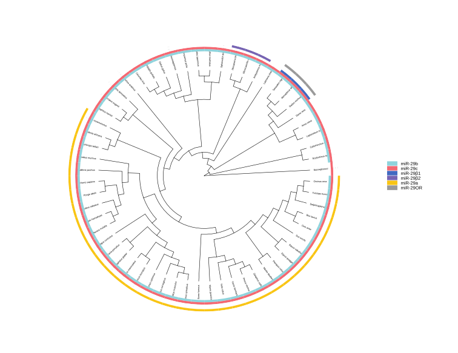

Panel a analytical component. Cached vertebrate phylogeny used to organize the miR-29 evolutionary reconstruction.


## Final editorial reference


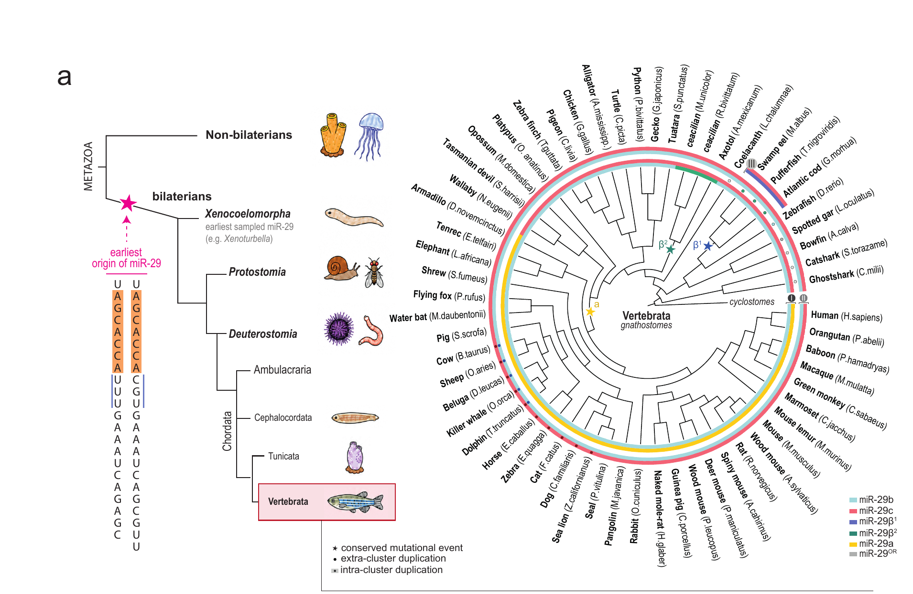

Panel a manuscript reference. The final artwork combines the reproducible topology with sequence-state annotations, icons and the inferred origin schematic.


# Panel b - Cross-species miR-29 locus alignment

Panel b was generated with dedicated alignment software outside R and then assembled in Illustrator. The complete final panel is represented here, while the underlying alignment/provenance files are retained in `data/manual_and_alignment/`. It is intentionally not presented as an R recalculation.

The sequence catalogue in Supplementary Data 2 covers the 59 displayed vertebrate species: 121 clusters containing 257 precursor loci, plus nine singletons (266 loci in total). Each mature sequence is contained in its corresponding precursor fragment. Assembly and nucleotide accessions, chromosome/scaffold, strand and separate precursor and mature coordinates are provided in the [locus catalogue](data/sequence_catalog/miR29_loci_and_sequences.tsv). Coordinates are 1-based and inclusive; precursor-fragment boundaries denote the extracted sequence around the mature miRNA, not experimentally mapped processing boundaries. Sequence matches were determined in both orientations on the designated reference chromosome or scaffold. Figure 2b remains an illustrative alignment; use the catalogue and accompanying FASTAs for sequence-level reuse.


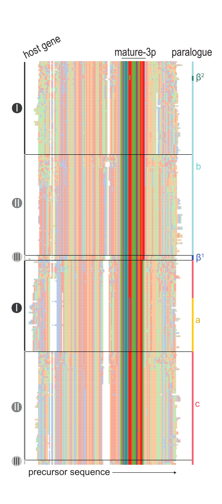

Panel b. Cross-species alignment of host-gene, mature-3p and paralogue regions; imported manuscript artwork.


# Panel c - Human miR-29 loci and mature sequences

This editorial schematic summarizes the two human host loci, the mature miR-29a/b/c sequences, the shared seed and the nuclear-localization motif. It does not encode a statistical calculation.


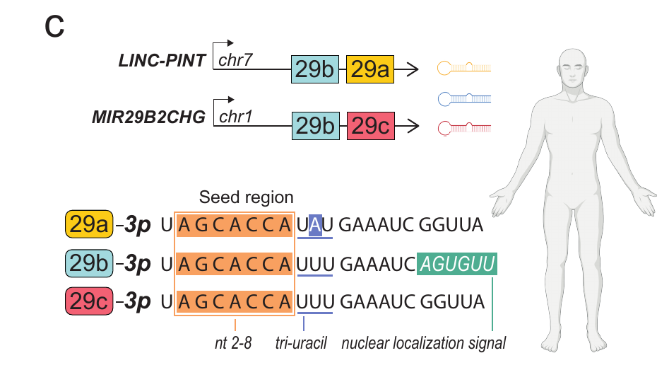

Panel c. Human LINC-PINT and MIR29B2CHG loci and mature miR-29 sequences; imported manuscript schematic.


# Panel d - Evolutionary reconstruction of mature miR-29

Panel d is the graphical reconstruction of sequence and localization changes from xenacoelomorphs and tunicates to vertebrate miR-29 family members. The display is retained as artwork because the final reconstruction includes manual biological interpretation rather than a purely algorithmic layout.


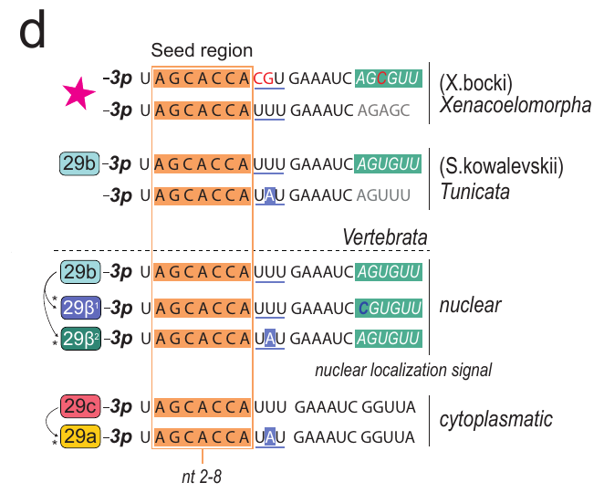

Panel d. Reconstructed evolutionary transitions of mature miR-29 sequences; imported manuscript artwork.


# Panel e - Cluster architecture across major clades

The cluster/host-gene state matrix is an editorial synthesis of the curated sequence survey. Its machine-readable source files and accession-level provenance accompany the bundle; the exact box-glyph layout is imported.


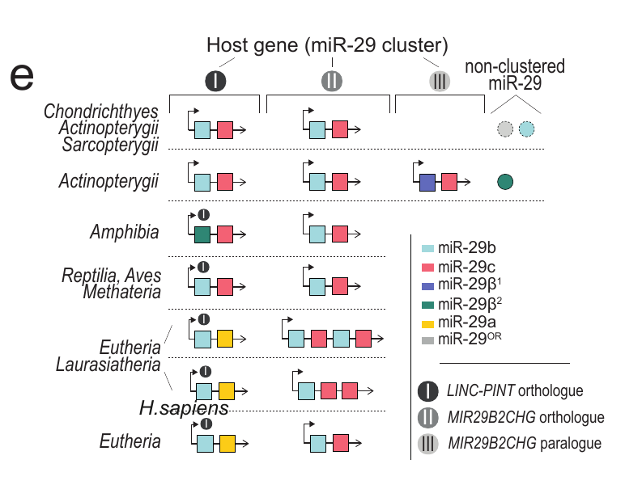

Panel e. miR-29 cluster organization and host-gene status across major vertebrate groups; imported manuscript artwork.


# Panel f - Mature-miRNA associations with age

Panel f places the distribution of all measured mature-miRNA age correlations in each species against the corresponding miR-29 family coefficients. The analysis uses Spearman correlations. *Capra hircus* sample `SRR9663090` is corrected from 24 days to 1 day, and *Macaca mulatta* is restricted to the 14 brain samples; the historical testis series is excluded.


## Draw panel f


```r
panel_f
```


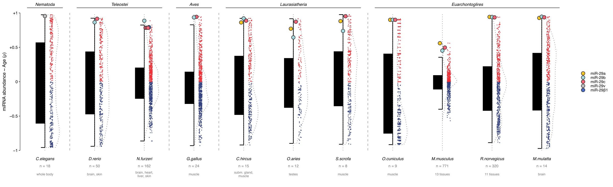

Panel f. Mature-miRNA associations with age across 11 species. Coloured circles identify the available miR-29 family members.


| Species      | Samples | Tissues                   | Macroclade       |
|:-------------|--------:|:--------------------------|:-----------------|
| C.elegans    |      18 | whole body                | Nematoda         |
| D.rerio      |      50 | brain, skin               | Teleostei        |
| N.furzeri    |     162 | brain, heart, liver, skin | Teleostei        |
| G.gallus     |      24 | muscle                    | Aves             |
| C.hircus     |      15 | subm. gland, muscle       | Laurasiatheria   |
| O.aries      |      12 | testes                    | Laurasiatheria   |
| S.scrofa     |       8 | muscle                    | Laurasiatheria   |
| O.cuniculus  |       9 | muscle                    | Euarchontoglires |
| M.musculus   |     771 | 13 tissues                | Euarchontoglires |
| R.norvegicus |     320 | 11 tissues                | Euarchontoglires |
| M.mulatta    |      14 | brain                     | Euarchontoglires |

Species-level coverage used in panel f.


# Panel g - AGCACCA seed meta-analysis

Mature miRNAs are first collapsed by seed within species in Fisher-z space. Species are then equally weighted within their macroclade, and the five macroclades are equally weighted in the final vertebrate summary. Human is excluded from this current panel; the corrected goat and brain-only macaque inputs are retained.


## Draw panel g


```r
panel_g
```


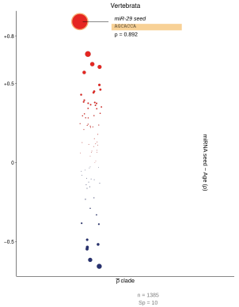

Panel g. Equal-macroclade mature-miRNA seed meta-analysis excluding Human.


The locked AGCACCA result is rho = 0.8923, rank 1 of 76 tested seeds, with 1,385 profiles from 10 species.


# Pan-mammalian DNA-methylation analysis

The methylation panels use one locked hierarchy throughout:

1.  Spearman correlation between probe beta and chronological age within each eligible species-tissue stratum;
2.  unweighted arithmetic mean of tissue rho values within species;
3.  equal-unit Fisher-z averaging above species, including the five-clade Boreoeutheria aggregate.

Samples require a recorded age and `Confidenceinageestimate > 80`. A species–tissue stratum requires at least 10 retained samples; at least one eligible tissue suffices for a species, and age-association plots require an estimable target coefficient. The retained probe universe contains 37,554 mammalian-array probes. Species-level sample and tissue counts are reported in Supplementary Data 2. The 36 conserved-target species in the five-clade aggregate are a subset of the wider sequence survey, not all species that pass the tissue filter.


# Panel h - Human CpG-age correlation atlas

The Human distribution includes all 37,554 probe-level tissue-balanced age correlations. `cg10501210`, located in the regulatory region associated with `MIR29B2CHG`, is the most negatively age-associated probe.


```r
panel_h
```


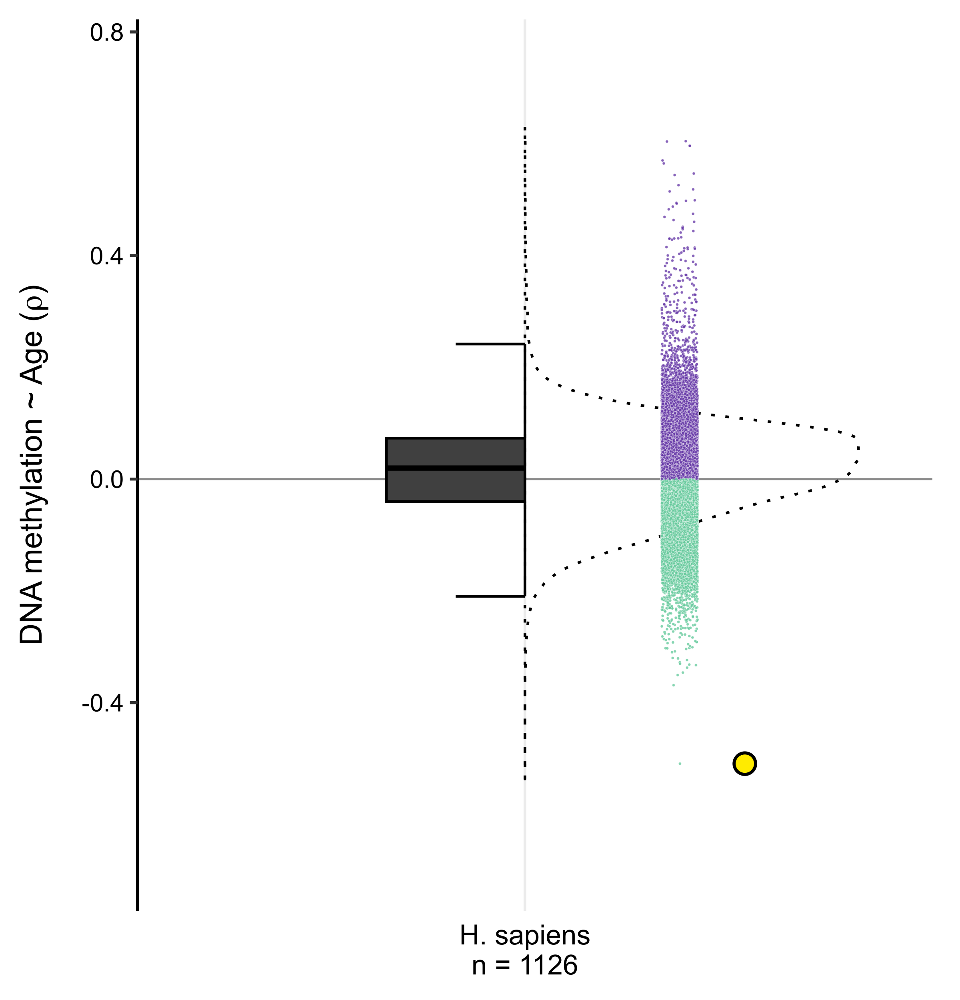

Panel h. Human tissue-balanced CpG-age correlation distribution with cg10501210 highlighted.


Locked result: rho = -0.5091, rank 1 of 37,554, across 1,126 filtered Human profiles.


# Panel i - Conservation of the cg10501210 sequence

The portable alignment table reconstructs the analytical sequence matrix and marks whether the target CpG dinucleotide is intact. Species ordering and sequence calls are data-derived; animal silhouettes and the final curved probe annotation remain editorial artwork.

For the illustrative alignment, 60 genomic fragments were uploaded to [NGPhylogeny.fr](https://doi.org/10.1093/nar/gkz303) in PhyML-SMS/OneClick mode. MAFFT v7.467 (L-INS-i) aligned the sequences, followed by BMGE trimming. The displayed alignment is the BMGE cleaned FASTA (step 7), shown in MSAViewer with the nucleotide colour scheme; it is not the inferred PhyML tree. The retained output has 60 sequences and 119 alignment columns. The [genomic-fragment catalogue](data/sequence_catalog/cg10501210_conservation.tsv) and [FASTA](data/sequence_catalog/cg10501210_60_genomic_fragments_DNA.fasta) provide the final sequence records and assembly-specific coordinates for sequence-level reuse, independently of the illustrative artwork.

The survey comprises 77 species with eligible tissues. The target CpG is conserved in 41 and non-conserved in 25: 19 retain an alignable region with a disrupted target dinucleotide, whereas six have an available reference genome but no identified homologous probe-target region. Eleven species are not assessable because the exact-species reference genome was unavailable or inadequate and are excluded from the conserved/non-conserved comparison. Thus the 60 available fragments represent 41 conserved and 19 non-conserved targets; their number does not arise from a requirement for multiple tissues. The analysis uses *Sus scrofa* and does not pool the separately labelled *Sus scrofa domesticus* samples.


## Analytical reconstruction


```r
panel_i
```


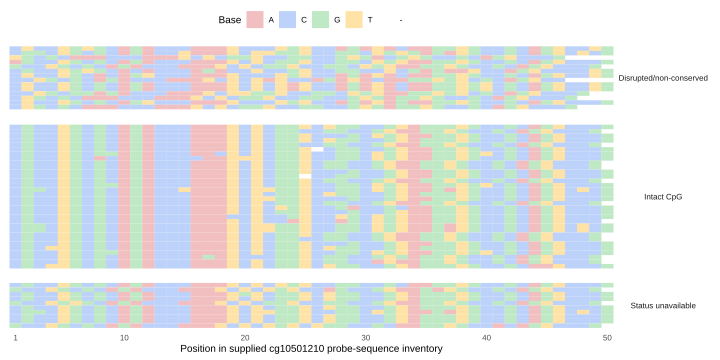

Panel i analytical component. Cross-species alignment around cg10501210 and target-CpG conservation.


## Final editorial reference


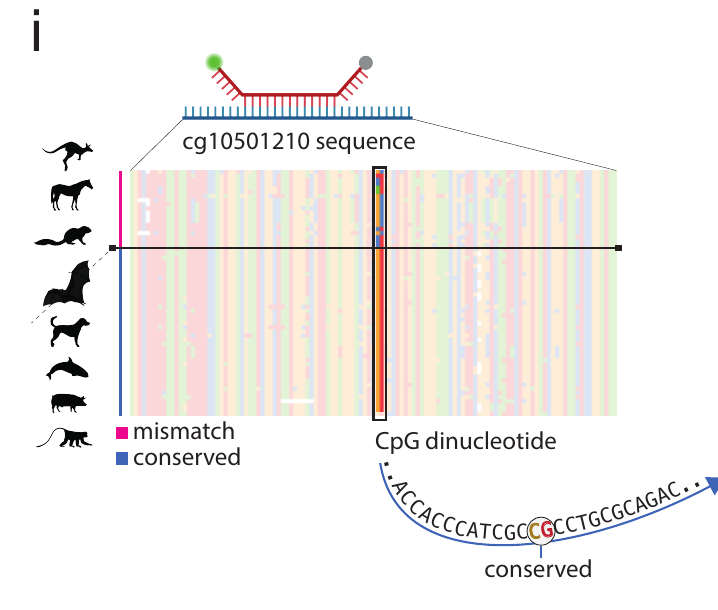

Panel i manuscript reference, including the editorial species silhouettes and probe-position callout.


# Panel j - Macroclade-resolved CpG-age associations

The target probe is compared with the full probe distribution in five macroclades. Each species first contributes one tissue-balanced rho value and species are then equally combined in Fisher-z space within each clade.


```r
panel_j
```


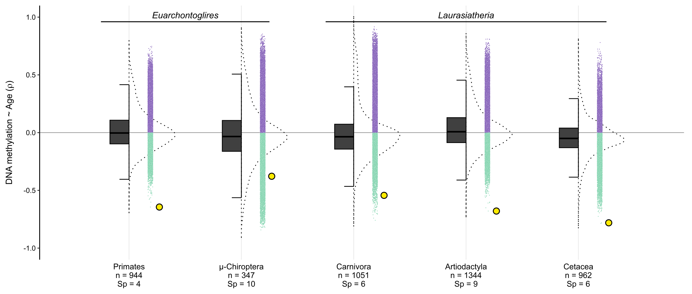

Panel j. Macroclade-resolved CpG-age correlation distributions with cg10501210 highlighted.


# Panel k - Boreoeutheria aggregate

The five macroclades contribute equally to the final Boreoeutheria distribution. Human is included within the primate component. The surrounding sequence and clade-tree labels in the manuscript are editorial; the complete distribution and target ranking are calculated here.


```r
panel_k
```


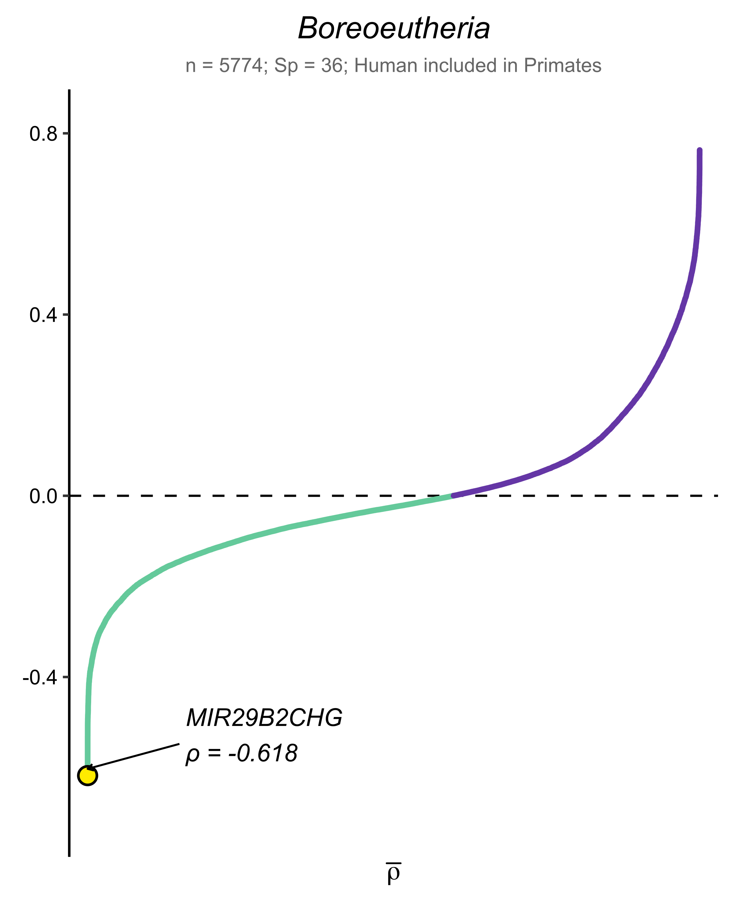

Panel k. Equal-macroclade Boreoeutheria CpG-age correlation distribution.


Locked result: `cg10501210` rho = -0.6176, rank 1 of 37,554, from 5,774 profiles representing 36 species.


# Complete Figure 2 reference

The final A4 page below is the current Illustrator composition. It provides the authoritative panel packing, connective artwork and final typography; the analytical plots above are the reproducible counterparts.


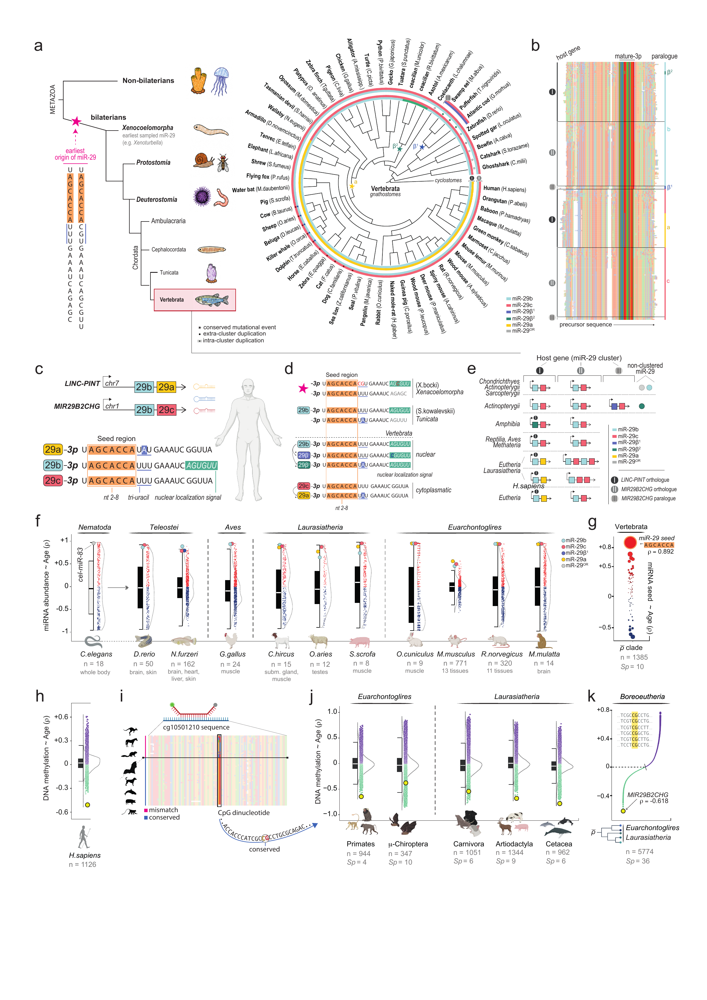

Current main Figure 2 Illustrator reference (source filename figure_03 because the preceding pages were renumbered after Figure 1 was merged).


# Supplementary Figure S2


S2 follows the approved figure: locus-resolved miR-29 complement; expression and methylation coverage; tissue-resolved associations; sequence-status controls; human tissue effects; and leave-one-out robustness. The calculations are unchanged by the Illustrator layout edits. Correlation coefficients shown in S2 are Spearman coefficients, not Pearson coefficients.


## Complete S2 reconstruction code

These three modules contain the data preparation, plotting code and numerical checks. They use only files inside this project. Frozen annotations and coefficient tables retain the original upstream analyses; h also recomputes its sample-level bootstrap, and i recomputes all 41 omission analyses from the complete 37,554-probe tissue matrices. No external database query is required.


```r
## Supplementary Figure S2a-c - portable plotting module
##
## The module consumes only frozen, analysis-ready tables stored inside the
## Figure2_main bundle. It does not recalculate correlations or infer locus
## complements from expression data. Source this file with the working
## directory set to Figure2_main, or set `figure2_s2_root` first.

suppressPackageStartupMessages({
  library(dplyr)
  library(ggplot2)
  library(gghalves)
  library(readr)
  library(tibble)
})

options(stringsAsFactors = FALSE)

if (!exists("figure2_s2_root", inherits = FALSE)) {
  figure2_s2_root <- getOption("figure2_s2_root", ".")
}
if (!exists("s2_export", inherits = FALSE)) {
  s2_export <- isTRUE(getOption("s2_export", FALSE))
}

figure2_s2_root <- normalizePath(
  path.expand(as.character(figure2_s2_root[[1]])),
  mustWork = FALSE
)
s2_export <- isTRUE(s2_export)

s2_abc_data_dir <- file.path(
  figure2_s2_root, "data", "figure2_s2", "abc"
)
s2_abc_figure_dir <- file.path(
  figure2_s2_root, "figures", "supplementary_s2"
)

if (!dir.exists(s2_abc_data_dir)) {
  stop(
    "Cannot find the portable S2a-c data directory: ", s2_abc_data_dir,
    ". Set figure2_s2_root to the Figure2_main bundle root."
  )
}

s2_abc_dimensions <- list(
  S2a = c(width = 9.00, height = 2.90),
  S2b = c(width = 3.80, height = 2.90),
  S2c = c(width = 14.80, height = 4.35)
)

read_s2_tsv <- function(filename) {
  path <- file.path(s2_abc_data_dir, filename)
  if (!file.exists(path)) stop("Missing portable S2 input: ", path)
  readr::read_tsv(path, show_col_types = FALSE, progress = FALSE)
}

format_signed_tick <- function(x) {
  ifelse(
    x > 0,
    paste0("+", formatC(x, format = "f", digits = 1)),
    ifelse(x < 0, formatC(x, format = "f", digits = 1), "0")
  )
}

## -------------------------------------------------------------------------
## S2a - exact miR-29 locus complement across the Figure 2 phylogeny
## -------------------------------------------------------------------------

s2a_source <- read_s2_tsv("S2a_mir29_complement_source.tsv") %>%
  arrange(species_order, match(row_id, c(
    "I_1", "I_2", "II_1", "II_2", "III_1", "III_2", "S_1"
  )))

s2a_identity_levels <- c(
  "miR-29a", "miR-29b", "miR-29c",
  "miR-29β1", "miR-29β2", "miR-29OR"
)
s2a_identity_colours <- c(
  "miR-29a" = "#F9C515",
  "miR-29b" = "#8FD3DC",
  "miR-29c" = "#F46872",
  "miR-29β1" = "#4169C1",
  "miR-29β2" = "#2E8B73",
  "miR-29OR" = "#9A9A9A"
)
s2a_identity_labels <- expression(
  "miR-29a", "miR-29b", "miR-29c",
  "miR-29" * beta * "1", "miR-29" * beta * "2", "miR-29 variant"
)

s2a_row_positions <- tibble::tribble(
  ~row_id, ~y,
  "I_1",    7.75,
  "I_2",    7.05,
  "II_1",   5.55,
  "II_2",   4.85,
  "III_1",  3.35,
  "III_2",  2.65,
  "S_1",    1.05
)

s2a_species <- s2a_source %>%
  distinct(species_order, species_full, species_short, Genome) %>%
  arrange(species_order)

s2a_plot_data <- s2a_source %>%
  left_join(s2a_row_positions, by = "row_id") %>%
  mutate(
    identity = factor(identity, levels = s2a_identity_levels),
    duplicated = as.logical(duplicated),
    present = as.logical(present)
  )

s2a_block_labels <- tibble::tribble(
  ~block_label,   ~roman, ~y,   ~fontface, ~circle_fill, ~circle_text,
  "LINC-PINT",   "I",    7.40, "italic",  "#4B4B4B",   "white",
  "MIR29B2CHG",  "II",   5.20, "italic",  "#777777",   "white",
  "duplication", "III",  3.00, "plain",   "#B5B5B5",   "#303030",
  "singleton",   "",     1.05, "plain",   NA_character_, NA_character_
)

s2a_validation <- list(
  species_59 = nrow(s2a_species) == 59L,
  seven_rows_per_species = nrow(s2a_plot_data) == 59L * 7L &&
    all(table(s2a_plot_data$Genome) == 7L),
  exact_endpoints = identical(s2a_species$Genome[[1]], "Callorhinchus_milii") &&
    identical(tail(s2a_species$Genome, 1), "Homo_sapiens"),
  no_source_tree_outgroup = !any(s2a_species$Genome == "Saccoglossus_kowalevskii"),
  singleton_or_six = sum(
    s2a_plot_data$row_id == "S_1" &
      as.character(s2a_plot_data$identity) == "miR-29OR",
    na.rm = TRUE
  ) == 6L,
  singleton_beta2_three = sum(
    s2a_plot_data$row_id == "S_1" &
      as.character(s2a_plot_data$identity) == "miR-29β2",
    na.rm = TRUE
  ) == 3L,
  cluster_iii_six_members = sum(
    s2a_plot_data$block == "Cluster III" & s2a_plot_data$present,
    na.rm = TRUE
  ) == 6L,
  fifteen_duplicate_markers = sum(s2a_plot_data$duplicated, na.rm = TRUE) == 15L
)
stopifnot(all(unlist(s2a_validation, use.names = FALSE)))

p_S2a <- ggplot(s2a_plot_data, aes(x = species_order, y = y)) +
  geom_hline(
    yintercept = s2a_row_positions$y,
    linewidth = 0.20, colour = "#E9E9E9"
  ) +
  geom_vline(
    xintercept = s2a_species$species_order,
    linewidth = 0.17, colour = "#F0F0F0"
  ) +
  geom_point(
    shape = 21, size = 1.38, stroke = 0.19,
    fill = "white", colour = "#D2D2D2"
  ) +
  geom_point(
    data = filter(s2a_plot_data, present),
    aes(fill = identity),
    shape = 21, size = 1.70, stroke = 0.22, colour = "#555555"
  ) +
  geom_point(
    data = filter(s2a_plot_data, duplicated),
    aes(shape = "intra-cluster duplication"),
    size = 0.52, colour = "black"
  ) +
  geom_text(
    data = filter(s2a_block_labels, fontface == "italic"),
    aes(x = -2.70, y = y, label = block_label),
    inherit.aes = FALSE, hjust = 1,
    family = "Helvetica", fontface = "italic", size = 2.55,
    colour = "#303030"
  ) +
  geom_text(
    data = filter(s2a_block_labels, fontface == "plain"),
    aes(x = -2.70, y = y, label = block_label),
    inherit.aes = FALSE, hjust = 1,
    family = "Helvetica", size = 2.55, colour = "#303030"
  ) +
  geom_point(
    data = filter(s2a_block_labels, roman != ""),
    aes(x = -2.10, y = y, fill = circle_fill),
    inherit.aes = FALSE, shape = 21, size = 3.10,
    stroke = 0, show.legend = FALSE
  ) +
  geom_text(
    data = filter(s2a_block_labels, roman != ""),
    aes(x = -2.10, y = y, label = roman, colour = circle_text),
    inherit.aes = FALSE, family = "Helvetica", fontface = "bold",
    size = 1.92, show.legend = FALSE
  ) +
  scale_fill_manual(
    name = NULL,
    values = c(s2a_identity_colours, stats::setNames(
      s2a_block_labels$circle_fill[!is.na(s2a_block_labels$circle_fill)],
      s2a_block_labels$circle_fill[!is.na(s2a_block_labels$circle_fill)]
    )),
    breaks = s2a_identity_levels,
    labels = s2a_identity_labels,
    drop = FALSE,
    guide = guide_legend(
      order = 1, nrow = 1, byrow = TRUE,
      override.aes = list(shape = 21, size = 2.30, colour = "#555555")
    )
  ) +
  scale_colour_identity() +
  scale_shape_manual(
    name = NULL,
    values = c("intra-cluster duplication" = 16),
    guide = guide_legend(
      order = 2,
      override.aes = list(shape = 16, size = 1.45, colour = "black")
    )
  ) +
  scale_x_continuous(
    breaks = s2a_species$species_order,
    labels = s2a_species$species_short,
    limits = c(-7.3, 59.6),
    expand = expansion(mult = c(0, 0))
  ) +
  scale_y_continuous(limits = c(0.55, 8.10), expand = expansion(mult = c(0, 0))) +
  labs(title = "miR-29 locus complement", x = NULL, y = NULL) +
  theme_minimal(base_family = "Helvetica", base_size = 7.0) +
  theme(
    panel.grid = element_blank(),
    axis.text.x = element_text(
      angle = 90, hjust = 1, vjust = 0.5, face = "italic",
      colour = "#202020", size = 4.05, margin = margin(t = 1.4)
    ),
    axis.text.y = element_blank(),
    axis.ticks = element_blank(),
    legend.position = "top",
    legend.justification = "left",
    legend.direction = "horizontal",
    legend.box = "horizontal",
    legend.text = element_text(size = 5.65, colour = "#333333"),
    legend.spacing.x = grid::unit(1.5, "pt"),
    legend.key.width = grid::unit(7.2, "pt"),
    legend.key.height = grid::unit(5.4, "pt"),
    plot.title = element_text(
      face = "bold", size = 7.4, colour = "#171717",
      margin = margin(b = 0.4)
    ),
    plot.margin = margin(2.5, 3.5, 2.5, 3.5)
  )

## -------------------------------------------------------------------------
## S2b - compact miRNA-age sample/stratum coverage table
## -------------------------------------------------------------------------

s2b_coverage <- read_s2_tsv("S2b_mirna_coverage_source.tsv") %>%
  arrange(species_order) %>%
  mutate(
    n = as.integer(n),
    n_tissues = as.integer(n_tissues),
    y = if_else(species_key == "human", 0.62, 13 - as.numeric(species_order)),
    bar_start = 0.315,
    bar_end = bar_start + 0.400 *
      (log10(n) - min(log10(n))) /
      (max(log10(n)) - min(log10(n))),
    sample_tissue_label = paste0(
      format(n, big.mark = ",", scientific = FALSE, trim = TRUE),
      " / ", n_tissues
    )
  )

s2b_provenance <- read_s2_tsv("S2b_dataset_provenance.tsv") %>%
  arrange(match(species_key, s2b_coverage$species_key))

s2b_validation <- list(
  twelve_species = nrow(s2b_coverage) == 12L,
  total_samples_17635 = sum(s2b_coverage$n) == 17635L,
  total_strata_68 = sum(s2b_coverage$n_tissues) == 68L,
  nonhuman_samples_1403 = sum(s2b_coverage$n[s2b_coverage$species_key != "human"]) == 1403L,
  human_gtex_16232_30 = with(
    filter(s2b_coverage, species_key == "human"),
    length(n) == 1L && n == 16232L && n_tissues == 30L
  ),
  macaca_brain_only_14_1 = with(
    filter(s2b_coverage, species_key == "macaca"),
    length(n) == 1L && n == 14L && n_tissues == 1L && tissue_names == "Brain"
  ),
  complete_provenance = setequal(s2b_coverage$species_key, s2b_provenance$species_key)
)
stopifnot(all(unlist(s2b_validation, use.names = FALSE)))

p_S2b <- ggplot(s2b_coverage, aes(y = y)) +
  geom_hline(yintercept = 1.40, linetype = "dotted", linewidth = 0.38, colour = "#777777") +
  geom_hline(yintercept = 0.08, linewidth = 0.32, colour = "#8A8A8A") +
  geom_vline(xintercept = c(0.285, 0.755), linewidth = 0.26, colour = "#B8B8B8") +
  geom_segment(
    aes(x = bar_start, xend = bar_end, yend = y),
    linewidth = 3.15, lineend = "round", colour = "#D1D1D1"
  ) +
  geom_point(
    aes(x = bar_end), shape = 21, size = 2.05,
    stroke = 0.30, fill = "#656565", colour = "#353535"
  ) +
  geom_text(
    aes(x = 0.015, label = species_label),
    hjust = 0, fontface = "italic", family = "Helvetica", size = 2.90
  ) +
  geom_text(
    aes(x = 0.985, label = sample_tissue_label),
    hjust = 1, fontface = "italic", family = "Helvetica", size = 2.78
  ) +
  annotate(
    "text", x = 0.015, y = 13.05, label = "species",
    hjust = 0, fontface = "bold", family = "Helvetica", size = 2.60
  ) +
  annotate(
    "text", x = 0.315, y = 13.05, label = "samples (log)",
    hjust = 0, fontface = "bold", family = "Helvetica", size = 2.60
  ) +
  annotate(
    "text", x = 0.985, y = 13.05, label = "samples/tissues",
    hjust = 1, fontface = "bold", family = "Helvetica", size = 2.60
  ) +
  coord_cartesian(xlim = c(0, 1), ylim = c(0, 13.35), clip = "off") +
  theme_void(base_family = "Helvetica", base_size = 7.0) +
  theme(plot.margin = margin(2.5, 3.5, 2.5, 3.5))

## -------------------------------------------------------------------------
## S2c - tissue-resolved mature-miRNA age-association distributions
## -------------------------------------------------------------------------

s2c_distribution <- read_s2_tsv("S2c_mirna_tissue_distribution_source.tsv") %>%
  mutate(
    x = as.numeric(x),
    rho = as.numeric(rho),
    x_points = x + 0.120
  )

s2c_highlights <- read_s2_tsv("S2c_mirna_tissue_highlights.tsv") %>%
  mutate(
    x = as.numeric(x),
    x_highlight = as.numeric(x_highlight),
    rho = as.numeric(rho),
    highlight_class = factor(
      highlight_class,
      levels = c("miR-29b", "miR-29c", "miR-29beta1", "miR-29a")
    )
  )

s2c_tissue_index <- read_s2_tsv("S2c_mirna_tissue_index.tsv") %>%
  arrange(species_order, tissue_order) %>%
  mutate(x = as.numeric(x), n_samples = as.integer(n_samples))

s2c_species_spans <- s2c_tissue_index %>%
  group_by(species_key, species_label, species_order) %>%
  summarise(
    xmin = min(x), xmax = max(x), xmid = mean(c(xmin, xmax)),
    .groups = "drop"
  ) %>%
  arrange(species_order)

s2c_separators <- head(s2c_species_spans$xmax + 0.5, -1L)
s2c_x_labels <- paste0(
  s2c_tissue_index$tissue_label,
  "<br><span style='color:#A8A8A8'>n=",
  s2c_tissue_index$n_samples,
  "</span>"
)
names(s2c_x_labels) <- as.character(s2c_tissue_index$x)

s2c_highlight_colours <- c(
  "miR-29b" = "#A3D9DE",
  "miR-29c" = "#F36275",
  "miR-29beta1" = "#3155C6",
  "miR-29a" = "#F8C717"
)

s2c_validation <- list(
  five_multitissue_species = identical(
    s2c_species_spans$species_key,
    c("zfish", "furzeri", "goat", "mouse", "rat")
  ),
  exact_strata = nrow(s2c_tissue_index) == 32L,
  exact_strata_per_species = identical(
    as.integer(table(factor(
      s2c_tissue_index$species_key,
      levels = c("zfish", "furzeri", "goat", "mouse", "rat")
    ))),
    c(2L, 4L, 2L, 13L, 11L)
  ),
  exact_distribution_rows = nrow(s2c_distribution) == 23772L,
  exact_highlight_rows = nrow(s2c_highlights) == 102L,
  no_human_profiles = !any(s2c_distribution$species_key == "human"),
  x_index_complete = setequal(unique(s2c_distribution$x), s2c_tissue_index$x),
  finite_rho = all(is.finite(s2c_distribution$rho)),
  source_highlight_colours_unchanged = all(
    unique(s2c_highlights$highlight_color) %in% unname(s2c_highlight_colours)
  )
)
stopifnot(all(unlist(s2c_validation, use.names = FALSE)))

set.seed(290629)
p_S2c <- ggplot(s2c_distribution, aes(x = x, y = rho, group = x)) +
  geom_segment(
    data = s2c_tissue_index,
    aes(x = x, xend = x, y = -1, yend = 1),
    inherit.aes = FALSE, linetype = "dotted",
    linewidth = 0.20, colour = "#3E3E3E"
  ) +
  geom_vline(
    xintercept = s2c_separators, linetype = "dashed",
    linewidth = 0.38, colour = "#888888"
  ) +
  gghalves::geom_half_boxplot(
    side = "l", width = 0.40, outlier.shape = NA,
    fill = "#5A5A5A", colour = "#202020", linewidth = 0.34,
    show.legend = FALSE
  ) +
  gghalves::geom_half_violin(
    side = "r", scale = "width", trim = TRUE, width = 0.58,
    fill = NA, colour = "#444444", linetype = "dotted",
    linewidth = 0.25, adjust = 1.05, show.legend = FALSE
  ) +
  geom_point(
    data = filter(s2c_distribution, sign == "negative"),
    aes(x = x_points, y = rho), inherit.aes = FALSE,
    colour = "#33417F", shape = 16, size = 0.20, alpha = 0.76,
    position = position_jitter(width = 0.019, height = 0, seed = 290629),
    show.legend = FALSE
  ) +
  geom_point(
    data = filter(s2c_distribution, sign == "positive"),
    aes(x = x_points, y = rho), inherit.aes = FALSE,
    colour = "#EE3137", shape = 16, size = 0.20, alpha = 0.76,
    position = position_jitter(width = 0.019, height = 0, seed = 290630),
    show.legend = FALSE
  ) +
  geom_point(
    data = s2c_highlights,
    aes(x = x_highlight, y = rho, fill = highlight_class),
    inherit.aes = FALSE, shape = 21, colour = "#555555",
    stroke = 0.30, size = 1.62
  ) +
  geom_segment(
    data = s2c_species_spans,
    aes(x = xmin + 0.08, xend = xmax - 0.08, y = 1.105, yend = 1.105),
    inherit.aes = FALSE, linewidth = 0.32, colour = "#737373"
  ) +
  geom_text(
    data = s2c_species_spans,
    aes(x = xmid, y = 1.205, label = species_label),
    inherit.aes = FALSE, family = "Helvetica", fontface = "italic",
    size = 2.82
  ) +
  scale_fill_manual(
    values = s2c_highlight_colours,
    breaks = names(s2c_highlight_colours),
    labels = expression(
      "miR-29b", "miR-29c", "miR-29" * beta * "1", "miR-29a"
    ),
    name = NULL,
    guide = guide_legend(
      nrow = 1, byrow = TRUE,
      override.aes = list(shape = 21, size = 2.55, colour = "#555555")
    )
  ) +
  scale_x_continuous(
    breaks = s2c_tissue_index$x,
    labels = s2c_x_labels[as.character(s2c_tissue_index$x)],
    limits = c(0.45, max(s2c_tissue_index$x) + 0.65),
    expand = c(0, 0)
  ) +
  scale_y_continuous(
    breaks = c(-1, -0.5, 0, 0.5, 1),
    labels = format_signed_tick,
    expand = expansion(mult = c(0, 0))
  ) +
  coord_cartesian(ylim = c(-1, 1.29), clip = "off") +
  labs(
    x = NULL,
    y = expression("miRNA abundance ~ Age (" * rho * ")")
  ) +
  theme_bw(base_family = "Helvetica", base_size = 7.0) +
  theme(
    panel.grid = element_blank(),
    panel.border = element_rect(colour = "#454545", fill = NA, linewidth = 0.45),
    axis.text.x = ggtext::element_markdown(
      angle = 62, hjust = 1, vjust = 1,
      size = 4.75, colour = "#202020", lineheight = 0.90
    ),
    axis.text.y = element_text(size = 6.15, colour = "#202020"),
    axis.ticks.x = element_blank(),
    axis.ticks.y = element_line(linewidth = 0.30),
    axis.title.y = element_text(size = 7.35, margin = margin(r = 4)),
    legend.position = "bottom",
    legend.justification = "left",
    legend.direction = "horizontal",
    legend.key.width = grid::unit(7.0, "pt"),
    legend.key.height = grid::unit(6.0, "pt"),
    legend.spacing.x = grid::unit(1.4, "pt"),
    legend.text = element_text(size = 5.5),
    plot.margin = margin(11, 5, 2, 5)
  )

## -------------------------------------------------------------------------
## Public objects, checks, provenance, and optional exports
## -------------------------------------------------------------------------

s2_abc_data <- list(
  S2a = list(
    locus_matrix = s2a_plot_data,
    species_order = s2a_species,
    identity_colours = s2a_identity_colours
  ),
  S2b = list(
    coverage = s2b_coverage,
    dataset_provenance = s2b_provenance
  ),
  S2c = list(
    distributions = s2c_distribution,
    highlights = s2c_highlights,
    tissue_index = s2c_tissue_index,
    species_spans = s2c_species_spans
  )
)

s2_abc_checks <- dplyr::bind_rows(
  tibble::tibble(
    panel = "S2a",
    check = names(s2a_validation),
    status = as.logical(unlist(s2a_validation, use.names = FALSE)),
    detail = c(
      "59 displayed vertebrates in the frozen anticlockwise order.",
      "413 matrix cells: seven locus rows for every species.",
      "Order runs from Callorhinchus milii to Homo sapiens.",
      "The Saccoglossus source-tree outgroup is not displayed.",
      "Six ancestral singleton miR-29-variant calls.",
      "Three singleton miR-29beta2 calls.",
      "Three teleosts carry both members of Cluster III.",
      "Fifteen Cluster II cells carry an intra-cluster duplication marker."
    )
  ),
  tibble::tibble(
    panel = "S2b",
    check = names(s2b_validation),
    status = as.logical(unlist(s2b_validation, use.names = FALSE)),
    detail = c(
      "Twelve rows including the contextual human GTEx reference.",
      "17,635 displayed profiles including GTEx.",
      "68 displayed analysis tissues/strata including GTEx.",
      "1,403 profiles across the 11 non-human Figure 2F datasets.",
      paste0(
        "Human contextual GTEx RNA-atlas reference: 16,232 profiles across ",
        "30 tissues; this is not a count of directly measured, paired ",
        "mature-miRNA libraries."
      ),
      "Accepted macaque analysis: brain only, n=14.",
      "Every coverage row has a matching repository/provenance record."
    )
  ),
  tibble::tibble(
    panel = "S2c",
    check = names(s2c_validation),
    status = as.logical(unlist(s2c_validation, use.names = FALSE)),
    detail = c(
      "D. rerio, N. furzeri, C. hircus, M. musculus and R. norvegicus.",
      "Thirty-two exact species-by-tissue strata.",
      "Strata per species: 2, 4, 2, 13 and 11.",
      "23,772 finite mature-miRNA tissue-level Spearman coefficients.",
      "102 frozen miR-29 highlight points.",
      "Human profiles are not part of this non-human tissue strip.",
      "Every plotted coefficient maps to the frozen tissue index.",
      "No non-finite Spearman coefficient is plotted.",
      "The source highlight palette is reproduced without alteration."
    )
  )
)

s2_abc_notes <- list(
  dimensions_inches = s2_abc_dimensions,
  provenance = list(
    S2a = paste0(
      "Frozen 59-vertebrate anticlockwise locus matrix; complement derives ",
      "from the curated phylogeny annotation, not from expression datasets."
    ),
    S2b = paste0(
      "Non-human entries summarize the Figure 2F species datasets. The ",
      "H. sapiens entry (16,232 profiles; 30 tissues) is the broader GTEx ",
      "RNA-atlas reference from Figure 1/S1 and is displayed for context. ",
      "It is not a count of directly measured, paired mature-miRNA libraries ",
      "and is not included in the non-human Figure 2F/G aggregation."
    ),
    S2c = paste0(
      "Precomputed tissue-specific Spearman coefficients for the five ",
      "multi-tissue non-human species; distributions show all finite mature-",
      "miRNA coefficients and coloured circles mark the frozen miR-29 calls."
    )
  ),
  illustrator_manual_elements = c(
    S2a = "Panel letter is intentionally omitted.",
    S2b = "Panel letter is intentionally omitted.",
    S2c = paste0(
      "Animal silhouettes are intentionally not recreated in R. Add the ",
      "five established Illustrator silhouettes above the species labels; ",
      "the plot leaves top clearance and contains the corresponding anchors."
    )
  )
)

save_s2_abc_panel <- function(plot, stem, dimensions, dpi = 450) {
  dir.create(s2_abc_figure_dir, recursive = TRUE, showWarnings = FALSE)
  pdf_path <- file.path(s2_abc_figure_dir, paste0(stem, ".pdf"))
  svg_path <- file.path(s2_abc_figure_dir, paste0(stem, ".svg"))
  png_path <- file.path(s2_abc_figure_dir, paste0(stem, ".png"))

  ggplot2::ggsave(
    pdf_path, plot = plot,
    width = dimensions[["width"]], height = dimensions[["height"]],
    units = "in", device = grDevices::cairo_pdf, bg = "white"
  )
  if (!requireNamespace("svglite", quietly = TRUE)) {
    stop("Package 'svglite' is required when s2_export = TRUE.")
  }
  ggplot2::ggsave(
    svg_path, plot = plot,
    width = dimensions[["width"]], height = dimensions[["height"]],
    units = "in", device = svglite::svglite, bg = "white"
  )
  ggplot2::ggsave(
    png_path, plot = plot,
    width = dimensions[["width"]], height = dimensions[["height"]],
    units = "in", dpi = dpi, bg = "white"
  )

  invisible(c(pdf = pdf_path, svg = svg_path, png = png_path))
}

s2_abc_export_paths <- NULL
if (s2_export) {
  s2_abc_export_paths <- list(
    S2a = save_s2_abc_panel(p_S2a, "S2a", s2_abc_dimensions$S2a),
    S2b = save_s2_abc_panel(p_S2b, "S2b", s2_abc_dimensions$S2b),
    S2c = save_s2_abc_panel(p_S2c, "S2c", s2_abc_dimensions$S2c)
  )
}

invisible(list(
  p_S2a = p_S2a,
  p_S2b = p_S2b,
  p_S2c = p_S2c,
  s2_abc_data = s2_abc_data,
  s2_abc_checks = s2_abc_checks,
  exports = s2_abc_export_paths
))
```


```r
# Figure S2 panels d-g: portable, frozen-data reconstruction
#
# Usage from the portable Figure2_main project root:
#   figure2_s2_root <- "."
#   s2_export <- FALSE
#   source("code/figure2_s2_defg.R")
#
# Objects exposed by this module:
#   p_S2d, p_S2e, p_S2f, p_S2g
#   s2_defg_data, s2_defg_checks, s2_defg_dimensions
#
# Analytical values are read from frozen tables. This module does not rerun
# correlations, methylation preprocessing, sequence classification, or any
# bootstrap. Exports are optional and are disabled by default.

suppressPackageStartupMessages({
  library(ggplot2)
  library(gghalves)
  library(cowplot)
  library(grid)
})

if (!exists("figure2_s2_root", inherits = TRUE)) {
  figure2_s2_root <- "."
}
if (!exists("s2_export", inherits = TRUE)) {
  s2_export <- FALSE
}
s2_export <- isTRUE(s2_export)

figure2_s2_root <- normalizePath(
  path.expand(as.character(figure2_s2_root)[1]),
  mustWork = TRUE
)
s2_defg_data_dir <- file.path(
  figure2_s2_root, "data", "figure2_s2", "defg"
)
s2_defg_export_dir <- file.path(
  figure2_s2_root, "figures", "supplementary_s2"
)

s2_defg_paths <- c(
  S2d_coverage = file.path(
    s2_defg_data_dir, "S2d_methylation_coverage_source.tsv"
  ),
  S2e_target = file.path(
    s2_defg_data_dir, "S2e_tissue_target_summary.tsv"
  ),
  S2e_points = file.path(
    s2_defg_data_dir, "S2e_tissue_display_points.tsv"
  ),
  S2e_distribution = file.path(
    s2_defg_data_dir, "S2e_tissue_full_distributions.tsv.gz"
  ),
  S2f_beta_species = file.path(
    s2_defg_data_dir, "S2f_beta_species_summary.tsv"
  ),
  S2f_beta_tissue_provenance = file.path(
    s2_defg_data_dir, "S2f_beta_tissue_summary_provenance.tsv"
  ),
  S2g_rho_species = file.path(
    s2_defg_data_dir, "S2g_rho_species_summary.tsv"
  )
)

missing_s2_defg <- s2_defg_paths[!file.exists(s2_defg_paths)]
if (length(missing_s2_defg)) {
  stop(
    "Missing frozen Figure S2 d-g input(s):\n  ",
    paste(missing_s2_defg, collapse = "\n  ")
  )
}

read_frozen_tsv <- function(path) {
  read.delim(
    path,
    check.names = FALSE,
    stringsAsFactors = FALSE,
    na.strings = c("NA", "NaN", "")
  )
}

read_frozen_tsv_gz <- function(path) {
  con <- gzfile(path, open = "rt")
  on.exit(close(con), add = TRUE)
  read.delim(
    con,
    check.names = FALSE,
    stringsAsFactors = FALSE,
    na.strings = c("NA", "NaN", "")
  )
}

abbreviate_species <- function(x) {
  vapply(strsplit(x, " +"), function(parts) {
    if (length(parts) < 2L) return(parts[[1]])
    paste0(substr(parts[[1]], 1, 1), ". ", paste(parts[-1], collapse = " "))
  }, character(1))
}

pretty_tissue_compact <- function(x) {
  out <- x
  out[out == "BoneMarrow"] <- "B. marrow"
  out[out == "CerebralCortex"] <- "Cortex"
  out[out == "LymphNode"] <- "L. node"
  out
}

clade_colours <- c(
  Primates = "#477DB3",
  Chiroptera = "#7856A6",
  Carnivora = "#C95C78",
  Artiodactyla = "#E89B4C",
  Cetacea = "#42A7A1"
)

sign_colours <- c(
  Negative = "#72BF98",
  Positive = "#6D3E91"
)

sequence_status_colours <- c(
  `Intact CpG` = "#72BF98",
  `Disrupted/non-conserved` = "#D95F5F"
)

target_fill <- "#FFD92F"
target_probe <- "cg10501210"
probe_universe_n <- 37554L

theme_s2_defg <- theme_classic(base_family = "Helvetica", base_size = 7.1) +
  theme(
    axis.text = element_text(colour = "black"),
    axis.title = element_text(colour = "black"),
    axis.line = element_line(colour = "black", linewidth = 0.36),
    plot.margin = margin(3, 3, 3, 3)
  )

# -----------------------------------------------------------------------------
# S2d. Methylation species/sample atlas (36 species; 5 macroclades).
#
# `n / tissues` reports profiles and tissue strata meeting the upstream n >= 10
# rule. It intentionally describes coverage, including the two Human strata
# with no age variance; those two strata are omitted from S2e because no rho can
# be estimated there.
# -----------------------------------------------------------------------------

s2d_coverage <- read_frozen_tsv(s2_defg_paths[["S2d_coverage"]])
s2d_coverage$clade <- factor(
  s2d_coverage$clade,
  levels = names(clade_colours)
)
s2d_coverage <- s2d_coverage[order(s2d_coverage$species_order), , drop = FALSE]

stopifnot(
  nrow(s2d_coverage) == 36L,
  identical(as.integer(table(s2d_coverage$clade)), c(5L, 10L, 6L, 9L, 6L)),
  sum(s2d_coverage$n_filtered) == 5774L,
  sum(s2d_coverage$n_eligible) == 5660L,
  sum(s2d_coverage$n_eligible_strata) == 67L,
  sum(s2d_coverage$n_target) == 5617L,
  sum(s2d_coverage$n_target_strata) == 65L
)

s2d_coverage$y <- nrow(s2d_coverage) - seq_len(nrow(s2d_coverage)) + 1
s2d_coverage$stats_label <- paste0(
  format(s2d_coverage$n_eligible, big.mark = ",", trim = TRUE),
  " / ",
  s2d_coverage$n_eligible_strata
)

s2d_log_range <- range(log10(s2d_coverage$n_eligible))
s2d_coverage$bar_start <- 0.545
s2d_coverage$bar_end <- s2d_coverage$bar_start +
  0.185 * (log10(s2d_coverage$n_eligible) - s2d_log_range[[1]]) /
  diff(s2d_log_range)

s2d_clade_blocks <- do.call(
  rbind,
  lapply(split(s2d_coverage, s2d_coverage$clade), function(z) {
    data.frame(
      clade = as.character(z$clade[[1]]),
      ymin = min(z$y) - 0.39,
      ymax = max(z$y) + 0.39,
      ymid = mean(range(z$y)),
      stringsAsFactors = FALSE
    )
  })
)
s2d_clade_blocks$clade <- factor(
  s2d_clade_blocks$clade,
  levels = names(clade_colours)
)

p_S2d <- ggplot(s2d_coverage, aes(y = y)) +
  geom_segment(
    data = s2d_clade_blocks,
    aes(x = 0.300, xend = 0.300, y = ymin, yend = ymax, colour = clade),
    inherit.aes = FALSE,
    linewidth = 2.05,
    lineend = "butt",
    show.legend = FALSE
  ) +
  geom_text(
    data = s2d_clade_blocks,
    aes(x = 0.315, y = ymid, label = as.character(clade), colour = clade),
    inherit.aes = FALSE,
    hjust = 0,
    size = 2.12,
    show.legend = FALSE
  ) +
  geom_segment(
    aes(x = bar_start, xend = bar_end, yend = y, colour = clade),
    linewidth = 2.45,
    lineend = "round",
    alpha = 0.58,
    show.legend = FALSE
  ) +
  geom_point(
    aes(x = bar_end, fill = clade),
    shape = 21,
    size = 1.85,
    stroke = 0.31,
    colour = "#222222",
    show.legend = FALSE
  ) +
  geom_text(
    aes(x = 0.006, label = species_label),
    hjust = 0,
    family = "Helvetica",
    fontface = "italic",
    size = 2.16
  ) +
  geom_text(
    aes(x = 0.985, label = stats_label),
    hjust = 1,
    family = "Helvetica",
    size = 2.08
  ) +
  annotate(
    "text", x = 0.006, y = 37.30, label = "Species",
    hjust = 0, family = "Helvetica", fontface = "bold", size = 2.40
  ) +
  annotate(
    "text", x = 0.300, y = 37.30, label = "Macroclade",
    hjust = 0, family = "Helvetica", fontface = "bold", size = 1.90
  ) +
  annotate(
    "text", x = 0.505, y = 37.30, label = "Sample coverage (log)",
    hjust = 0, family = "Helvetica", fontface = "bold", size = 1.65
  ) +
  annotate(
    "text", x = 0.985, y = 37.30, label = "n / tissues",
    hjust = 1, family = "Helvetica", fontface = "bold", size = 1.85
  ) +
  scale_colour_manual(values = clade_colours, drop = FALSE) +
  scale_fill_manual(values = clade_colours, drop = FALSE) +
  coord_cartesian(
    xlim = c(0, 1), ylim = c(0.45, 37.65), clip = "off"
  ) +
  theme_void(base_family = "Helvetica", base_size = 7.1) +
  theme(plot.margin = margin(2, 4, 2, 2))

# -----------------------------------------------------------------------------
# S2e. Tissue-resolved distribution of age-correlation coefficients.
#
# Each half-violin/boxplot is the complete frozen distribution of 37,554
# tissue-specific CpG Spearman rho values. The yellow point is cg10501210.
# Human Keratinocyte and Placenta are deliberately omitted: although each met
# n >= 10, age was invariant and neither a tissue-wide rho distribution nor a
# target rho could be estimated. Exactly 41 informative strata remain.
# -----------------------------------------------------------------------------

s2e_target_all <- read_frozen_tsv(s2_defg_paths[["S2e_target"]])
s2e_points_all <- read_frozen_tsv(s2_defg_paths[["S2e_points"]])
s2e_distribution_all <- read_frozen_tsv_gz(
  s2_defg_paths[["S2e_distribution"]]
)

s2e_target <- s2e_target_all[
  s2e_target_all$informative & is.finite(s2e_target_all$target_rho),
  , drop = FALSE
]
s2e_valid_keys <- s2e_target$tissue_key
s2e_points <- s2e_points_all[
  s2e_points_all$tissue_key %in% s2e_valid_keys &
    is.finite(s2e_points_all$rho),
  , drop = FALSE
]
s2e_distribution <- s2e_distribution_all[
  s2e_distribution_all$tissue_key %in% s2e_valid_keys &
    is.finite(s2e_distribution_all$rho),
  , drop = FALSE
]
rm(s2e_distribution_all)

s2e_species_rows <- list(
  top = c(
    "Phoca vitulina", "Zalophus californianus", "Bos taurus", "Ovis aries",
    "Delphinapterus leucas", "Lagenorhynchus obliquidens", "Orcinus orca",
    "Tursiops truncatus"
  ),
  middle = c(
    "Chlorocebus sabaeus", "Macaca mulatta", "Papio hamadryas"
  ),
  bottom = "Homo sapiens"
)

s2e_expected_species <- unname(unlist(s2e_species_rows, use.names = FALSE))
stopifnot(
  nrow(s2e_target_all) == 43L,
  nrow(s2e_target) == 41L,
  setequal(unique(s2e_target$species), s2e_expected_species),
  sum(s2e_target$species %in% s2e_species_rows$top) == 17L,
  sum(s2e_target$species %in% s2e_species_rows$middle) == 11L,
  sum(s2e_target$species %in% s2e_species_rows$bottom) == 13L,
  nrow(s2e_distribution) == probe_universe_n * 41L,
  length(unique(s2e_distribution$probe)) == probe_universe_n,
  target_probe == "cg10501210"
)

make_s2e_row <- function(species_in_row) {
  meta_parts <- lapply(species_in_row, function(sp) {
    z <- s2e_target[s2e_target$species == sp, , drop = FALSE]
    z[order(tolower(z$tissue)), , drop = FALSE]
  })
  meta <- do.call(rbind, meta_parts)
  rownames(meta) <- NULL
  meta$x <- seq_len(nrow(meta))
  x_lookup <- setNames(meta$x, meta$tissue_key)

  dat <- s2e_distribution[
    s2e_distribution$tissue_key %in% meta$tissue_key,
    , drop = FALSE
  ]
  dat$x <- unname(x_lookup[dat$tissue_key])

  pts <- s2e_points[
    s2e_points$tissue_key %in% meta$tissue_key,
    , drop = FALSE
  ]
  pts$x <- unname(x_lookup[pts$tissue_key])
  pts$display_index <- ave(
    seq_len(nrow(pts)), pts$tissue_key, FUN = seq_along
  )
  pts$x_jitter <- pts$x + 0.150 +
    0.038 * sin(pts$display_index * 2.399963)
  pts$sign <- ifelse(pts$rho < 0, "Negative", "Positive")

  meta$x_target <- meta$x + 0.225

  species_positions <- do.call(rbind, lapply(species_in_row, function(sp) {
    xx <- meta$x[meta$species == sp]
    data.frame(
      species = abbreviate_species(sp),
      x = mean(range(xx)),
      stringsAsFactors = FALSE
    )
  }))

  species_n <- as.integer(table(factor(meta$species, levels = species_in_row)))
  boundaries <- head(cumsum(species_n), -1L) + 0.5
  x_labels <- setNames(
    paste0(
      pretty_tissue_compact(meta$tissue),
      "\nn=", meta$n_samples
    ),
    meta$x
  )

  ggplot(dat, aes(x = x, y = rho, group = tissue_key)) +
    geom_hline(yintercept = 0, colour = "grey58", linewidth = 0.25) +
    geom_segment(
      data = data.frame(x = boundaries),
      aes(x = x, xend = x, y = -1, yend = 1.02),
      inherit.aes = FALSE,
      colour = "grey70",
      linewidth = 0.30
    ) +
    gghalves::geom_half_violin(
      side = "r",
      fill = NA,
      colour = "black",
      linetype = "dotted",
      linewidth = 0.25,
      trim = FALSE,
      scale = "width",
      width = 0.61
    ) +
    gghalves::geom_half_boxplot(
      side = "l",
      center = FALSE,
      errorbar.draw = TRUE,
      width = 0.27,
      outlier.shape = NA,
      fill = "grey15",
      colour = "black",
      linewidth = 0.29
    ) +
    geom_point(
      data = pts,
      aes(x = x_jitter, y = rho, colour = sign),
      inherit.aes = FALSE,
      size = 0.16,
      alpha = 0.72
    ) +
    geom_point(
      data = meta,
      aes(x = x_target, y = target_rho),
      inherit.aes = FALSE,
      shape = 21,
      fill = target_fill,
      colour = "black",
      stroke = 0.34,
      size = 1.42
    ) +
    geom_text(
      data = species_positions,
      aes(x = x, y = 1.105, label = species),
      inherit.aes = FALSE,
      family = "Helvetica",
      fontface = "italic",
      size = 2.05
    ) +
    scale_colour_manual(values = sign_colours, guide = "none") +
    scale_x_continuous(
      breaks = meta$x,
      labels = x_labels,
      limits = c(0.45, nrow(meta) + 0.55),
      expand = c(0, 0)
    ) +
    scale_y_continuous(
      breaks = c(-1, -0.5, 0, 0.5, 1),
      labels = c("-1", "-0.5", "0", "+0.5", "+1")
    ) +
    coord_cartesian(ylim = c(-1, 1), clip = "off") +
    labs(
      x = NULL,
      y = expression("CpG methylation ~ age (" * rho * ")")
    ) +
    theme_s2_defg +
    theme(
      axis.text.x = element_text(
        angle = 54, hjust = 1, vjust = 1,
        size = 4.80, lineheight = 0.88
      ),
      axis.text.y = element_text(size = 4.95),
      axis.title.y = element_text(size = 5.70, margin = margin(r = 2)),
      plot.margin = margin(8, 2, 1, 4)
    )
}

s2e_row_plots <- lapply(s2e_species_rows, make_s2e_row)
p_S2e <- cowplot::plot_grid(
  plotlist = s2e_row_plots,
  ncol = 1,
  rel_heights = c(0.96, 0.96, 1.08),
  align = "v",
  axis = "lr"
)

# -----------------------------------------------------------------------------
# S2f. Mean normalized beta signal by mapped-sequence status.
#
# Frozen upstream aggregation represented by each point:
#   1. retain confidence-filtered samples in tissue strata with n >= 10;
#   2. calculate the arithmetic mean cg10501210 beta across finite samples
#      separately within every eligible species-tissue stratum;
#   3. calculate an unweighted arithmetic mean of those tissue means within
#      species. Thus each species contributes one point and its tissues receive
#      equal weight, irrespective of tissue sample count.
# -----------------------------------------------------------------------------

s2f_beta <- read_frozen_tsv(s2_defg_paths[["S2f_beta_species"]])
s2f_beta$conservation_status <- factor(
  s2f_beta$conservation_status,
  levels = names(sequence_status_colours)
)
s2f_status_n <- table(s2f_beta$conservation_status)

stopifnot(
  nrow(s2f_beta) == 66L,
  identical(as.integer(s2f_status_n), c(41L, 25L)),
  all(is.finite(s2f_beta$beta_tissue_mean_to_species_mean)),
  all(s2f_beta$beta_tissue_mean_to_species_mean >= 0 &
        s2f_beta$beta_tissue_mean_to_species_mean <= 1)
)

s2_status_labels <- c(
  `Intact CpG` = "Intact CpG\nSp=41",
  `Disrupted/non-conserved` = "Disrupted\nSp=25"
)

p_S2f <- ggplot(
  s2f_beta,
  aes(x = conservation_status, y = beta_tissue_mean_to_species_mean)
) +
  geom_violin(
    aes(fill = conservation_status),
    alpha = 0.18,
    colour = "black",
    linewidth = 0.31,
    trim = TRUE,
    width = 0.82
  ) +
  geom_boxplot(
    width = 0.21,
    outlier.shape = NA,
    fill = "white",
    colour = "black",
    linewidth = 0.34
  ) +
  geom_point(
    aes(fill = conservation_status),
    shape = 21,
    colour = "black",
    stroke = 0.20,
    size = 0.92,
    alpha = 0.84,
    position = position_jitter(width = 0.115, height = 0, seed = 29024)
  ) +
  scale_fill_manual(values = sequence_status_colours, guide = "none") +
  scale_x_discrete(labels = s2_status_labels) +
  scale_y_continuous(
    breaks = seq(0, 1, 0.2),
    limits = c(0, 1),
    labels = function(x) sprintf("%.1f", x)
  ) +
  labs(
    x = NULL,
    y = "Normalized probe beta signal"
  ) +
  theme_s2_defg +
  theme(
    axis.text.x = element_text(size = 5.05, lineheight = 0.90),
    axis.text.y = element_text(size = 5.15),
    axis.title.y = element_text(size = 5.70, margin = margin(r = 2)),
    plot.margin = margin(3, 2, 2, 3)
  )

# -----------------------------------------------------------------------------
# S2g. Species-level age association by mapped-sequence status.
#
# Frozen upstream aggregation represented by each point:
#   1. calculate Spearman rho between cg10501210 beta and chronological age
#      separately within every eligible species-tissue stratum (n >= 10);
#   2. take the unweighted arithmetic mean of the finite tissue-level rho values
#      within species. No Fisher-z transformation is used at this tissue-to-
#      species step. Point size is the sum of samples across contributing tissue
#      strata (`target_effective_n`).
# -----------------------------------------------------------------------------

s2g_rho_all <- read_frozen_tsv(s2_defg_paths[["S2g_rho_species"]])
s2g_rho <- s2g_rho_all[
  s2g_rho_all$included & is.finite(s2g_rho_all$rho),
  , drop = FALSE
]
s2g_rho$conservation_status <- factor(
  s2g_rho$conservation_status,
  levels = names(sequence_status_colours)
)
s2g_status_n <- table(s2g_rho$conservation_status)

stopifnot(
  nrow(s2g_rho) == 66L,
  identical(as.integer(s2g_status_n), c(41L, 25L)),
  all(s2g_rho$rho >= -1 & s2g_rho$rho <= 1),
  all(s2g_rho$target_effective_n > 0)
)

p_S2g <- ggplot(s2g_rho, aes(x = conservation_status, y = rho)) +
  geom_hline(yintercept = 0, linetype = "dashed", linewidth = 0.28) +
  geom_violin(
    aes(fill = conservation_status),
    alpha = 0.18,
    colour = "black",
    linewidth = 0.31,
    trim = FALSE,
    width = 0.82
  ) +
  geom_boxplot(
    width = 0.21,
    outlier.shape = NA,
    fill = "white",
    colour = "black",
    linewidth = 0.34
  ) +
  geom_point(
    aes(
      fill = conservation_status,
      size = pmax(target_effective_n, 1)
    ),
    shape = 21,
    colour = "black",
    stroke = 0.19,
    alpha = 0.84,
    position = position_jitter(width = 0.115, height = 0, seed = 29012)
  ) +
  scale_fill_manual(values = sequence_status_colours, guide = "none") +
  scale_size_continuous(
    trans = "sqrt",
    range = c(0.62, 2.10),
    breaks = c(100, 1000, 3000),
    labels = c("100", "1,000", "3,000"),
    name = "samples"
  ) +
  scale_x_discrete(labels = s2_status_labels) +
  scale_y_continuous(
    breaks = seq(-1, 1, 0.5),
    labels = c("-1", "-0.5", "0", "+0.5", "+1")
  ) +
  coord_cartesian(ylim = c(-1, 1)) +
  labs(
    x = NULL,
    y = expression("Species aggregate Spearman " * rho)
  ) +
  guides(
    size = guide_legend(
      title.position = "top",
      override.aes = list(fill = "white")
    )
  ) +
  theme_s2_defg +
  theme(
    axis.text.x = element_text(size = 5.05, lineheight = 0.90),
    axis.text.y = element_text(size = 5.15),
    axis.title.y = element_text(size = 5.70, margin = margin(r = 2)),
    legend.position = "right",
    legend.title = element_text(size = 5.2),
    legend.text = element_text(size = 4.8),
    legend.key.height = unit(0.17, "in"),
    legend.key.width = unit(0.13, "in"),
    plot.margin = margin(3, 2, 2, 2)
  )

# Recommended native export geometry for the approved A4 S2 layout. Panel
# letters are deliberately absent and remain controlled by the assembly layer.
s2_defg_dimensions <- data.frame(
  panel = c("S2d", "S2e", "S2f", "S2g"),
  width_in = c(2.75, 5.15, 1.45, 2.25),
  height_in = c(5.25, 4.65, 1.70, 1.70),
  stringsAsFactors = FALSE
)

s2_defg_aggregation <- c(
  S2d = paste0(
    "Coverage n is the number of confidence/age-filtered profiles in ",
    "species-tissue strata with n >= 10; the tissue count uses the same rule."
  ),
  S2e = paste0(
    "Each tissue distribution contains all 37,554 frozen CpG-age Spearman ",
    "rho values; yellow is cg10501210. Human age-invariant strata are omitted."
  ),
  S2f = paste0(
    "For each species, cg10501210 beta was averaged across finite samples ",
    "within each eligible tissue and those tissue means were then averaged ",
    "arithmetically with equal tissue weight."
  ),
  S2g = paste0(
    "For each species, tissue-level cg10501210 Spearman rho values were ",
    "averaged arithmetically with equal tissue weight (no Fisher-z at the ",
    "tissue-to-species step)."
  )
)

s2_defg_data <- list(
  S2d_coverage = s2d_coverage,
  S2e_target_all = s2e_target_all,
  S2e_target_plotted = s2e_target,
  S2e_display_points = s2e_points,
  S2e_full_distributions = s2e_distribution,
  S2e_species_rows = s2e_species_rows,
  S2f_beta_species = s2f_beta,
  S2g_rho_species_all = s2g_rho_all,
  S2g_rho_species_plotted = s2g_rho,
  source_paths = s2_defg_paths,
  aggregation = s2_defg_aggregation
)

s2_defg_omitted_strata <- sort(paste(
  s2e_target_all$species[!s2e_target_all$informative],
  s2e_target_all$tissue[!s2e_target_all$informative],
  sep = "||"
))

s2_defg_checks <- data.frame(
  check = c(
    "all_frozen_inputs_present",
    "S2d_species_n",
    "S2d_macroclade_n",
    "S2d_eligible_profile_n",
    "S2d_eligible_tissue_strata_n",
    "S2e_species_n",
    "S2e_informative_tissue_strata_n",
    "S2e_omitted_strata_are_human_age_invariant",
    "S2e_full_rho_rows",
    "S2e_cpgs_per_tissue",
    "S2f_species_n",
    "S2f_intact_disrupted_n",
    "S2g_species_n",
    "S2g_intact_disrupted_n"
  ),
  status = c(
    all(file.exists(s2_defg_paths)),
    nrow(s2d_coverage) == 36L,
    nlevels(droplevels(s2d_coverage$clade)) == 5L,
    sum(s2d_coverage$n_eligible) == 5660L,
    sum(s2d_coverage$n_eligible_strata) == 67L,
    length(unique(s2e_target$species)) == 12L,
    nrow(s2e_target) == 41L,
    identical(
      s2_defg_omitted_strata,
      c("Homo sapiens||Keratinocyte", "Homo sapiens||Placenta")
    ),
    nrow(s2e_distribution) == probe_universe_n * 41L,
    length(unique(s2e_distribution$probe)) == probe_universe_n,
    nrow(s2f_beta) == 66L,
    identical(as.integer(s2f_status_n), c(41L, 25L)),
    nrow(s2g_rho) == 66L,
    identical(as.integer(s2g_status_n), c(41L, 25L))
  ),
  observed = c(
    paste(sum(file.exists(s2_defg_paths)), "of", length(s2_defg_paths)),
    as.character(nrow(s2d_coverage)),
    as.character(nlevels(droplevels(s2d_coverage$clade))),
    as.character(sum(s2d_coverage$n_eligible)),
    as.character(sum(s2d_coverage$n_eligible_strata)),
    as.character(length(unique(s2e_target$species))),
    as.character(nrow(s2e_target)),
    paste(s2_defg_omitted_strata, collapse = "; "),
    as.character(nrow(s2e_distribution)),
    as.character(length(unique(s2e_distribution$probe))),
    as.character(nrow(s2f_beta)),
    paste(as.integer(s2f_status_n), collapse = "/"),
    as.character(nrow(s2g_rho)),
    paste(as.integer(s2g_status_n), collapse = "/")
  ),
  expected = c(
    paste(length(s2_defg_paths), "of", length(s2_defg_paths)),
    "36", "5", "5660", "67", "12", "41",
    "Homo sapiens||Keratinocyte; Homo sapiens||Placenta",
    as.character(probe_universe_n * 41L),
    as.character(probe_universe_n),
    "66", "41/25", "66", "41/25"
  ),
  stringsAsFactors = FALSE
)

stopifnot(all(s2_defg_checks$status))

if (s2_export) {
  dir.create(s2_defg_export_dir, recursive = TRUE, showWarnings = FALSE)
  if (!requireNamespace("svglite", quietly = TRUE)) {
    stop("Package 'svglite' is required when s2_export is TRUE.")
  }

  s2_plots_for_export <- list(
    S2d = p_S2d,
    S2e = p_S2e,
    S2f = p_S2f,
    S2g = p_S2g
  )

  for (i in seq_len(nrow(s2_defg_dimensions))) {
    stem <- s2_defg_dimensions$panel[[i]]
    plot_i <- s2_plots_for_export[[stem]]
    width_i <- s2_defg_dimensions$width_in[[i]]
    height_i <- s2_defg_dimensions$height_in[[i]]

    ggsave(
      file.path(s2_defg_export_dir, paste0(stem, ".pdf")),
      plot_i,
      width = width_i,
      height = height_i,
      units = "in",
      device = grDevices::cairo_pdf,
      bg = "white"
    )
    ggsave(
      file.path(s2_defg_export_dir, paste0(stem, ".svg")),
      plot_i,
      width = width_i,
      height = height_i,
      units = "in",
      device = svglite::svglite,
      bg = "white"
    )
    ggsave(
      file.path(s2_defg_export_dir, paste0(stem, ".png")),
      plot_i,
      width = width_i,
      height = height_i,
      units = "in",
      dpi = 300,
      bg = "white"
    )
  }
}
```


```r
# Supplementary Figure 2: revised h and compact leave-one-clade-out inset.
# Uses audited coefficients and percentile bootstrap intervals unchanged.
# Source in RStudio or run with Rscript. No command-line arguments required.
suppressPackageStartupMessages({
  library(ggplot2)
  library(svglite)
})

if (!exists("figure2_s2_root")) figure2_s2_root <- "."
if (!exists("s2_export")) s2_export <- FALSE
output_dir <- file.path(figure2_s2_root, "figures/supplementary_s2")
dir.create(output_dir, recursive = TRUE, showWarnings = FALSE)
human_path <- file.path(figure2_s2_root, "data/figure2_s2/hi/human_bootstrap.tsv")
loo_path <- file.path(figure2_s2_root, "data/figure2_s2/hi/leave_one_out.tsv")
human <- read.delim(human_path, check.names = FALSE, stringsAsFactors = FALSE)
loo <- read.delim(loo_path, check.names = FALSE, stringsAsFactors = FALSE)

# Match the user's current human panel: the 13 estimable tissues only.
# Keratinocyte and Placenta remain in the full source table, with NA rho.
human_tissues <- human[human$level == "tissue" & is.finite(human$rho_cached), ]
aggregate <- human[human$level == "aggregate", ]
pretty_names <- c(BoneMarrow = "Bone marrow", CerebralCortex = "Cerebral cortex", LymphNode = "Lymph node")
human_tissues$tissue_label <- human_tissues$tissue
named <- human_tissues$tissue %in% names(pretty_names)
human_tissues$tissue_label[named] <- unname(pretty_names[human_tissues$tissue[named]])
human_tissues <- human_tissues[order(tolower(human_tissues$tissue_label), method = "radix"), ]
stopifnot(
  nrow(human_tissues) == 13L,
  nrow(aggregate) == 1L,
  human_tissues$tissue_label[[1]] == "Adipose",
  tail(human_tissues$tissue_label, 1) == "Spleen",
  all(is.finite(human_tissues$ci_low)), all(is.finite(human_tissues$ci_high)),
  abs(aggregate$rho_cached - mean(human_tissues$rho_cached)) < 1e-12
)
human_tissues$y <- seq(nrow(human_tissues) + 1L, 2L)
human_tissues$label <- sprintf("%s (n=%d)", human_tissues$tissue_label, human_tissues$n_complete)
aggregate$y <- 0.65
aggregate$label <- "Aggregate"
forest <- rbind(
  human_tissues[, c("level", "tissue", "y", "label", "n_complete", "rho_cached", "ci_low", "ci_high")],
  aggregate[, c("level", "tissue", "y", "label", "n_complete", "rho_cached", "ci_low", "ci_high")]
)

p_h <- ggplot(forest, aes(x = rho_cached, y = y)) +
  geom_vline(xintercept = 0, linetype = "dashed", linewidth = 0.20, colour = "#333333") +
  geom_hline(yintercept = 1.30, linewidth = 0.16, colour = "#CCD6D9") +
  geom_segment(aes(x = ci_low, xend = ci_high, yend = y), colour = "#6B6B6B", linewidth = 0.22) +
  geom_point(data = subset(forest, level == "tissue"), aes(size = n_complete),
             shape = 21, fill = "#72BF98", colour = "#333333", stroke = 0.18) +
  geom_point(data = subset(forest, level == "aggregate"),
             shape = 23, fill = "#FFD92F", colour = "#222222", stroke = 0.22, size = 1.5) +
  scale_size_continuous(range = c(0.80, 1.60), guide = "none") +
  scale_x_continuous(breaks = c(-1, -0.5, 0), labels = c("-1", "-0.5", "0"),
                     limits = c(-1, 0.10), expand = expansion(mult = c(0.015, 0))) +
  scale_y_continuous(breaks = forest$y, labels = forest$label,
                     limits = c(0.05, 14.65), expand = expansion(mult = c(0, 0))) +
  labs(x = expression("Spearman's " * rho), y = NULL) +
  theme_classic(base_family = "Helvetica", base_size = 5) +
  theme(
    panel.background = element_rect(fill = "#F5FAFC", colour = NA),
    axis.line.y = element_blank(),
    axis.line.x = element_line(linewidth = 0.22, colour = "black"),
    axis.ticks.y = element_blank(),
    axis.ticks.x = element_line(linewidth = 0.18),
    axis.ticks.length = grid::unit(0.6, "mm"),
    axis.text.y = element_text(size = 5, colour = "black", margin = margin(r = 1.4)),
    axis.text.x = element_text(size = 4.8, colour = "black", margin = margin(t = 1)),
    axis.title.x = element_text(size = 5.2, margin = margin(t = 2)),
    plot.margin = margin(0.5, 1, 0.5, 0.5)
  )

# Compact clade summary: the available space is ~10 mm high. Explicit values
# and ranks retain the result without compressing a second correlation axis.
clade_order <- c("Primates", "Chiroptera", "Carnivora", "Artiodactyla", "Cetacea")
clade_colours <- c(Primates = "#4E86BD", Chiroptera = "#8463AD", Carnivora = "#D55B88",
                   Artiodactyla = "#E69B52", Cetacea = "#42A8A0")
clades <- loo[loo$omission_type == "clade", ]
clades <- clades[match(clade_order, clades$omitted), ]
stopifnot(
  nrow(clades) == 5L,
  identical(clades$omitted, clade_order),
  identical(as.integer(clades$global_rank_ascending_min), c(1L, 1L, 1L, 2L, 2L)),
  all(clades$global_rank_denominator == 37554L)
)
# Align the five summaries to the centres of the clade groups in the user's
# existing species plot (PDF page coordinates minus the inset x = 326 pt).
clades$x <- c(43.15, 88.45, 133.90, 177.55, 220.60)
clades$rho_label <- sprintf("\u03c1 = %.3f", clades$global_rho)
clades$rank_label <- paste("rank", clades$global_rank_ascending_min)
p_i_clade <- ggplot(clades, aes(x = x)) +
  annotate("text", x = 0.53, y = 3.27, label = "Leave one clade out", hjust = 0,
           size = 5.4 / ggplot2::.pt, fontface = "bold", family = "Helvetica", colour = "#333333") +
  geom_segment(aes(x = x - 17, xend = x + 17, y = 2.64, yend = 2.64, colour = omitted),
               linewidth = 0.35) +
  geom_text(aes(y = 2.05, label = omitted, colour = omitted), size = 5.0 / ggplot2::.pt, family = "Helvetica") +
  geom_text(aes(y = 1.21, label = rho_label), size = 5.0 / ggplot2::.pt, family = "Helvetica", colour = "#222222") +
  geom_text(aes(y = 0.40, label = rank_label), size = 4.7 / ggplot2::.pt, family = "Helvetica", colour = "#555555") +
  scale_colour_manual(values = clade_colours, guide = "none") +
  scale_x_continuous(limits = c(0, 238), expand = c(0, 0)) +
  scale_y_continuous(limits = c(0, 3.7), expand = c(0, 0)) +
  theme_void(base_family = "Helvetica") + theme(plot.margin = margin(0, 1, 0, 1))

save_panel <- function(plot, stem, width_mm, height_mm) {
  ggsave(file.path(output_dir, paste0(stem, ".pdf")), plot,
         width = width_mm, height = height_mm, units = "mm", device = grDevices::cairo_pdf, bg = "white")
  ggsave(file.path(output_dir, paste0(stem, ".svg")), plot,
         width = width_mm, height = height_mm, units = "mm", device = svglite::svglite, bg = "white")
}
# Species order is inherited from the frozen table, which follows main K.
species_loo <- loo[loo$omission_type == "species", ]
species_loo$omitted_clade <- factor(species_loo$omitted_clade, levels = clade_order)
species_loo$short_name <- sub("^([A-Z])[a-z]+ ", "\\1. ", species_loo$omitted)
species_loo$short_name <- sub("^C[.] lupus familiaris$", "C. l. familiaris", species_loo$short_name)
species_loo$short_name <- sub("^O[.] rosmarus divergens$", "O. r. divergens", species_loo$short_name)
species_loo$short_name <- sub("^C[.] taurinus albojubatus$", "C. t. albojubatus", species_loo$short_name)
species_loo$short_name <- factor(species_loo$short_name, levels = species_loo$short_name)
baseline <- unique(loo$baseline_global_rho)
stopifnot(length(baseline) == 1L, abs(baseline + 0.617636318578119) < 1e-12)
p_S2i_species <- ggplot(species_loo, aes(short_name, global_rho, colour = omitted_clade)) +
  geom_hline(yintercept = baseline, linetype = "dashed", colour = "grey45", linewidth = .2) +
  geom_segment(aes(xend = short_name, y = baseline, yend = global_rho), linewidth = .3) +
  geom_point(aes(fill = omitted_clade), shape = 21, colour = "#333333", stroke = .2, size = 1.1) +
  facet_grid(~omitted_clade, scales = "free_x", space = "fixed") +
  scale_colour_manual(values = clade_colours, guide = "none") +
  scale_fill_manual(values = clade_colours, guide = "none") +
  scale_y_continuous(breaks = c(-.64, -.62, -.60),
                     labels = scales::label_number(accuracy = .01)) +
  coord_cartesian(ylim = c(-.648, -.587)) +
  labs(x = NULL, y = expression(atop("Spearman's " * rho, "(leave one species out)"))) +
  theme_classic(base_size = 5, base_family = "Helvetica") +
  theme(axis.text.x = element_text(angle = 70, hjust = 1, size = 4),
        axis.text = element_text(colour = "black"),
        axis.ticks.x = element_blank(),
        axis.line = element_blank(),
        panel.border = element_rect(colour = "black", fill = NA, linewidth = .2),
        axis.ticks = element_line(linewidth = .15),
        axis.ticks.length = grid::unit(.6, "mm"),
        strip.background = element_blank(), strip.text = element_text(size = 4.8),
        panel.spacing = grid::unit(1, "mm"),
        plot.title = element_text(size = 5.4, face = "bold"),
        plot.margin = margin(1, 1, 1, 1))
p_S2h <- p_h
p_S2i_clades <- p_i_clade
p_S2i <- cowplot::plot_grid(p_S2i_clades, p_S2i_species, ncol = 1,
                           rel_heights = c(10, 39))

# Verify the entire leave-one-out analysis directly from the portable
# 37,554-probe tissue matrices, including the balanced Myotis/Tursiops units.
s2_check_loo <- function() {
  x <- readRDS(file.path(figure2_s2_root, "data/methylation/figure2_methylation_portable_input.rds"))
  fm <- function(m) {
    m[!is.finite(m)] <- NA_real_
    m[] <- pmax(-1 + 1e-12, pmin(1 - 1e-12, m))
    tanh(rowMeans(atanh(m), na.rm = TRUE))
  }
  sm <- do.call(cbind, lapply(x$rho_by_species_tissue, function(m) rowMeans(m, na.rm = TRUE)))
  build <- function(m) {
    z <- lapply(names(x$clade_species), function(cl) {
      members <- intersect(x$clade_species[[cl]], colnames(m))
      groups <- x$special_collapses
      grouped <- intersect(unlist(groups), members)
      units <- m[, setdiff(members, grouped), drop = FALSE]
      for (g in groups) {
        keep <- intersect(g, members)
        if (length(keep)) units <- cbind(units, fm(m[, keep, drop = FALSE]))
      }
      fm(units)
    })
    out <- do.call(cbind, z)
    colnames(out) <- names(x$clade_species)
    rownames(out) <- rownames(m)
    out
  }
  all_clades <- build(sm)
  result <- lapply(seq_len(nrow(loo)), function(i) {
    z <- if (loo$omission_type[i] == "species")
      build(sm[, colnames(sm) != loo$omitted[i], drop = FALSE]) else
      all_clades[, colnames(all_clades) != loo$omitted[i], drop = FALSE]
    k <- fm(z)
    at <- match("cg10501210", rownames(z))
    data.frame(omitted = loo$omitted[i], rho = k[at],
               global_rank = rank(k, ties.method = "min", na.last = "keep")[at],
               clade_rank = if (loo$omission_type[i] == "species")
                 rank(z[, loo$omitted_clade[i]], ties.method = "min", na.last = "keep")[at] else NA_real_)
  })
  result <- do.call(rbind, result)
  stopifnot(max(abs(result$rho - loo$global_rho)) < 1e-12,
            all(result$global_rank == loo$global_rank_ascending_min),
            all(result$clade_rank[1:36] == loo$clade_rank_ascending_min[1:36]))
  result
}
loo_verified <- s2_check_loo()
# Reproduce the 95% percentile intervals from the compact one-probe sample
# extract, without loading the original multi-gigabyte beta matrix.
s2_recompute_human_bootstrap <- function(reps = 2000L, seed = 290105L) {
  a <- readRDS(file.path(figure2_s2_root, "data/figure2_s2/hi/cg10501210_sample_annotation_beta.rds"))
  a <- a[a$SpeciesLatinName == "Homo sapiens", , drop = FALSE]
  counts <- table(a$Tissue)
  eligible <- names(counts[counts >= 10L])
  draws <- matrix(NA_real_, reps, length(eligible), dimnames = list(NULL, eligible))
  point <- setNames(rep(NA_real_, length(eligible)), eligible)
  set.seed(seed)
  for (t in eligible) {
    d <- a[a$Tissue == t & is.finite(a$Age) & is.finite(a$target_beta), ]
    if (nrow(d) >= 3L && length(unique(d$Age)) >= 2L && length(unique(d$target_beta)) >= 2L)
      point[t] <- cor(d$Age, d$target_beta, method = "spearman")
    if (nrow(d) >= 20L && length(unique(d$Age)) >= 5L && length(unique(d$target_beta)) >= 5L) {
      for (b in seq_len(reps)) {
        idx <- sample.int(nrow(d), nrow(d), replace = TRUE)
        draws[b, t] <- suppressWarnings(cor(d$Age[idx], d$target_beta[idx], method = "spearman"))
      }
    }
  }
  keep <- names(point)[is.finite(point)]
  qs <- function(x) {
    x <- x[is.finite(x)]
    if (length(x) < .9 * reps) return(c(NA_real_, NA_real_))
    unname(quantile(x, c(.025, .975), type = 6))
  }
  cis <- t(apply(draws, 2, qs))
  tab <- data.frame(tissue = eligible, rho = unname(point), ci_low = cis[, 1], ci_high = cis[, 2])
  agg_draws <- rowMeans(draws[, keep, drop = FALSE])
  ag_ci <- qs(agg_draws)
  tab <- rbind(tab, data.frame(tissue = "Human unweighted tissue mean", rho = mean(point, na.rm = TRUE),
                               ci_low = ag_ci[1], ci_high = ag_ci[2]))
  original <- human[match(tab$tissue, human$tissue), ]
  stopifnot(isTRUE(all.equal(tab$rho, original$rho_cached, tolerance = 1e-12)),
            isTRUE(all.equal(tab$ci_low, original$ci_low, tolerance = 1e-12)),
            isTRUE(all.equal(tab$ci_high, original$ci_high, tolerance = 1e-12)))
  list(summary = tab, draws = draws, aggregate_draws = agg_draws, seed = seed, reps = reps)
}
human_bootstrap_recomputed <- s2_recompute_human_bootstrap()
s2_hi_data <- list(human_source = human, human_display = forest,
                   human_bootstrap_recomputed = human_bootstrap_recomputed,
                   leave_one_out = loo, leave_one_out_recomputed = loo_verified,
                   clade_display = clades, species_display = species_loo)
s2_hi_checks <- data.frame(
  check = c("Human: 13 estimable tissues", "Human: alphabetical tissue order",
            "Human: aggregate is the arithmetic tissue mean", "K: 41 leave-one-out recomputations match",
            "LOSO: global rank 1 in all 36 omissions", "LOCO: global ranks 1, 1, 1, 2, 2",
            "Human: all 2000-replicate bootstrap CIs reproduced from sample data"),
  status = rep("PASS", 7))
if (isTRUE(s2_export)) {
  save_panel(p_S2h, "S2h_human_tissues", 40, 36)
  save_panel(p_S2i_clades, "S2i_clade_strip", 84, 10)
  save_panel(p_S2i_species, "S2i_species_omissions", 84, 39)
  save_panel(p_S2i, "S2i_leave_one_out", 84, 49)
  write.table(forest, file.path(output_dir, "S2h_plot_values.tsv"), sep = "\t", quote = FALSE, row.names = FALSE)
  write.table(loo, file.path(output_dir, "S2i_plot_values.tsv"), sep = "\t", quote = FALSE, row.names = FALSE)
}
```


## S2a — Locus-resolved miR-29 complement

Species follow the main radial phylogeny counterclockwise, from *C. milii* to *H. sapiens*. Rows represent two positions in each of three clusters and a separate singleton locus; the dot colour specifies the miRNA identity at that position. Thus miR-29a replaces miR-29c within cluster I rather than occupying an additional row. The green amphibian points in cluster I denote beta-2; beta-1 is in cluster III of the three indicated teleosts. Small black centres mark the annotated duplications. Empty positions indicate no annotated member in the supplied reconstruction, not proof of biological absence.

The host-gene labels identify the corresponding human loci; they should not be read as evidence that the same host-transcript annotation is conserved in every species. The source table is the curated evolutionary reconstruction, not an inference from the age-association datasets.

Cluster I–III, row identities and singleton assignments follow this panel. The [species summary](data/sequence_catalog/miR29_species_and_clusters.tsv) reports the number and composition of clusters and singletons. Within a cluster, loci are ordered from the first miR-29b in the 5′-to-3′ direction, accounting for strand. For b–c–b–c or b–c–c arrangements, the more distal repeated locus receives the second copy index. This distinguishes separate genomic copies even when their precursor sequences are identical. The catalogue contains 15 additional intracluster copies, without overlapping precursor fragments within a cluster. The source-tree outgroup *Saccoglossus kowalevskii* is not one of the 59 displayed vertebrates.


```r
p_S2a
```


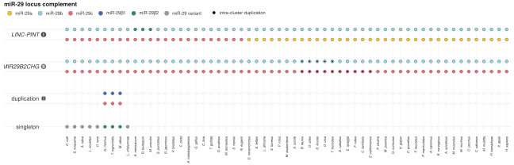

S2a. Cluster- and locus-resolved miR-29 family complement, ordered as in the main phylogeny.


## S2b–c — Expression coverage and tissue-resolved effects

The non-human expression coverage uses the corrected goat age (24 hours = 1 day) and the brain-only macaque cohort (14 samples). The Human row is the Figure 1 GTEx RNA atlas reference (16,232 samples across 30 tissues), not a human cohort included in Figure 2f or the seed analysis in Figure 2g. In particular, it must not be interpreted as the number of directly measured, paired mature-miRNA libraries.


```r
p_S2b
```


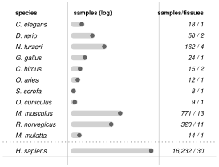

S2b. Species-level expression coverage. The separated Human row provides Figure 1 context and is excluded from the Figure 2f/g non-human analyses.


For c, only the five non-human species with more than one analyzed tissue are shown, in main-figure order. Each grey half-box summarizes the distribution of miRNA–age coefficients; the background points are individual miRNAs, coloured by direction. The larger coloured circles identify the selected miR-29 family members. Box widths, jitter and point sizes are graphical encodings, not confidence intervals. The box spans the interquartile range, with a median line and standard 1.5-IQR whiskers. The compact tissue-level source coefficients preserve the species-specific processing used in the main panel.


```r
p_S2c
```


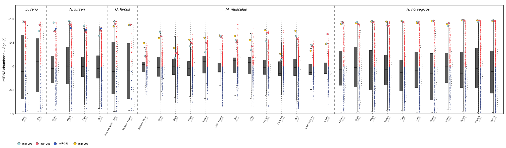

S2c. Mature-miRNA age associations resolved by tissue in the multi-tissue species. Animal icons in the Illustrator page are editorial layers.


## S2d–e — Methylation coverage and tissue-resolved cg10501210

The coverage panel reports samples in eligible species–tissue strata after the age-confidence filter (`Confidenceinageestimate > 80`) and the minimum of 10 samples per tissue. The five macroclades and 36 species correspond to the aggregate in main K, including Human within Primates. These eligible sample counts need not equal the broader annotation totals used in main K: the per-tissue eligibility filter is made explicit here.


```r
p_S2d
```


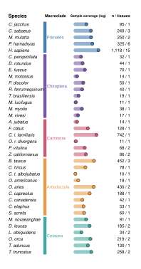

S2d. Methylation sample coverage by species and macroclade, with eligible sample and tissue counts.


Panel e uses the complete available CpG correlation distribution for each tissue, not a distribution restricted to selected probes. Purple and green indicate positive and negative Spearman associations, respectively; the yellow circle identifies cg10501210. The final layout places the remaining multi-tissue mammals first, the three non-human primates second, and Human last. Of 43 eligible tissues across 12 multi-tissue species, 41 yield finite correlations. Human keratinocytes and placenta are not plotted as zero: their age-invariant annotations make an age correlation undefined. They remain documented in the eligibility tables.


```r
p_S2e
```


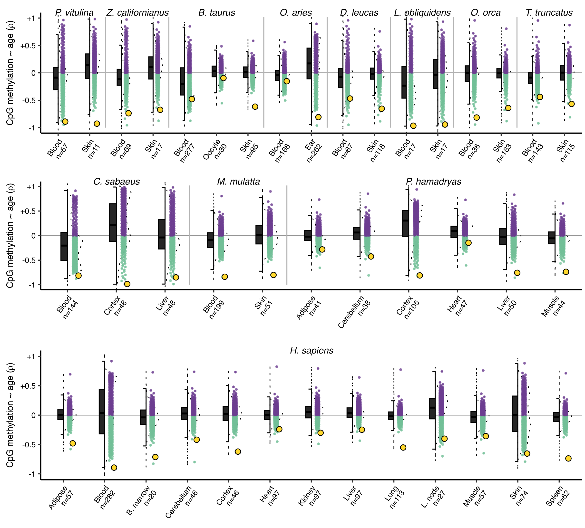

S2e. Tissue-resolved methylation–age distributions, with cg10501210 highlighted. Only estimable tissue distributions are displayed.


## S2f–g — Target sequence status

These panels use the wider mapped sequence-status comparison, not only the 36 species entering main K. They compare 41 species with a conserved target CpG and 25 with a non-conserved target, including both disrupted target dinucleotides and absent homologous probe-target regions. The 11 not-assessable species are excluded. Supplementary Data 2 distinguishes these sequence contexts and gives the available genomic fragments.

For f, normalized cg10501210 beta values are summarized within tissue and then across tissues with equal tissue weight, yielding one point per species. For g, species-level effects are arithmetic means of the eligible tissue Spearman coefficients, consistently with the main methylation analysis. Dot size in g represents sample coverage. Violin and box distributions describe differences between species; they are not confidence intervals.

The beta comparison is an assay/sequence-status control: altered hybridization or absence of the interrogated CpG can affect the signal. Low beta values in the non-conserved group must not be interpreted as a direct measure of biological hypomethylation at a conserved target. These comparisons are descriptive and do not correct for phylogenetic non-independence.


```r
p_S2f
```


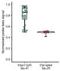

S2f. Species-level beta signal grouped by mapped target-CpG status.


```r
p_S2g
```


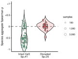

S2g. Species-level cg10501210 age associations grouped by mapped target-CpG status.


## S2h — Human tissue effects and bootstrap confidence intervals

The 13 estimable tissues are alphabetical, with the aggregate at the bottom. The point estimate is the sample-level Spearman correlation of age with the normalized cg10501210 beta signal within that tissue. Samples are resampled with replacement **within tissue**, preserving each age–beta pair and the original sample size. Spearman rho is recalculated in each of 2,000 draws using seed 290105. The endpoints are the 2.5th and 97.5th percentiles (`quantile(type = 6)`), not symmetric standard-error bars. Thus a point need not be centred between its two endpoints. Point area increases with sample coverage and is not an inverse-variance weight.

The yellow diamond marks the **unweighted arithmetic mean of the 13 tissue rho values**, not a random-effects meta-analysis. The aggregate interval is obtained by taking that mean within each bootstrap iteration and then its percentiles. It is conditional on these 13 tissues, does not resample tissues, and does not account for cross-tissue donor dependence. We therefore do not call it a donor-clustered or random-effects interval. The diamond itself has a fixed graphical size; the horizontal whisker reports its interval.


```r
p_S2h
```


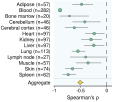

S2h. Alphabetical human tissue effects with sample-bootstrap 95% intervals; the bottom diamond is the arithmetic tissue aggregate.


|     | label                  | n_complete | rho_cached |  ci_low | ci_high |
|:----|:-----------------------|-----------:|-----------:|--------:|--------:|
| 1   | Adipose (n=57)         |         57 |    -0.4807 | -0.6595 | -0.2625 |
| 2   | Blood (n=282)          |        282 |    -0.8933 | -0.9104 | -0.8701 |
| 3   | Bone marrow (n=20)     |         20 |    -0.7128 | -0.9025 | -0.3410 |
| 4   | Cerebellum (n=46)      |         46 |    -0.4190 | -0.6553 | -0.1196 |
| 5   | Cerebral cortex (n=46) |         46 |    -0.6209 | -0.8008 | -0.3607 |
| 6   | Heart (n=97)           |         97 |    -0.2405 | -0.4125 | -0.0429 |
| 8   | Kidney (n=97)          |         97 |    -0.3012 | -0.4886 | -0.0938 |
| 9   | Liver (n=97)           |         97 |    -0.2486 | -0.4318 | -0.0464 |
| 10  | Lung (n=113)           |        113 |    -0.5511 | -0.6701 | -0.4105 |
| 11  | Lymph node (n=27)      |         27 |    -0.4015 | -0.7027 |  0.0184 |
| 12  | Muscle (n=57)          |         57 |    -0.3576 | -0.5903 | -0.1061 |
| 14  | Skin (n=74)            |         74 |    -0.6543 | -0.7975 | -0.4577 |
| 15  | Spleen (n=62)          |         62 |    -0.7375 | -0.8468 | -0.5865 |
| 16  | Aggregate              |       1075 |    -0.5091 | -0.5581 | -0.4396 |

Exact points and interval endpoints for S2h.


## S2i — Leave-one-species-out and leave-one-clade-out

Each lower-panel point is the rebuilt global K coefficient after omitting one species; its line connects it to the complete-analysis baseline (`rho = -0.617636318578119`). These lines are changes relative to baseline, **not confidence intervals**. All 37,554 probes are reaggregated and reranked for each omission; the rank is not calculated using only cg10501210.

The hierarchy remains the one used in main K: arithmetic averaging across tissues within species, Fisher-z averaging above species, with *Myotis* and *Tursiops* retained as balanced genus-level units. If one of their species is omitted, the genus unit is rebuilt from the remaining members. Five macroclades receive equal weight in the full aggregate; after omitting a clade, the four remaining macroclades receive equal weight.

The compact top strip reports the global coefficient and ascending global rank after omitting each macroclade. Rank 1 means the most negative coefficient. The target retains global rank 1 in all 36 species omissions; clade omissions give ranks 1, 1, 1, 2 and 2. The full source table also retains the target’s within-clade rank after each species omission, which is a different quantity and should not be confused with its global rank.


```r
p_S2i
```


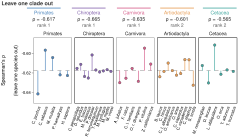

S2i. Compact clade-omission summary above species-omission effects. The dashed line is the full main-K baseline.


|     | omitted      | global_rho | global_rank_ascending_min |
|:----|:-------------|-----------:|--------------------------:|
| 37  | Primates     |    -0.6171 |                         1 |
| 38  | Chiroptera   |    -0.6652 |                         1 |
| 39  | Carnivora    |    -0.6347 |                         1 |
| 40  | Artiodactyla |    -0.6010 |                         2 |
| 41  | Cetacea      |    -0.5646 |                         2 |

Leave-one-clade-out global results; the rank universe contains 37,554 CpGs.


## Complete approved S2 reference

The page below is the approved Illustrator composition with the updated alphabetical h panel and the compact clade-omission strip. It is preserved separately from the analytical reconstructions above, so editorial icons, panel placement and typography remain available without confusing them with the statistical analysis. The original manuscript PDF is not modified.


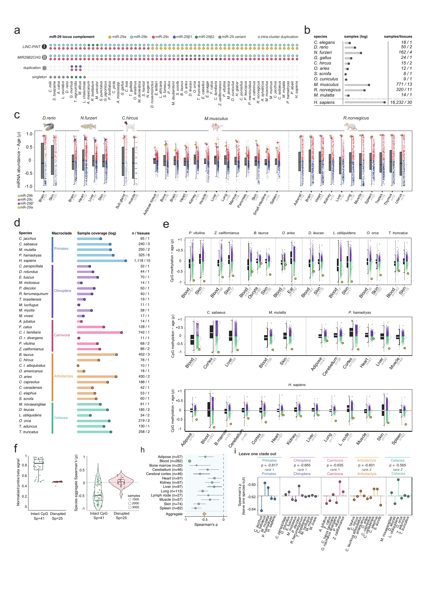

Approved Supplementary Figure S2. The individual analytical panels above are generated by the bundled R code.


# Sequence catalogue and alignment references

The machine-readable sequence catalogue corresponds to the sequence and cluster sheets of Supplementary Data 2:

- [Species and clusters](data/sequence_catalog/miR29_species_and_clusters.tsv)
- [Loci, precursor and mature sequences](data/sequence_catalog/miR29_loci_and_sequences.tsv)
- [All 266 precursor fragments, DNA FASTA](data/sequence_catalog/miR29_precursors_266_DNA.fasta)
- [The 257 clustered precursor fragments, DNA FASTA](data/sequence_catalog/miR29_clustered_precursors_257_DNA.fasta)
- [All 266 mature sequences, RNA FASTA](data/sequence_catalog/miR29_mature_266_RNA.fasta)
- [CpG conservation and genomic coordinates](data/sequence_catalog/cg10501210_conservation.tsv)
- [The 60 cg10501210 genomic fragments, DNA FASTA](data/sequence_catalog/cg10501210_60_genomic_fragments_DNA.fasta)

RNA sequences are written 5′ to 3′, and the seed is nucleotides 2–8 of the recorded mature sequence. Genomic coordinates use the reference sequence's forward-coordinate system and a separate strand field. The CpG-coordinate columns describe the entire supplied fragment, not the individual CpG. The catalogue preserves species labels used by each analysis; genome annotations from a different species are not substituted for missing loci.

The panel 2i alignment workflow uses NGPhylogeny.fr (Lemoine et al., 2019, [doi:10.1093/nar/gkz303](https://doi.org/10.1093/nar/gkz303)), MAFFT (Katoh and Standley, 2013, [doi:10.1093/molbev/mst010](https://doi.org/10.1093/molbev/mst010)), BMGE (Criscuolo and Gribaldo, 2010, [doi:10.1186/1471-2148-10-210](https://doi.org/10.1186/1471-2148-10-210)) and MSAViewer (Yachdav et al., 2016, [doi:10.1093/bioinformatics/btw474](https://doi.org/10.1093/bioinformatics/btw474)).


# Exported analytical files

The standalone modules write editable SVG and PDF files, 300-dpi PNG previews, and reusable R workspaces to `figures/generated/`. These files are linked below when present.

- panel_A\_phylogeny_radial_R\_reconstruction.svg *(not included in this source snapshot)*
- panel_A\_phylogeny_radial_R\_reconstruction.pdf *(not included in this source snapshot)*
- panel_F\_mature_miRNA_age_across_species.svg *(not included in this source snapshot)*
- panel_F\_mature_miRNA_age_across_species.pdf *(not included in this source snapshot)*
- panel_G\_miRNA_seed_age_no_human.svg *(not included in this source snapshot)*
- panel_G\_miRNA_seed_age_no_human.pdf *(not included in this source snapshot)*
- Figure2H_human_methylation_age.svg *(not included in this source snapshot)*
- Figure2H_human_methylation_age.pdf *(not included in this source snapshot)*
- Figure2I_cg10501210_sequence_inventory.svg *(not included in this source snapshot)*
- Figure2I_cg10501210_sequence_inventory.pdf *(not included in this source snapshot)*
- Figure2J_methylation_macroclades.svg *(not included in this source snapshot)*
- Figure2J_methylation_macroclades.pdf *(not included in this source snapshot)*
- Figure2K_boreoeutheria_rank.svg *(not included in this source snapshot)*
- Figure2K_boreoeutheria_rank.pdf *(not included in this source snapshot)*
- figure2_plot_objects.rds *(not included in this source snapshot)*
- figure2_workspace.RData *(not included in this source snapshot)*
- Figure2_and_S2_plot_objects.rds *(not included in this source snapshot)*
- Figure2_and_S2_workspace.RData *(not included in this source snapshot)*
- S2_analytical_data.rds *(not included in this source snapshot)*
- S2a.pdf *(not included in this source snapshot)*
- S2a.svg *(not included in this source snapshot)*
- S2b.pdf *(not included in this source snapshot)*
- S2b.svg *(not included in this source snapshot)*
- S2c.pdf *(not included in this source snapshot)*
- S2c.svg *(not included in this source snapshot)*
- S2d.pdf *(not included in this source snapshot)*
- S2d.svg *(not included in this source snapshot)*
- S2e.pdf *(not included in this source snapshot)*
- S2e.svg *(not included in this source snapshot)*
- S2f.pdf *(not included in this source snapshot)*
- S2f.svg *(not included in this source snapshot)*
- S2g.pdf *(not included in this source snapshot)*
- S2g.svg *(not included in this source snapshot)*
- S2h_human_tissues.pdf *(not included in this source snapshot)*
- S2h_human_tissues.svg *(not included in this source snapshot)*
- S2i_clade_strip.pdf *(not included in this source snapshot)*
- S2i_clade_strip.svg *(not included in this source snapshot)*
- S2i_leave_one_out.pdf *(not included in this source snapshot)*
- S2i_leave_one_out.svg *(not included in this source snapshot)*
- S2i_species_omissions.pdf *(not included in this source snapshot)*
- S2i_species_omissions.svg *(not included in this source snapshot)*
- mir29_figure_02S_preprint_final.pdf *(not included in this source snapshot)*


# Reproducibility checks

Numerical safeguards for the portable Figure 2 workflow.

Module


Quantity

Observed

Expected

Status

miRNA / phylogeny

Panel A tree tips

60

60

PASS

miRNA / phylogeny

Panel A annotation rows

60

60

PASS

miRNA / phylogeny

Panel F species

11

11

PASS

miRNA / phylogeny

Panel F displayed samples

1403

1403

PASS

miRNA / phylogeny

Panel F goat correction

SRR9663090 = 1 day

SRR9663090 = 1 day

PASS

miRNA / phylogeny

Panel F macaque

brain only; n=14

brain only; n=14

PASS

miRNA / phylogeny

Panel G Human included

FALSE

FALSE

PASS

miRNA / phylogeny

Panel G samples

1385

1385

PASS

miRNA / phylogeny

Panel G species

10

10

PASS

miRNA / phylogeny

Panel G seed universe

76

76

PASS

miRNA / phylogeny

Panel G target rank

1

1

PASS

miRNA / phylogeny

Panel G target rho

0.892295927357748

0.892295927357748

PASS

miRNA / phylogeny

Panel G reference delta

1.665335e-16

\<= 1e-12

PASS

methylation

Probe universe

37554

37554

PASS

methylation

Human filtered samples

1126

1126

PASS

methylation

All-panel filtered samples

5774

5774

PASS

methylation

Species in K

36

36

PASS

methylation

Human included in K Primates

TRUE

TRUE

PASS

methylation

K target rho

-0.617636318578

-0.617636318578

PASS

methylation

K target ascending rank

1

1

PASS

Numerical and layout safeguards for the approved S2 reconstruction.

module

panel

check

status

detail

observed

expected

abc

S2a

species_59

PASS

59 displayed vertebrates in the frozen anticlockwise order.

NA

NA

abc

S2a

seven_rows_per_species

PASS

413 matrix cells: seven locus rows for every species.

NA

NA

abc

S2a

exact_endpoints

PASS

Order runs from Callorhinchus milii to Homo sapiens.

NA

NA

abc

S2a

no_source_tree_outgroup

PASS

The Saccoglossus source-tree outgroup is not displayed.

NA

NA

abc

S2a

singleton_or_six

PASS

Six ancestral singleton miR-29-variant calls.

NA

NA

abc

S2a

singleton_beta2_three

PASS

Three singleton miR-29beta2 calls.

NA

NA

abc

S2a

cluster_iii_six_members

PASS

Three teleosts carry both members of Cluster III.

NA

NA

abc

S2a

fifteen_duplicate_markers

PASS

Fifteen Cluster II cells carry an intra-cluster duplication marker.

NA

NA

abc

S2b

twelve_species

PASS

Twelve rows including the contextual human GTEx reference.

NA

NA

abc

S2b

total_samples_17635

PASS

17,635 displayed profiles including GTEx.

NA

NA

abc

S2b

total_strata_68

PASS

68 displayed analysis tissues/strata including GTEx.

NA

NA

abc

S2b

nonhuman_samples_1403

PASS

1,403 profiles across the 11 non-human Figure 2F datasets.

NA

NA

abc

S2b

human_gtex_16232_30

PASS

Human contextual GTEx RNA-atlas reference: 16,232 profiles across 30 tissues; this is not a count of directly measured, paired mature-miRNA libraries.

NA

NA

abc

S2b

macaca_brain_only_14_1

PASS

Accepted macaque analysis: brain only, n=14.

NA

NA

abc

S2b

complete_provenance

PASS

Every coverage row has a matching repository/provenance record.

NA

NA

abc

S2c

five_multitissue_species

PASS

D. rerio, N. furzeri, C. hircus, M. musculus and R. norvegicus.

NA

NA

abc

S2c

exact_strata

PASS

Thirty-two exact species-by-tissue strata.

NA

NA

abc

S2c

exact_strata_per_species

PASS

Strata per species: 2, 4, 2, 13 and 11.

NA

NA

abc

S2c

exact_distribution_rows

PASS

23,772 finite mature-miRNA tissue-level Spearman coefficients.

NA

NA

abc

S2c

exact_highlight_rows

PASS

102 frozen miR-29 highlight points.

NA

NA

abc

S2c

no_human_profiles

PASS

Human profiles are not part of this non-human tissue strip.

NA

NA

abc

S2c

x_index_complete

PASS

Every plotted coefficient maps to the frozen tissue index.

NA

NA

abc

S2c

finite_rho

PASS

No non-finite Spearman coefficient is plotted.

NA

NA

abc

S2c

source_highlight_colours_unchanged

PASS

The source highlight palette is reproduced without alteration.

NA

NA

defg

NA

all_frozen_inputs_present

PASS

NA

7 of 7

7 of 7

defg

NA

S2d_species_n

PASS

NA

36

36

defg

NA

S2d_macroclade_n

PASS

NA

5

5

defg

NA

S2d_eligible_profile_n

PASS

NA

5660

5660

defg

NA

S2d_eligible_tissue_strata_n

PASS

NA

67

67

defg

NA

S2e_species_n

PASS

NA

12

12

defg

NA

S2e_informative_tissue_strata_n

PASS

NA

41

41

defg

NA

S2e_omitted_strata_are_human_age_invariant

PASS

NA

Homo sapiens\|\|Keratinocyte; Homo sapiens\|\|Placenta

Homo sapiens\|\|Keratinocyte; Homo sapiens\|\|Placenta

defg

NA

S2e_full_rho_rows

PASS

NA

1539714

1539714

defg

NA

S2e_cpgs_per_tissue

PASS

NA

37554

37554

defg

NA

S2f_species_n

PASS

NA

66

66

defg

NA

S2f_intact_disrupted_n

PASS

NA

41/25

41/25

defg

NA

S2g_species_n

PASS

NA

66

66

defg

NA

S2g_intact_disrupted_n

PASS

NA

41/25

41/25

hi

NA

Human: 13 estimable tissues

PASS

NA

NA

NA

hi

NA

Human: alphabetical tissue order

PASS

NA

NA

NA

hi

NA

Human: aggregate is the arithmetic tissue mean

PASS

NA

NA

NA

hi

NA

K: 41 leave-one-out recomputations match

PASS

NA

NA

NA

hi

NA

LOSO: global rank 1 in all 36 omissions

PASS

NA

NA

NA

hi

NA

LOCO: global ranks 1, 1, 1, 2, 2

PASS

NA

NA

NA

hi

NA

Human: all 2000-replicate bootstrap CIs reproduced from sample data

PASS

NA

NA

NA

Bundled provenance manifests.

Manifest

Records

data/miRNA_phylogeny/input_manifest.tsv

data/miRNA_phylogeny/input_manifest.tsv

32

data/methylation/MANIFEST.tsv

data/methylation/MANIFEST.tsv

7

data/manual_and_alignment/provenance_manifest.tsv

data/manual_and_alignment/provenance_manifest.tsv

13


## Session information


```r
sessionInfo()
```


    ## R version 4.2.3 (2023-03-15)
    ## Platform: x86_64-apple-darwin17.0 (64-bit)
    ## Running under: macOS Big Sur ... 10.16
    ## 
    ## Matrix products: default
    ## BLAS:   /Library/Frameworks/R.framework/Versions/4.2/Resources/lib/libRblas.0.dylib
    ## LAPACK: /Library/Frameworks/R.framework/Versions/4.2/Resources/lib/libRlapack.dylib
    ## 
    ## locale:
    ## [1] C.UTF-8/C.UTF-8/C.UTF-8/C/C.UTF-8/C.UTF-8
    ## 
    ## attached base packages:
    ## [1] grid      stats     graphics  grDevices utils     datasets  methods   base     
    ## 
    ## other attached packages:
    ##  [1] svglite_2.2.1  cowplot_1.1.1  tidyr_1.3.0    tibble_3.2.1   stringr_1.5.0  readr_2.1.4    purrr_1.0.1   
    ##  [8] ggtree_3.6.2   gghalves_0.1.4 ggplot2_3.5.1  dplyr_1.1.4    ape_5.7-1     
    ## 
    ## loaded via a namespace (and not attached):
    ##  [1] sass_0.4.9         bit64_4.0.5        vroom_1.6.3        jsonlite_1.8.4     bslib_0.9.0       
    ##  [6] highr_0.10         yulab.utils_0.2.1  vipor_0.4.5        yaml_2.3.7         ggrepel_0.9.3     
    ## [11] pillar_1.9.0       lattice_0.20-45    glue_1.6.2         digest_0.6.31      RColorBrewer_1.1-3
    ## [16] gridtext_0.1.5     ggfun_0.2.0        htmltools_0.5.9    pkgconfig_2.0.3    patchwork_1.1.2   
    ## [21] tidytree_0.4.2     scales_1.4.0       ggplotify_0.1.0    ggrastr_1.0.2      tzdb_0.4.0        
    ## [26] generics_0.1.3     farver_2.1.1       cachem_1.1.0       withr_2.5.0        lazyeval_0.2.2    
    ## [31] cli_3.6.1          magrittr_2.0.3     crayon_1.5.2       ggtext_0.1.2       evaluate_0.20     
    ## [36] fs_1.6.1           fansi_1.0.4        nlme_3.1-162       xml2_1.3.4         beeswarm_0.4.0    
    ## [41] Cairo_1.6-2        textshaping_1.0.1  tools_4.2.3        hms_1.1.3          lifecycle_1.0.3   
    ## [46] aplot_0.1.10       compiler_4.2.3     jquerylib_0.1.4    gridGraphics_0.5-1 systemfonts_1.2.3 
    ## [51] rlang_1.1.4        rstudioapi_0.14    rappdirs_0.3.3     labeling_0.4.2     rmarkdown_2.21    
    ## [56] gtable_0.3.6       DBI_1.1.3          markdown_1.8       R6_2.5.1           knitr_1.42        
    ## [61] fastmap_1.2.0      bit_4.0.5          utf8_1.2.3         commonmark_2.0.0   treeio_1.22.0     
    ## [66] ragg_1.2.5         stringi_1.7.12     ggbeeswarm_0.7.2   parallel_4.2.3     Rcpp_1.0.10       
    ## [71] vctrs_0.6.5        tidyselect_1.2.0   xfun_0.41




