> **External inputs — restricted Zenodo draft.** The five input packages were last confirmed in an unpublished, restricted Zenodo draft on 9 October 2026, with reserved DOI [10.5281/zenodo.23266285](https://doi.org/10.5281/zenodo.23266285). The DOI becomes active on publication; draft access is granted separately. Extract the matching ZIP into the repository root. Individual GTEx donor ages are withheld, and full-notebook execution boundaries remain documented in the [module instructions](README.md). Scientific code and recorded results below are unchanged.
>
> **Figure 3 annotation status.** Existing reconstructed images can retain older q labels. [CURRENT_STATISTICAL_LABELS.tsv](CURRENT_STATISTICAL_LABELS.tsv) records the approved global pooled/matched annotations. The images have not been silently relabelled. The donor age in this repository's narrative is 60 years, matching the corrected manuscript artwork.

# Current statistical annotations — 9 October 2026

This annotation update records the global q values used in the current artwork. Clock curves use global q values only; individual-timepoint asterisks are not displayed. Pooled main-panel and matched supplementary comparisons remain explicitly available. The analytical images and output tables below are historical reconstructions and may retain older labels; the mapping below and CURRENT_STATISTICAL_LABELS.tsv govern the updated statistical annotations. Figure 3i is an explicit exception to pooled display/inference correspondence: its legend reports the original transcriptome-wide DESeq2 matched-control q values.

| Panel | Endpoint | Arm | Controls | Global/endpoint q |
|---|---|---|---|---:|
| S3b | RNAAgeCalc | INH | matched | 2.5878e-09 |
| S3b | RNAAgeCalc | MIM | matched | 1.3728e-29 |
| 3e | RNAAgeCalc | INH | pooled | 3.3032e-09 |
| 3e | RNAAgeCalc | MIM | pooled | 6.4679e-42 |
| S3b | tAge YuGene | INH | matched | 1.2469e-13 |
| S3b | tAge YuGene | MIM | matched | 2.1243e-28 |
| 3e | tAge YuGene | INH | pooled | 1.1817e-16 |
| 3e | tAge YuGene | MIM | pooled | 3.3231e-42 |
| S3b | PASTA | INH | matched | 4.3711e-13 |
| S3b | PASTA | MIM | matched | 1.5288e-32 |
| 3i legend | EDA2R | INH | matched (pooled display) | 0.044957 |
| 3i legend | EDA2R | MIM | matched (pooled display) | 1.1143e-31 |
| 3i legend | PTCHD4 | INH | matched (pooled display) | 0.01039 |
| 3i legend | PTCHD4 | MIM | matched (pooled display) | 2.4881e-94 |
| 3i legend | DUSP6 | INH | matched (pooled display) | 7.4114e-10 |
| 3i legend | DUSP6 | MIM | matched (pooled display) | 0.59364 |
| 3i legend | EREG | INH | matched (pooled display) | 1.9262e-22 |
| 3i legend | EREG | MIM | matched (pooled display) | 0.26343 |
| S3h | ELK1 | INH | matched | 6.1321e-07 |
| S3h | ELK1 | MIM | matched | 0.71582 |
| S3h | MYC | INH | matched | 4.1966e-05 |
| S3h | MYC | MIM | matched | 0.00033076 |
| S3h | ATF4 | INH | matched | 2.0505e-08 |
| S3h | ATF4 | MIM | matched | 5.106e-18 |
| S3h | p53 | INH | matched | 0.086837 |
| S3h | p53 | MIM | matched | 4.9174e-12 |
| S3h | MAPK | INH | matched | 5.0688e-10 |
| S3h | MAPK | MIM | matched | 0.00018098 |
| S3h | EGFR | INH | matched | 6.2897e-06 |
| S3h | EGFR | MIM | matched | 0.56091 |

# Scope and execution

This document accompanies the final **Figure 3 and Figure S3**. It asks whether
sustained miR-29 inhibition or mimic treatment shifts primary human gingival
fibroblasts along age-associated transcriptional programs, and relates these
responses to regulatory activity, miR-29 targets and epigenetic regulators.
Figure S3 provides tissue-sensitivity, control-arm and cell-identity analyses.

The approved layouts are preserved in `reference/`. Only the selected panels
are included here. Every analytical plot below is generated from bundled data;
historical SVGs are not substituted for newly calculated results.

Open `Figure3_main_plus_supplementary.Rproj` in RStudio and knit this file, or run:


```r
source("render_figure3_and_s3.R")
# Load, validate and export individual panels without rendering HTML:
source("run_figure3_and_s3_in_RStudio.R")
```

Setup executes the clean modules in `code/` once. Each section displays code
from those same files and its resulting figure. Optional Monte Carlo replay
functions are not run on knitting. All execution paths are relative.

## Reproduction boundary

Bundled starting points include raw growth counts, bulk RNA-seq counts and
metadata, pre/post-batch VST matrices, pre-sex-correction external-fibroblast
VST matrices, gene sets, GSEA estimates, per-sample activity and clock
checkpoints, Cytoscape coordinates and compact single-cell marker/embedding
summaries. This is a panel reconstruction from these stated inputs, not a
repeat of read alignment, single-cell integration or external clock training.

Cell illustrations, manually placed arrows, network-region outlines and final
page composition remain editorial artwork in the reference PDFs. Archived
working scripts are segregated under `provenance/`; they are not executed or
embedded. Statistical inference is distinguished from display transformations.

## Final signature key

B/C are the unchanged historical GTEx sets. D–G are the accepted partial-Pearson
HF/HGF sets. No concordance, stable-tail or LOTO-consensus filter is added.


```r
table_show(data.frame(Signature = signature_key$letter, Definition = signature_key$label,
  Genes = lengths(signature_sets[signature_key$id])))
```


|Signature |Definition   | Genes|
|:---------|:------------|-----:|
|B         |PanTissue-UP |   354|
|C         |PanTissue-DN |   355|
|D         |HF-UP        |   149|
|E         |HF-DN        |   149|
|F         |HGF-UP       |   125|
|G         |HGF-DN       |   125|

# Figure 3 — main figure

## a — Experimental design

Primary gingival fibroblasts from one 60-year-old female donor underwent three
treatment cycles, sampled at 72 and 96 hours per cycle. T1–T6 correspond to
72, 96, 168, 192, 264 and 288 cumulative hours. RNA-seq includes five independent
experimental runs in the inhibitor arm and three in the mimic arm, each with
its own negative controls: 96 samples. These are repeated experiments within
one donor, not eight donors. The timeline itself is editorial artwork.


```r
table_show(data.frame(Group = rownames(pca_checkpoint$sample_counts),
                     as.data.frame.matrix(pca_checkpoint$sample_counts)))
```


|Group   | X1| X2| X3| X4| X5| X6|
|:-------|--:|--:|--:|--:|--:|--:|
|INH     |  5|  5|  5|  5|  5|  5|
|inhCTRL |  5|  5|  5|  5|  5|  5|
|MIM     |  3|  3|  3|  3|  3|  3|
|mimCTRL |  3|  3|  3|  3|  3|  3|

## b — Cell-growth trajectories

Growth is normalized within each replicate as
`100 * (count - count_T0) / (max_count - count_T0)`.
Points show mean ± SEM across three growth experiments per arm; one mimic
measurement at 264 hours is missing. Solid curves are exponential-plateau
fits to replicate measurements, not quadratic clock fits. Reconstructed means
are checked against the archived results.


```r
# Original cell counts; columns identify treatment and independent experiment.
growth_raw <- list(
  INH = data.frame(time = c(0, 72, 96, 168, 192, 264, 288),
    ctrl_EXP15 = c(23360,46600,53200,75800,80200,81200,78800),
    ctrl_EXP25 = c(39000,47000,44000,59200,68200,78200,73400),
    ctrl_EXP27 = c(50200,109400,115800,148800,148600,142800,120500),
    inh_EXP15 = c(23360,55200,64000,76800,87800,88200,82200),
    inh_EXP25 = c(39000,43400,44600,60600,65200,71800,66400),
    inh_EXP27 = c(50200,95400,102800,121000,124800,126400,130600)),
  MIM = data.frame(time = c(0, 72, 96, 168, 192, 264, 288),
    ctrl_EXP45 = c(40800,63600,62600,68000,66400,89000,87200),
    ctrl_EXP49 = c(74600,152400,110000,157400,132600,111000,131200),
    ctrl_EXP52 = c(54000,69800,78400,83200,82200,90000,80800),
    mim_EXP45 = c(40800,49400,55800,59200,50400,55400,71400),
    mim_EXP49 = c(74600,142000,100800,120400,114800,NA,148800),
    mim_EXP52 = c(54000,70200,75800,76000,73000,75000,79200)))
normalize_growth <- function(raw) {
  do.call(rbind, lapply(setdiff(names(raw), "time"), function(id) {
    value <- raw[[id]]
    data.frame(time = raw$time, group = sub("_.*", "", id), experiment = sub(".*_", "", id),
      y = 100 * (value - value[1]) / (max(value, na.rm = TRUE) - value[1]))
  }))
}
fit_growth <- function(d) {
  do.call(rbind, lapply(split(d, d$group), function(z) {
    fit <- minpack.lm::nlsLM(y ~ plateau * (1 - exp(-k * time)), data = na.omit(z),
      start = list(plateau = max(z$y, na.rm = TRUE), k = .01), lower = c(0, 0), upper = c(200, 1))
    out <- data.frame(time = seq(0, 288, length.out = 250), group = z$group[1])
    out$yhat <- predict(fit, out)
    out
  }))
}
```


```r
growth <- readRDS("data/main/panel_b_audit.rds")
source("code/growth_data.R")
growth_plot <- function(d, colour, title, raw) {
  d$group <- as.character(d$group)
  long <- normalize_growth(raw)
  check <- mean_sem(long[is.finite(long$y), ], "y", c("group", "time"))
  keys <- function(x) paste(x$group, x$time)
  stopifnot(max(abs(check$mean[match(keys(d), keys(check))] - d$mean)) < 1e-10)
  fit <- fit_growth(long)
  cols <- setNames(c("grey50", colour), c("ctrl", setdiff(unique(d$group), "ctrl")))
  ggplot(d, aes(time, mean, colour = group, group = group)) +
    geom_errorbar(aes(ymin = mean - sem, ymax = mean + sem), width = 4, linewidth = .3) +
    geom_point(size = 1.8) + geom_line(linewidth = .25, linetype = 2) +
    geom_line(data = fit, aes(y = yhat), linewidth = .65) +
    scale_colour_manual(values = cols) + labs(x = "Time (h)", y = "Relative cell growth (%)", title = title, colour = NULL) + theme_figure()
}
growth_panels <- list(growth_plot(growth$summary_inh, "#328A37", "Inhibitor", growth_raw$INH),
                     growth_plot(growth$summary_mim, "#923D8E", "Mimic", growth_raw$MIM))
```


```r
grid.arrange(grobs = growth_panels, ncol = 2)
```

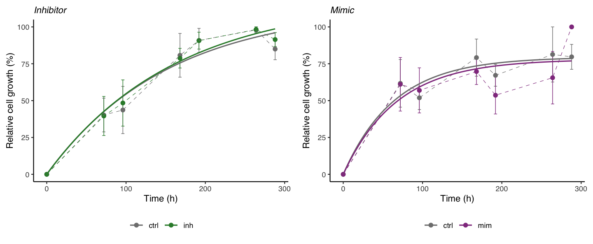

The archived growth tests are retained separately from the RNA-seq run design:


```r
growth$stats_inh
```

```
## $model
## Linear mixed model fit by maximum likelihood  ['lmerModLmerTest']
## Formula: y ~ group * time_f + (1 | exp) + (1 | exp:time_f)
##    Data: df_norm
##       AIC       BIC    logLik  deviance  df.resid 
##  342.7418  372.2821 -154.3709  308.7418        25 
## Random effects:
##  Groups     Name        Std.Dev.
##  exp:time_f (Intercept) 8.727   
##  exp        (Intercept) 8.299   
##  Residual               5.862   
## Number of obs: 42, groups:  exp:time_f, 21; exp, 3
## Fixed Effects:
##       (Intercept)           groupinh           time_fT1           time_fT2           time_fT3  
##        -5.139e-13          1.513e-13          4.021e+01          4.363e+01          8.073e+01  
##          time_fT4           time_fT5           time_fT6  groupinh:time_fT1  groupinh:time_fT2  
##         9.085e+01          9.797e+01          8.497e+01         -6.298e-01          4.765e+00  
## groupinh:time_fT3  groupinh:time_fT4  groupinh:time_fT5  groupinh:time_fT6  
##        -1.954e+00         -1.703e-01          2.871e-01          6.460e+00  
## 
## $p_interaction
## [1] 0.8813253
## 
## $p_group
## [1] 0.515585
## 
## $timepoint_contrasts
##     contrast time_f      estimate       SE       df       t.ratio   p.value p_adj
## 1 inh - ctrl     T0  1.513020e-13 5.861883 31.49973  2.581116e-14 1.0000000     1
## 2 inh - ctrl     T1 -6.298358e-01 5.861883 31.49973 -1.074460e-01 0.9151166     1
## 3 inh - ctrl     T2  4.765426e+00 5.861883 31.49973  8.129515e-01 0.4223481     1
## 4 inh - ctrl     T3 -1.954297e+00 5.861883 31.49973 -3.333907e-01 0.7410485     1
## 5 inh - ctrl     T4 -1.702778e-01 5.861883 31.49973 -2.904832e-02 0.9770093     1
## 6 inh - ctrl     T5  2.871040e-01 5.861883 31.49973  4.897813e-02 0.9612460     1
## 7 inh - ctrl     T6  6.459713e+00 5.861883 31.49973  1.101986e+00 0.2788168     1
```

```r
growth$stats_mim
```

```
## $model
## Linear mixed model fit by maximum likelihood  ['lmerModLmerTest']
## Formula: y ~ group * time_f + (1 | exp) + (1 | exp:time_f)
##    Data: df_norm
##       AIC       BIC    logLik  deviance  df.resid 
##  371.0405  400.1712 -168.5202  337.0405        24 
## Random effects:
##  Groups     Name        Std.Dev.
##  exp:time_f (Intercept) 13.542  
##  exp        (Intercept)  3.607  
##  Residual                9.805  
## Number of obs: 41, groups:  exp:time_f, 21; exp, 3
## Fixed Effects:
##       (Intercept)           groupmim           time_fT1           time_fT2           time_fT3  
##         3.361e-13         -6.812e-14          6.172e+01          5.192e+01          7.918e+01  
##          time_fT4           time_fT5           time_fT6  groupmim:time_fT1  groupmim:time_fT2  
##         6.716e+01          8.132e+01          7.969e+01         -6.424e-01          5.026e+00  
## groupmim:time_fT3  groupmim:time_fT4  groupmim:time_fT5  groupmim:time_fT6  
##        -9.462e+00         -1.352e+01         -2.814e+01          2.031e+01  
## 
## $p_interaction
## [1] 0.07284391
## 
## $p_group
## [1] 0.6438784
## 
## $timepoint_contrasts
##     contrast time_f      estimate        SE       df       t.ratio    p.value     p_adj
## 1 mim - ctrl     T0 -6.811706e-14  9.917484 30.68201 -6.868381e-15 1.00000000 1.0000000
## 2 mim - ctrl     T1 -6.424257e-01  9.917484 30.68201 -6.477709e-02 0.94877170 1.0000000
## 3 mim - ctrl     T2  5.025967e+00  9.917484 30.68201  5.067784e-01 0.61593316 1.0000000
## 4 mim - ctrl     T3 -9.461758e+00  9.917484 30.68201 -9.540482e-01 0.34751579 1.0000000
## 5 mim - ctrl     T4 -1.351547e+01  9.917484 30.68201 -1.362792e+00 0.18286737 0.9143369
## 6 mim - ctrl     T5 -2.814288e+01 12.011782 33.84929 -2.342940e+00 0.02514958 0.1760470
## 7 mim - ctrl     T6  2.031084e+01  9.917484 30.68201  2.047983e+00 0.04920291 0.2952175
```

## c — Differentially expressed genes

DESeq2 contrasts compare each treatment with its own control at the same
timepoint, using separate arm-specific models `~ 0 + SHORT_GROUP + BATCH`.
Independent filtering retains the original `results(..., alpha = 0.001)`
setting. Displayed genes have adjusted p < 0.05, with no fold-change threshold;
the sign of log2 fold change determines up/down. Counts are recalculated from
all twelve bundled gene-level contrast tables and checked against the original.

The optional normalization and differential-expression functions below start
from the bundled raw counts. Normal knitting uses the accepted matrices and
contrast tables, avoiding repeated model fitting.


```r
# Optional bulk-expression normalization from the bundled counts.
# The standard render uses the verified matrices to avoid repeating DESeq2 fits.
rebuild_pca_vst <- function(input) {
  metadata <- input$metadata[colnames(input$counts), , drop = FALSE]
  dds <- DESeq2::DESeqDataSetFromMatrix(round(as.matrix(input$counts)), metadata, design = ~1)
  dds <- DESeq2::DESeq(dds, quiet = TRUE)
  vst <- SummarizedExperiment::assay(DESeq2::vst(dds, blind = TRUE))
  protected <- model.matrix(~0 + reGROUP + TIME, metadata)
  adjusted <- limma::removeBatchEffect(vst, batch = metadata$EXPERIMENT, design = protected)
  adjusted <- limma::removeBatchEffect(adjusted, batch = metadata$BATCH, design = protected)
  list(vst = vst, corrected = adjusted)
}

# Historical per-arm DE model; no count-level subtraction is performed.
rebuild_arm_de <- function(input, arm) {
  metadata <- input$metadata[input$metadata$GROUP %in% c(arm, if (arm == "INH") "inhCTRL" else "mimCTRL"), ]
  metadata$SHORT_GROUP <- factor(metadata$SHORT_GROUP)
  metadata$BATCH <- factor(metadata$BATCH)
  counts <- round(as.matrix(input$counts[, rownames(metadata), drop = FALSE]))
  dds <- DESeq2::DESeqDataSetFromMatrix(counts, metadata, design = ~0 + SHORT_GROUP + BATCH)
  dds <- DESeq2::DESeq(dds, quiet = TRUE)
  lapply(1:6, function(time) {
    treated <- unique(metadata$SHORT_GROUP[metadata$TIME == time & metadata$GROUP == arm])
    control <- unique(metadata$SHORT_GROUP[metadata$TIME == time & metadata$GROUP != arm])
    stopifnot(length(treated) == 1L, length(control) == 1L)
    as.data.frame(DESeq2::results(dds, contrast = c("SHORT_GROUP", as.character(treated), as.character(control)), alpha = .001))
  })
}
```


```r
# Recount differential expression directly from the twelve audited contrasts.
de <- read_input("differential_expression")
de_counts <- t(vapply(de$results, function(z) c(up = sum(z$padj < .05 & z$log2FoldChange > 0, na.rm = TRUE),
  down = sum(z$padj < .05 & z$log2FoldChange < 0, na.rm = TRUE)), numeric(2)))
stopifnot(all(unname(de_counts) == unname(de$stored_counts)))
de_display <- data.frame(arm = rep(c("INH", "MIM"), each = 6), time = rep(1:6, 2), de_counts)
de_long <- rbind(transform(de_display, count = up, direction = "UP"), transform(de_display, count = -down, direction = "DN"))
de_plot <- ggplot(de_long, aes(time, count, fill = direction)) + geom_col(width = .65) +
  geom_hline(yintercept = 0, linewidth = .3) + facet_wrap(~arm, nrow = 1) +
  scale_fill_manual(values = c(UP = "#E5262F", DN = "#284FA0")) +
  scale_x_continuous(breaks = 1:6, labels = paste0("T", 1:6)) +
  scale_y_continuous(labels = abs) + labs(x = NULL, y = "Differentially expressed genes", fill = NULL) + theme_figure()
write.csv(de_display, "validation/differential_expression_counts.csv", row.names = FALSE)
```


```r
print(de_plot)
```

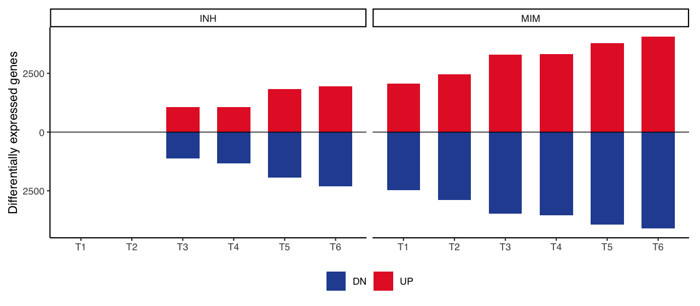

```r
table_show(de_display)
```


|arm | time|   up| down|
|:---|----:|----:|----:|
|INH |    1|    0|    1|
|INH |    2|    0|    0|
|INH |    3| 1074| 1132|
|INH |    4| 1069| 1340|
|INH |    5| 1829| 1928|
|INH |    6| 1952| 2319|
|MIM |    1| 2056| 2484|
|MIM |    2| 2469| 2891|
|MIM |    3| 3292| 3469|
|MIM |    4| 3323| 3545|
|MIM |    5| 3788| 3938|
|MIM |    6| 4054| 4093|

## d — Principal-component analysis

PCA uses the 20,000 most variable genes in the saved batch-corrected VST matrix,
with gene centering and scaling. The code reruns PCA and verifies its singular
values. Saved coordinates retain the original arbitrary axis signs. PC1/PC2
explain 20.3%/7.8%. Raw counts used for DESeq2 are not batch-subtracted.


```r
# The frozen PCA was fitted to the 20,000 most variable corrected VST genes.
pca_checkpoint <- readRDS("data/main/panel_d_audit.rds")
expression_input <- read_input("expression")
top_genes <- names(sort(matrixStats::rowVars(expression_input$vst_corrected, useNames = TRUE), decreasing = TRUE))[1:20000]
stopifnot(identical(top_genes, pca_checkpoint$top_gene_ids))
pca_recomputed <- prcomp(t(expression_input$vst_corrected[top_genes, ]), center = TRUE, scale. = TRUE)
stopifnot(max(abs(pca_recomputed$sdev - pca_checkpoint$pca$sdev)) < 1e-8)
pca_data <- pca_checkpoint$coordinates
pca_data$fill <- "grey50"
for (group in unique(pca_data$GROUP)) {
  colours <- if (group == "INH") c("#d6ebe4", "#228536") else if (group == "MIM") c("#f3dfee", "#57338A") else c("#d9d9d9", "#343434")
  take <- pca_data$GROUP == group
  pca_data$fill[take] <- scales::col_numeric(colours, domain = c(1, 6))(pca_data$TIME[take])
}
pca_plot <- ggplot(pca_data, aes(PC1, PC2)) +
  stat_ellipse(aes(group = reGROUP, colour = reGROUP), type = "norm", level = .99, linetype = 2, linewidth = .35, show.legend = FALSE) +
  geom_point(aes(fill = fill, shape = GROUP), size = 2, colour = "grey35", stroke = .35) +
  scale_fill_identity() + scale_colour_manual(values = c(INH = "#228536", CTRL = "black", MIM = "#57338A"), guide = "none") +
  scale_shape_manual(values = c(INH = 21, MIM = 21, inhCTRL = 22, mimCTRL = 23)) +
  labs(x = sprintf("PC1 (%.1f%%)", pca_checkpoint$variance_percent[1]),
       y = sprintf("PC2 (%.1f%%)", pca_checkpoint$variance_percent[2]), fill = NULL, shape = NULL) + theme_figure()
```


```r
print(pca_plot)
```

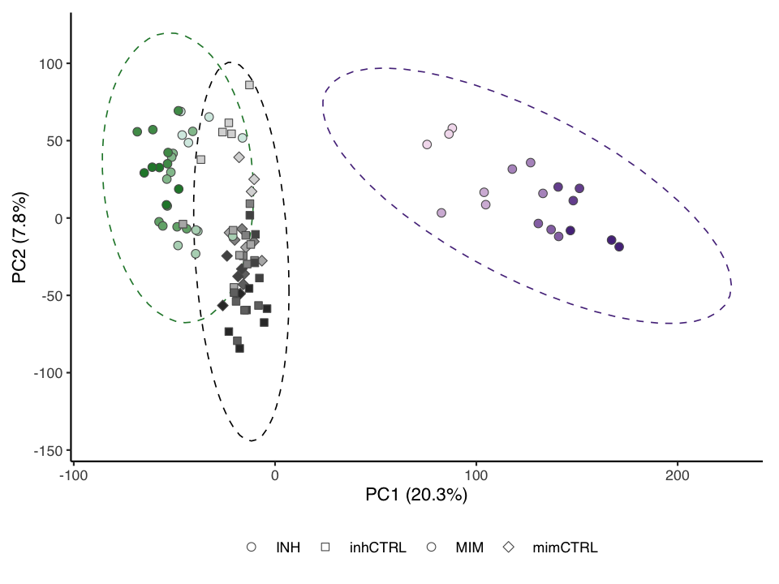

## e — RNAAgeCalc and tAge

RNAAgeCalc retains its native age predictions. tAge uses the human-inclusive
universal model with **YuGene** input. Its model-input reference is the per-gene
median YuGene expression of negative controls across all timepoints, separately
within each arm. This reference is distinct from the displayed T1 baseline.

For the main display, batch correction occurs **after prediction**, preserving
treatment-by-time cells, not by feeding VST values to the clocks. tAge output is
multiplied by 122.5 to express model-scale years; the own-arm T1 control mean
is then subtracted from every sample in that arm. Controls are pooled
in the main plot and separated in the supplementary plot. “Delta age from baseline” is therefore a model-scale change
relative to the corresponding T1 controls, not chronological time elapsed in
culture. SEM is conditional on the estimated baseline and batch correction.

Points/error bars/ribbons show mean ± SEM. Thin lines connect means; thick
curves are quadratic descriptive fits. The main-style x positions
`1, 2, 4, 5, 7, 8` visually group cycles: they are display positions, not a
uniformly scaled elapsed-hour axis.


```r
# Final clock summaries and their matched-control inferential results.
main_clocks <- read_input("main_clocks")
clock_tests <- read_input("clock_stars")
mobile_clocks <- read_input("mobile_clocks")

mean_sem <- function(samples, value, groups) {
  do.call(rbind, lapply(split(samples, interaction(samples[groups], drop = TRUE)), function(d) {
    v <- d[[value]]
    cbind(d[1, groups, drop = FALSE], data.frame(n = length(v), mean = mean(v), sem = sd(v) / sqrt(length(v))))
  }))
}
quadratic_fit <- function(d, group_name, x_name = "x") {
  do.call(rbind, lapply(split(d, d[[group_name]]), function(z) {
    x <- z[[x_name]]
    model <- lm(z$mean ~ poly(x, 2, raw = TRUE))
    grid_x <- seq(min(x), max(x), length.out = 201)
    data.frame(group = z[[group_name]][1], x = grid_x,
               fitted = as.numeric(predict(model, newdata = data.frame(x = grid_x))))
  }))
}
plot_clock <- function(d, fit, title, y_label) {
  ggplot(d, aes(x, mean, colour = group, group = group)) +
    geom_ribbon(aes(ymin = mean - sem, ymax = mean + sem, fill = group), alpha = .12, colour = NA) +
    geom_line(aes(linetype = group), linewidth = .25) +
    geom_line(data = fit, aes(x, fitted, colour = group, linetype = group), inherit.aes = FALSE, linewidth = .85) +
    geom_errorbar(aes(ymin = mean - sem, ymax = mean + sem), width = .12, linewidth = .25, linetype = "solid") +
    geom_point(size = 1.9, shape = 16) +
    scale_colour_manual(values = arm_colours) + scale_fill_manual(values = arm_colours, guide = "none") +
    scale_linetype_manual(values = arm_lines) +
    scale_x_continuous(breaks = time_positions, labels = paste0("T", 1:6)) +
    labs(x = NULL, y = y_label, title = title, colour = NULL, linetype = NULL) + theme_figure(10)
}
main_clock_panels <- list()
for (clock in c("RNAAgeCalc", "tAge")) {
  d <- if (clock == "RNAAgeCalc") main_clocks$rna_summary else main_clocks$summary_T1
  d$group <- d$grp
  d$x <- d$xdisp
  fit <- quadratic_fit(d, "group")
  main_clock_panels[[clock]] <- plot_clock(d, fit,
    if (clock == "tAge") "tAge (YuGene)" else clock,
    if (clock == "tAge") "Delta age from baseline (years)" else "Transcriptomic age (years)")
}
```


```r
grid.arrange(grobs = main_clock_panels, ncol = 2)
```

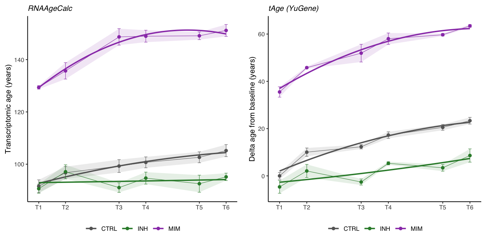

Inference uses individual native predictions, with pooled controls for Figure 3e and matched controls for Supplementary Figure 3b. Global q values retain the batch-aware overall-shift test and four-test BH family per clock and control definition (two shifts and two quadratic-time interactions). Current clock curves display global q values only, without timepoint significance asterisks. Frozen timepoint tests are retained below as historical supplementary analyses, not current plot annotations. Both comparator definitions and a portable replay are provided in statistics_20261009/.

The reference test functions below reproduce the modeling structure. Historical timepoint comparisons retain the archived Kenward–Roger degrees-of-freedom convention. They are not substituted for the global-shift annotation or displayed as timepoint stars in the current figures.


```r
# Overall shift versus own-arm controls; repeated experimental runs share an intercept.
fit_global_shift <- function(samples) {
  samples$group <- factor(samples$group, levels = c("control", "treated"))
  samples$time <- factor(samples$time)
  null <- lme4::lmer(score ~ time + (1 | batch), samples, REML = FALSE)
  shift <- lme4::lmer(score ~ group + time + (1 | batch), samples, REML = FALSE)
  comparison <- anova(null, shift)
  list(p = comparison$`Pr(>Chisq)`[2], estimate = lme4::fixef(shift)["grouptreated"],
       singular = lme4::isSingular(null) || lme4::isSingular(shift))
}

# Timepoint comparisons use the complete treatment-by-time model.
fit_timepoint_tests <- function(samples, df_method = "kenward-roger") {
  samples$group <- factor(samples$group, levels = c("control", "treated"))
  samples$time <- factor(samples$time)
  model <- lme4::lmer(score ~ group * time + (1 | batch), samples, REML = FALSE)
  means <- emmeans::emmeans(model, ~group | time, lmer.df = df_method)
  tests <- as.data.frame(emmeans::contrast(means, list("treated - control" = c(-1, 1)), adjust = "none"))
  tests$p_holm6 <- p.adjust(tests$p.value, "holm", n = 6)
  tests
}
```


```r
table_show(main_clocks$qvalues, digits = 12)
```


|clock       |arm |p           |q           |
|:-----------|:---|:-----------|:-----------|
|RNAAgeCalc  |INH |1.29391e-09 |2.58783e-09 |
|RNAAgeCalc  |MIM |3.43199e-30 |1.37280e-29 |
|tAge YuGene |INH |6.23429e-14 |1.24686e-13 |
|tAge YuGene |MIM |5.31080e-29 |2.12432e-28 |

```r
table_show(clock_tests$table[, c("clock", "arm", "TIMEF", "p_raw", "p_adjusted", "stars")], digits = 12)
```


|clock       |arm | TIMEF|p_raw       |p_adjusted  |stars |
|:-----------|:---|-----:|:-----------|:-----------|:-----|
|RNAAgeCalc  |INH |     1|1.46715e-01 |2.93430e-01 |ns    |
|RNAAgeCalc  |INH |     2|3.88525e-01 |3.88525e-01 |ns    |
|RNAAgeCalc  |INH |     3|4.25786e-04 |1.70314e-03 |**    |
|RNAAgeCalc  |INH |     4|2.87083e-03 |8.61249e-03 |**    |
|RNAAgeCalc  |INH |     5|5.86758e-05 |3.52055e-04 |***   |
|RNAAgeCalc  |INH |     6|6.37432e-05 |3.52055e-04 |***   |
|RNAAgeCalc  |MIM |     1|9.64677e-18 |1.69454e-17 |***   |
|RNAAgeCalc  |MIM |     2|8.47269e-18 |1.69454e-17 |***   |
|RNAAgeCalc  |MIM |     3|8.44475e-22 |5.06685e-21 |***   |
|RNAAgeCalc  |MIM |     4|1.48198e-21 |7.40992e-21 |***   |
|RNAAgeCalc  |MIM |     5|7.96700e-21 |3.18680e-20 |***   |
|RNAAgeCalc  |MIM |     6|1.21104e-20 |3.63311e-20 |***   |
|tAge YuGene |INH |     1|1.25517e-01 |1.25517e-01 |ns    |
|tAge YuGene |INH |     2|6.78270e-03 |1.35654e-02 |*     |
|tAge YuGene |INH |     3|4.45580e-06 |1.82918e-05 |***   |
|tAge YuGene |INH |     4|2.17420e-05 |6.52259e-05 |***   |
|tAge YuGene |INH |     5|2.95799e-07 |1.77479e-06 |***   |
|tAge YuGene |INH |     6|3.65837e-06 |1.82918e-05 |***   |
|tAge YuGene |MIM |     1|3.16677e-16 |3.16677e-16 |***   |
|tAge YuGene |MIM |     2|1.13991e-16 |2.27983e-16 |***   |
|tAge YuGene |MIM |     3|4.34685e-18 |1.73874e-17 |***   |
|tAge YuGene |MIM |     4|9.52819e-20 |5.71692e-19 |***   |
|tAge YuGene |MIM |     5|7.98554e-18 |2.39566e-17 |***   |
|tAge YuGene |MIM |     6|1.53624e-18 |7.68120e-18 |***   |

## f — Aging-signature definitions and rankings

**B/C, pan-tissue:** unchanged historical GTEx definitions. The alternative
intercept-corrected GTEx results were sensitivity analyses, not replacements.

**D/E, pan-HF:** within each of seven tissues, both expression and age are
regressed on sex with an intercept, and Pearson correlation is calculated
between their residuals. Input is VST **before** sex removal. Each tissue has
equal weight in `tanh(mean(atanh(r)))`. Coefficients are clipped to
±(1 − 10^-6) for transformation; at least five finite tissue coefficients are
required. Strict upper/lower 1% cutoffs are computed in the estimable universe,
with positive/negative sign requirements. LINC-PINT and MIR29B2CHG are excluded
without refilling tails. Final sizes are 149/149 genes.

**F/G, HGF:** the same partial Pearson calculation is applied to the five
gingival samples. Strict 1% tails of the 12,467-gene universe produce 125/125
genes; there is no between-tissue aggregation for this single tissue.

The code below recalculates tissue coefficients, both HF tails, HGF coefficients
and all omitted-tissue definitions from the bundled pre-sex-correction VST.
It checks actual coefficients and gene membership against the final checkpoints.


```r
# Reconstruct the accepted partial correlations from pre-sex-correction VST.
definitions <- read_input("definitions")
curve_checkpoint <- read_input("curves")
simple_checkpoint <- read_input("simple_results")
authentic <- read_input("authentic")
fibroblast_vst <- read_input("unadjusted_fibroblast_vst")

partial_pearson <- function(expression, metadata) {
  stopifnot(identical(colnames(expression), rownames(metadata)))
  metadata$SEX <- factor(metadata$SEX)
  design <- model.matrix(~ SEX, metadata)
  residual_expression <- t(qr.resid(qr(design), t(expression)))
  residual_age <- qr.resid(qr(design), metadata$AGE)
  coefficient <- suppressWarnings(drop(cor(t(residual_expression), residual_age)))
  centered_norm <- function(m) sqrt(rowSums((m - rowMeans(m))^2))
  original_norm <- centered_norm(expression)
  informative <- original_norm > 1e-12 * pmax(1, sqrt(rowSums(expression^2))) &
    centered_norm(residual_expression) > 1e-12 * pmax(1, original_norm)
  coefficient[!informative] <- NA_real_
  setNames(coefficient, rownames(expression))
}
hf_ids <- rownames(definitions$partial_correlations)
partial_coefficients <- vapply(definitions$tissues, function(tissue) {
  z <- fibroblast_vst[[tissue]]
  partial_pearson(z$expression[hf_ids, , drop = FALSE], z$metadata)
}, numeric(length(hf_ids)))
rownames(partial_coefficients) <- hf_ids
stopifnot(identical(is.finite(partial_coefficients), is.finite(definitions$partial_correlations)),
          max(abs(partial_coefficients - definitions$partial_correlations), na.rm = TRUE) < 1e-10)

select_tails <- function(coefficient, symbols) {
  thresholds <- quantile(coefficient, c(.01, .99), na.rm = TRUE, names = FALSE)
  eligible <- is.finite(coefficient) & !symbols %in% c("LINC-PINT", "MIR29B2CHG")
  list(UP = eligible & coefficient > thresholds[2] & coefficient > 0,
       DN = eligible & coefficient < thresholds[1] & coefficient < 0,
       thresholds = thresholds)
}
aggregate_hf <- function(tissues) {
  r <- partial_coefficients[, tissues, drop = FALSE]
  n_valid <- rowSums(is.finite(r))
  r[!is.finite(r)] <- NA_real_
  score <- tanh(rowMeans(atanh(pmax(pmin(r, 1 - 1e-6), -1 + 1e-6)), na.rm = TRUE))
  score[n_valid < 5 | !is.finite(score)] <- NA_real_
  symbols <- definitions$run_definitions$full$table$symbol
  tails <- select_tails(score, symbols)
  data.frame(gene = hf_ids, symbol = symbols, r = score,
             UP = tails$UP, DN = tails$DN, n_valid = n_valid)
}
hf_curve <- aggregate_hf(definitions$tissues)
hgf_curve <- curve_checkpoint$source_curves$HGF
gingiva <- fibroblast_vst$Gingiva
hgf_recomputed <- partial_pearson(gingiva$expression[hgf_curve$gene, , drop = FALSE], gingiva$metadata)
stopifnot(max(abs(hgf_recomputed - hgf_curve$r), na.rm = TRUE) < 1e-10)
hgf_tails <- select_tails(hgf_recomputed, hgf_curve$symbol)
stopifnot(identical(unname(hgf_tails$UP), hgf_curve$UP), identical(unname(hgf_tails$DN), hgf_curve$DN))
signature_sets <- definitions$run_definitions$full$signatures
for (direction in c("UP", "DN")) {
  id <- if (direction == "UP") "new_panfib_up_R1" else "new_panfib_dn_R1"
  stopifnot(setequal(unique(hf_curve$symbol[hf_curve[[direction]]]), signature_sets[[id]]))
}
stopifnot(identical(signature_sets, support$signature_sets))

# Preserve the exact historical Monte Carlo NES, and use the accepted
# multilevel probabilities with a separately declared BH family.
main_statistics <- support$main_statistics
main_statistics$letter <- final_letter(main_statistics$signature)
main_statistics$label <- final_label(main_statistics$signature)
main_statistics <- main_statistics[match(signature_key$id, main_statistics$signature), ]
stopifnot(max(abs(main_statistics$NES - c(-1.917397, 1.900731, -2.040113, 2.061773, -1.821168, 1.763397))) < 1e-6,
          identical(as.integer(main_statistics$n_defined), c(354L, 355L, 149L, 149L, 125L, 125L)))
stopifnot(identical(as.integer(main_statistics$n_matched), c(311L, 351L, 149L, 148L, 124L, 125L)))
full_simple <- simple_checkpoint$runs$full$all_results
full_ml <- multilevel$variants$full
stopifnot(max(abs(main_statistics$NES - simple_checkpoint$runs$full$six$NES[
  match(main_statistics$signature, simple_checkpoint$runs$full$six$signature)])) < 1e-12)

# Verify every leave-one-tissue-out signature before plotting its cached GSEA.
for (tissue in definitions$tissues) {
  variant <- paste0("omit_", tissue)
  recomputed <- aggregate_hf(setdiff(definitions$tissues, tissue))
  expected <- definitions$run_definitions[[variant]]
  stopifnot(max(abs(recomputed$r - expected$score), na.rm = TRUE) < 1e-12,
            identical(unname(recomputed$UP), unname(expected$table$UP)),
            identical(unname(recomputed$DN), unname(expected$table$DN)))
}
loto_statistics <- multilevel$six_summary
loto_statistics$letter <- final_letter(loto_statistics$signature)
loto_statistics$label <- final_label(loto_statistics$signature)
write.csv(main_statistics, "validation/main_signature_statistics.csv", row.names = FALSE)
write.csv(loto_statistics, "validation/leave_one_tissue_out_statistics.csv", row.names = FALSE)
membership <- do.call(rbind, lapply(signature_key$id, function(id)
  data.frame(letter = final_letter(id), signature = final_label(id), gene = signature_sets[[id]])))
write.csv(membership, "validation/final_signature_membership.csv", row.names = FALSE)
```


```r
# The y axis retains correlations or the historical normalized enrichment score.
curve_plot <- function(d, title, reverse_rank = FALSE, vertical = FALSE) {
  d <- d[is.finite(d$r), ]
  d <- d[order(if (reverse_rank) d$r else -d$r, d$gene), ]
  d$x <- if (vertical) 0 else seq_len(nrow(d)) / nrow(d)
  d$tail <- ifelse(d$UP, "UP", ifelse(d$DN, "DN", "Other"))
  ggplot(d, aes(x, r)) +
    geom_point(aes(colour = tail), size = .7, shape = 16) +
    scale_colour_manual(values = c(UP = "#ED1B24", DN = "#294DA3", Other = "black")) +
    scale_y_continuous(breaks = c(-1, 0, 1), expand = expansion(mult = .08)) +
    labs(x = if (vertical) NULL else "Gene rank (fraction)", y = "mRNA ~ age correlation", title = title) +
    theme_figure() + theme(legend.position = "none", axis.text.x = element_blank(), axis.ticks.x = element_blank())
}
hf_plot <- curve_plot(hf_curve, "HF: D / E")
hgf_plot <- curve_plot(hgf_curve, "HGF: F / G", reverse_rank = TRUE)
hgf_vertical_plot <- curve_plot(hgf_curve, "HGF: F / G", vertical = TRUE)
pan <- authentic$Pan
pan$tail <- ifelse(pan$SYMBOL %in% signature_sets$pan_aging_up, "UP",
                   ifelse(pan$SYMBOL %in% signature_sets$pan_aging_dn, "DN", "Other"))
pan_plot <- ggplot(pan, aes(r, 0, colour = tail)) + geom_point(size = .7) +
  scale_colour_manual(values = c(UP = "#ED1B24", DN = "#294DA3", Other = "black")) +
  labs(x = "Historical pan-tissue age correlation", y = NULL, title = "B: PanTissue-UP   C: PanTissue-DN") +
  theme_figure() + theme(legend.position = "none", axis.text.y = element_blank(), axis.ticks.y = element_blank())
```


```r
print(pan_plot)
```

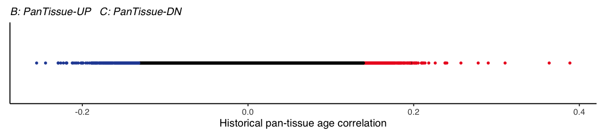


```r
grid.arrange(hf_plot, hgf_plot, ncol = 2)
```

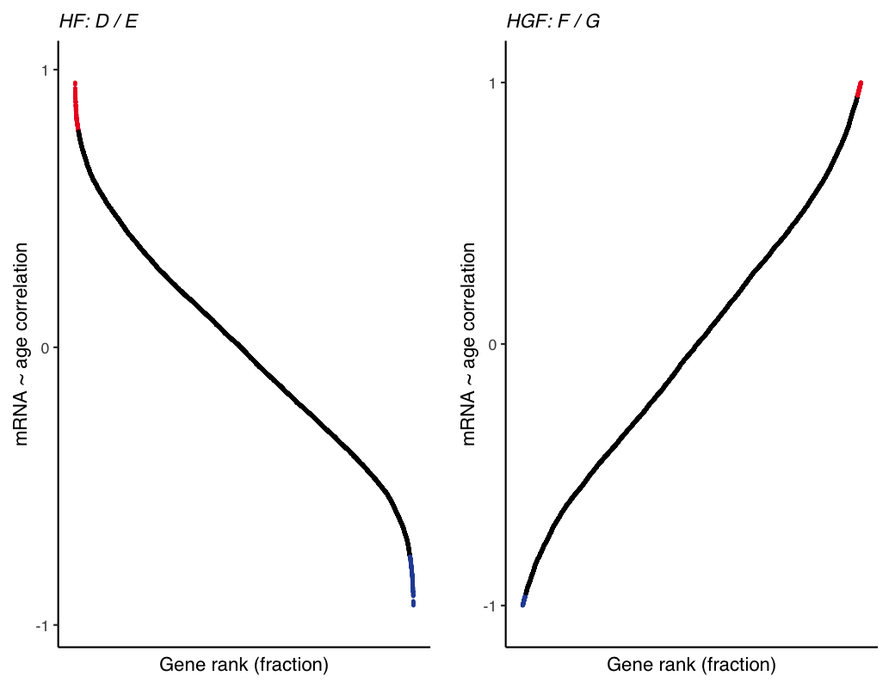

The optional constant-x HGF geometry changes neither coefficients nor membership:


```r
print(hgf_vertical_plot)
```

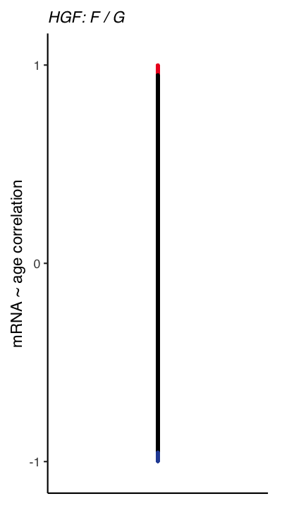

## g — Temporal GSEA under miR-29 inhibition

The frozen signed Wald ranking represents the inhibitor-by-time term, not a
single timepoint contrast. All 25,987 ranked entries, including 57 duplicated
gene-symbol entries and historical first-match handling, are preserved for
exact reproduction. Background pathways are unchanged.

**Plotted NES comes from the accepted historical `fgseaSimple` recipe**:
10,000 permutations, seed 10403. The four updated HF/HGF definitions replace
their old points; B/C and the background retain their original NES.
Multilevel NES must not be silently substituted into the plot.

Multilevel p-values use `sampleSize = 501`, `nPermSimple = 10000`, `eps = 0`,
seed 29030910 and four workers. Global BH is recomputed within each 4,721-set
family; six-signature BH is a separately labeled adjustment. The automatic
4,735-union BH is not used for comparisons. The code validates these corrections
from raw saved p-values and provides optional exact-environment replay functions.


```r
# Exact statistical recipes for optional Monte Carlo replay.
# The normal notebook render validates the saved results without rerunning them.
prepare_collection <- function(sets) {
  pairs <- data.frame(term = rep(names(sets), lengths(sets)), gene = unlist(sets, use.names = FALSE))
  pairs <- unique(pairs[!is.na(pairs$term) & !is.na(pairs$gene), ])
  split(as.character(pairs$gene), as.character(pairs$term))
}
replay_simple <- function(variant = "full") {
  stopifnot(as.character(packageVersion("fgsea")) == "1.24.0")
  pathways <- prepare_collection(c(definitions$background, definitions$run_definitions[[variant]]$signatures))
  RNGkind("Mersenne-Twister", "Inversion", "Rejection")
  set.seed(10403L)
  result <- as.data.frame(fgsea::fgseaSimple(pathways, definitions$ranked_stats,
    nperm = 10000L, minSize = 20L, maxSize = Inf, gseaParam = 1, scoreType = "std",
    BPPARAM = BiocParallel::SerialParam(progressbar = FALSE)))
  stopifnot(nrow(result) == 4721L)
  result$q_global_BH <- p.adjust(result$pval, "BH", n = 4721L)
  result
}
build_multilevel_union <- function() {
  ids <- definitions$map$signature
  background <- prepare_collection(definitions$background)
  background <- background[vapply(background, function(s) length(intersect(s, names(definitions$ranked_stats))) >= 20L, logical(1))]
  fixed <- definitions$fixed_HGF_GTEx_signatures[ids[3:6]]
  varying <- key <- list()
  for (variant in names(definitions$run_definitions)) {
    aliases <- paste0("LOTO_ML_", variant, "_", c("UP", "DN"))
    varying <- c(varying, setNames(definitions$run_definitions[[variant]]$signatures[ids[1:2]], aliases))
    key[[variant]] <- setNames(c(aliases, ids[3:6]), ids)
  }
  list(pathways = prepare_collection(c(background, fixed, varying)), key = key, background = names(background))
}
replay_multilevel <- function() {
  stopifnot(as.character(packageVersion("fgsea")) == "1.24.0", .Platform$OS.type == "unix")
  union <- build_multilevel_union()
  stopifnot(length(union$pathways) == 4735L)
  RNGkind("Mersenne-Twister", "Inversion", "Rejection")
  set.seed(29030910L)
  fgsea::fgseaMultilevel(union$pathways, definitions$ranked_stats,
    sampleSize = 501L, nPermSimple = 10000L, eps = 0, minSize = 20L,
    maxSize = Inf, gseaParam = 1, scoreType = "std",
    BPPARAM = BiocParallel::MulticoreParam(workers = 4L, progressbar = FALSE))
}

# Recompute BH from the saved raw multilevel probabilities, per tested family.
union_specification <- build_multilevel_union()
stopifnot(identical(union_specification$key, multilevel$variant_key))
for (variant in names(multilevel$variants)) {
  z <- multilevel$variants[[variant]]
  stopifnot(nrow(z$all_results) == 4721L,
    max(abs(p.adjust(z$all_results$pval, "BH", n = 4721L) - z$all_results$q_global_BH)) < 1e-14,
    max(abs(p.adjust(z$six$pval, "BH", n = 6L) - z$six$q_six_BH)) < 1e-14)
  expected <- simple_checkpoint$runs[[variant]]$all_results
  matched <- match(z$all_results$pathway, expected$pathway)
  stopifnot(max(abs(z$all_results$ES - expected$ES[matched])) < 1e-12,
    max(abs(z$all_results$NES_simple - expected$NES[matched])) < 1e-12)
}
```


```r
# Optional; requires the recorded fgsea 1.24.0 environment.
simple_replay <- replay_simple("full")
multilevel_replay <- replay_multilevel()
```


```r
table_show(main_statistics[, c("letter", "label", "n_defined", "n_matched", "NES",
  "pval", "q_global_BH", "p_multilevel", "q_multilevel_global_4721", "q_multilevel_six")], digits = 10)
```


|letter |label        | n_defined| n_matched|       NES|         pval| q_global_BH|p_multilevel | q_multilevel_global_4721|q_multilevel_six |
|:------|:------------|---------:|---------:|---------:|------------:|-----------:|:------------|------------------------:|:----------------|
|B      |PanTissue-UP |       354|       311| -1.917397| 0.0001494545| 0.004313779|1.17345e-11  |             0.0000000010|3.52034e-11      |
|C      |PanTissue-DN |       355|       351|  1.900731| 0.0003110420| 0.004313779|4.92340e-12  |             0.0000000005|2.95404e-11      |
|D      |HF-UP        |       149|       149| -2.040113| 0.0001612903| 0.004313779|7.59860e-10  |             0.0000000466|1.51972e-09      |
|E      |HF-DN        |       149|       148|  2.061773| 0.0002636436| 0.004313779|1.30518e-09  |             0.0000000751|1.95777e-09      |
|F      |HGF-UP       |       125|       124| -1.821168| 0.0001637733| 0.004313779|5.35121e-06  |             0.0001011982|6.42145e-06      |
|G      |HGF-DN       |       125|       125|  1.763397| 0.0002551671| 0.004313779|1.60642e-05  |             0.0002519574|1.60642e-05      |


```r
# Compress only the central NES interval, matching the approved figure.
compress_nes <- scales::trans_new("central_NES_compression",
  transform = function(y) ifelse(abs(y) <= .75, y / 10, sign(y) * (.075 + abs(y) - .75)),
  inverse = function(y) ifelse(abs(y) <= .075, y * 10, sign(y) * (.75 + abs(y) - .075)))
gsea_plot <- function(statistics, title = "miR-29 inhibition over time") {
  background <- authentic$background
  highlights <- authentic$highlights
  ids <- rownames(highlights)
  stopifnot(all(ids %in% statistics$signature))
  highlights$NES <- statistics$NES[match(ids, statistics$signature)]
  highlights$letter <- final_letter(ids)
  ggplot(background, aes(x, NES)) +
    geom_point(aes(colour = color, alpha = alpha), size = .28) +
    geom_point(data = highlights, aes(x, NES, fill = fill), colour = "#202020", shape = 21, size = 5.1, stroke = .5) +
    geom_text(data = highlights, aes(x, NES, label = letter), colour = "white", size = 3.1, fontface = "bold") +
    scale_colour_identity() + scale_fill_identity() + scale_alpha_identity() +
    scale_y_continuous(trans = compress_nes, breaks = c(-2.5, -2, -1.5, -1, 0, 1, 1.5, 2, 2.5)) +
    labs(x = NULL, y = "Normalized enrichment score (NES)", title = title) + theme_figure() +
    theme(axis.line.x = element_blank(), axis.text.x = element_blank(), axis.ticks.x = element_blank())
}
main_gsea_plot <- gsea_plot(main_statistics)
loto_plots <- lapply(definitions$tissues, function(tissue) {
  d <- loto_statistics[loto_statistics$variant == paste0("omit_", tissue), ]
  d$NES <- d$NES_simple
  label <- unname(support$tissue_labels[tissue])
  gsea_plot(d, paste("Omit", label)) + theme_figure(8) +
    theme(axis.text.x = element_blank(), axis.ticks.x = element_blank(), axis.line.x = element_blank())
})
```


```r
print(main_gsea_plot)
```

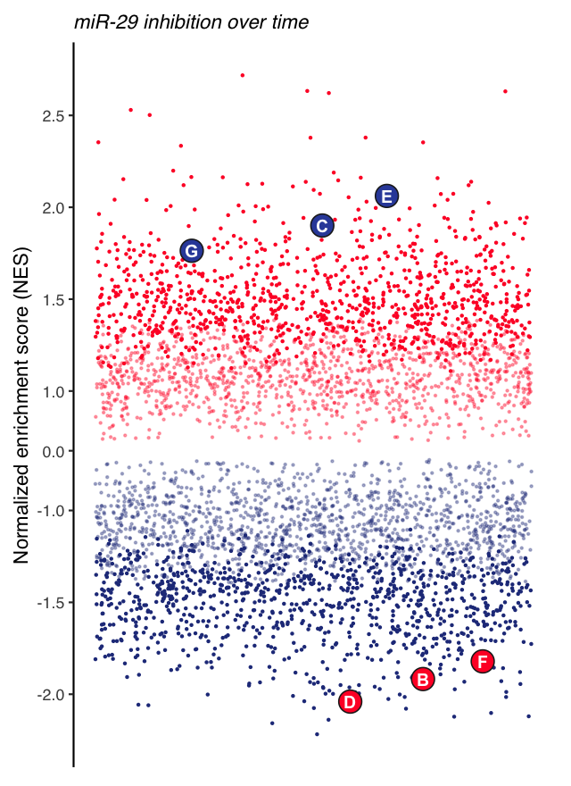

The central NES interval [−0.75, +0.75] is compressed tenfold, as in the layout;
axis labels remain NES. Horizontal jitter has no biological meaning.
Background coordinates and opacity are inherited from the original display;
that opacity is not a newly calculated multilevel significance annotation.

## h — TF and pathway activity with dendrograms

Both heatmaps show **mean treatment activity minus mean own-arm control
activity at the same timepoint**. They do not subtract a pooled reference
across arms or timepoints. DoRothEA/VIPER TF scores are retained from the
accepted per-sample checkpoint. PROGENy uses the Human model, top 500 genes
per pathway, 10,000 permutations and z-score output. INH/MIM calls used seeds
29030907/29030908 after the accepted within-arm VST batch adjustment.

The code reconstructs matched-control matrices, recomputes Euclidean/complete
row clustering and checks merges/heights against the final dendrograms.
Columns stay in T1–T6 order within arm; there is no row z-scoring. ±2 is a color
saturation range, not a truncation applied before clustering.


```r
# Reconstruct matched-control matrices and row dendrograms.
tf <- read_input("tf")
progeny <- read_input("progeny")
heatmap_checkpoint <- read_input("heatmaps")
matched_control <- function(scores, metadata) {
  scores <- scores[, rownames(metadata), drop = FALSE]
  cell <- paste(metadata$GROUP, metadata$TIME, sep = "_")
  means <- vapply(unique(cell), function(g) rowMeans(scores[, cell == g, drop = FALSE]), numeric(nrow(scores)))
  rownames(means) <- rownames(scores)
  result <- cbind(means[, paste0("INH_", 1:6)] - means[, paste0("inhCTRL_", 1:6)],
                  means[, paste0("MIM_", 1:6)] - means[, paste0("mimCTRL_", 1:6)])
  colnames(result) <- c(paste0("INH_", 1:6), paste0("MIM_", 1:6))
  result
}
tf_matrix <- matched_control(tf$primary$raw_scores, tf$metadata)
progeny_matrix <- matched_control(progeny$scores, progeny$metadata)
stopifnot(max(abs(tf_matrix[rownames(tf$main), ] - tf$main)) < 1e-10,
          max(abs(progeny_matrix - progeny$main)) < 1e-10)
palette <- heatmap_checkpoint$palette
colour_activity <- circlize::colorRamp2(palette$values, palette$colours, space = "LAB")

dendrogram_segments <- function(tree) {
  labels <- labels(tree)
  segments <- list()
  xcoord <- function(h) -.18 - 2.45 * h / attr(tree, "height")
  recurse <- function(node) {
    if (is.leaf(node)) return(list(x = xcoord(0), y = length(labels) + 1 - match(attr(node, "label"), labels)))
    children <- lapply(node, recurse)
    x <- xcoord(attr(node, "height"))
    y <- vapply(children, `[[`, numeric(1), "y")
    for (child in children) segments[[length(segments) + 1L]] <<- data.frame(x = x, xend = child$x, y = child$y, yend = child$y)
    segments[[length(segments) + 1L]] <<- data.frame(x = x, xend = x, y = min(y), yend = max(y))
    list(x = x, y = mean(y))
  }
  recurse(tree)
  do.call(rbind, segments)
}
plot_activity_heatmap <- function(name) {
  m <- if (name == "TF") tf_matrix else progeny_matrix
  frozen <- heatmap_checkpoint$trees[[name]]
  m <- m[rownames(frozen$matrix), colnames(frozen$matrix), drop = FALSE]
  hc <- hclust(dist(m), method = "complete")
  stopifnot(isTRUE(all.equal(hc$height, frozen$hclust$height, tolerance = 1e-10)),
            identical(hc$merge, frozen$hclust$merge))
  tree <- frozen$dendrogram
  rows <- labels(tree)
  d <- expand.grid(row = rows, condition = colnames(m), stringsAsFactors = FALSE)
  d$value <- as.vector(m[rows, , drop = FALSE])
  d$hex <- colour_activity(d$value)
  d$x <- match(d$condition, colnames(m))
  d$x <- d$x + ifelse(d$x > 6, .4, 0)
  d$y <- length(rows) + 1 - match(d$row, rows)
  branch <- dendrogram_segments(tree)
  row_labels <- sub("TP53", "p53", rows)
  row_labels <- sub("JAK.STAT", "JAK/STAT", row_labels, fixed = TRUE)
  ggplot(d, aes(x, y)) +
    geom_segment(data = branch, aes(x, y, xend = xend, yend = yend), inherit.aes = FALSE, linewidth = .25) +
    geom_tile(aes(fill = hex), colour = "#303030", linewidth = .22) + scale_fill_identity() +
    annotate("text", x = 13.2, y = length(rows):1, label = row_labels, hjust = 0, size = 3.2) +
    annotate("text", x = c(3.5, 9.9), y = length(rows) + 1, label = c("inh", "mimic"), fontface = "italic") +
    scale_x_continuous(breaks = c(1:6, 7:12 + .4), labels = rep(1:6, 2)) +
    coord_fixed(xlim = c(-2.9, 17.3), ylim = c(0, length(rows) + 1.5), clip = "off") +
    theme_void() + theme(axis.text.x = element_text(size = 8), plot.margin = margin(5, 5, 5, 5))
}
tf_heatmap <- plot_activity_heatmap("TF")
progeny_heatmap <- plot_activity_heatmap("PROGENy")
```


```r
print(tf_heatmap)
```

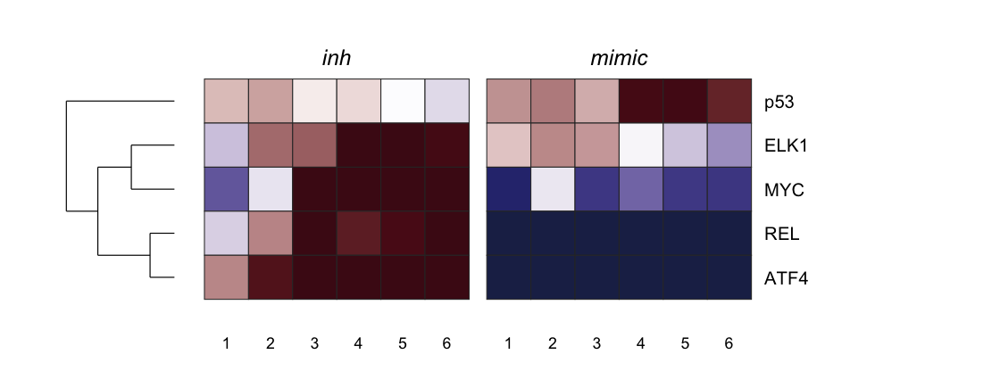


```r
print(progeny_heatmap)
```

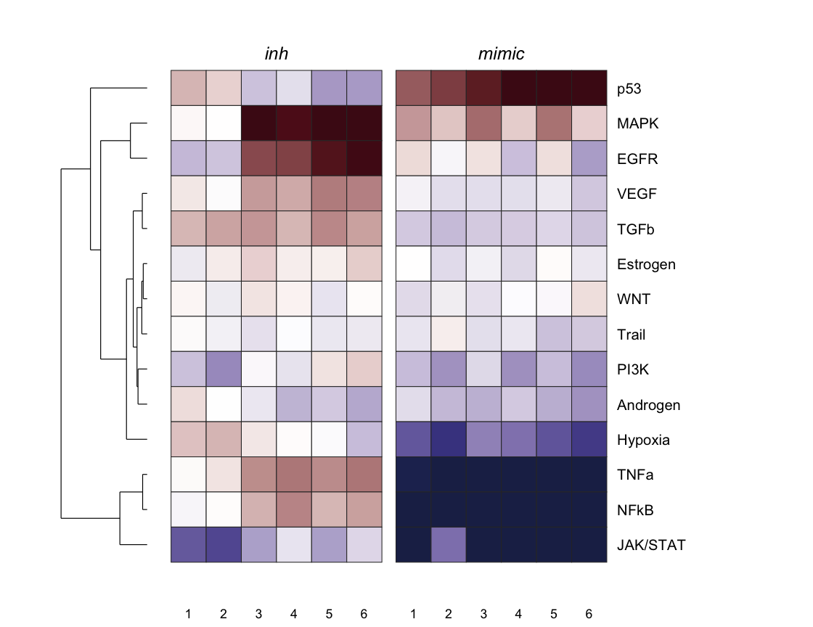

## i — Selected-gene expression trajectories

EDA2R, PTCHD4, DUSP6 and EREG are shown on the accepted batch-corrected VST scale, with pooled controls. These are expression values, not treatment-minus-control contrasts. Points and ribbons show mean ± SEM; fits are quadratic. Legend q values are the original global DESeq2 contrasts against each treatment's matched controls, with categorical timepoint and experiment adjustment and transcriptome-wide BH correction after independent filtering. They are not pooled-control tests on the illustrated VST means. See statistics_20261009/Fig3i_global_DESeq2_matched.csv.


```r
gene_input <- read_input("genes")
gene_summary <- subset(gene_input$summaries, method == "VST_batch_corrected")
gene_summary$gene <- factor(gene_summary$gene, levels = c("EDA2R", "PTCHD4", "DUSP6", "EREG"))
gene_plot <- ggplot(gene_summary, aes(TIME, mean, colour = GROUP3, group = GROUP3)) +
  geom_ribbon(aes(ymin = ymin, ymax = ymax, fill = GROUP3), alpha = .12, colour = NA) +
  geom_line(linewidth = .25) + geom_point(size = 1.3) +
  geom_errorbar(aes(ymin = ymin, ymax = ymax), width = .10, linewidth = .2) +
  geom_smooth(method = "lm", formula = y ~ poly(x, 2), se = FALSE, linewidth = .6) +
  facet_wrap(~gene, ncol = 2, scales = "free_y") +
  scale_colour_manual(values = arm_colours) + scale_fill_manual(values = arm_colours, guide = "none") +
  scale_x_continuous(breaks = 1:6, labels = paste0("T", 1:6)) +
  labs(x = NULL, y = "mRNA (VST)", colour = NULL) + theme_figure()
```


```r
print(gene_plot)
```

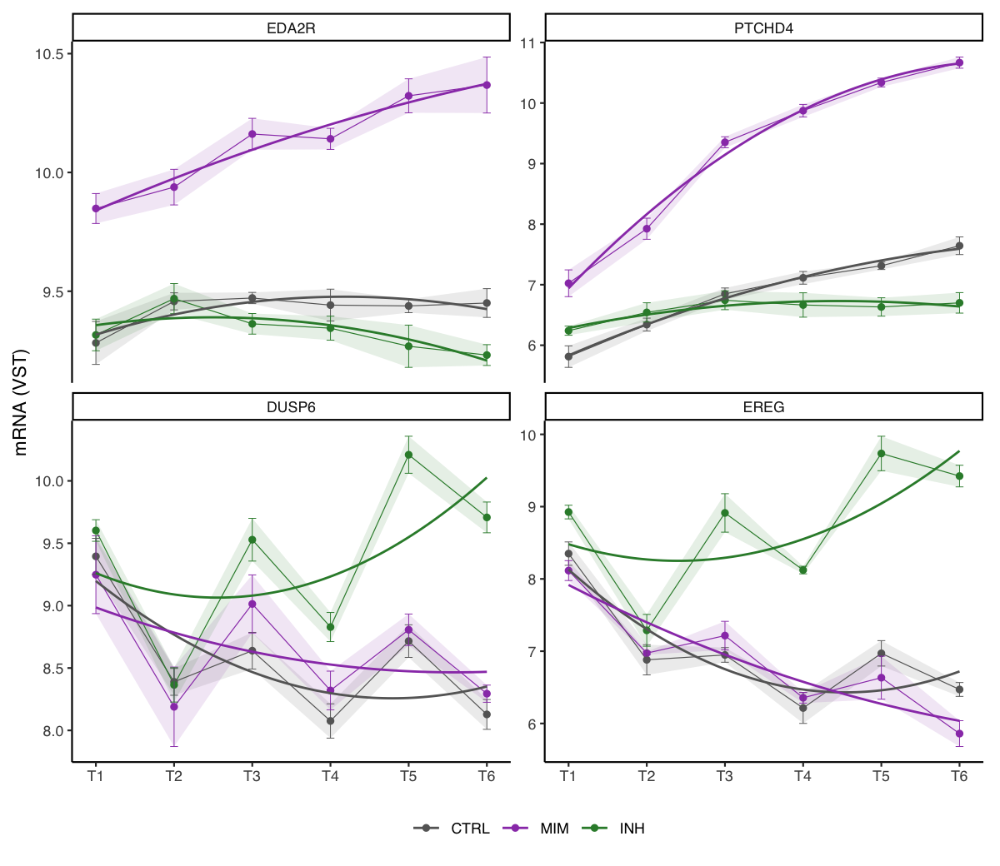

## j — Enrichment maps

Twelve Cytoscape networks represent treatment-versus-own-control enrichment
at T1–T6. Node coordinates, edges, mapped colors and dimensions are read from
the accepted session-derived checkpoint. The statistical maps are not laid
out again. Final numbered groups, outlines and enlarged T6 compositions are
editorial additions preserved in the reference PDF.


```r
# Preserved Cytoscape coordinates and node mappings define the network panels.
networks <- read_input("networks")
network_plot <- function(d, title) {
  n <- d$nodes
  e <- d$edges
  ggplot() +
    geom_segment(data = e, aes(x, y, xend = xend, yend = yend), colour = "grey70", linewidth = .12, alpha = .6) +
    ggforce::geom_circle(data = n, aes(x0 = display_x, y0 = display_y, r = diameter / 2, fill = fill, colour = border), n = 48, size = .08) +
    scale_fill_identity() + scale_colour_identity() + coord_fixed() + theme_void() + labs(title = title) +
    theme(plot.title = element_text(size = 9, hjust = .5))
}
network_panels <- lapply(names(networks$prepared), function(nm)
  network_plot(networks$prepared[[nm]], sub("MIR_", "", nm)))
```


```r
grid.arrange(grobs = network_panels, ncol = 6)
```

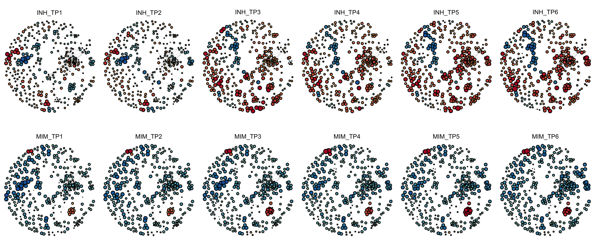

## k — Oral single-cell reference and bulk projection

The published GSE164241 oral-mucosa reference contains 133,335 cells in the
saved embedding. The fibroblast macrogroup combines homeostatic and
inflammatory/remodeling subclusters. Projection includes all 96 experimental
RNA-seq samples at T1–T6, not one selected timepoint. Coordinates are reused;
this compact reconstruction does not rerun single-cell integration or UMAP.


```r
# The embedding and bulk projections are preserved, rather than re-estimated.
singlecell <- readRDS("data/singlecell/reference_plot_data.rds")
cells <- singlecell$cells
cell_groups <- list(
  Fibroblast = c("Fibro_homeostatic", "Fibro_inflammatory_remodeling"),
  Epithelial = c("Epithelial_basal", "Epithelial_differentiated"),
  Endothelial = c("Endothelial_activated_ACKR1", "Endothelial_general", "Endothelial_capillary", "Endothelial_arterial", "Endothelial_lymphatic"),
  Immune = c("T_NK_cytotoxic", "T_cells_IL7R", "B_cells", "Plasma_cells", "Myeloid_inflammatory", "Mast_cells"),
  SMC = "Mural_pericyte_SMC"
)
cells$macro_group <- "Other"
for (group in names(cell_groups)) cells$macro_group[cells$celltype %in% cell_groups[[group]]] <- group
cell_palette <- c(Fibroblast = "#E51C23", Epithelial = "#F2C500", Endothelial = "#762A83", Immune = "#377EB8", SMC = "#B98245", Other = "#BDBDBD")
umap_plot <- ggplot(cells, aes(x, y)) +
  geom_point(colour = "#222222", size = .25) +
  geom_point(aes(colour = macro_group), size = .15) +
  scale_colour_manual(values = cell_palette) + coord_equal() + theme_void() +
  theme(legend.position = "bottom") + labs(colour = NULL)
bulk <- singlecell$bulk
projection_plot <- ggplot(cells, aes(x, y)) + geom_point(size = .15, colour = "#DDDDDD") +
  geom_point(data = bulk, aes(proj_UMAP_1, proj_UMAP_2, colour = treatment), size = 1.6) +
  scale_colour_manual(values = c(control = "grey45", inhibitor = "#328A37", mimic = "#923D8E")) +
  coord_equal() + theme_void() + theme(legend.position = "bottom") + labs(colour = NULL)
```


```r
grid.arrange(umap_plot, projection_plot, ncol = 2)
```

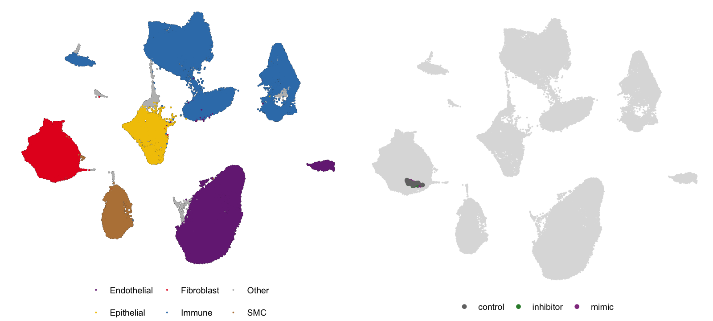

## l — Functional taxonomy of miR-29 targets

The frozen miRTarBase/TargetScan cross-table and curated taxonomy determine the
alluvial groups and ordering. The diagram contains 149 classified targets:
six DNA-methylation, thirteen chromatin-regulation and 130 other targets.
Historical wSCORE is an input; its original database-level construction is
not claimed to be regenerated here.


```r
# Portable reconstruction of final Figure 3l from the frozen target taxonomy.
# The original taxonomy-building source and target-score table are retained in
# provenance/historical_code/source_legacy/ and data/main/alluvial/.

figure3_build_alluvial <- function(results) {
  if (!requireNamespace("ggplot2", quietly = TRUE) ||
      !requireNamespace("ggalluvial", quietly = TRUE)) {
    stop("Install ggplot2 and ggalluvial to rebuild Figure 3l.")
  }

  taxo_plot <- results$taxonomy_plotted
  required <- c(
    "Gene_lbl", "Fine_lbl", "Macro_lbl", "Freq", "flow_group"
  )
  stopifnot(all(required %in% names(taxo_plot)))

  p0 <- ggplot2::ggplot(
    taxo_plot,
    ggplot2::aes(
      y = Freq, axis1 = Gene_lbl, axis2 = Fine_lbl, axis3 = Macro_lbl
    )
  ) +
    ggalluvial::geom_alluvium(
      ggplot2::aes(fill = flow_group, alpha = flow_group),
      width = 0.10, knot.pos = 0.40, decreasing = FALSE,
      lode.guidance = "forward", aes.bind = "flows", discern = TRUE,
      color = NA
    ) +
    ggalluvial::geom_stratum(
      width = 0.10, fill = "grey97", color = "grey35",
      linewidth = 0.25, discern = TRUE
    ) +
    ggplot2::scale_fill_manual(
      values = c(
        Background = "#C8C8C8", `DNA methylation` = "magenta",
        `Chromatin regulation` = "#7B61FF"
      ),
      breaks = c("DNA methylation", "Chromatin regulation"), name = NULL
    ) +
    ggplot2::scale_alpha_manual(
      values = c(
        Background = 0.28, `DNA methylation` = 0.95,
        `Chromatin regulation` = 0.95
      ),
      guide = "none"
    ) +
    ggplot2::scale_x_discrete(
      limits = c("Gene", "Fine", "Macro"), expand = c(0.02, 0.02)
    ) +
    ggplot2::theme_void(base_family = "Helvetica") +
    ggplot2::theme(
      legend.position = "bottom",
      legend.text = ggplot2::element_text(size = 8),
      legend.key.width = grid::unit(0.45, "cm"),
      plot.title = ggplot2::element_text(size = 11, margin = ggplot2::margin(b = 8)),
      plot.margin = ggplot2::margin(8, 75, 8, 24)
    ) +
    ggplot2::labs(title = "miR-29 targeted genes")

  strata <- ggplot2::ggplot_build(p0)$data[[2]]
  epi <- strata[
    strata$x == 3 & as.character(strata$stratum) == "M: Epigenetics",
    , drop = FALSE
  ]
  stopifnot(nrow(epi) == 1L)
  n_target <- nrow(taxo_plot)

  p0 +
    ggplot2::annotate(
      "rect", xmin = 2.95, xmax = 3.05,
      ymin = epi$ymin, ymax = epi$ymax, fill = "black"
    ) +
    ggplot2::annotate(
      "text", x = 3.07, y = epi$y, label = "Epigenetics",
      hjust = 0, fontface = "bold", size = 3.2
    ) +
    ggplot2::annotate(
      "text", x = 3.08,
      y = seq(epi$y - 12, epi$y - 57, length.out = 6),
      label = c("TET3", "TET1", "TET2", "TDG", "DNMT3A", "DNMT3B"),
      hjust = 0, size = 3.1
    ) +
    ggplot2::annotate(
      "segment", x = 0.82, xend = 0.82, y = 1, yend = n_target + 2,
      linewidth = 0.35,
      arrow = grid::arrow(length = grid::unit(2, "mm"), type = "closed")
    ) +
    ggplot2::annotate(
      "text", x = 0.72, y = n_target / 2,
      label = "Higher predicted repression", angle = 90, size = 3.1
    ) +
    ggplot2::coord_cartesian(
      xlim = c(0.9, 3.05), ylim = c(0, n_target + 2), clip = "off"
    )
}
```


```r
print(alluvial_plot)
```

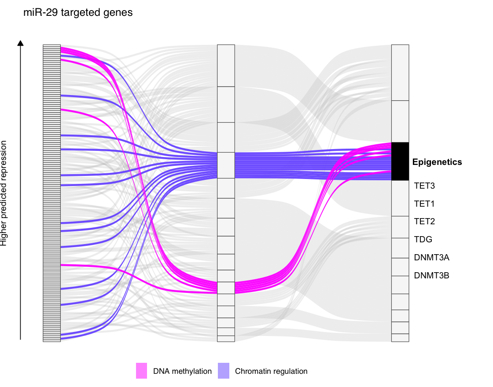

## m — Epigenetic-regulator expression

The heatmap shows saved treatment-versus-own-control log2 fold changes for
DNMT3A, DNMT3B, TET1, TET2, TET3 and TDG. Gene/time order is fixed; ±1 is a
color-display range, not a significance threshold.


```r
# Expression fold changes for the epigenetic-regulator panel.
alluvial <- readRDS("data/main/alluvial/tf_n_o_results.rds")
regulator_matrix <- alluvial$o_log2fc
regulators <- as.data.frame(as.table(regulator_matrix))
names(regulators) <- c("gene", "condition", "log2FC")
regulator_plot <- ggplot(regulators, aes(condition, gene, fill = log2FC)) +
  geom_tile(colour = "grey25", linewidth = .2) +
  scale_fill_gradient2(low = "#262064", mid = "white", high = "#791B2D", limits = c(-1, 1), oob = scales::squish, name = "log2 fold change") +
  scale_y_discrete(limits = rev(rownames(regulator_matrix))) +
  labs(x = NULL, y = NULL) + coord_fixed() + theme_figure(9) +
  theme(axis.text.x = element_text(angle = 90, hjust = 1), axis.line = element_blank(), axis.ticks = element_blank())
```


```r
print(regulator_plot)
```

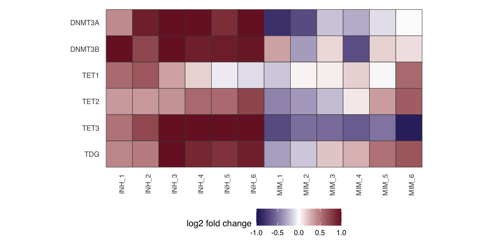

# Figure S3 — supplementary figure

## a — Timepoint Jaccard similarity

For each arm, Jaccard is `length(intersect(A, B)) / length(union(A, B))`, where
A/B are genes with adjusted p < 0.05 against their own control, restricted
within each arm to the common universe with finite adjusted p and fold change
at **all six timepoints**. This fixed eligibility rule is reproduced below.
Up and down
are combined: the metric measures membership, not directional agreement.
Empty-versus-empty is undefined. The gray identity diagonal is excluded from
color-scale estimation. Arms share an off-diagonal magnitude scale with
white-to-green (INH) and white-to-purple (MIM) palettes.


```r
# Jaccard values retain a common off-diagonal scale across treatment arms.
jaccard <- read_input("overlap")$original_data
recomputed_jaccard <- list()
for (arm in c("INH", "MIM")) {
  tables <- de$results[if (arm == "INH") 1:6 else 7:12]
  universe <- Reduce(intersect, lapply(tables, function(z)
    rownames(z)[is.finite(z$padj) & is.finite(z$log2FoldChange)]))
  significant <- vapply(tables, function(z) z[universe, "padj"] < .05, logical(length(universe)))
  for (t1 in 1:6) for (t2 in 1:6) {
    n_union <- sum(significant[, t1] | significant[, t2])
    value <- if (n_union) sum(significant[, t1] & significant[, t2]) / n_union else NA_real_
    recomputed_jaccard[[length(recomputed_jaccard) + 1L]] <- data.frame(arm, t1, t2, value, n_union)
  }
}
jaccard_check <- do.call(rbind, recomputed_jaccard)
stopifnot(identical(is.na(jaccard_check$value), is.na(jaccard$jaccard)),
          max(abs(jaccard_check$value - jaccard$jaccard), na.rm = TRUE) < 1e-14,
          all(jaccard_check$n_union == jaccard$union))
upper <- max(jaccard$jaccard[jaccard$t1 != jaccard$t2], na.rm = TRUE)
jaccard$colour <- "#D0D0D0"
for (arm in c("INH", "MIM")) {
  take <- jaccard$arm == arm & jaccard$t1 != jaccard$t2
  endpoint <- if (arm == "INH") "#248636" else "#923d8e"
  jaccard$colour[take] <- scales::col_numeric(c("white", endpoint), domain = c(0, upper))(jaccard$jaccard[take])
}
jaccard$area <- ifelse(jaccard$t1 == jaccard$t2, upper, jaccard$jaccard)
jaccard$text <- ifelse(jaccard$t1 == jaccard$t2, "", sprintf("%.2f", jaccard$jaccard))
jaccard_plot <- ggplot(jaccard, aes(t1, t2)) +
  geom_point(aes(size = area, fill = colour), shape = 21, stroke = 0) +
  geom_text(aes(label = text), size = 2.2) +
  scale_fill_identity() + scale_size_area(max_size = 10, limits = c(0, upper), guide = "none") +
  scale_x_continuous(breaks = 1:6, labels = paste0("T", 1:6)) +
  scale_y_continuous(breaks = 1:6, labels = paste0("T", 1:6)) +
  facet_wrap(~arm, nrow = 1) + coord_fixed() + labs(x = NULL, y = NULL) + theme_figure()
```


```r
print(jaccard_plot)
```

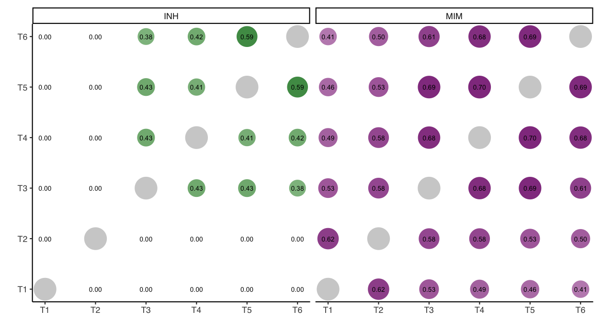

## b — Transcriptomic clocks with separate controls

Retained clocks are **tAge (YuGene), RNAAgeCalc and PASTA**; CT46 is not in the
final page. All four conditions are separate, using unadjusted predictions.
tAge model-year values are recentered to the own-arm T1 control mean. Control
connecting/fitting lines are dashed, but points/error bars are solid. Shading
is mean ± SEM, not a confidence band around the regression.

Frozen fitted y values are remapped onto the main's display spacing, not
refitted because x-axis geometry changed. Inference remains on individual
samples and actual timepoint labels, not on the illustrated mean curves.


```r
# Supplementary curves retain native predictions and separate control arms.
# Saved fitted y values are reused, so the main-style x spacing cannot refit them.
supplementary_clock_panels <- list()
for (clock in c("tAge", "RNAAgeCalc", "PASTA")) {
  p <- mobile_clocks$plots[[clock]]
  d <- as.data.frame(p$data)
  if (!"hours" %in% names(d)) d$hours <- d$TIME_H
  if (!"sem" %in% names(d)) d$sem <- d$SEM
  layer <- which(vapply(p$layers, function(x) inherits(x$geom, "GeomSmooth"), logical(1)))
  fit <- p$layers[[layer]]$data
  if (clock == "tAge") {
    baseline <- d[d$TIME == 1 & d$GROUP %in% c("inhCTRL", "mimCTRL"), ]
    offset <- setNames(baseline$mean, baseline$arm)
    group_arm <- setNames(as.character(d$arm), d$GROUP)
    d$mean <- d$mean - offset[as.character(d$arm)]
    fit$y <- fit$y - offset[group_arm[fit$GROUP]]
    stopifnot(max(abs(d$mean[d$TIME == 1 & d$GROUP %in% c("inhCTRL", "mimCTRL")])) < 1e-10)
  }
  d$group <- as.character(d$GROUP)
  d$x <- map_time(d$hours)
  f <- data.frame(group = fit$GROUP, x = map_time(fit$x), fitted = fit$y)
  supplementary_clock_panels[[clock]] <- plot_clock(d, f,
    if (clock == "tAge") "tAge (YuGene)" else clock,
    if (clock == "tAge") "Delta age from baseline (years)" else "Transcriptomic age (years)")
}
write.csv(clock_tests$table, "validation/clock_timepoint_statistics.csv", row.names = FALSE)
write.csv(main_clocks$qvalues, "validation/clock_global_statistics.csv", row.names = FALSE)
```


```r
grid.arrange(grobs = supplementary_clock_panels, ncol = 3)
```

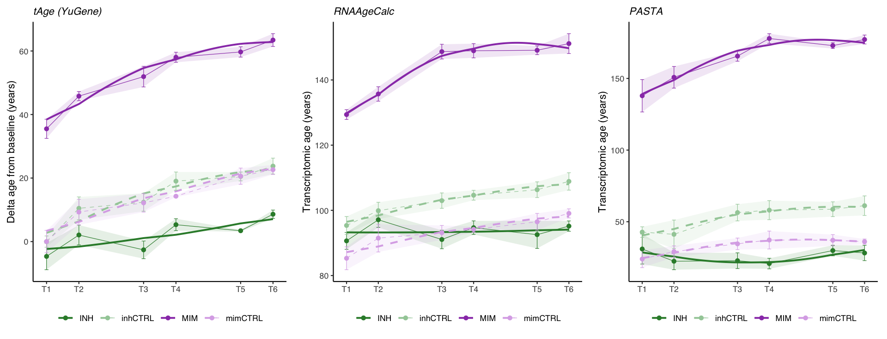

PASTA predictions and matched-control global statistics are bundled with the other clocks. The historical timepoint table is retained for completeness but its asterisks are not displayed in the current clock curves:


```r
pasta_global <- read.csv("data/supplementary/global_statistics.csv")
pasta_timepoint <- read.csv("data/supplementary/own_control_posthoc_Holm6.csv")
table_show(subset(pasta_global, grepl("PASTA", clock)), digits = 12)
```


|clock |arm | n_samples| n_runs| shift_estimate|p_global_shift | p_interaction| p_quadratic_interaction|q_global_shift_BH4 | q_quadratic_interaction_BH4|q_global_shift_all12_audit |
|:-----|:---|---------:|------:|--------------:|:--------------|-------------:|-----------------------:|:------------------|---------------------------:|:--------------------------|
|PASTA |INH |        60|      5|      -27.21186|2.18554e-13    |    0.05010614|             0.007072192|4.37107e-13        |                 0.007072192|8.74214e-13                |
|PASTA |MIM |        36|      3|      130.67918|3.82188e-33    |    0.01069590|             0.001679489|1.52875e-32        |                 0.002239319|2.29313e-32                |

```r
table_show(subset(pasta_timepoint, grepl("PASTA", clock)), digits = 10)
```


|contrast          |time_f |  estimate|       SE|       df|   t.ratio|p.value     |clock |arm | TIMEF| TIME_H|p_holm6     |q_BH6_audit |stars | direct_treated_minus_control|p_raw_archived |p_holm6_archived |q_BH12_audit |
|:-----------------|:------|---------:|--------:|--------:|---------:|:-----------|:-----|:---|-----:|------:|:-----------|:-----------|:-----|----------------------------:|:--------------|:----------------|:------------|
|treated - control |T1     | -11.77991| 7.050576| 68.75000| -1.670773|9.93132e-02 |PASTA |INH |     1|     72|9.93132e-02 |9.93132e-02 |ns    |                    -11.77991|9.93132e-02    |9.93132e-02      |9.93132e-02  |
|treated - control |T2     | -18.78036| 7.050576| 68.75000| -2.663664|9.62048e-03 |PASTA |INH |     2|     96|1.92410e-02 |1.15446e-02 |*     |                    -18.78036|9.62048e-03    |1.92410e-02      |1.04951e-02  |
|treated - control |T3     | -33.59407| 7.050576| 68.75000| -4.764727|1.01730e-05 |PASTA |INH |     3|    168|5.08649e-05 |2.76695e-05 |***   |                    -33.59407|1.01730e-05    |5.08649e-05      |1.52595e-05  |
|treated - control |T4     | -37.27208| 7.050576| 68.75000| -5.286388|1.39675e-06 |PASTA |INH |     4|    192|8.38048e-06 |8.38048e-06 |***   |                    -37.27208|1.39675e-06    |8.38048e-06      |2.39442e-06  |
|treated - control |T5     | -28.83486| 7.050576| 68.75000| -4.089718|1.15532e-04 |PASTA |INH |     5|    264|3.46596e-04 |1.73298e-04 |***   |                    -28.83486|1.15532e-04    |3.46596e-04      |1.38638e-04  |
|treated - control |T6     | -33.00986| 7.050576| 68.75000| -4.681867|1.38348e-05 |PASTA |INH |     6|    288|5.53390e-05 |2.76695e-05 |***   |                    -33.00986|1.38348e-05    |5.53390e-05      |1.84463e-05  |
|treated - control |T1     | 113.93636| 6.882594| 49.49996| 16.554277|8.08395e-22 |PASTA |MIM |     1|     72|8.08395e-22 |8.08395e-22 |***   |                    113.93636|8.08395e-22    |8.08395e-22      |1.61679e-21  |
|treated - control |T2     | 121.61195| 6.882594| 49.49996| 17.669494|5.07118e-23 |PASTA |MIM |     2|     96|1.01424e-22 |6.08541e-23 |***   |                    121.61195|5.07118e-23    |1.01424e-22      |1.21708e-22  |
|treated - control |T3     | 131.00488| 6.882594| 49.49996| 19.034231|2.02796e-24 |PASTA |MIM |     3|    168|6.08387e-24 |3.04194e-24 |***   |                    131.00488|2.02796e-24    |6.08387e-24      |6.08387e-24  |
|treated - control |T4     | 140.63460| 6.882594| 49.49996| 20.433373|8.93619e-26 |PASTA |MIM |     4|    192|4.70764e-25 |2.68086e-25 |***   |                    140.63460|8.93619e-26    |4.70764e-25      |5.36172e-25  |
|treated - control |T5     | 135.83972| 6.882594| 49.49996| 19.736705|4.13931e-25 |PASTA |MIM |     5|    264|1.65573e-24 |8.27863e-25 |***   |                    135.83972|4.13931e-25    |1.65573e-24      |1.65573e-24  |
|treated - control |T6     | 141.04758| 6.882594| 49.49996| 20.493376|7.84606e-26 |PASTA |MIM |     6|    288|4.70764e-25 |2.68086e-25 |***   |                    141.04758|7.84606e-26    |4.70764e-25      |5.36172e-25  |

## c — External-fibroblast coverage

Coverage comprises 34 samples, 15 individuals and seven tissues. Columns
identify source individuals ordered by age; squares show sampled tissues,
age and sex. This is the external aging cohort, not the perturbation experiment.


```r
# Sampling coverage and descriptive tissue contributions.
md <- support$source_metadata
donor_labels <- setNames(paste0(support$source_donors$donor, "\n", support$source_donors$SEX), support$source_donors$donor)
coverage_plot <- ggplot(md, aes(donor, tissue, fill = AGE)) +
  geom_tile(width = .9, height = .88, colour = "grey50", linewidth = .25) +
  geom_text(aes(label = AGE, colour = text_colour), size = 3) + scale_colour_identity() +
  scale_fill_gradient(low = "white", high = "#C81D25", limits = c(25, 89), name = "Age (years)") +
  scale_x_discrete(labels = donor_labels, drop = FALSE) + scale_y_discrete(drop = FALSE) +
  labs(x = "Individual / sex (ordered by age)", y = NULL) + coord_fixed() + theme_figure(9)
```


```r
print(coverage_plot)
```

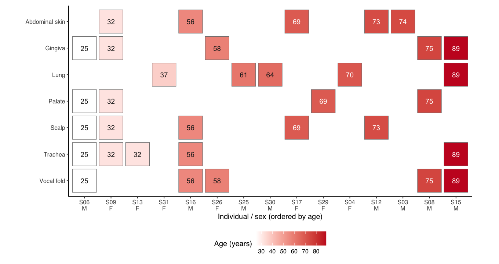

## d — Tissue contributions to pan-HF signatures

Violin dots are tissue-specific partial Pearson coefficients for the final
HF-UP/DN genes. Sample size is five per tissue except palate (four). Labels
show **arithmetic mean r** within each set, not the Fisher aggregate defining
the signature. These descriptive distributions use the same tissues from
which sets were selected; a gene-wise independence test would not provide
independent validation.


```r
contribution <- support$tissue_partial_correlations
contribution <- contribution[is.finite(contribution$r), ]
contribution$signature <- factor(contribution$signature, levels = c("HF-UP", "HF-DN"))
contribution$tissue <- factor(contribution$tissue, levels = unname(support$tissue_labels[definitions$tissues]))
contribution_means <- aggregate(r ~ tissue + signature, contribution, mean)
write.csv(contribution_means, "validation/tissue_mean_partial_Pearson.csv", row.names = FALSE)
contribution_plot <- ggplot(contribution, aes(signature, r, fill = signature)) +
  geom_hline(yintercept = 0, colour = "grey85", linetype = 2, linewidth = .25) +
  geom_violin(trim = TRUE, colour = NA, alpha = .35, scale = "width") +
  geom_boxplot(width = .12, fill = "white", linewidth = .25, outlier.shape = NA) +
  geom_point(aes(colour = signature), position = position_jitter(width = .10, seed = 29), size = .4) +
  geom_text(data = contribution_means, aes(y = 1.16, label = sprintf("%.2f", r), colour = signature), size = 2.8, show.legend = FALSE) +
  scale_fill_manual(values = c("HF-UP" = "#D86D70", "HF-DN" = "#829CC8")) +
  scale_colour_manual(values = c("HF-UP" = "#A92C23", "HF-DN" = "#315995")) +
  facet_wrap(~tissue, nrow = 1) + scale_y_continuous(breaks = seq(-1, 1, .5)) +
  labs(x = NULL, y = "mRNA ~ age partial Pearson r") + theme_figure(9) +
  theme(axis.text.x = element_blank(), axis.ticks.x = element_blank(), legend.title = element_blank())
```


```r
print(contribution_plot)
```

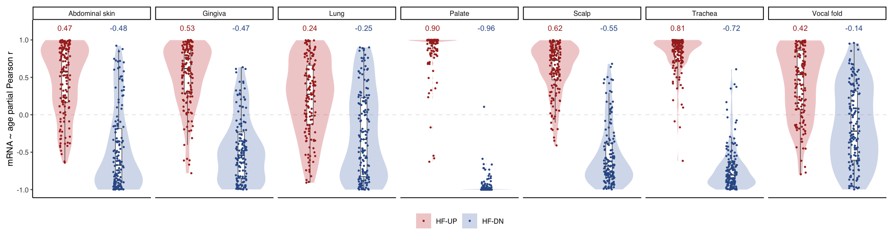

```r
table_show(contribution_means, digits = 3)
```


|tissue         |signature |      r|
|:--------------|:---------|------:|
|Abdominal skin |HF-UP     |  0.467|
|Gingiva        |HF-UP     |  0.526|
|Lung           |HF-UP     |  0.237|
|Palate         |HF-UP     |  0.896|
|Scalp          |HF-UP     |  0.617|
|Trachea        |HF-UP     |  0.813|
|Vocal fold     |HF-UP     |  0.424|
|Abdominal skin |HF-DN     | -0.478|
|Gingiva        |HF-DN     | -0.469|
|Lung           |HF-DN     | -0.251|
|Palate         |HF-DN     | -0.961|
|Scalp          |HF-DN     | -0.553|
|Trachea        |HF-DN     | -0.719|
|Vocal fold     |HF-DN     | -0.143|

## e — Six running-enrichment curves

Curves use the same signed Wald ranking and first-match semantics as main g.
Ticks mark set members; the bottom strip shows the rank statistic. Labels use
historical simple NES and multilevel global BH (4,721 sets). Every pair is
**UP then DN**, including pan-tissue B then C. Defined and matched sizes are
different quantities; both are given in the main statistics table.


```r
# Reconstruct weighted running enrichment without altering duplicate-symbol
# first-match semantics in the frozen 25,987-entry Wald vector.
running_enrichment <- function(statistic, genes) {
  hits <- sort(match(intersect(genes, names(statistic)), names(statistic)))
  step <- rep(-1 / (length(statistic) - length(hits)), length(statistic))
  step[hits] <- abs(statistic[hits]) / sum(abs(statistic[hits]))
  es <- c(0, cumsum(step))
  display_indices <- sort(unique(c(0, length(statistic), hits, pmax(hits - 1, 0), seq(0, length(statistic), by = 25))))
  list(curve = data.frame(rank = display_indices, ES = es[display_indices + 1L]), hits = hits,
       ES = if (max(es) > -min(es)) max(es) else min(es))
}
plot_enrichment <- function(id) {
  rank <- support$main_rank
  z <- running_enrichment(rank, signature_sets[[id]])
  s <- main_statistics[main_statistics$signature == id, ]
  stopifnot(abs(z$ES - s$ES) < 1e-8)
  colour <- if (z$ES > 0) "#D83C60" else "#315995"
  p <- ggplot(z$curve, aes(rank, ES)) +
    geom_area(fill = colour, alpha = .15) + geom_line(colour = colour, linewidth = .55) +
    geom_hline(yintercept = 0, colour = "grey60", linewidth = .2) +
    scale_x_continuous(limits = c(0, length(rank)), expand = c(0, 0)) +
    scale_y_continuous(limits = c(-.65, .65), breaks = c(-.5, 0, .5)) +
    labs(title = paste(final_label(id), final_letter(id)), x = NULL, y = "ES",
         subtitle = sprintf("NES = %+.2f\nFDR = %.2g", s$NES, s$q_multilevel_global_4721)) +
    theme_figure(9) + theme(axis.text.x = element_blank(), axis.ticks.x = element_blank())
  hits <- ggplot(data.frame(rank = z$hits), aes(rank)) +
    geom_segment(aes(xend = rank, y = 0, yend = 1), linewidth = .15) +
    scale_x_continuous(limits = c(0, length(rank)), expand = c(0, 0)) + theme_void()
  indices <- sort(unique(c(1, length(rank), which(diff(sign(rank)) != 0), which(diff(sign(rank)) != 0) + 1, seq(1, length(rank), by = 25))))
  metric <- data.frame(rank = indices, statistic = as.numeric(rank[indices]))
  strip <- ggplot(metric, aes(rank, statistic)) +
    geom_area(aes(y = pmax(statistic, 0)), fill = "#CE7D81") +
    geom_area(aes(y = pmin(statistic, 0)), fill = "#859BC1") +
    scale_x_continuous(limits = c(0, length(rank)), breaks = c(0, 10000, 20000, length(rank)), labels = c("0", "10k", "20k", "26k"), expand = c(0, 0)) +
    labs(x = paste0("Rank (", s$n_defined, " defined genes)"), y = "Wald") + theme_figure(8)
  grobs <- lapply(list(p, hits, strip), ggplotGrob)
  widths <- do.call(unit.pmax, lapply(grobs, `[[`, "widths"))
  grobs <- lapply(grobs, function(g) { g$widths <- widths; g })
  arrangeGrob(grobs = grobs, ncol = 1, heights = c(3, .3, 1.25))
}
ordered_signatures <- signature_key$id[c(3, 4, 5, 6, 1, 2)]
enrichment_plots <- lapply(ordered_signatures, plot_enrichment)
```


```r
grid.arrange(grobs = enrichment_plots, ncol = 6)
```

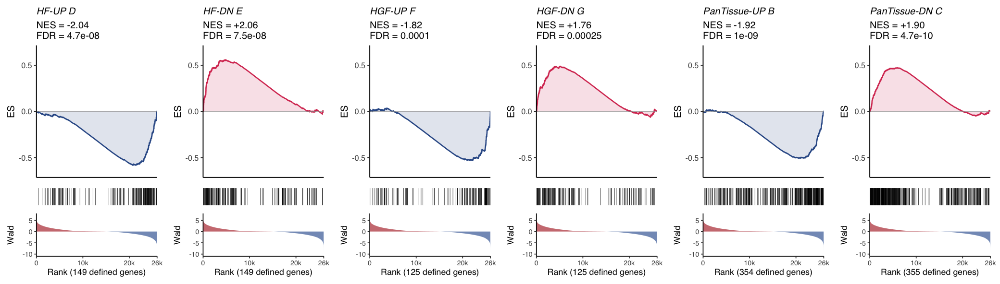

## f — Complete signature overlaps

Numbers are intersection sizes; color is Jaccard similarity. The gray diagonal
contains unique-gene counts and is excluded from the scale. These are complete
definitions, **not leading-edge sets**. PanTissue-UP has 354 unique genes and
PanTissue-DN 355.


```r
# The final S3f contains only full-definition overlap, not leading-edge overlap.
overlap <- expand.grid(a = ordered_signatures, b = ordered_signatures, stringsAsFactors = FALSE)
overlap$n <- mapply(function(a, b) length(intersect(signature_sets[[a]], signature_sets[[b]])), overlap$a, overlap$b)
overlap$jaccard <- mapply(function(a, b) length(intersect(signature_sets[[a]], signature_sets[[b]])) / length(union(signature_sets[[a]], signature_sets[[b]])), overlap$a, overlap$b)
overlap$jaccard[overlap$a == overlap$b] <- NA_real_
overlap$a <- factor(overlap$a, levels = ordered_signatures)
overlap$b <- factor(overlap$b, levels = rev(ordered_signatures))
overlap_plot <- ggplot(overlap, aes(a, b, fill = jaccard)) +
  geom_tile(colour = "white", linewidth = .3) +
  geom_text(aes(label = n), size = 3) +
  scale_fill_gradient(low = "white", high = "#23616D", na.value = "#D2D2D2", name = "Jaccard") +
  scale_x_discrete(labels = final_label) + scale_y_discrete(labels = final_label) + coord_fixed() +
  labs(x = NULL, y = NULL) + theme_figure(9) + theme(axis.text.x = element_text(angle = 45, hjust = 1), axis.line = element_blank(), axis.ticks = element_blank())
```


```r
print(overlap_plot)
```

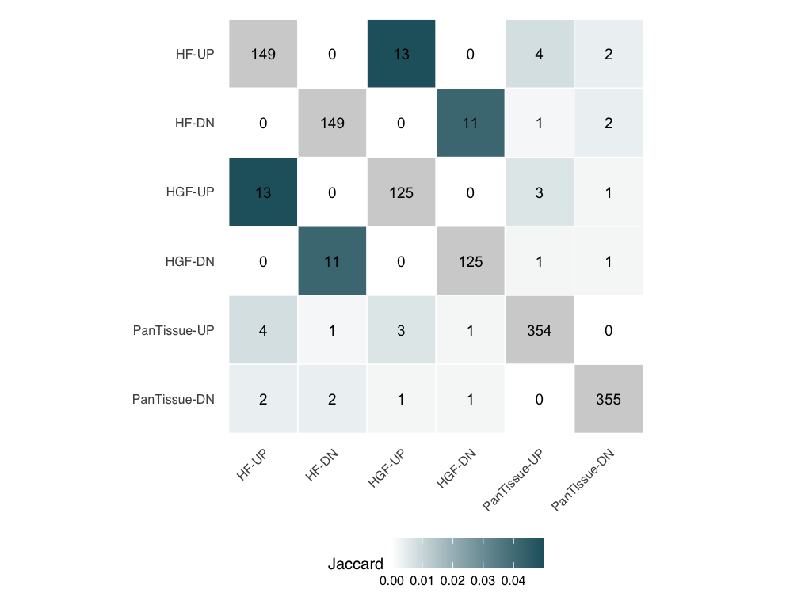

## g — Leave-one-tissue-out sensitivity

Each plot omits one tissue before recalculating the equal-Fisher HF aggregate
and its strict 1% tails. The requirement of five finite tissue coefficients
remains. Only D/E change; B/C/F/G stay fixed, including when gingiva is omitted
from the pan-HF aggregation. This post hoc sensitivity analysis is not a new
signature-selection filter. Stable downstream enrichment does not by itself
imply stable gene membership.

Definitions are recomputed and validated in the signature-analysis code above;
the plot function is shared with main g. Historical NES and multilevel FDR are
reported for all six signatures in each run.


```r
loto_plots <- lapply(definitions$tissues, function(tissue) {
  d <- loto_statistics[loto_statistics$variant == paste0("omit_", tissue), ]
  d$NES <- d$NES_simple
  label <- unname(support$tissue_labels[tissue])
  gsea_plot(d, paste("Omit", label)) + theme_figure(8) +
    theme(axis.text.x = element_blank(), axis.ticks.x = element_blank(), axis.line.x = element_blank())
})
```


```r
grid.arrange(grobs = loto_plots, ncol = 7)
```

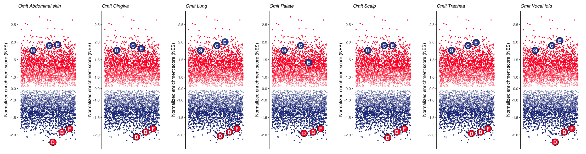

```r
table_show(loto_statistics[, c("variant", "letter", "label", "n_supplied", "n_matched",
  "NES_simple", "pval", "q_global_BH", "q_six_BH")], digits = 9)
```


|variant      |letter |label        | n_supplied| n_matched| NES_simple|pval        |q_global_BH |q_six_BH    |
|:------------|:------|:------------|----------:|---------:|----------:|:-----------|:-----------|:-----------|
|full         |D      |HF-UP        |        149|       149|  -2.040113|7.59860e-10 |4.65883e-08 |1.51972e-09 |
|full         |E      |HF-DN        |        149|       148|   2.061773|1.30518e-09 |7.51435e-08 |1.95777e-09 |
|full         |F      |HGF-UP       |        125|       124|  -1.821168|5.35121e-06 |1.01198e-04 |6.42145e-06 |
|full         |G      |HGF-DN       |        125|       125|   1.763397|1.60642e-05 |2.51957e-04 |1.60642e-05 |
|full         |C      |PanTissue-DN |        355|       351|   1.900731|4.92340e-12 |4.74355e-10 |2.95404e-11 |
|full         |B      |PanTissue-UP |        354|       311|  -1.917397|1.17345e-11 |1.04525e-09 |3.52034e-11 |
|omit_Abs     |D      |HF-UP        |        149|       149|  -2.209432|4.56451e-13 |5.98585e-11 |2.73871e-12 |
|omit_Abs     |E      |HF-DN        |        149|       149|   1.929508|6.62616e-08 |2.33448e-06 |9.93923e-08 |
|omit_Abs     |F      |HGF-UP       |        125|       124|  -1.821168|5.35121e-06 |1.01198e-04 |6.42145e-06 |
|omit_Abs     |G      |HGF-DN       |        125|       125|   1.763397|1.60642e-05 |2.51957e-04 |1.60642e-05 |
|omit_Abs     |C      |PanTissue-DN |        355|       351|   1.900731|4.92340e-12 |4.64867e-10 |1.47702e-11 |
|omit_Abs     |B      |PanTissue-UP |        354|       311|  -1.917397|1.17345e-11 |1.02590e-09 |2.34689e-11 |
|omit_Gingiva |D      |HF-UP        |        149|       149|  -2.059223|3.69430e-10 |2.42233e-08 |7.38860e-10 |
|omit_Gingiva |E      |HF-DN        |        149|       149|   1.816526|1.52353e-06 |3.72673e-05 |2.28529e-06 |
|omit_Gingiva |F      |HGF-UP       |        125|       124|  -1.821168|5.35121e-06 |1.01198e-04 |6.42145e-06 |
|omit_Gingiva |G      |HGF-DN       |        125|       125|   1.763397|1.60642e-05 |2.51957e-04 |1.60642e-05 |
|omit_Gingiva |C      |PanTissue-DN |        355|       351|   1.900731|4.92340e-12 |4.74355e-10 |2.95404e-11 |
|omit_Gingiva |B      |PanTissue-UP |        354|       311|  -1.917397|1.17345e-11 |1.04525e-09 |3.52034e-11 |
|omit_Lung    |D      |HF-UP        |        149|       148|  -2.029671|9.09827e-10 |5.43708e-08 |1.81965e-09 |
|omit_Lung    |E      |HF-DN        |        149|       149|   2.004387|7.47331e-09 |3.42539e-07 |1.12100e-08 |
|omit_Lung    |F      |HGF-UP       |        125|       124|  -1.821168|5.35121e-06 |1.01198e-04 |6.42145e-06 |
|omit_Lung    |G      |HGF-DN       |        125|       125|   1.763397|1.60642e-05 |2.51957e-04 |1.60642e-05 |
|omit_Lung    |C      |PanTissue-DN |        355|       351|   1.900731|4.92340e-12 |4.74355e-10 |2.95404e-11 |
|omit_Lung    |B      |PanTissue-UP |        354|       311|  -1.917397|1.17345e-11 |1.04525e-09 |3.52034e-11 |
|omit_Palate  |D      |HF-UP        |        149|       149|  -1.954114|1.73214e-08 |7.36704e-07 |3.46427e-08 |
|omit_Palate  |E      |HF-DN        |        149|       149|   1.417014|4.71911e-03 |2.20937e-02 |4.71911e-03 |
|omit_Palate  |F      |HGF-UP       |        125|       124|  -1.821168|5.35121e-06 |1.01605e-04 |8.02681e-06 |
|omit_Palate  |G      |HGF-DN       |        125|       125|   1.763397|1.60642e-05 |2.52797e-04 |1.92771e-05 |
|omit_Palate  |C      |PanTissue-DN |        355|       351|   1.900731|4.92340e-12 |4.74355e-10 |2.95404e-11 |
|omit_Palate  |B      |PanTissue-UP |        354|       311|  -1.917397|1.17345e-11 |1.04525e-09 |3.52034e-11 |
|omit_Scalp   |D      |HF-UP        |        149|       149|  -2.079010|1.52420e-10 |1.12433e-08 |3.04840e-10 |
|omit_Scalp   |E      |HF-DN        |        149|       148|   1.900547|1.90910e-07 |6.04889e-06 |2.86365e-07 |
|omit_Scalp   |F      |HGF-UP       |        125|       124|  -1.821168|5.35121e-06 |1.01198e-04 |6.42145e-06 |
|omit_Scalp   |G      |HGF-DN       |        125|       125|   1.763397|1.60642e-05 |2.51957e-04 |1.60642e-05 |
|omit_Scalp   |C      |PanTissue-DN |        355|       351|   1.900731|4.92340e-12 |4.74355e-10 |2.95404e-11 |
|omit_Scalp   |B      |PanTissue-UP |        354|       311|  -1.917397|1.17345e-11 |1.04525e-09 |3.52034e-11 |
|omit_Trachea |D      |HF-UP        |        149|       148|  -1.958678|1.34033e-08 |5.75245e-07 |2.41153e-08 |
|omit_Trachea |E      |HF-DN        |        149|       147|   1.986089|1.60769e-08 |6.77668e-07 |2.41153e-08 |
|omit_Trachea |F      |HGF-UP       |        125|       124|  -1.821168|5.35121e-06 |1.01198e-04 |6.42145e-06 |
|omit_Trachea |G      |HGF-DN       |        125|       125|   1.763397|1.60642e-05 |2.51957e-04 |1.60642e-05 |
|omit_Trachea |C      |PanTissue-DN |        355|       351|   1.900731|4.92340e-12 |4.74355e-10 |2.95404e-11 |
|omit_Trachea |B      |PanTissue-UP |        354|       311|  -1.917397|1.17345e-11 |1.04525e-09 |3.52034e-11 |
|omit_VF      |D      |HF-UP        |        149|       149|  -2.206019|5.37536e-13 |6.99137e-11 |3.22521e-12 |
|omit_VF      |E      |HF-DN        |        149|       148|   2.040021|2.70816e-09 |1.37476e-07 |4.06224e-09 |
|omit_VF      |F      |HGF-UP       |        125|       124|  -1.821168|5.35121e-06 |1.01198e-04 |6.42145e-06 |
|omit_VF      |G      |HGF-DN       |        125|       125|   1.763397|1.60642e-05 |2.51957e-04 |1.60642e-05 |
|omit_VF      |C      |PanTissue-DN |        355|       351|   1.900731|4.92340e-12 |4.64867e-10 |1.47702e-11 |
|omit_VF      |B      |PanTissue-UP |        354|       311|  -1.917397|1.17345e-11 |1.02590e-09 |2.34689e-11 |

## h — Selected regulatory trajectories

Order is p53 (PROGENy), EGFR, MAPK, ELK1 (VIPER), MYC and ATF4. Both control
arms are shown. Error bars/ribbons are mean ± SEM; thick curves retain the
accepted descriptive fits and main-style timepoint display spacing.

The global comparison tests an overall treatment shift controlling for
categorical time and a run random intercept. BH families remain all ten TF-arm
tests or all 28 pathway-arm tests, not just the selected panels. PROGENy
inference is conditional on its preprocessed scores. Boundary random-effect
fits and sensitivity tests are recorded in the complete table. These are
within-donor, model-based results.


```r
activity <- read_input("activity")
activity_order <- c("p53", "EGFR", "MAPK", "ELK1", "MYC", "ATF4")
d <- activity$means
f <- activity$fits
d$feature <- factor(d$feature, levels = activity_order)
f$feature <- factor(f$feature, levels = activity_order)
d$x <- map_time(d$hours)
f$x <- map_time(f$hours)
activity_plot <- ggplot(d, aes(x, mean, group = group, colour = group)) +
  geom_ribbon(aes(ymin = mean - sem, ymax = mean + sem, fill = group), colour = NA, alpha = .12) +
  geom_line(aes(linetype = group), linewidth = .25) +
  geom_line(data = f, aes(x, fitted, linetype = group), linewidth = .85) +
  geom_errorbar(aes(ymin = mean - sem, ymax = mean + sem), width = .12, linewidth = .25) +
  geom_point(size = 1.4) + facet_wrap(~feature, nrow = 1, scales = "free_y") +
  scale_colour_manual(values = arm_colours) + scale_fill_manual(values = arm_colours, guide = "none") +
  scale_linetype_manual(values = arm_lines) +
  scale_x_continuous(breaks = time_positions, labels = paste0("T", 1:6)) +
  labs(x = NULL, y = "Inferred activity (score)", colour = NULL, linetype = NULL) + theme_figure(9)
write.csv(activity$tests, "validation/selected_activity_statistics.csv", row.names = FALSE)
```


```r
print(activity_plot)
```

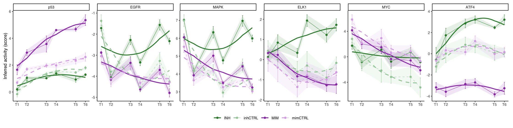

```r
table_show(activity$tests[, c("feature", "arm", "p_global_shift", "family_n", "q_global_shift_BH_panel")], digits = 10)
```


|feature |arm |p_global_shift | family_n|q_global_shift_BH_panel |
|:-------|:---|:--------------|--------:|:-----------------------|
|ELK1    |INH |3.06604e-07    |       10|6.13208e-07             |
|ELK1    |MIM |7.15816e-01    |       10|7.15816e-01             |
|MYC     |INH |2.51798e-05    |       10|4.19663e-05             |
|MYC     |MIM |2.64605e-04    |       10|3.30756e-04             |
|ATF4    |INH |6.15158e-09    |       10|2.05053e-08             |
|ATF4    |MIM |5.10603e-19    |       10|5.10603e-18             |
|p53     |INH |7.13304e-02    |       28|8.68370e-02             |
|p53     |MIM |5.26867e-13    |       28|4.91742e-12             |
|MAPK    |INH |9.05136e-11    |       28|5.06876e-10             |
|MAPK    |MIM |9.69512e-05    |       28|1.80976e-04             |
|EGFR    |INH |2.24631e-06    |       28|6.28967e-06             |
|EGFR    |MIM |5.40876e-01    |       28|5.60909e-01             |

## i — Macrocluster identity markers

Dot area is the fraction of cells expressing each gene; color is the
across-macrogroup z score of `log1p(mean normalized counts)`. Means pool cells
with cell-count weighting rather than averaging subclusters equally. The
131,475 cells in these five macroclasses exclude cycling/myogenic categories;
the UMAP retains all 133,335 cells. Both fibroblast subclusters are combined.
MCAM is retained as a canonical perivascular marker, not claimed as a specific
selection of the original publication.


```r
# Pooled macrocluster summaries retain cell-count weighting.
marker_checkpoint <- readRDS("data/singlecell/marker_dotplot_macro_identity.rds")
markers <- marker_checkpoint$data
markers$macro_group <- factor(markers$macro_group,
  levels = c("SMC / perivascular", "Immune", "Endothelial", "Epithelial", "Fibroblast"))
markers$pct_detected <- 100 * markers$n_detected / markers$n_cells
markers$expression_z <- ave(log1p(markers$mean_normalized_counts), markers$gene,
  FUN = function(x) if (sd(x) > 0) (x - mean(x)) / sd(x) else rep(0, length(x)))
stopifnot(max(abs(markers$expression_z - marker_checkpoint$data$expression_z)) < 1e-10)
marker_order <- unique(markers$gene[order(-markers$gene_y)])
markers$gene <- factor(markers$gene, levels = rev(marker_order))
marker_plot <- ggplot(markers, aes(gene, macro_group)) +
  geom_point(aes(size = pct_detected, colour = expression_z), shape = 16) +
  scale_size_area(max_size = 4, limits = c(0, 100), breaks = c(10, 50, 100), name = "Cells expressing (%)") +
  scale_colour_gradient2(low = "#3B6FA3", mid = "#F2F2F2", high = "#BD3C4A", limits = c(-2.5, 2.5), oob = scales::squish, name = "Expression z score") +
  labs(x = NULL, y = NULL) + theme_figure(9) +
  theme(axis.text.x = element_text(angle = 90, hjust = 1), axis.line = element_blank(), axis.ticks = element_blank())
stopifnot(nrow(cells) == 133335L, nrow(bulk) == 96L,
          sum(unique(markers[, c("macro_group", "n_cells")])[, "n_cells"]) == 131475L)
```


```r
grid.arrange(marker_plot, umap_plot, ncol = 2, widths = c(2.2, 1))
```

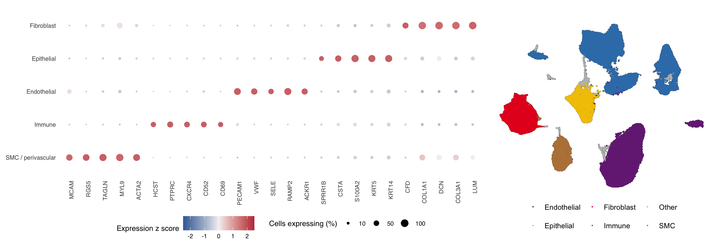

## j — Transcriptome position of miR-29 targets

The y-axis is the percentile of each gene's signed Wald statistic within the
tested transcriptome for that contrast. Higher values mean a more positive
treatment-associated statistic; lower values a more negative statistic. This
is **not expression abundance**. Gray boxes represent background genes and
colored boxes/dots represent targets. The frozen percentile table preserves
the original ranking and target-universe choices.

Inference uses the archived competitive CAMERA-style test with assumed
inter-gene correlation 0.01 and its saved multiple-testing correction, not a
test treating genes as independent biological replicates. Alternative
correlation sensitivity results are retained in the checkpoint.


```r
# Signed-Wald transcriptome percentiles for all tested miR-29 targets.
target_data <- core$data$activity_results$target_ecdf
target_data$time <- as.integer(sub(".*_", "", target_data$condition))
target_data$rank_percentile <- 100 * target_data$percentile
target_data$display <- ifelse(target_data$group == "miR-29 targets", target_data$arm, "Background")
target_data$x <- target_data$time + ifelse(target_data$group == "miR-29 targets", .16, -.16)
target_plot <- ggplot(target_data, aes(x, rank_percentile, group = interaction(time, group), fill = display)) +
  geom_boxplot(width = .27, outlier.shape = NA, linewidth = .25) +
  geom_point(data = subset(target_data, group == "miR-29 targets"), aes(colour = arm),
    position = position_jitter(width = .07, seed = 29030908), size = .16, alpha = .45) +
  facet_wrap(~arm, nrow = 1) +
  scale_fill_manual(values = c(INH = "#C6E2C9", MIM = "#E2CCE9", Background = "#CCCCCC")) +
  scale_colour_manual(values = arm_colours) +
  scale_x_continuous(breaks = 1:6, labels = paste0("T", 1:6)) +
  labs(x = NULL, y = "Relative transcriptome rank (%)") + theme_figure() + theme(legend.position = "none")
target_tests <- subset(core$data$activity_results$target_camera_tests, assumed_correlation == .01)
write.csv(target_tests, "validation/target_CAMERA_statistics.csv", row.names = FALSE)
```


```r
print(target_plot)
```

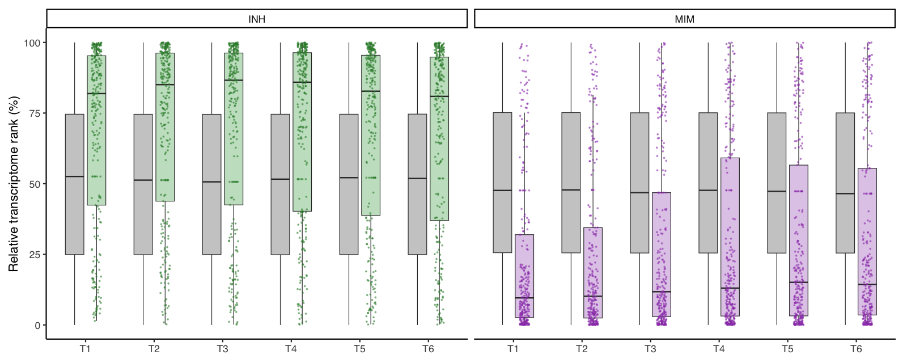

```r
table_show(target_tests, digits = 12)
```


|condition |arm | time| assumed_correlation|direction |p           | n_targets|q           |
|:---------|:---|----:|-------------------:|:---------|:-----------|---------:|:-----------|
|INH_1     |INH |    1|                0.01|Up        |1.89148e-11 |       285|2.06343e-11 |
|INH_2     |INH |    2|                0.01|Up        |3.10401e-15 |       285|5.32116e-15 |
|INH_3     |INH |    3|                0.01|Up        |8.04832e-15 |       285|1.20725e-14 |
|INH_4     |INH |    4|                0.01|Up        |1.40826e-14 |       285|1.87768e-14 |
|INH_5     |INH |    5|                0.01|Up        |3.96027e-12 |       285|4.75232e-12 |
|INH_6     |INH |    6|                0.01|Up        |6.25787e-09 |       285|6.25787e-09 |
|MIM_1     |MIM |    1|                0.01|Down      |6.15371e-44 |       285|7.38445e-43 |
|MIM_2     |MIM |    2|                0.01|Down      |6.09510e-41 |       285|3.65706e-40 |
|MIM_3     |MIM |    3|                0.01|Down      |6.52758e-31 |       285|2.61103e-30 |
|MIM_4     |MIM |    4|                0.01|Down      |9.40586e-28 |       285|2.82176e-27 |
|MIM_5     |MIM |    5|                0.01|Down      |1.53272e-23 |       285|3.67853e-23 |
|MIM_6     |MIM |    6|                0.01|Down      |9.72446e-23 |       285|1.94489e-22 |

# Validation record

Normal rendering stops on a failed numerical assertion. Checks cover partial
correlations; full and omitted-tissue gene membership; all six historical NES;
BH families; matched-control activity matrices and dendrograms; growth means;
DE counts; PCA singular values; and single-cell/marker dimensions.

Machine-readable tables are written to `validation/`; executable modules are
in `code/`. The export script writes newly reconstructed panels to
`figures/reconstructed/`. Frozen stochastic checkpoints remain authoritative
for exact Monte Carlo values; optional replay requires the recorded package
version, seeds, pathway order and parallel backend.


```r
table_show(data.frame(Signature = main_statistics$letter, Genes = main_statistics$n_defined,
  Matched = main_statistics$n_matched, Historical_NES = main_statistics$NES,
  Multilevel_global_FDR = main_statistics$q_multilevel_global_4721), digits = 10)
```


|Signature | Genes| Matched| Historical_NES| Multilevel_global_FDR|
|:---------|-----:|-------:|--------------:|---------------------:|
|B         |   354|     311|      -1.917397|          0.0000000010|
|C         |   355|     351|       1.900731|          0.0000000005|
|D         |   149|     149|      -2.040113|          0.0000000466|
|E         |   149|     148|       2.061773|          0.0000000751|
|F         |   125|     124|      -1.821168|          0.0001011982|
|G         |   125|     125|       1.763397|          0.0002519574|

## Approved layout references

These are the user-supplied final layouts, separate from the analytical
reconstructions above; they preserve the final panel selection and artwork.

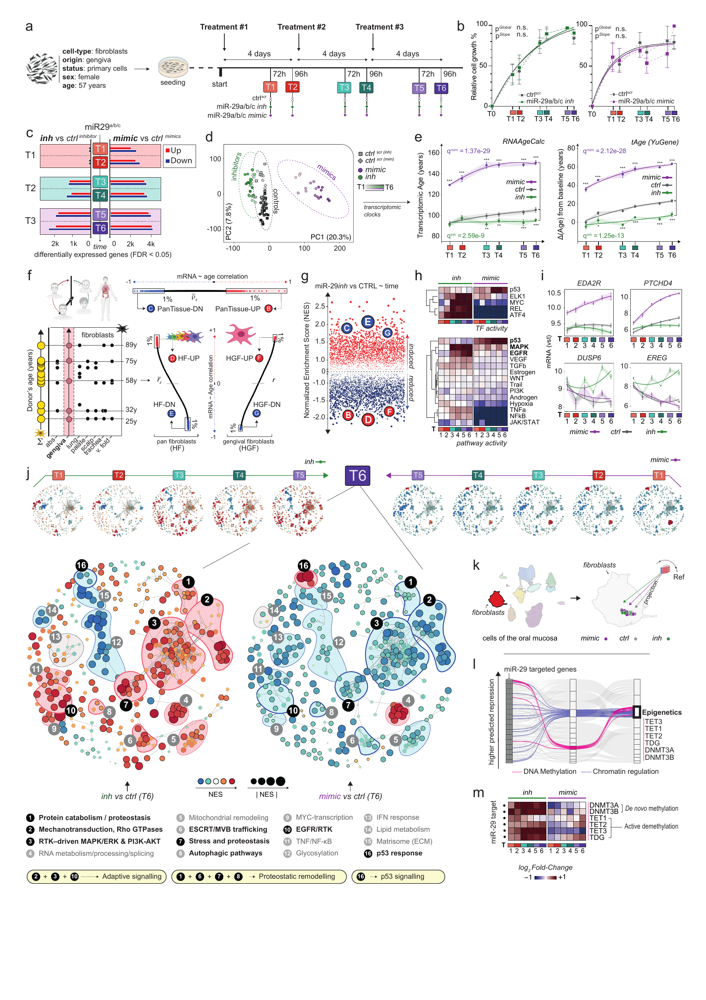

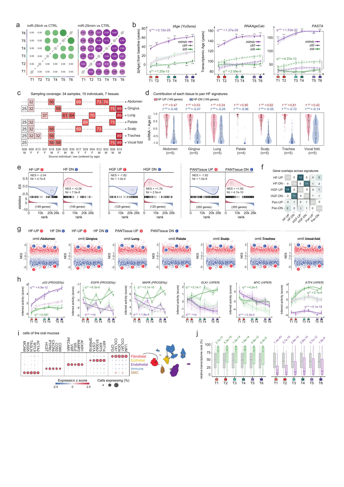

## Software session


```r
sessionInfo()
```

```
## R version 4.2.3 (2023-03-15)
## Platform: x86_64-apple-darwin17.0 (64-bit)
## Running under: macOS Big Sur ... 10.16
## 
## Matrix products: default
## BLAS:   /Library/Frameworks/R.framework/Versions/4.2/Resources/lib/libRblas.0.dylib
## LAPACK: /Library/Frameworks/R.framework/Versions/4.2/Resources/lib/libRlapack.dylib
## 
## locale:
## [1] C.UTF-8/C.UTF-8/C.UTF-8/C/C.UTF-8/C.UTF-8
## 
## attached base packages:
## [1] grid      stats     graphics  grDevices utils     datasets  methods   base     
## 
## other attached packages:
## [1] lmerTest_3.1-3 lme4_1.1-33    Matrix_1.5-3   gridExtra_2.3  ggplot2_3.5.1 
## 
## loaded via a namespace (and not attached):
##  [1] circlize_0.4.15     shape_1.4.6         minpack.lm_1.2-4    tidyselect_1.2.0   
##  [5] xfun_0.41           bslib_0.9.0         purrr_1.0.1         splines_4.2.3      
##  [9] lattice_0.20-45     colorspace_2.1-0    vctrs_0.6.5         generics_0.1.3     
## [13] htmltools_0.5.9     mgcv_1.8-42         yaml_2.3.7          utf8_1.2.3         
## [17] rlang_1.1.4         jquerylib_0.1.4     pillar_1.9.0        nloptr_2.0.3       
## [21] glue_1.6.2          withr_2.5.0         tweenr_2.0.2        RColorBrewer_1.1-3 
## [25] matrixStats_0.63.0  lifecycle_1.0.3     gtable_0.3.6        ggalluvial_0.12.5  
## [29] GlobalOptions_0.1.2 evaluate_0.20       labeling_0.4.2      knitr_1.42         
## [33] fastmap_1.2.0       fansi_1.0.4         highr_0.10          Rcpp_1.0.10        
## [37] scales_1.4.0        cachem_1.1.0        jsonlite_1.8.4      farver_2.1.1       
## [41] ggforce_0.4.1       digest_0.6.31       dplyr_1.1.4         numDeriv_2016.8-1.1
## [45] polyclip_1.10-4     cowplot_1.1.1       cli_3.6.1           tools_4.2.3        
## [49] magrittr_2.0.3      sass_0.4.9          tibble_3.2.1        tidyr_1.3.0        
## [53] pkgconfig_2.0.3     MASS_7.3-58.2       minqa_1.2.5         rmarkdown_2.21     
## [57] R6_2.5.1            boot_1.3-28.1       nlme_3.1-162        compiler_4.2.3
```
