> **Repository snapshot — input bundle pending.** This chapter preserves the existing analytical narrative, code and rendered outputs. References below to bundled input data describe the full analytical bundle, not this lightweight repository snapshot. Required inputs are not yet fully distributed here, so a fresh clone cannot regenerate the analysis. See [module instructions](README.md).

# Current statistical annotations — 9 October 2026

The active reconstruction uses the **123-CpG fibroblast reference**, selected with an external fibroblast-contrast BH q threshold of 0.20 and the effect-size/stability criteria below. Its [reference and annotations](data/fidelity123/HGF123_reference.tsv), primary-HGF inputs *(not included in this source snapshot)*, and hTERT inputs *(not included in this source snapshot)* are included in this standalone bundle. Panel 4o and its statistics are regenerated from these inputs; historical 43-CpG results are not used as current results.

Clock curves display **global q values only**, without individual-timepoint asterisks. Main-panel pooled-control comparisons and supplementary matched-control comparisons are identified explicitly in both plots and tables. Figure 4l is unchanged. `CURRENT_STATISTICAL_LABELS.tsv` provides unrounded values and test/comparator definitions. In panel 4o, q = 0.025 tests the average inhibitor-minus-matched-control distance over T1–T6, **not** a temporal slope or treatment-by-time interaction.

| Panel | Endpoint | Arm | Controls | Global/endpoint q |
|---|---|---|---|---:|
| 4d | Global methylation | INH | pooled | 0.00064515 |
| S4a | Global methylation | INH | matched | 0.012547 |
| 4d | Global methylation | MIM | pooled | 0.25638 |
| S4a | Global methylation | MIM | matched | 0.4851 |
| 4f | entropy | INH | pooled | 8.7678e-05 |
| 4f legend matched comparator | entropy | INH | matched | 0.011887 |
| 4f | entropy | MIM | pooled | 0.038153 |
| 4f legend matched comparator | entropy | MIM | matched | 0.011887 |
| 4f | FAE | INH | pooled | 0.0001862 |
| 4f legend matched comparator | FAE | INH | matched | 0.011887 |
| 4f | FAE | MIM | pooled | 0.097594 |
| 4f legend matched comparator | FAE | MIM | matched | 0.021957 |
| 4i right | Skin & Blood | INH | pooled | 0.00010235 |
| S4c | Skin & Blood | INH | matched | 0.0013268 |
| 4i right | Skin & Blood | MIM | pooled | 0.018476 |
| S4c | Skin & Blood | MIM | matched | 0.01601 |
| 4j right | RetroAge | INH | pooled | 3.6398e-14 |
| S4e | RetroAge | INH | matched | 3.7951e-10 |
| 4j right | RetroAge | MIM | pooled | 0.0029373 |
| S4e | RetroAge | MIM | matched | 0.00058328 |
| S4d | CausAge | INH | matched | 0.00023117 |
| S4d | CausAge | MIM | matched | 0.031412 |
| S4d | DamAge | INH | matched | 0.00071491 |
| S4d | DamAge | MIM | matched | 0.32948 |
| S4d | AdaptAge | INH | matched | 0.0033144 |
| S4d | AdaptAge | MIM | matched | 0.10837 |
| S4k | RNAAgeCalc | INH | matched | 0.0025459 |
| S4k | RNAAgeCalc | MIM | matched | 1.3026e-08 |
| S4k | tAge | INH | matched | 1.3609e-05 |
| S4k | tAge | MIM | matched | 3.5617e-10 |
| S4k | PASTA | INH | matched | 1.5892e-06 |
| S4k | PASTA | MIM | matched | 1.5652e-12 |
| 4o centre | Reference distance, mean T1–T6 | INH | matched | 0.025263 |
| 4o centre | Reference distance, mean T1–T6 | MIM | matched | 0.89538 |
| 4o right | Reference distance, mean T5–T6 | INH | matched | 0.013162 |
| 4o right | Reference distance, mean T5–T6 | MIM | matched | 0.42385 |
| Cross-model reference check | hTERT reference distance, final cycle | INH | matched | 0.040926 |
| Cross-model reference check | hTERT reference distance, final cycle | MIM | matched | 0.40590 |

# Scope and execution

This document accompanies the final **Figure 4 and Figure S4**. It reconstructs
the evidence for extensive, directional methylome remodeling in primary human
gingival fibroblasts (HGF) following miR-29 inhibition, despite lower values of
several epigenetic clocks. It distinguishes a clock-decreasing score from a
balanced reversal of age-associated methylation, examines pre-existing temporal
trajectories, and measures departure from an externally defined fibroblast
reference. Figure S4 adds control-resolved curves, CHIR-responsive loci,
immortalized hTERT HGF, and persistence after inhibitor withdrawal in HPF.

The approved Illustrator layouts are preserved unchanged in `reference/`.
Every **analytical plot** below is newly drawn by the displayed code from the
bundled numerical inputs. Page composition, cell illustrations and experimental
schematics remain editorial artwork. Those exceptions are identified explicitly;
an image of a published plot is never substituted for its analytical reconstruction.

Open `Figure4_main_plus_supplementary.Rproj` in RStudio and knit this file, or run:


```r
source("render_figure4_and_s4.R")
# Recalculate panel-level summaries/statistics and export plots without HTML:
source("run_figure4_and_s4_in_RStudio.R")
```

Setup executes the clean modules once. The code blocks in each section are read
from those same executable files, so the displayed code cannot drift into a
separate, nonfunctional transcription. Supplementary sections include code as
well as figures. Paths are relative to the bundle root. No automatic package
installation, data download, clock training or genome-wide model fitting occurs
during knitting.

## Reproduction boundary and input provenance

The supported starting point is a set of **frozen, verified analytical
checkpoints**, not the raw IDAT files. These include sample metadata; limma
temporal statistics/counts; per-sample methylome summaries; fitted global-mean
contrasts; calibrated clock inputs and coefficients; the 123-CpG beta matrices and
external-reference centroid; external selection audits; DMRcate calls with local
beta values; hTERT RNA counts, preprocessing and prediction inputs; and HPF
selection/retention checkpoints.

Small computations are rerun: clock linear predictors, AUC contributions,
matched-control reference scores, DKK2 regional responses/interactions, hTERT
CAMERA, HPF projection checks, and panel-level statistical tests. PCA and
methylation-walk coordinates and genome-wide DMR/DMP discovery are replayed
from their audited checkpoints. Their algorithms and upstream recipes are
documented, but their original large input matrices are not silently reloaded.

`provenance/input_sources.tsv` records original locations, file sizes and MD5
checksums. `provenance/bundle_checksums.tsv` inventories the delivered code,
data and reference assets. `validation/` records numerical checks and the
software environment. Historical source scripts are segregated in
`provenance/`; they are not an alternative executable entry point.

| Analysis | Input scale / resolution | Batch handling |
|:--|:--|:--|
| Genome-wide temporal DMPs and slope geometry | Historical noncollapsed assay-level M-value limma results | Historical model retained; ordinal time retained |
| PCA and methylation walk | Batch-adjusted noncollapsed M values | Sequential correction protecting the biological design |
| Global mean methylation | Raw beta, replicate probes collapsed by base CpG | Run included in the statistical model, not removed from the raw matrix |
| Entropy, FAE, compartment and repeat summaries | Adjusted noncollapsed beta | Historical adjusted matrix; run retained in relevant panel-level tests |
| Skin & Blood and causal clocks | Adjusted collapsed beta | Frozen preprocessing/calibration; pooled controls in 4i, matched controls in S4c/d |
| RetroAge | Adjusted noncollapsed beta with EPIC v2 assay IDs | Frozen preprocessing; pooled controls in 4j, matched controls in S4e |
| 123-CpG fibroblast reference | Raw collapsed beta | Same-run, same-time, same-arm control subtraction |
| CHIR-responsive loci | Frozen DMRcate discovery plus local beta measurements | Biological experiment in discovery design; complete matched experiments for displays/tests |

Collapsing beta and then converting to M is not generally identical to collapsing
M values. This reconstruction preserves the historical choice in each analysis;
it does not replace the source results with a different preprocessing pipeline.
Counts of noncollapsed assay features must not be interpreted as counts of unique
base CpGs or genes.

## Experimental units and time

The classic primary-HGF experiment contains separate inhibitor and mimic arms,
each with its own matched scramble controls and three biological experimental
runs. There are six timepoints per condition, giving 72 samples in total.
T1–T6 correspond to 72, 96, 168, 192, 264 and 288 hours. Display positions
`1, 2, 4, 5, 7, 8` preserve the paired timepoint blocks in ordinal plots; these
positions are **not hours**. Historical genome-wide models use ordinal time.
The clock decomposition integrates over actual hours. Statistical curve tests
use categorical time unless explicitly stated otherwise.

For the 123-CpG cycle display, T1+T2, T3+T4 and T5+T6 are averaged **within each
biological experiment first**. Their actual-time midpoints are 84, 180 and
276 hours. Six late observations therefore represent three experiment means,
not six independent replicates.

## Statistical conventions

All tests are two-sided unless explicitly specified otherwise. Current annotations use pooled-control results where the main panel displays pooled controls (4d, 4f and the clock curves in 4i/j), and matched-control results in the corresponding control-resolved supplementary panels. Both results remain available; the comparator is stated explicitly. Figure 4l and its annotation convention are unchanged. CURRENT_STATISTICAL_LABELS.tsv maps every updated value to its displayed panel and comparator.

- Global methylation and CTRL-selected mover curves: treatment-by-categorical-time
  interaction, allowing a constant treatment offset; Kenward–Roger F test.
- Epigenetic clocks: average treatment offset controlling categorical time,
  with a random intercept for experimental run; Kenward–Roger F test. A separate
  time-interaction result is provided, not chosen according to significance.
- T6 entropy/FAE: mixed-model contrasts with run accounted for. Figure 4f uses
  pooled controls, with matched-control q values also reported in its legend.
- The 123-CpG reference: two-sided one-sample t tests on three experiment-level
  matched differences per arm. The centre-panel test averages T1–T6 within
  experiment; the late test averages T5 and T6 within experiment. The hTERT
  final-cycle test uses three matched differences at 96 h after cycle 3.
  Whole-series means, AUCs and temporal slopes are distinct estimands.
- DKK2: one-sample t test on three paired factorial contrasts,
  `(INH+CHIR − CHIR) − (INH − CTRL)`, on the beta scale.
- HPF retention and scatterplots: descriptive projection measures. Their
  envelope is a range across nested feature universes, **not** a biological
  SEM or confidence interval.

The retained BH families are: two arms for each global
epigenetic-clock comparison; 12 timepoint contrasts per epigenetic clock;
two global-methylation interactions; four entropy/FAE contrasts; four
CTRL-mover interactions; two reference-distance tests separately for each
endpoint and cellular model; two nested DKK2 region tests. hTERT RNA-clock inference retains its
historical four-test family per clock (two arms × shift/interaction), with
six timepoint tests per clock. Alternative inferential conventions are labelled
as sensitivities rather than substituted post hoc.

Nominal p and adjusted q are both reported. A nominal p below 0.05 with q above
0.05 is not labelled FDR-significant. The two-arm test family is not narrowed
after looking at the results. Singular mixed-model fits are recorded in the
diagnostic tables; small biological sample sizes remain an inferential limitation.

## Shared display code

Colors, typography, ordinal positions, mean/SEM summaries and quadratic
descriptive clock curves are shared across main and supplementary panels.
Unless a panel specifies otherwise, a shaded clock ribbon interpolates the
pointwise mean ± SEM; it is not the confidence interval of the fitted polynomial.
Controls have open points and solid error bars; only their curves/connecting
lines are dashed.


```r
# Shared configuration. Run from the bundle root, never from the source archive.
suppressPackageStartupMessages({
  library(ggplot2); library(dplyr); library(tidyr); library(cowplot)
})
COLORS <- c(CTRL = "#686868", INH = "#248636", MIM = "#923d8e",
            CHIR = "#427DB5", COMBO = "#C57B2D")
CS <- c(INH = "#248636", inhCTRL = "#A8CDAE", MIM = "#923D8E",
        mimCTRL = "#D4ADCE", CTRL = "#686868")
TP_COLORS <- c("#e47c64", "#d02d18", "#2fb5b5", "#00736d", "#9881ba", "#56338a")
ORDINAL_X <- c(1, 2, 4, 5, 7, 8)
HOURS <- c(72, 96, 168, 192, 264, 288)
panels <- list()
for (d in c("figures/reconstructed", "tables", "validation"))
  dir.create(d, recursive = TRUE, showWarnings = FALSE)
theme_figure <- function(size = 10) {
  theme_classic(base_size = size, base_family = "Helvetica") +
    theme(plot.title = element_text(size = size, face = "bold"),
          legend.title = element_blank(), strip.background = element_blank(),
          strip.text = element_text(face = "bold"), legend.position = "bottom")
}
theme_set(theme_figure())
base_probe <- function(ids) sub("_[^_]+$", "", ids)
input <- function(file) readRDS(file.path("data", file))
metadata <- function() input("primary/sample_metadata.rds")
# Optional upstream regeneration requires the original large matrices.
# Normal rendering uses the documented frozen analytical checkpoints.
read_input <- function(file) {
  folder <- Sys.getenv("FIG4_RAW_DATA", unset = "")
  if (!nzchar(folder)) stop("Set FIG4_RAW_DATA to the original matrix directory for upstream recalculation.")
  readRDS(file.path(folder, file))
}
cache <- function(name, calculation) {
  path <- file.path("data/primary", paste0(name, ".rds"))
  if (!file.exists(path)) stop("Missing frozen checkpoint: ", path,
                             ". Restore it or run the documented upstream procedure explicitly.")
  readRDS(path)
}
save_table <- function(x, name) {
  write.table(as.data.frame(x), file.path("tables", paste0(name, ".tsv")),
              sep = "\t", row.names = FALSE, quote = FALSE, na = "NA")
}
save_panel <- function(plot, name, width = 6, height = 4) {
  panels[[name]] <<- plot
  path <- file.path("figures/reconstructed", name)
  ggsave(paste0(path, ".pdf"), plot, width = width, height = height,
         device = cairo_pdf, bg = "white", limitsize = FALSE)
  ggsave(paste0(path, ".png"), plot, width = width, height = height,
         dpi = 160, bg = "white", limitsize = FALSE)
  message("Reconstructed ", name)
  invisible(plot)
}
assert_close <- function(actual, expected, label, tolerance = 1e-8) {
  error <- max(abs(actual - expected), na.rm = TRUE)
  if (!is.finite(error) || error > tolerance) stop(label, ": validation failed (", error, ")")
  cat(label, "\tPASS\t", format(error, digits = 12), "\n",
      file = "validation/numeric_checks.tsv", append = TRUE)
  invisible(TRUE)
}
# Quadratic curves are descriptive. The ribbon interpolates pointwise mean +/-
# SEM, not a regression confidence band. Controls have solid markers/error bars.
trajectory <- function(d, ylab, xpos = ORDINAL_X, title = NULL) {
  d <- as.data.frame(d)
  d$x <- xpos[as.integer(d$TP2)]
  sm <- d %>% group_by(series, x, TP2) %>%
    summarise(mean = mean(score), sem = sd(score) / sqrt(n()), n = n(), .groups = "drop")
  stopifnot(all(sm$n >= 3), !anyNA(sm$sem))
  fitted <- sm %>% group_by(series) %>% group_modify(~ {
    degree <- min(2, nrow(.x) - 1)
    model <- lm(mean ~ poly(x, degree, raw = TRUE), .x)
    grid <- seq(min(.x$x), max(.x$x), length.out = 151)
    data.frame(x = grid, fit = predict(model, data.frame(x = grid)),
               lower = approx(.x$x, .x$mean - .x$sem, grid)$y,
               upper = approx(.x$x, .x$mean + .x$sem, grid)$y)
  }) %>% ungroup()
  ggplot(sm, aes(x, mean, color = series, group = series)) +
    geom_ribbon(data = fitted, aes(x, ymin = lower, ymax = upper, fill = series),
                inherit.aes = FALSE, alpha = .15) +
    geom_line(aes(linetype = series), linewidth = .3, alpha = .6) +
    geom_line(data = fitted, aes(y = fit, linetype = series), linewidth = .85) +
    geom_errorbar(aes(ymin = mean - sem, ymax = mean + sem), width = .14, linewidth = .4) +
    geom_point(aes(shape = series), size = 2.8, stroke = .7) +
    scale_color_manual(values = CS, labels = c(INH = "INH", inhCTRL = "CTRL (INH)",
                                              MIM = "MIM", mimCTRL = "CTRL (MIM)", CTRL = "CTRL")) +
    scale_fill_manual(values = CS, guide = "none") +
    scale_linetype_manual(values = c(INH = 1, MIM = 1, inhCTRL = 2, mimCTRL = 2, CTRL = 2), guide = "none") +
    scale_shape_manual(values = c(INH = 16, MIM = 16, inhCTRL = 1, mimCTRL = 1, CTRL = 1), guide = "none") +
    scale_x_continuous(breaks = xpos, labels = paste0("T", seq_along(xpos))) +
    labs(x = NULL, y = ylab, title = title) + theme_figure()
}
```

# Figure 4 — primary HGF methylome

## a — Methylome PCA

Noncollapsed M values were corrected sequentially for experiment arm and batch
with the time-by-group design protected. The 20,000 highest-variance features
were selected; 19,876 finite features entered the standardized PCA. PC1 and PC2
explain 56.9% and 9.5% of variance. Axis orientation is arbitrary and is fixed
here to the accepted layout. Point shading encodes time; distinct control
symbols distinguish the two experimental arms. Ellipses are descriptive.

The routine reconstruction uses the saved PCA scores and rotation. The cache
calculation shown below records the original matrix-to-PCA algorithm.


```r
# ---- 4a
pca_data <- cache("pca", function() {
  meta <- metadata()
  x <- as.matrix(read_input("pan_mval_all.june2026.RDS"))[, meta$sample, drop = FALSE]
  design <- model.matrix(~ TIME * GROUP, meta)
  x <- limma::removeBatchEffect(x, batch = meta$EXPERIMENT, design = design)
  x <- limma::removeBatchEffect(x, batch = meta$BATCH, design = design)
  variance <- matrixStats::rowVars(x, na.rm = TRUE)
  x <- x[order(variance, decreasing = TRUE)[seq_len(20000)], , drop = FALSE]
  x <- x[rowSums(!is.finite(x)) == 0, , drop = FALSE]
  fit <- prcomp(t(x), center = TRUE, scale. = TRUE)
  percent <- 100 * fit$sdev^2 / sum(fit$sdev^2)
  # A PCA axis sign is arbitrary. Orient INH to the right, as in the artwork.
  scores <- fit$x[, 1:2]
  if (mean(scores[meta$GROUP == "INH", 1]) < mean(scores[meta$GROUP == "MIM", 1])) scores[, 1] <- -scores[, 1]
  list(samples = cbind(meta, scores), percent = percent,
       probes = rownames(x), rotation = fit$rotation[, 1:2])
})
print(pca_data$percent[1:4])
save_table(pca_data$samples, "4a_PCA_scores")
z <- pca_data$samples
low <- c(CTRL = "#ededed", INH = "#B9DAB5", MIM = "#E4C5E0")
high <- c(CTRL = "#515151", INH = "#00736D", MIM = "#841452")
z$fill <- vapply(seq_len(nrow(z)), function(i) colorRampPalette(c(low[z$GROUP[i]], high[z$GROUP[i]]))(6)[z$TP2[i]], character(1))
z$shape <- ifelse(z$GROUP == "CTRL", ifelse(z$EXPERIMENT == "inh", 22, 23), 21)
p <- ggplot(z, aes(PC1, PC2)) +
  stat_ellipse(aes(group = GROUP, color = GROUP), type = "norm", level = .99,
               linewidth = .35, show.legend = FALSE) +
  geom_point(aes(fill = fill, shape = shape), size = 2.2, stroke = .25) +
  scale_fill_identity() + scale_shape_identity() + scale_color_manual(values = COLORS) +
  labs(x = sprintf("PC1 (%.1f%%)", pca_data$percent[1]),
       y = sprintf("PC2 (%.1f%%)", pca_data$percent[2])) + theme_figure() +
  theme(aspect.ratio = .6)
save_panel(p, "4a_PCA", 5.2, 3.6)
```
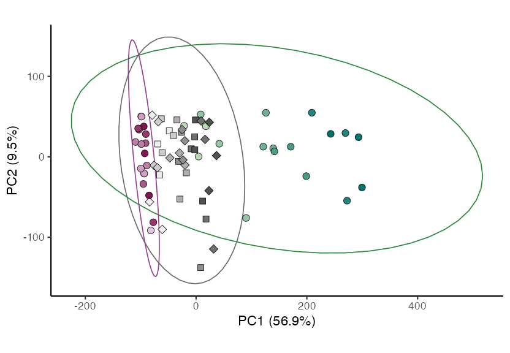

## b — Time-resolved differentially methylated probes

This panel uses the final historical **temporal-subset** procedure, not an
earlier unrestricted contrast table. Within each condition, probes were selected
by the temporal limma model at BH q < 0.05. For each comparison with CTRL at T1,
BH adjustment was then recomputed **within that selected set**. Positive and
negative effects are counted separately. Thus this is a data-selected testing
family, not an independently controlled genome-wide FDR for each bar.

The temporal sets contain 23,072 CTRL, 160,996 INH and zero MIM assay probes.
The hypo and hyper halves have separate scales, as in the accepted artwork;
bar lengths must not be compared across the two halves without reading the axes.


```r
# ---- 4b
# unrestricted panT1 count table in the same file.
# 1. Select temporal probes within each condition using Time BH < .05.
# 2. For each timepoint-vs-CTRL-T1 contrast, recompute BH only within that set.
# 3. Count positive/negative effects at this restricted BH < .05.
# This is a historical, data-selected test family, NOT genome-wide FDR.
counts <- cache("panel_b_historical_restricted_counts", function() {
  r <- read_input("methy_res.notcollapsed_2026.RDS")
  sets <- lapply(r$Time, function(z) rownames(z)[which(z$adj.P.Val < .05)])
  out <- bind_rows(lapply(names(r$panT1C), function(nm) {
    group <- toupper(sub(".*\\.", "", nm)); if (group == "CTR") group <- "CTRL"
    ids <- sets[[paste0("TIME_", tolower(group))]]
    z <- r$panT1C[[nm]][ids, , drop = FALSE]
    q <- p.adjust(z$P.Value, "BH")
    data.frame(GROUP = group, TP2 = as.integer(sub(".*T([1-6])vs.*", "\\1", nm)),
               n_temporal_set = length(ids), hyper = sum(q < .05 & z$logFC > 0, na.rm = TRUE),
               hypo = sum(q < .05 & z$logFC < 0, na.rm = TRUE))
  }))
  bind_rows(out, data.frame(GROUP = "CTRL", TP2 = 1, n_temporal_set = length(sets$TIME_ctrl), hyper = 0, hypo = 0))
})
save_table(counts, "panel_b_historical_temporal_subset_counts")
print(counts)
z <- counts %>% pivot_longer(c(hyper, hypo), names_to = "direction", values_to = "n") %>%
  mutate(GROUP = factor(GROUP, c("CTRL", "INH", "MIM")),
         y = 7 - TP2 + c(CTRL = .20, INH = 0, MIM = -.20)[GROUP])
parts <- lapply(c("hypo", "hyper"), function(direction) {
  p <- ggplot(z[z$direction == direction, ], aes(n, y, fill = GROUP)) +
    geom_col(orientation = "y", width = .17, color = "#444444", linewidth = .2) +
    scale_fill_manual(values = COLORS) + scale_y_continuous(breaks = 1:6, labels = paste0("T", 6:1)) +
    labs(x = if (direction == "hypo") "Hypomethylated" else "Hypermethylated", y = NULL) +
    theme_figure() + theme(legend.position = "none")
  if (direction == "hypo") p <- p + scale_x_reverse(labels = scales::label_number(scale = 1e-3, suffix = "k"))
  else p <- p + scale_x_continuous(labels = scales::label_number(scale = 1e-3, suffix = "k")) + theme(axis.text.y = element_blank(), axis.ticks.y = element_blank())
  p
})
save_panel(cowplot::plot_grid(plotlist = parts, nrow = 1, align = "h"), "4b_temporal_DMP_counts", 4.4, 3.5)
```
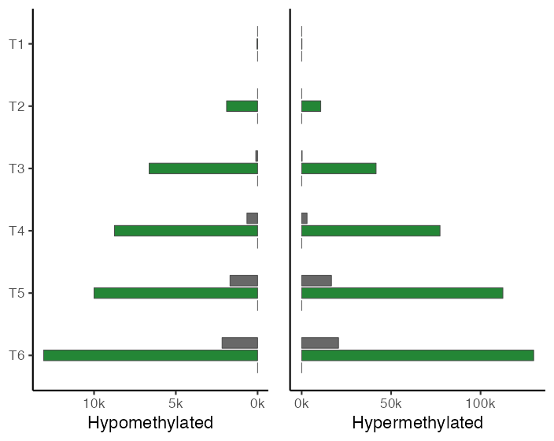

## c — Total temporal DMPs and directional imbalance

Genome-wide temporal limma results are thresholded at their saved BH q < 0.05.
Hyper/hypomethylation refers to the sign of the ordinal-time coefficient.
The stacked bars show counts; the adjacent ratio is hyper divided by hypo.
No ratio is calculated for the zero-DMP mimic set. These are noncollapsed
assay-probe counts, not distinct genomic-region counts.


```r
# ---- 4c
r <- list(counts = input("primary/limma_contrast_counts.rds"))
d <- subset(r$counts, section == "Time")
d$GROUP <- c("CTRL", "INH", "MIM")[match(d$contrast, c("TIME_ctrl", "TIME_inh", "TIME_mim"))]
d$total <- d$hyper + d$hypo; d$ratio <- ifelse(d$hypo > 0, d$hyper / d$hypo, NA)
save_table(d, "panel_c_temporal_DMP_totals")
bars <- d %>% pivot_longer(c(hyper, hypo), names_to = "direction", values_to = "count")
p1 <- ggplot(bars, aes(count, factor(GROUP, c("MIM", "INH", "CTRL")), fill = direction)) +
  geom_col(width = .65, position = position_stack(reverse = TRUE)) +
  scale_fill_manual(values = c(hyper = "#DC3237", hypo = "#4878BA")) +
  geom_text(data = d, aes(total, GROUP, label = format(total, big.mark = ",")),
            inherit.aes = FALSE, hjust = -.15, size = 3) +
  scale_x_continuous(expand = expansion(mult = c(0, .3))) +
  labs(x = "DMPs", y = NULL) + theme_figure()
p2 <- ggplot(subset(d, is.finite(ratio)), aes(ratio, factor(GROUP, c("MIM", "INH", "CTRL")), color = GROUP)) +
  geom_segment(aes(x = 1, xend = ratio, yend = GROUP), linewidth = .45) +
  geom_point(size = 2) + geom_text(aes(label = sprintf("%.1fx", ratio)), hjust = -.3, size = 3) +
  scale_color_manual(values = COLORS) + scale_x_log10(limits = c(.9, 20)) +
  labs(x = "Hyper / hypo", y = NULL) + theme_figure() + theme(legend.position = "none")
save_panel(cowplot::plot_grid(p1, p2, nrow = 1, rel_widths = c(3, 1)), "4c_temporal_DMP_summary", 5.5, 2.2)
```
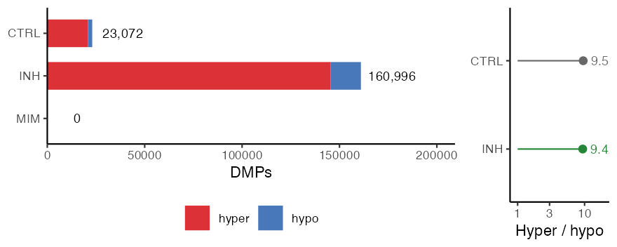

|GROUP |  hyper|  hypo|  total|  ratio|
|:-----|------:|-----:|------:|------:|
|CTRL  |  20884|  2188|  23072| 9.5448|
|INH   | 145483| 15513| 160996| 9.3781|
|MIM   |      0|     0|      0|     NA|

## d — Global methylation change

Replicate probes are collapsed by averaging available **raw beta** values at
each base CpG. Complete features are retained before computing the sample mean.
A mixed model estimates condition-by-time means with experimental run as a
random intercept. Each condition is contrasted with its own T1 baseline;
the two control arms are equally combined only for the main display.

The vertical scale is 1,000 × delta mean beta, not percent methylation. Error bars and shading are model-based 90% confidence intervals for those contrasts. The curve is a descriptive quadratic; the inferential test evaluates the treatment-by-time interaction, allowing a constant treatment offset. Figure 4d uses pooled-control q values; S4a resolves the two control trajectories and uses matched-control q values.


```r
# Historical mixed-model functions, unchanged apart from formatting.
build_delta_contrasts <- function(emm_grid, time_values, baseline_time_hours) {
    emm_grid_df <- as.data.frame(emm_grid@grid)
    emm_grid_df$mGROUP <- as.character(emm_grid_df$mGROUP)
    emm_grid_df$TIME_factor <- as.character(emm_grid_df$TIME_factor)
    baseline_label <- as.character(baseline_time_hours)
    contrast_list <- list()
    add_weight <- function(weight_vector, group_name, time_label, weight_value) {
        matching_index <- which(emm_grid_df$mGROUP == group_name & emm_grid_df$TIME_factor == time_label)
        if (length(matching_index) != 1) {
            stop("Could not uniquely identify ", group_name, " at time ", time_label, ".")
        }
        weight_vector[matching_index] <- weight_vector[matching_index] + weight_value
        weight_vector
    }
    nonbaseline_times <- time_values[time_values != baseline_time_hours]
    for (current_time in nonbaseline_times) {
        current_label <- as.character(current_time)
        ctrl_weights <- rep(0, nrow(emm_grid_df))
        ctrl_weights <- add_weight(ctrl_weights, "inh_CTRL", current_label, 0.5)
        ctrl_weights <- add_weight(ctrl_weights, "inh_CTRL", baseline_label, -0.5)
        ctrl_weights <- add_weight(ctrl_weights, "mim_CTRL", current_label, 0.5)
        ctrl_weights <- add_weight(ctrl_weights, "mim_CTRL", baseline_label, -0.5)
        contrast_list[[paste("CTRL", current_time, sep = "__")]] <- ctrl_weights
        inhibitor_weights <- rep(0, nrow(emm_grid_df))
        inhibitor_weights <- add_weight(inhibitor_weights, "inh_INH", current_label, 1)
        inhibitor_weights <- add_weight(inhibitor_weights, "inh_INH", baseline_label, -1)
        contrast_list[[paste("Inhibitor", current_time, sep = "__")]] <- inhibitor_weights
        mimic_weights <- rep(0, nrow(emm_grid_df))
        mimic_weights <- add_weight(mimic_weights, "mim_MIM", current_label, 1)
        mimic_weights <- add_weight(mimic_weights, "mim_MIM", baseline_label, -1)
        contrast_list[[paste("Mimic", current_time, sep = "__")]] <- mimic_weights
    }
    contrast_list
} 

fit_own_baseline_metric <- function(data, metric_name) {
    data_metric <- data[is.finite(data[[metric_name]]), , drop = FALSE]
    observed_cells <- table(data_metric$mGROUP, data_metric$TIME_factor)
    if (any(observed_cells == 0)) {
        stop("At least one mGROUP × TIME combination is missing for ", metric_name, ".")
    }
    factor_formula <- stats::as.formula(paste0(metric_name, " ~ mGROUP * TIME_factor"))
    numeric_formula <- stats::as.formula(paste0(metric_name, " ~ mGROUP * TIME_FROM_T1_DAYS"))
    fit_factor <- nlme::lme(fixed = factor_formula, random = ~1 | BLOCK, data = data_metric, method = "REML", 
        na.action = stats::na.omit, control = nlme::lmeControl(opt = "optim", maxIter = 300, msMaxIter = 300, 
            returnObject = TRUE))
    fit_numeric <- nlme::lme(fixed = numeric_formula, random = ~1 | BLOCK, data = data_metric, method = "ML", 
        na.action = stats::na.omit, control = nlme::lmeControl(opt = "optim", maxIter = 300, msMaxIter = 300, 
            returnObject = TRUE))
    emm_full <- emmeans::emmeans(fit_factor, specs = ~mGROUP * TIME_factor, weights = "equal")
    delta_contrast_list <- build_delta_contrasts(emm_grid = emm_full, time_values = time_values, baseline_time_hours = baseline_time_hours)
    delta_contrast_object <- emmeans::contrast(emm_full, method = delta_contrast_list, adjust = "none")
    delta_df <- as.data.frame(confint(delta_contrast_object, level = confidence_level))
    lower_column <- intersect(c("lower.CL", "asymp.LCL"), colnames(delta_df))[1]
    upper_column <- intersect(c("upper.CL", "asymp.UCL"), colnames(delta_df))[1]
    if (is.na(lower_column) || is.na(upper_column)) {
        stop("Could not identify confidence interval columns for ", metric_name, ".")
    }
    delta_df$lower.CL <- delta_df[[lower_column]]
    delta_df$upper.CL <- delta_df[[upper_column]]
    parsed_names <- strsplit(as.character(delta_df$contrast), "__", fixed = TRUE)
    delta_df$GROUP <- vapply(parsed_names, function(x) {
        x[1]
    }, character(1))
    delta_df$TIME_HOURS <- as.numeric(vapply(parsed_names, function(x) {
        x[2]
    }, character(1)))
    delta_df <- delta_df %>% dplyr::mutate(GROUP = factor(GROUP, levels = plot_group_levels), metric = metric_name) %>% 
        dplyr::select(GROUP, TIME_HOURS, estimate, SE, df, lower.CL, upper.CL, metric)
    baseline_rows <- tibble::tibble(GROUP = factor(plot_group_levels, levels = plot_group_levels), TIME_HOURS = baseline_time_hours, 
        estimate = 0, SE = 0, df = NA_real_, lower.CL = 0, upper.CL = 0, metric = metric_name)
    trajectory_df <- dplyr::bind_rows(baseline_rows, delta_df) %>% dplyr::arrange(GROUP, TIME_HOURS)
    slope_emmeans <- emmeans::emtrends(fit_numeric, specs = ~mGROUP, var = "TIME_FROM_T1_DAYS")
    slope_methods <- list(`Inhibitor vs matched CTRL` = c(-1, 1, 0, 0), `Mimic vs matched CTRL` = c(0, 
        0, -1, 1))
    slope_contrasts <- emmeans::contrast(slope_emmeans, method = slope_methods, adjust = "none")
    slope_contrast_df <- as.data.frame(summary(slope_contrasts, infer = c(TRUE, TRUE), level = confidence_level, 
        adjust = "none"))
    list(metric = metric_name, fit_factor = fit_factor, fit_numeric = fit_numeric, emm_full = emm_full, 
        delta_contrast_object = delta_contrast_object, trajectory = trajectory_df, slope_emmeans = slope_emmeans, 
        slope_contrasts = slope_contrast_df)
}
```

```r
# ---- 4d
# historical actual-time mixed model and its 90% confidence intervals.
source("code/upstream/lib_global_methylation.R")
baseline_time_hours <- 72
time_values <- c(72, 96, 168, 192, 264, 288)
confidence_level <- .90
plot_group_levels <- c("CTRL", "Inhibitor", "Mimic")
sample_global_metrics <- cache("global_raw_collapsed_metrics", function() {
  b <- as.matrix(read_input("pan_beta_all.june2026.RDS"))
  ids <- base_probe(rownames(b))
  # Mean of available replicate probes, on beta scale (not inverse-logit of M).
  sums <- rowsum(replace(b, is.na(b), 0), ids, reorder = FALSE)
  counts <- rowsum(1L * !is.na(b), ids, reorder = FALSE)
  b <- sums / counts
  rm(sums, counts); gc()
  complete <- rowSums(is.finite(b)) == ncol(b)
  x <- b[complete, , drop = FALSE]
  saveRDS(list(n_collapsed = nrow(b), n_complete = sum(complete),
               retained_probes = rownames(x)), "data/primary/global_mean_probe_universe.rds")
  meta <- metadata()
  out <- data.frame(sample = colnames(x), mean_beta = colMeans(x))
  out <- left_join(out, meta, by = "sample")
  out$mGROUP <- factor(out$mGROUP, c("inh_CTRL", "inh_INH", "mim_CTRL", "mim_MIM"))
  out$TIME_HOURS <- out$TP3
  out$TIME_factor <- factor(out$TP3, levels = time_values)
  out$TIME_FROM_T1_DAYS <- (out$TP3 - 72) / 24
  out$BLOCK <- interaction(out$EXPERIMENT, out$BATCH, drop = TRUE)
  out
})
fit <- cache("global_mean_mixed_model", function() fit_own_baseline_metric(sample_global_metrics, "mean_beta"))
save_table(sample_global_metrics, "panel_d_sample_metrics")
save_table(fit$trajectory, "panel_d_model_adjusted_delta_beta")
save_table(fit$slope_contrasts, "panel_d_slope_contrasts")
z <- fit$trajectory
z$x <- (z$TIME_HOURS - 72) / 24
colors <- c(CTRL = COLORS["CTRL"], Inhibitor = COLORS["INH"], Mimic = COLORS["MIM"])
names(colors) <- plot_group_levels
p <- ggplot(z, aes(x, estimate * 1000, color = GROUP, fill = GROUP, group = GROUP)) +
  geom_hline(yintercept = 0, linetype = 3, color = "grey65", linewidth = .3) +
  geom_ribbon(aes(ymin = lower.CL * 1000, ymax = upper.CL * 1000), alpha = .12, color = NA) +
  geom_line(linetype = "dashed", linewidth = .25) +
  geom_errorbar(aes(ymin = lower.CL * 1000, ymax = upper.CL * 1000), width = .12, linewidth = .3) +
  geom_smooth(method = "lm", formula = y ~ 0 + x + I(x^2), se = FALSE, linewidth = .8) +
  geom_point(size = 1.6) + scale_color_manual(values = colors) + scale_fill_manual(values = colors) +
  scale_x_continuous(breaks = (time_values - 72) / 24, labels = paste0("T", 1:6)) +
  labs(x = NULL, y = expression(Delta~"mean methylation ("*10^3*")")) + theme_figure()
save_panel(p, "4d_global_methylation", 5.5, 2.5)
```
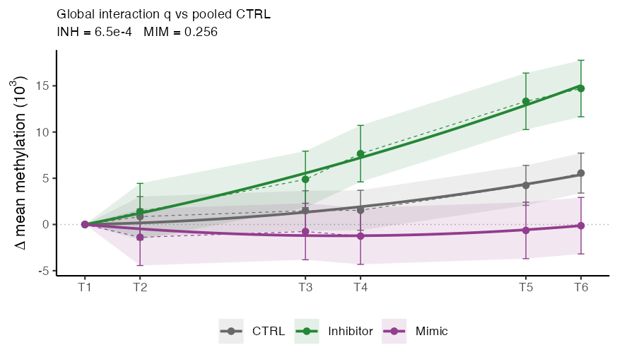

## e — Genome-wide beta distributions

Adjusted noncollapsed beta values are bounded to [0,1] and evaluated using a
kernel-density bandwidth of 0.02 over 512 positions. The accepted reconstruction
uses **no boundary reflection**. Curves represent the mean density across
samples at T1 or T6, with ±1 between-sample SD where shown. Density height is
not a fraction of methylated probes. No global-curve significance is inferred
from this descriptive density display.


```r
# ---- 4e_f_h
d <- readRDS("data/primary/hgf_density_adjusted_no_reflection.rds") %>% group_by(GROUP, TP2, beta) %>%
  summarise(mean = mean(density), sd = sd(density), .groups = "drop")
p <- ggplot(d, aes(beta, mean, color = GROUP, fill = GROUP)) +
  geom_ribbon(aes(ymin = pmax(0, mean - sd), ymax = mean + sd), alpha = .1, color = NA) +
  geom_line(linewidth = .55) + facet_wrap(~paste0("T", TP2), nrow = 1) +
  scale_color_manual(values = COLORS) + scale_fill_manual(values = COLORS) +
  labs(x = expression(beta), y = "Density") + theme_figure()
save_panel(p, "4e_beta_distributions", 5.0, 2.9)
```
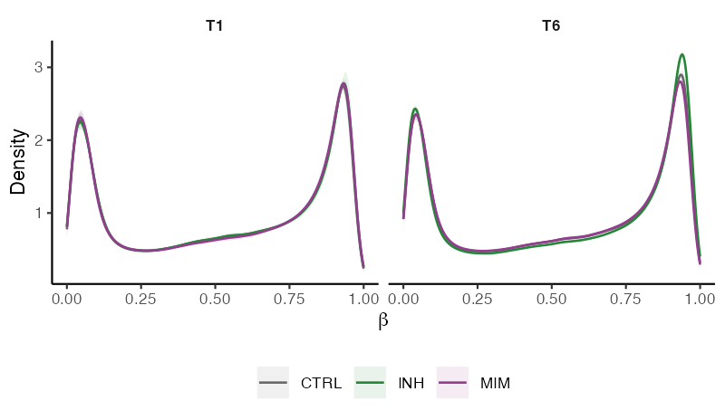

## f — Entropy and fraction at extremes at T6

For each sample, methylation entropy is −sum(p × log(p)) across 20 equal-width beta bins, using the historical small numerical offset. FAE is the fraction of probes with beta < 0.2 or beta > 0.8 and is displayed as 100 × FAE. Boxes summarize samples, not probes. Figure 4f has six pooled controls and three samples per treatment and reports the pooled T6 contrasts; its legend also reports the matched-control q values. These are T6 endpoint comparisons, not global-curve tests.


```r
metrics <- readRDS("data/primary/hgf_compartment_metrics_adjusted_verified_annotation.rds")
d <- subset(metrics, comp == "All_CpGs" & TP2 == 6) %>% pivot_longer(c(entropy, FAE))
d$value[d$name == "FAE"] <- 100 * d$value[d$name == "FAE"]
p <- ggplot(d, aes(GROUP, value, fill = GROUP)) +
  geom_boxplot(width = .5, outlier.shape = NA, alpha = .55, linewidth = .3) +
  geom_point(position = position_jitter(width = .09, height = 0, seed = 42), size = 1.3, stroke = 0) +
  facet_wrap(~name, scales = "free_y", nrow = 1) + scale_fill_manual(values = COLORS) +
  labs(x = NULL, y = NULL, title = "T6") + theme_figure() + theme(legend.position = "none")
save_panel(p, "4f_entropy_FAE", 4.6, 2.6)
```
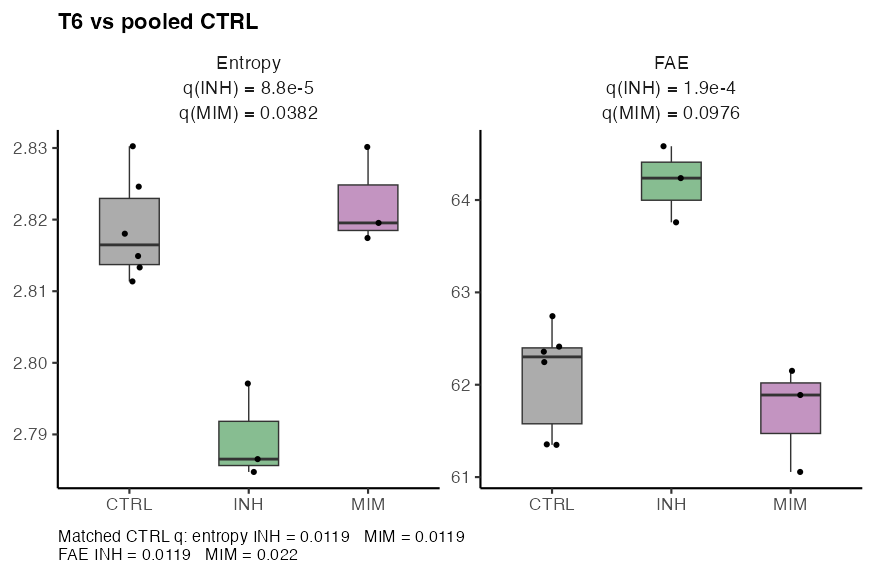

## g — GTEx methylation context

The upper entropy and FAE plots use **DNAm age**, whereas the lower beta-density
context uses **chronological age**. They must not be described as having the same
age variable. Upper-panel summaries use tissue-adjusted sample metrics,
15-sample sliding windows with step five, and age bins supported by at least
six windows. The frozen reconstruction contains 161 upper-panel windows.
The effective GAM basis dimension is three; the original request for `k=1`
was raised by the fitting software to its supported minimum.

Overlapping windows are not independent replicates; the smooth and its band
are descriptive and no window-based inferential p-value is claimed. The lower
curves preserve the accepted cached reconstruction, whose upstream Monte Carlo
sampling used seed 20260917. That seed reproduces this reconstruction, not an
unrecorded original random draw.


```r
# ---- 4g
# but chronological AGE for the density panel. Both scatter candidates are
# exported and labeled explicitly; this ambiguity must not be hidden.
source("code/upstream/lib_gtex_density.R")
suppressPackageStartupMessages(library(mgcv))
annotations <- NULL # Only needed for optional upstream density regeneration.
metrics <- cache("gtex_sample_metrics", function() {
  b <- read_input("gtex.methylation.RDS")
  out <- bind_rows(lapply(names(annotations), function(tissue) {
    ann <- annotations[[tissue]]
    ids <- intersect(rownames(ann), colnames(b))
    bind_rows(lapply(ids, function(id) {
      v <- as.numeric(b[, id]); v[v < 0] <- 0; v[v > 1] <- 1
      p <- hist(v, breaks = seq(0, 1, .05), plot = FALSE)$counts
      p <- p / sum(p) + 1e-8
      data.frame(sample = id, tissue, AGE = ann[id, "AGE"], DNAmAge = ann[id, "DNAmAge"],
                 entropy = -sum(p * log(p)), FAE = mean(v < .2 | v > .8, na.rm = TRUE),
                 mean_beta = mean(v, na.rm = TRUE))
    }))
  }))
  rm(b); gc()
  out
})
save_table(metrics, "panel_g_GTEx_sample_metrics")
make_windows <- function(d, age_column) {
  d$age <- d[[age_column]]; d <- d[is.finite(d$age), ]
  design <- model.matrix(~age, d)
  d$entropy_adj <- as.numeric(limma::removeBatchEffect(matrix(d$entropy, 1), batch = d$tissue, design = design))
  z <- qlogis(pmax(1e-6, pmin(1-1e-6, d$FAE)))
  d$FAE_adj <- plogis(as.numeric(limma::removeBatchEffect(matrix(z, 1), batch = d$tissue, design = design)))
  breaks <- seq(min(d$age), max(d$age), length.out = 21)
  windows <- bind_rows(lapply(split(d, d$tissue), function(tis) {
    tis <- tis[order(tis$age), ]
    if (nrow(tis) < 15) return(NULL)
    bind_rows(lapply(seq(1, nrow(tis)-14, by = 5), function(i) {
      x <- tis[i:(i+14), ]
      ac <- mean(x$age)
      data.frame(tissue = tis$tissue[1], age = ac, age_bin = max(1, min(20, findInterval(ac, breaks, rightmost.closed = TRUE))),
                 entropy = mean(x$entropy_adj), FAE = mean(x$FAE_adj))
    }))
  }))
  keep <- names(which(table(windows$age_bin) >= 6))
  windows[windows$age_bin %in% keep, ]
}
plot_scatter <- function(windows, age_column) {
  z <- pivot_longer(windows, c(entropy, FAE), names_to = "metric", values_to = "value")
  ggplot(z, aes(age, value)) + geom_point(color = "grey45", alpha = .5, size = .65, stroke = 0) +
    geom_smooth(aes(color = metric, fill = metric), method = "gam", formula = y ~ s(x, k = 3),
                se = TRUE, linewidth = .7) +
    facet_wrap(~factor(metric, c("entropy", "FAE")), nrow = 1, scales = "free_y") +
    scale_color_manual(values = c(entropy = "#D8343B", FAE = "#386FA8")) +
    scale_fill_manual(values = c(entropy = "#D8343B", FAE = "#386FA8")) +
    labs(x = if (age_column == "AGE") "Chronological age (years)" else "DNAm age (years)", y = NULL) +
    theme_figure() + theme(legend.position = "none")
}
for (age_column in "DNAmAge") {
  windows <- make_windows(metrics, age_column)
  save_table(windows, paste0("panel_g_windows_", age_column))
  # The original requested k=1, which mgcv raises to its minimum k=3.
  p <- plot_scatter(windows, age_column)
  save_panel(p, paste0("panel_g_top_", age_column), 5.4, 2.6)
}
density_data <- cache("gtex_meta_density", function() {
  b <- as.matrix(read_input("gtex.methylation.RDS"))
  set.seed(20260917)
  meta_curves_fast_absolute(b, annotations, win_size = 15, step_size = 5,
                           target_n = 20000, nbins_beta = 256, n_age_bins = 20,
                           smooth_sigma = .010, min_windows_per_bin = 2)
})
save_table(density_data, "panel_g_beta_density_by_chronological_age")
p <- ggplot(density_data, aes(beta, density, color = age_mid, group = age_bin)) +
  geom_line(linewidth = .55) + scale_color_viridis_c(option = "plasma", name = "Age") +
  coord_cartesian(xlim = c(0, 1)) + labs(x = expression("Methylation "*beta), y = "Density") + theme_figure()
save_panel(p, "panel_g_bottom_age_density", 5.4, 2.5)
top <- plot_scatter(make_windows(metrics, "DNAmAge"), "DNAmAge")
save_panel(cowplot::plot_grid(top, p, ncol = 1, rel_heights = c(1, .85)),
           "4g_GTEx_context", 5.4, 4.8)
```
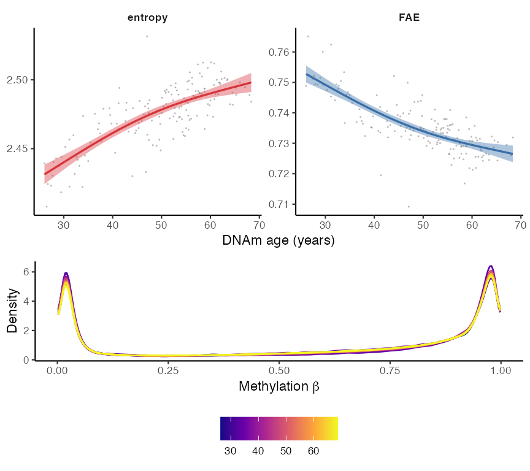

## h — Methylation and entropy by genomic compartment

Per-sample summaries use the verified server annotation and adjusted
noncollapsed beta matrix. Values are averaged within group/timepoint and
standardized **within each compartment/metric row across all 18 group-time
combinations**. The color scale is clipped at ±2 row standard deviations.
Colors describe relative changes within rows, not comparable absolute beta
or entropy differences between compartments. Neither heatmap color nor a
CpG annotation is itself a significance test.


```r
compartment_order <- c("All_CpGs", "OpenSea", "Shelf", "Shore", "Island", "Promoter_CGI")
heatmap_data <- metrics %>% group_by(comp, GROUP, TP2) %>%
  summarise(entropy = mean(entropy), mean_beta = mean(mean_beta), .groups = "drop") %>%
  pivot_longer(c(entropy, mean_beta), names_to = "metric") %>% group_by(metric, comp) %>%
  mutate(z = as.numeric(scale(value))) %>% ungroup() %>%
  mutate(x = TP2 + 6.6 * (as.integer(GROUP) - 1),
         y = match(comp, rev(compartment_order)))
save_table(heatmap_data, "panel_j_heatmap_values")
pal <- scico::scico(256, palette = "vik")
p <- ggplot(heatmap_data, aes(x, y, fill = z)) +
  geom_tile(width = .98, height = .96, color = "black", linewidth = .3) +
  facet_wrap(~factor(metric, c("entropy", "mean_beta"), c("Entropy", "Mean beta")), ncol = 1) +
  scale_fill_gradient2(low = pal[1], mid = "white", high = pal[256], limits = c(-2, 2), oob = scales::squish) +
  scale_x_continuous(breaks = c(1:6, 1:6 + 6.6, 1:6 + 13.2), labels = rep(1:6, 3), expand = expansion(add = .5)) +
  scale_y_continuous(breaks = 1:6, labels = gsub("_", " ", rev(compartment_order)), expand = expansion(add = .5)) +
  labs(x = "CTRL                       INH                       MIM", y = NULL, fill = "Row z") +
  theme_figure() + theme(axis.line = element_blank(), axis.ticks = element_blank())
save_panel(p, "4h_compartment_heatmaps", 5.5, 4.1)
```
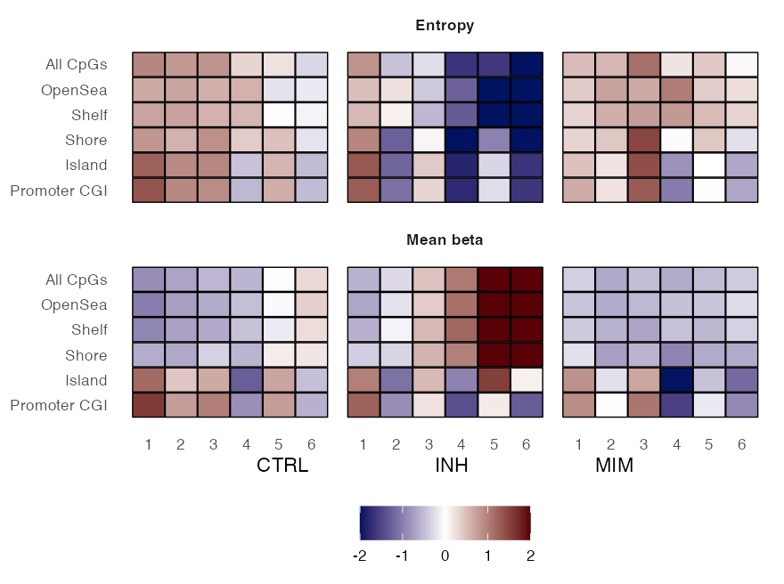

## i — Net compartment burden and Skin & Blood clock

**Left.** Each noncollapsed tested assay probe retains its own temporal
statistic. Base-CpG annotations define five sets: promoter CGI, island, shore,
shelf and open sea. Overlapping annotation categories are resolved with the
historical priority island > shore > shelf > open sea; promoter membership is
the union of TSS1500, TSS200, 5′ UTR and first-exon annotations. The quantity is
`100 × (number hyper − number hypo) / number tested in the compartment`.
Point size encodes total significant burden, `100 × (hyper + hypo) / N`.
Promoter CGI is a subset and is not disjoint from the island set.


```r
# ---- 4i_left
out <- input("primary/panel_k_compartment_burden.rds")$results
sets <- input("primary/panel_k_compartment_burden.rds")$feature_sets
out$y <- match(out$comp, rev(names(sets))) + c(CTRL = .17, INH = 0, MIM = -.17)[out$GROUP]
p <- ggplot(out, aes(net, y, color = GROUP, shape = GROUP)) +
  annotate("rect", xmin = -Inf, xmax = 0, ymin = -Inf, ymax = Inf, fill = "#E9EFFA", alpha = .55) +
  annotate("rect", xmin = 0, xmax = Inf, ymin = -Inf, ymax = Inf, fill = "#F8DADD", alpha = .55) +
  geom_vline(xintercept = 0, linewidth = .3, color = "grey50") +
  geom_segment(aes(x = 0, xend = net, yend = y), linewidth = .3) +
  geom_point(aes(size = burden)) + scale_color_manual(values = COLORS) +
  scale_shape_manual(values = c(CTRL = 16, INH = 15, MIM = 17)) +
  scale_size_continuous(range = c(1, 3.5), guide = "none") +
  scale_y_continuous(breaks = 1:5, labels = rev(paste0(names(sets), "\nn = ",
                           format(lengths(sets), big.mark = ",", trim = TRUE)))) +
  labs(x = "Net temporal DMP burden (%)", y = NULL) + theme_figure()
save_panel(p, "4i_left_compartment_burden", 4.5, 3.4)
```
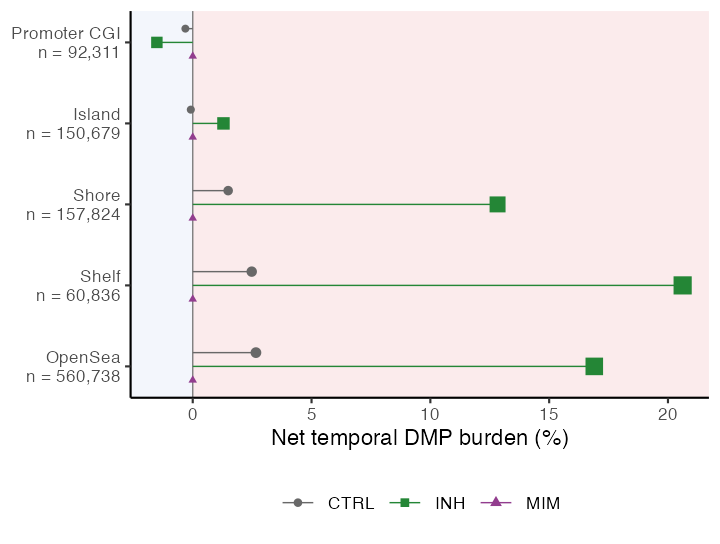

**Right.** Skin & Blood predictions use the frozen `meffonym` skin model
(version 1.2.1), adjusted collapsed beta and its calibration. The main plot
pools the two control arms and uses pooled-control q values; S4c separates
them and uses matched-control q values. Points are mean ± SEM and the
quadratic curve is descriptive. The main clock test is the average treatment
offset adjusted for categorical time, not a test that every part of the curve
has a different slope. Linear-predictor replay from the calibrated inputs is
checked against all 72 saved predictions.


```r
# Shared epigenetic clocks: frozen calibrated inputs; original scoring recipes.
clock_bundle <- input("clocks/primary_clocks.rds")
clock_scores <- as.data.frame(clock_bundle$scores)
clock_labels <- c(SkinBlood = "Skin & Blood DNAm age (years)", RetroAge = "RetroAge score",
                  CausAge = "CausAge score", DamAge = "Delta DamAge score", AdaptAge = "Delta AdaptAge score")
for (clock_name in names(clock_labels)) {
  d <- subset(clock_scores, clock == clock_name)
  d$score <- d$display_score
  d$series <- ifelse(d$GROUP == "CTRL", paste0(tolower(d$EXPERIMENT), "CTRL"), as.character(d$GROUP))
  panel_id <- c(SkinBlood = "S4c", RetroAge = "S4e", CausAge = "S4d_CausAge",
                DamAge = "S4d_DamAge", AdaptAge = "S4d_AdaptAge")[[clock_name]]
  save_panel(trajectory(d, clock_labels[clock_name], title = clock_name), panel_id, 5.3, 4.7)
  if (clock_name %in% c("SkinBlood", "RetroAge")) {
    d$series <- as.character(d$GROUP)
    save_panel(trajectory(d, clock_labels[clock_name], title = clock_name),
               ifelse(clock_name == "SkinBlood", "4i_right_SkinBlood", "4j_right_RetroAge"), 5.3, 4.7)
  }
}
save_panel(plot_grid(plotlist = panels[c("S4d_CausAge", "S4d_DamAge", "S4d_AdaptAge")], nrow = 1),
           "S4d_causal_clocks", 12, 4.5)
save_table(clock_scores, "epigenetic_clock_scores")
save_table(clock_bundle$coefficient_audit, "epigenetic_clock_coverage")

# Available-CpG linear predictors exactly preserve the historical missingness rule.
for (nm in names(clock_bundle$coefficients)) {
  co <- as.data.frame(clock_bundle$coefficients[[nm]])
  ids <- intersect(co$term, rownames(clock_bundle$small_beta_input))
  x <- clock_bundle$small_beta_input[ids, , drop = FALSE]
  w <- co$estimate[match(ids, co$term)]
  predicted <- as.numeric(co$estimate[co$term == "(Intercept)"] + crossprod(w, x))
  expected <- subset(clock_scores, clock == nm)
  assert_close(predicted, expected$score[match(colnames(x), expected$sample)], paste(nm, "linear predictor"))
}
```
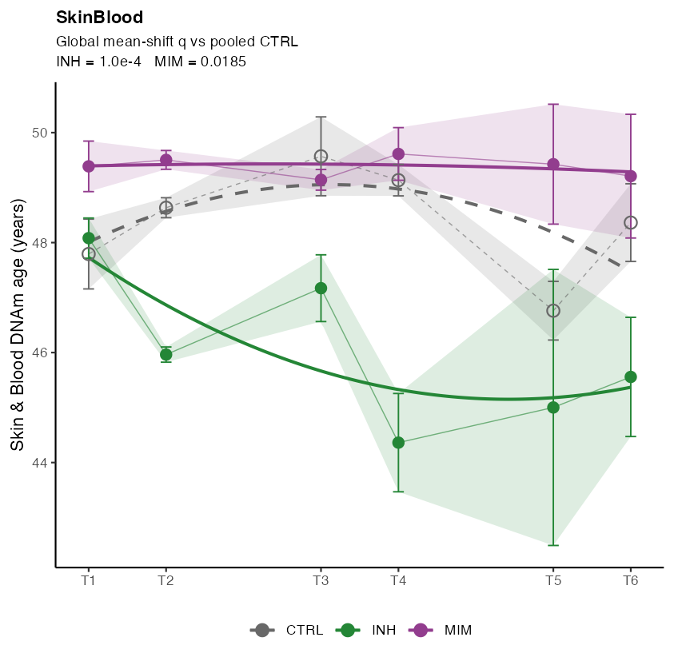

## j — Repeat-associated methylation and RetroAge

**Left.** Repeat associations use the historical RepeatMasker resource
AH99003 (hg38, September 2021), including strand-aware overlaps and exact
collapsed annotation strings. Mean beta is summarized by group/timepoint and
row-standardized as in panel h. ERVL includes ERVL-MaLR. The historical artwork
labels `DNA/hAT` and `SINE/Alu` refer to the broader **DNA** and **SINE** class
selections implemented in the source; they must not be read as hAT-only or
Alu-only analyses. The explicit class/family selectors are retained below.


```r
# ---- 4j_left
# Historical overlap semantics include probe strand and exact collapsed
# repClass/repFamily strings; multi-label entries are not silently expanded.
suppressPackageStartupMessages(library(GenomicRanges))
membership <- NULL # Stored membership was already used in the per-sample checkpoint.
spec <- data.frame(label = c("LTR", "ERVL", "ERV1", "ERVK", "LINE", "L1", "L2", "DNA/hAT", "Charlie", "Tip100", "SINE/Alu"),
                   field = c("repClass", rep("repFamily", 3), "repClass", rep("repFamily", 2), "repClass", rep("repFamily", 2), "repClass"),
                   block = c(rep("LTR", 4), rep("LINE", 3), rep("DNA/hAT", 3), "SINE/Alu"))
values <- list("LTR", c("ERVL", "ERVL-MaLR"), "ERV1", "ERVK", "LINE", "L1", "L2", "DNA", "hAT-Charlie", "hAT-Tip100", "SINE")
repeat_data <- cache("repeat_beta_metrics_historical_specification", function() {
  b <- as.matrix(read_input("pan_beta_all.adj.june2026.RDS"))
  bind_rows(lapply(seq_len(nrow(spec)), function(i) {
    probes <- intersect(membership$probe[membership[[spec$field[i]]] %in% values[[i]]], rownames(b))
    if (length(probes) < 50) return(NULL)
    data.frame(sample = colnames(b), label = spec$label[i], block = spec$block[i],
               n_probes = length(probes), beta = colMeans(b[probes, , drop = FALSE], na.rm = TRUE))
  })) %>% left_join(metadata(), by = "sample")
})
z <- repeat_data %>% group_by(label, block, GROUP, TP2) %>%
  summarise(value = mean(beta), n_probes = dplyr::first(n_probes), .groups = "drop") %>%
  group_by(label) %>% mutate(z = as.numeric(scale(value))) %>% ungroup() %>%
  mutate(x = TP2 + 6.6 * (as.integer(GROUP) - 1),
         y = length(spec$label) + 1 - match(label, spec$label))
save_table(z, "4j_left_repeat_heatmap")
save_table(unique(z[, c("label", "n_probes")]), "panel_i_left_repeat_probe_counts")
pal <- scico::scico(256, palette = "vik")
p <- ggplot(z, aes(x, y, fill = z)) +
  geom_tile(width = .98, height = .95, color = "black", linewidth = .3) +
  scale_fill_gradient2(low = pal[1], mid = "white", high = pal[256], limits = c(-2, 2), oob = scales::squish) +
  scale_x_continuous(breaks = c(1:6, 1:6 + 6.6, 1:6 + 13.2), labels = rep(1:6, 3), expand = expansion(add = .5)) +
  scale_y_continuous(breaks = 1:length(spec$label), labels = rev(spec$label), expand = expansion(add = .5)) +
  labs(x = "CTRL                       INH                       MIM", y = NULL, fill = "Row z") +
  theme_figure() + theme(axis.line = element_blank(), axis.ticks = element_blank())
save_panel(p, "4j_left_repeat_heatmap", 5.0, 4.1)
```
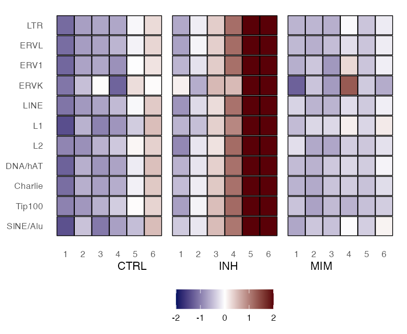

**Right.** RetroAge uses the supplied EPIC v2 coefficients and noncollapsed
assay IDs. The predictor is the saved intercept plus the weighted beta sum;
missing matrix entries use their probe's cohort mean. All 1,378 coefficient
features are available. No Horvath inverse-age transformation is applied.
Control display and inference follow panel i-right; S4e resolves the control arms.

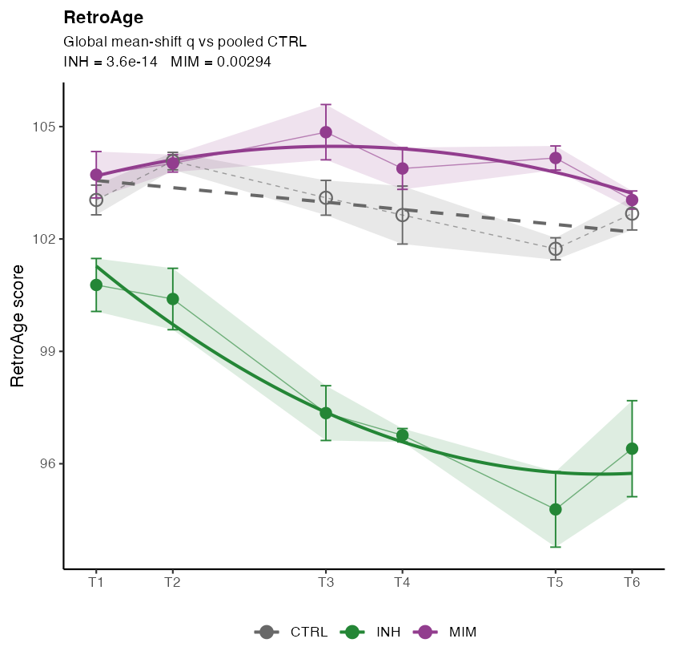

## k — Asymmetric components of the clock shift

This panel decomposes the INH-minus-matched-control clock shift across the
**whole T1–T6 trajectory**, not only T5–T6. For each probe and biological run,
the beta difference is integrated by signed trapezoids at 72, 96, 168, 192,
264 and 288 hours and divided by the 216-hour duration. Endpoint weights are
12 hours and the four internal weights are 48 hours. The result is a
time-averaged beta difference, retaining its sign.

Each probe's integrated difference is multiplied by its original clock
coefficient, then assigned to one of four routes:

| Beta change | Coefficient sign | Effect on linear clock predictor |
|:--|:--|:--|
| Hypermethylation | Negative | Decrease |
| Hypomethylation | Positive | Decrease |
| Hypermethylation | Positive | Increase |
| Hypomethylation | Negative | Increase |

Routing occurs **after integration within run**, not after averaging unsigned
instantaneous effects. Route contributions are averaged across three runs and
divided by the mean total absolute per-probe contribution. The absolute bar
segments therefore sum to 100%; the diamond is the signed net contribution
on the same scale. These percentages are not percentages of probes, years
rejuvenated or percentages of a biological aging process.

Skin & Blood and Horvath pan-tissue contributions are decomposed on their
additive predictor scales **before** the nonlinear inverse-age transform.
The five retained rows are Skin & Blood, RetroAge, CausAge, DamAge and Horvath
pan-tissue. AdaptAge remains in S4d but is not a row in the final decomposition.
Available-feature coverage and missing absolute coefficient weight are recorded
for every model; missing coefficients are not silently renormalized.


```r
suppressPackageStartupMessages(library(data.table))
bundle <- input("clocks/auc_inputs.rds")
meta <- as.data.table(bundle$metadata)
is_auc <- identical(bundle$estimand, "auc")
trap_mean <- function(y, hours) {
  stopifnot(length(y) == length(hours), all(diff(hours) > 0))
  sum(diff(hours) * (head(y, -1) + tail(y, -1)) / 2) / diff(range(hours))
}
trap_weights <- function(hours) {
  stopifnot(length(hours) >= 2L, all(diff(hours) > 0))
  interval <- diff(hours)
  (c(interval, 0) + c(0, interval)) / 2
}
order_clocks <- c("SkinBlood", "RetroAge", "CausAge", "DamAge", "Horvath2013")
n_clocks <- length(order_clocks)
clock_labels <- c(SkinBlood = "Skin & Blood", RetroAge = "RetroAge", CausAge = "CausAge",
                  DamAge = "DamAge", AdaptAge = "AdaptAge", Horvath2013 = "Horvath pan-tissue")
route_order <- c("down_negative_hyper", "down_positive_hypo", "up_positive_hyper", "up_negative_hypo")
get_route <- function(w, d) {
  fifelse(w < 0 & d > 0, "down_negative_hyper",
          fifelse(w > 0 & d < 0, "down_positive_hypo",
                   fifelse(w > 0 & d > 0, "up_positive_hyper",
                            fifelse(w < 0 & d < 0, "up_negative_hypo", "zero"))))
}
all_probes <- all_samples <- audits <- list()
for (clock_name in order_clocks) {
  model <- bundle$models[[clock_name]]
  x <- model$x
  w <- model$w[rownames(x)]
  stopifnot(all(is.finite(x)), !anyNA(w), !anyDuplicated(rownames(x)))
  pairs <- merge(meta[as.character(GROUP) == "INH", .(batch = as.character(BATCH), tp, treated = sample)],
                 meta[as.character(GROUP) == "CTRL", .(batch = as.character(BATCH), tp, control = sample)],
                 by = c("batch", "tp"))
  setorder(pairs, batch, tp)
  if (is_auc) {
    stopifnot(nrow(pairs) == 18L, all(table(pairs$batch) == 6L))
    pairs[, hours := meta$hours[match(treated, meta$sample)]]
    stopifnot(identical(pairs$hours, meta$hours[match(pairs$control, meta$sample)]),
              all(pairs$hours == c(72, 96, 168, 192, 264, 288)[pairs$tp]))
  } else {
    stopifnot(nrow(pairs) == 6L, all(table(pairs$batch) == 2L))
  }
  differences <- x[, pairs$treated, drop = FALSE] - x[, pairs$control, drop = FALSE]
  probe_rows <- list()
  for (batch_id in unique(pairs$batch)) {
    take <- pairs$batch == batch_id
    if (is_auc) {
      time_weights <- trap_weights(pairs$hours[take])
      delta <- as.numeric(differences[, take, drop = FALSE] %*% time_weights) / sum(time_weights)
    } else {
      delta <- rowMeans(differences[, take, drop = FALSE])
    }
    contribution <- w * delta
    probe_rows[[batch_id]] <- data.table(clock = clock_name, batch = batch_id,
      probe = rownames(x), weight = as.numeric(w), delta_beta = delta,
      contribution = as.numeric(contribution), route = get_route(w, delta))
  }
  all_probes[[clock_name]] <- rbindlist(probe_rows)
  linear <- as.numeric(model$intercept + w %*% x)
  predicted <- if (clock_name %in% c("SkinBlood", "Horvath2013")) ifelse(linear < 0, 21 * exp(linear) - 1, 21 * linear + 20) else linear
  samples <- data.table(clock = clock_name, sample = colnames(x), linear_predictor = linear,
                        predicted_score = predicted)
  all_samples[[clock_name]] <- merge(samples, meta[, .(sample, GROUP, BATCH, tp)], by = "sample")
  err <- max(abs(colSums(differences * w) -
                 (linear[match(pairs$treated, colnames(x))] - linear[match(pairs$control, colnames(x))])))
  stopifnot(err < 1e-8)
  if (is_auc) {
    # Independent trapezoid calculation from the reconstructed clock contrasts.
    auc_error <- max(vapply(unique(pairs$batch), function(batch_id) {
      pp <- pairs[batch == batch_id]
      expected <- trap_mean(linear[match(pp$treated, colnames(x))] -
                              linear[match(pp$control, colnames(x))], pp$hours)
      abs(expected - all_probes[[clock_name]][batch == batch_id, sum(contribution)])
    }, numeric(1)))
    stopifnot(auc_error < 1e-8)
  }
  audits[[clock_name]] <- data.table(clock = clock_name, n_present = length(w), n_required = model$required,
    n_positive_weights = sum(w > 0), n_negative_weights = sum(w < 0), n_zero_weights = sum(w == 0),
    missing_absolute_weight_fraction = model$missing_weight_fraction,
    max_delta_reconstruction_error = err, source_scale = model$scale)
  if (is_auc) audits[[clock_name]][, max_auc_reconstruction_error := auc_error]
}
probes <- rbindlist(all_probes)
if (is_auc) {
  duration <- diff(range(meta$hours))
  probes[, `:=`(auc_beta_hours = delta_beta * duration,
                 auc_contribution_hours = contribution * duration)]
}
sample_scores <- rbindlist(all_samples)
audit <- rbindlist(audits)
by_run <- probes[, .(contribution = sum(contribution), absolute_contribution = sum(abs(contribution)),
                     n_probes = .N), by = .(clock, batch, route)]
# Aggregate each probe within run BEFORE assigning its directional route:
# T5/T6 mean by default, or signed actual-time AUC / duration in AUC mode.
# Average absolute route totals over the three runs; normalize only afterwards.
grid <- CJ(clock = order_clocks, batch = unique(probes$batch), route = route_order)
by_run <- merge(grid, by_run, by = c("clock", "batch", "route"), all.x = TRUE)
for (column in c("contribution", "absolute_contribution", "n_probes"))
  set(by_run, which(is.na(by_run[[column]])), column, 0)
components <- by_run[, .(mean_contribution = mean(contribution),
                         mean_absolute = mean(absolute_contribution),
                         mean_n_probes = mean(n_probes)), by = .(clock, route)]
denom <- probes[, .(absolute_total = sum(abs(contribution)), net = sum(contribution)),
                by = .(clock, batch)][, .(denominator = mean(absolute_total)), by = clock]
components <- merge(components, denom, by = "clock")
components[, percent := 100 * mean_contribution / denominator]
stopifnot(all(denom$denominator > 0))
checks <- components[, .(sum_absolute_percent = sum(abs(percent))), by = clock]
stopifnot(max(abs(checks$sum_absolute_percent - 100)) < 1e-8)
net <- components[, .(net_percent = sum(percent),
                       down_percent = -sum(percent[percent < 0]),
                       up_percent = sum(percent[percent > 0]),
                       net_linear_shift = sum(mean_contribution)), by = clock]
net <- merge(net, audit, by = "clock")
net[, y := length(order_clocks) + 1 - match(clock, order_clocks)]
segments <- merge(components, net[, .(clock, y)], by = "clock")
segments[, route := factor(route, levels = route_order)]
setorder(segments, clock, route)
segments[, side := ifelse(percent < 0, "down", "up")]
segments[, edge_end := cumsum(percent), by = .(clock, side)]
segments[, edge_start := edge_end - percent]
segments[, `:=`(xmin = pmin(edge_start, edge_end), xmax = pmax(edge_start, edge_end))]
segments[, label := ifelse(abs(percent) >= 6, sprintf("%.0f%%", abs(percent)), "")]
segments[, label_color := ifelse(route %in% c("down_negative_hyper", "up_positive_hyper"), "white", "#263747")]
run_net <- probes[, .(net_linear_shift = sum(contribution)), by = .(clock, batch)]
run_net <- merge(run_net, denom, by = "clock")
run_net[, net_percent_common_denominator := 100 * net_linear_shift / denominator]
weight_sign <- probes[, .(contribution = sum(contribution)),
                       by = .(clock, batch, coefficient_sign = ifelse(weight > 0, "positive", "negative"))]
weight_sign <- weight_sign[, .(mean_contribution = mean(contribution)), by = .(clock, coefficient_sign)]
weight_sign <- merge(weight_sign, denom, by = "clock")
weight_sign[, net_percent := 100 * mean_contribution / denominator]

# Check observed age/score differences independently of route aggregation.
t <- sample_scores[as.character(GROUP) == "INH", .(clock, batch = as.character(BATCH), tp, treated = predicted_score)]
c <- sample_scores[as.character(GROUP) == "CTRL", .(clock, batch = as.character(BATCH), tp, control = predicted_score)]
observed <- merge(t, c, by = c("clock", "batch", "tp"))
observed[, difference := treated - control]
if (is_auc) {
  observed[, hours := meta$hours[match(paste(batch, tp), paste(as.character(meta$BATCH), meta$tp))]]
  setorder(observed, clock, batch, hours)
  observed_run <- observed[, .(mean_difference = trap_mean(difference, hours)), by = .(clock, batch)]
  observed_run[, auc_score_hours := mean_difference * duration]
} else {
  observed_run <- observed[, .(mean_difference = mean(difference)), by = .(clock, batch)]
}
observed_mean <- observed_run[, .(mean_clock_difference = mean(mean_difference),
                                sem_clock_difference = sd(mean_difference)/sqrt(.N)), by = clock]
net <- merge(net, observed_mean, by = "clock")

colors <- c(down_negative_hyper = "#286B9E", down_positive_hypo = "#B3D3E7",
            up_positive_hyper = "#C05842", up_negative_hypo = "#F0C4B6")
legend_text <- c(down_negative_hyper = "Hypermethylation; negative weight",
                 down_positive_hypo = "Hypomethylation; positive weight",
                 up_positive_hyper = "Hypermethylation; positive weight",
                 up_negative_hypo = "Hypomethylation; negative weight")
y_labels <- setNames(paste0(clock_labels[net$clock], "\n", net$n_present, "/", net$n_required, " features"), net$y)
plot <- ggplot() +
  annotate("rect", xmin = -100, xmax = 0, ymin = .5, ymax = n_clocks + .5, fill = "#F5F9FC") +
  annotate("rect", xmin = 0, xmax = 100, ymin = .5, ymax = n_clocks + .5, fill = "#FDF7F5") +
  geom_vline(xintercept = c(-100, -50, 50, 100), color = "#E1E6E9", linewidth = .3) +
  geom_vline(xintercept = 0, color = "#65727A", linewidth = .5) +
  geom_rect(data = segments, aes(xmin = xmin, xmax = xmax, ymin = y - .21, ymax = y + .21, fill = route),
            color = "white", linewidth = .35) +
  geom_text(data = segments, aes(x = (xmin + xmax)/2, y = y, label = label, color = label_color),
            size = 3.0, family = "Helvetica") +
  scale_color_identity() +
  geom_segment(data = net, aes(x = net_percent, xend = net_percent, y = y - .22, yend = y - .33),
               linewidth = .35, color = "#222222") +
  geom_point(data = net, aes(x = net_percent, y = y - .34), shape = 23, size = 2.6,
             fill = "#222222", color = "white", stroke = .35) +
  annotate("text", x = -50, y = n_clocks + .78, label = "Clock-decreasing", color = colors[1],
            size = 3.6, fontface = "bold", family = "Helvetica") +
  annotate("text", x = 50, y = n_clocks + .78, label = "Clock-increasing", color = colors[3],
            size = 3.6, fontface = "bold", family = "Helvetica") +
  scale_fill_manual(values = colors, breaks = route_order, labels = legend_text[route_order], name = NULL) +
  scale_x_continuous(limits = c(-102, 102), breaks = c(-100, -50, 0, 50, 100),
                     labels = c("-100", "-50", "0", "+50", "+100"), expand = c(0, 0)) +
  scale_y_continuous(breaks = seq_len(n_clocks), labels = y_labels[as.character(seq_len(n_clocks))],
                     limits = c(.48, n_clocks + 1.02), expand = c(0, 0)) +
  labs(x = "Share of total absolute weighted contribution (%)", y = NULL,
       title = if (is_auc) "Components of the INH-induced clock shift: AUC" else "Components of the INH-induced clock shift",
       subtitle = if (is_auc) "T1-T6 signed AUC (72-288 h); own matched controls; n = 3 biological experiments" else "T5-T6 averaged within each biological experiment; own matched controls; n = 3",
       caption = if (is_auc) "Actual-time trapezoids at each CpG; AUC divided by duration. Diamonds: net contribution.\nShares describe integrated score composition, not years or evidence of rejuvenation." else "Diamonds: net shift on the same scale. Available features only; no significance filtering.\nShares describe score composition, not the magnitude of age change or rejuvenation.") +
  guides(fill = guide_legend(ncol = 2, byrow = FALSE)) +
  theme_classic(base_size = 10, base_family = "Helvetica") +
  theme(axis.line.y = element_blank(), axis.ticks.y = element_blank(),
        axis.text.y = element_text(color = "#23333F", size = 10, lineheight = 1.0),
        axis.text.x = element_text(color = "#394B57"),
        axis.title.x = element_text(margin = margin(t = 8)),
        plot.title = element_text(face = "bold", size = 14),
        plot.subtitle = element_text(size = 9, color = "#52626D", margin = margin(b = 8)),
        plot.caption = element_text(hjust = 0, size = 8, color = "#52626D", margin = margin(t = 8)),
        legend.position = "bottom", legend.text = element_text(size = 8.5),
        legend.key.size = unit(.38, "cm"), legend.spacing.x = unit(.12, "cm"),
        plot.margin = margin(10, 12, 8, 10))

save_panel(plot, "4k_clock_component_AUC", 8.5, 5.2)
save_table(segments, "4k_plotted_components")
save_table(net, "4k_clock_component_summary")
save_table(probes, "4k_probe_AUC_contributions")
save_table(by_run, "4k_experiment_components")
expected <- data.table::fread("data/clocks/expected_auc_components.tsv")
comparison <- merge(segments, expected, by = c("clock", "route"), suffixes = c("_new", "_old"))
assert_close(comparison$percent_new, comparison$percent_old, "Five-clock AUC route shares")
```
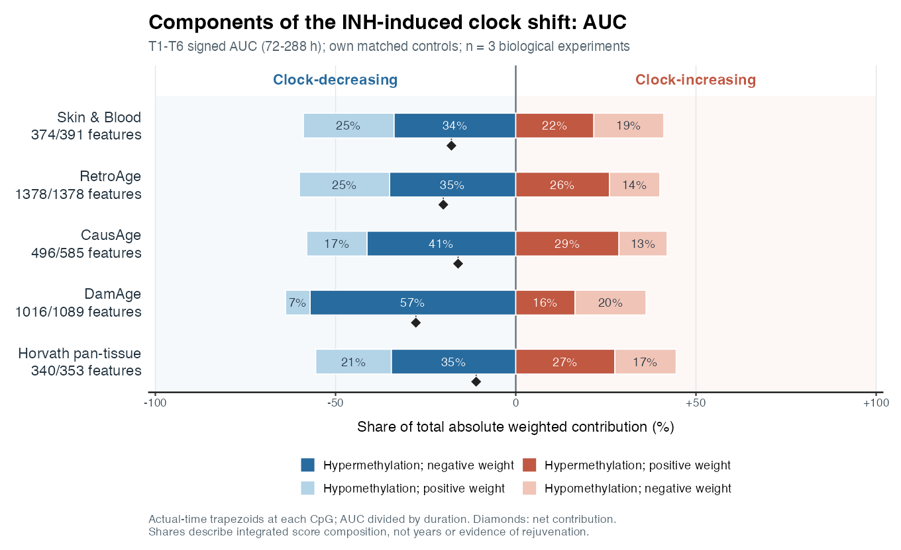

## l — Responses of CTRL-defined temporal movers

CTRL temporal DMPs are selected at BH q < 0.05 and split into 2,188
hypomethylating and 20,884 hypermethylating assay probes. Adjusted noncollapsed
beta values are centered on each condition's own T1 mean, then averaged within
biological run. GAM curves use a four-dimensional time smooth and a random
run term; plotted predictions exclude the run-specific smooth, with 90%
model-based intervals. The descriptive GAM is distinct from the categorical
time-interaction test reported in the statistics section.

Selection and display use the same experiment. These are conditional
descriptions of CTRL-selected sets, not an independent confirmation that a
preselected external signature changes with time.


```r
# ---- 4l
suppressPackageStartupMessages(library(mgcv))
objects <- cache("ctrl_mover_trajectories", function() {
  meta <- metadata()
  meta$bio_rep <- factor(stringr::str_extract(meta$SHORT_ID, "P\\d+|exp\\d+"))
  if (anyNA(meta$bio_rep)) stop("Historical biological replicate parser did not match all samples.")
  r <- readRDS("data/primary/results_notcollapsed.rds")$Time$TIME_ctrl
  ids <- rownames(r)[which(r$adj.P.Val < .05 & abs(r$logFC) > 0)]
  direction <- setNames(ifelse(r[ids, "logFC"] > 0, "Hyper", "Hypo"), ids)
  b <- as.matrix(read_input("pan_beta_all.adj.june2026.RDS"))[ids, meta$sample, drop = FALSE]
  # Subsetting before conversion to long format is exactly equivalent to the
  # original post-pivot subset and avoids materializing tens of millions of rows.
  for (condition in levels(meta$GROUP)) {
    idx <- which(meta$GROUP == condition)
    baseline <- rowMeans(b[, meta$GROUP == condition & meta$TP2 == 1, drop = FALSE], na.rm = TRUE)
    b[, idx] <- b[, idx, drop = FALSE] - baseline
  }
  dat <- bind_rows(lapply(c("Hypo", "Hyper"), function(d) {
    data.frame(sample = colnames(b), direction = d,
               value = colMeans(b[names(direction)[direction == d], , drop = FALSE], na.rm = TRUE))
  })) %>% left_join(meta, by = "sample") %>%
    group_by(bio_rep, direction, GROUP, TP2) %>% summarise(rep_mean = mean(value), .groups = "drop")
  fits <- dat %>% group_by(direction, GROUP) %>% group_modify(~ {
    fit <- gam(rep_mean ~ s(TP2, k = 4) + s(bio_rep, bs = "re"), data = .x, method = "REML", select = TRUE)
    grid <- data.frame(TP2 = seq(1, 6, length.out = 200), bio_rep = .x$bio_rep[1])
    pred <- predict(fit, grid, se.fit = TRUE, exclude = "s(bio_rep)")
    data.frame(TP2 = grid$TP2, fit = pred$fit, lower = pred$fit - qnorm(.95) * pred$se.fit,
               upper = pred$fit + qnorm(.95) * pred$se.fit)
  }) %>% ungroup()
  list(probes = direction, replicate_means = dat, fitted = fits)
})
save_table(objects$replicate_means, "panel_l_replicate_means")
save_table(objects$fitted, "panel_l_GAM_fitted_curves")
p <- ggplot(objects$replicate_means, aes(TP2, rep_mean, color = GROUP)) +
  geom_hline(yintercept = 0, linetype = 2, linewidth = .3, color = "grey60") +
  geom_line(aes(group = interaction(GROUP, bio_rep)), alpha = .12, linewidth = .35) +
  geom_point(aes(shape = bio_rep), size = 1.1) +
  geom_ribbon(data = objects$fitted, aes(x = TP2, ymin = lower, ymax = upper, fill = GROUP),
              inherit.aes = FALSE, alpha = .15) +
  geom_line(data = objects$fitted, aes(y = fit), linewidth = .7) +
  facet_wrap(~factor(direction, c("Hypo", "Hyper")), scales = "free_y", nrow = 1) +
  scale_x_continuous(breaks = 1:6, labels = paste0("T", 1:6)) +
  scale_color_manual(values = COLORS) + scale_fill_manual(values = COLORS) +
  labs(x = NULL, y = expression(Delta*beta~"from own T1")) + theme_figure()
save_panel(p, "4l_CTRL_temporal_movers", 5.8, 3.8)
```
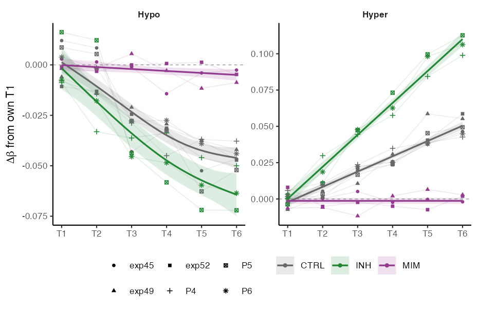

## m — Geometry of temporal effects

For each treatment/control pair, the plotted universe is the union of probes
with temporal BH q < 0.05 in either condition: 165,312 for INH and 23,072 for
MIM. The axes are limma ordinal-time M-value coefficients. The identity line
is descriptive; the colored line is a through-origin regression of treated
on control slopes. The resulting slope ratios are approximately 2.39 and
0.071. They are not fold changes of methylation percentages and do not replace
an interaction test. The classification function also supplies S4f.


```r
# ---- 4m_S4f
# P < .05 supports direction; interaction significance is not a class gate.
r <- NULL # Needed only for the optional upstream cache calculation.
standardize <- function(x, type = "DNAm") {
  x <- as.data.frame(x)
  if (type == "DNAm") data.frame(id = rownames(x), slope = x$logFC, p = x$P.Value, q = x$adj.P.Val)
  else data.frame(id = rownames(x), slope = x$log2FoldChange, p = x$pvalue, q = x$padj)
}
pair <- function(ctrl, trt, type, treatment) {
  x <- merge(standardize(ctrl, type), standardize(trt, type), by = "id", suffixes = c("_ctrl", "_trt"))
  sig <- function(x) is.finite(x) & x < .05
  x <- x[(sig(x$q_ctrl) | sig(x$q_trt)) & is.finite(x$slope_ctrl) & is.finite(x$slope_trt), ]
  x$layer <- type; x$treatment <- treatment
  support_c <- sig(x$p_ctrl) & abs(x$slope_ctrl) > 1e-12
  support_t <- sig(x$p_trt) & abs(x$slope_trt) > 1e-12
  same <- sign(x$slope_ctrl) == sign(x$slope_trt)
  larger <- abs(x$slope_trt) > abs(x$slope_ctrl) + 1e-12
  x$change <- (abs(x$slope_trt) - abs(x$slope_ctrl)) / pmax(abs(x$slope_trt), abs(x$slope_ctrl), 1e-12)
  x$detailed_class <- case_when(
    support_c & !support_t ~ "Attenuation_lost",
    !support_c & support_t & same & larger ~ "Amplification_emergent_concordant",
    !support_c & support_t ~ "Recruitment",
    support_c & support_t & !same ~ "Rerouting",
    support_c & support_t & same & x$change < -.2 ~ "Attenuation_weaker",
    support_c & support_t & same & x$change > .2 ~ "Amplification_shared",
    support_c & support_t & same & abs(x$change) <= .2 ~ "Preserved_shared",
    TRUE ~ "Unclassified")
  x$class <- case_when(grepl("^Attenuation", x$detailed_class) ~ "Attenuated",
                       grepl("^Amplification", x$detailed_class) ~ "Amplified",
                       grepl("^Preserved", x$detailed_class) ~ "Preserved",
                       x$detailed_class %in% c("Recruitment", "Rerouting") ~ "Rewired", TRUE ~ "Unclassified")
  x
}
geometries <- cache("temporal_slope_geometries", function() {
  out <- list(pair(r$Time$TIME_ctrl, r$Time$TIME_inh, "DNAm", "INH"),
              pair(r$Time$TIME_ctrl, r$Time$TIME_mim, "DNAm", "MIM"))
  for (arm in c("inh", "mim")) {
    z <- readRDS(file.path(Sys.getenv("FIG4_RNA_DIR", "external_inputs"), paste0("res_", arm, ".RDS")))
    saveRDS(z[c("res_time_ctrl", "res_time_trt", "res_interaction")], paste0("data/primary/rna_", arm, "_temporal_results.rds"))
    out[[length(out) + 1]] <- pair(z$res_time_ctrl, z$res_time_trt, "RNA", toupper(arm))
  }
  bind_rows(out)
})
stopifnot(!any(geometries$class == "Unclassified"))
summary <- geometries %>% count(layer, treatment, class) %>% group_by(layer, treatment) %>%
  mutate(total = sum(n), percent = 100 * n / total) %>% ungroup()
save_table(summary, "S4f_trajectory_outcomes")
print(summary)
scatter_stats <- geometries %>% filter(layer == "DNAm") %>% group_by(treatment) %>%
  summarise(n = n(), slope_ratio = coef(lm(slope_trt ~ 0 + slope_ctrl))[1], .groups = "drop")
save_table(scatter_stats, "panel_m_slope_statistics")
print(scatter_stats)
plots <- lapply(c("INH", "MIM"), function(arm) {
  x <- subset(geometries, layer == "DNAm" & treatment == arm)
  stat <- subset(scatter_stats, treatment == arm)
  main <- ggplot(x, aes(slope_ctrl, slope_trt)) +
    geom_hline(yintercept = 0, linetype = 3, color = "grey65", linewidth = .3) +
    geom_vline(xintercept = 0, linetype = 3, color = "grey65", linewidth = .3) +
    geom_abline(slope = 1, linetype = 2, linewidth = .35) +
    geom_point(color = COLORS[arm], alpha = .12, size = .25, stroke = 0) +
    geom_abline(slope = stat$slope_ratio, color = COLORS[arm], linewidth = .6) +
    annotate("text", x = .45, y = -.43, label = sprintf("SR = %.2f", stat$slope_ratio), hjust = 1, color = COLORS[arm], size = 3) +
    coord_equal(xlim = c(-.5, .5), ylim = c(-.5, .5)) + labs(x = "Slope CTRL", y = paste("Slope", arm)) + theme_figure()
  top <- ggplot(x %>% pivot_longer(c(slope_ctrl, slope_trt)), aes(value, factor(name, c("slope_trt", "slope_ctrl")))) +
    geom_boxplot(width = .55, outlier.shape = NA, fill = COLORS[arm], alpha = .35, linewidth = .3) +
    coord_cartesian(xlim = c(-.5, .5)) + labs(title = paste0("n = ", format(nrow(x), big.mark = ",")), x = NULL, y = NULL) +
    theme_figure(8) + theme(axis.text = element_blank(), axis.ticks = element_blank())
  cowplot::plot_grid(top, main, ncol = 1, rel_heights = c(.5, 2.6), align = "v")
})
save_panel(cowplot::plot_grid(plotlist = plots, nrow = 1), "4m_temporal_slope_scatter", 6.2, 3.9)
```
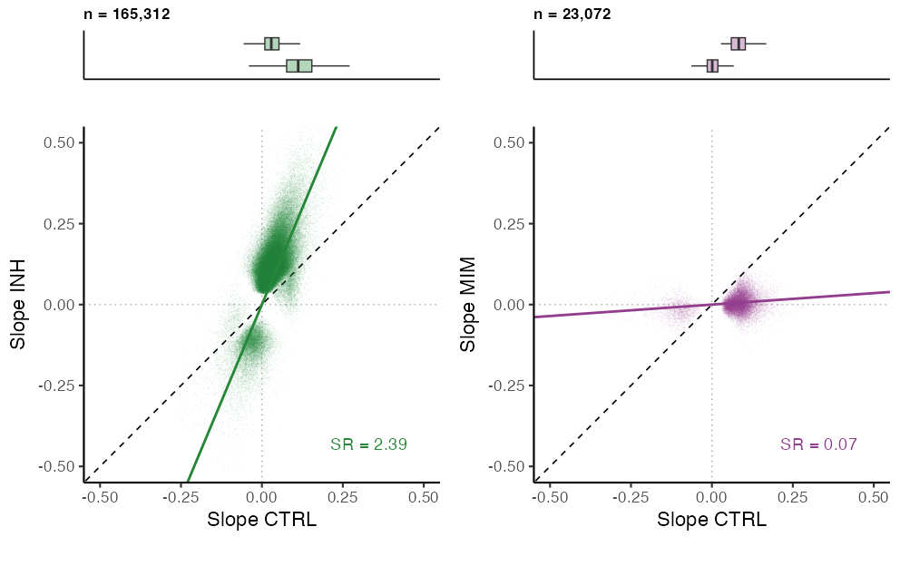

## n — Methylation displacement

The methylation walk uses the 50,000 most variable finite features of the
**adjusted noncollapsed M matrix**. Condition/time centroids define successive
changes; a shared two-dimensional step representation preserves the relevant
displacement geometry and RMS scaling. This is not an ordinary PCA or UMAP
of samples. The accepted panel uses the saved original orientation, without
the exploratory 90-degree rotation. Coordinates, selected probes, matrix name
and displacement metrics are bundled explicitly.


```r
# Historical walk algorithms; mechanically reformatted, no analytical changes.
# Source: methylation_walk_omd.R. Only reusable functions are retained.
distance_label <- function(mode = c("RMS", "MS")) {
    mode <- match.arg(mode)
    if (mode == "RMS") 
        "RMS ΔM"
    else "MS ΔM²"
} 

vector_distance <- function(x, mode = c("RMS", "MS")) {
    mode <- match.arg(mode)
    if (mode == "RMS") {
        sqrt(mean(x^2, na.rm = TRUE))
    }
    else {
        mean(x^2, na.rm = TRUE)
    }
} 

step_distances <- function(x, mode = c("RMS", "MS")) {
    mode <- match.arg(mode)
    if (mode == "RMS") {
        sqrt(colMeans(x^2, na.rm = TRUE))
    }
    else {
        colMeans(x^2, na.rm = TRUE)
    }
} 

cosine_similarity <- function(a, b) {
    den <- sqrt(sum(a^2, na.rm = TRUE) * sum(b^2, na.rm = TRUE))
    if (!is.finite(den) || den <= 0) 
        return(NA_real_)
    sum(a * b, na.rm = TRUE)/den
} 

rotate_xy <- function(xy, theta) {
    R <- matrix(c(cos(theta), -sin(theta), sin(theta), cos(theta)), nrow = 2, byrow = TRUE)
    as.matrix(xy) %*% t(R)
} 

make_spline_path <- function(df, n = SMOOTH_CURVE_N) {
    df <- df %>% dplyr::arrange(time)
    cumulative_arc_length <- c(0, cumsum(sqrt(diff(df$x_plot)^2 + diff(df$y_plot)^2)))
    if (nrow(df) < 3 || length(unique(cumulative_arc_length)) < 3) {
        return(df %>% dplyr::transmute(condition, experiment, arm, curve_order = dplyr::row_number(), 
            x_plot, y_plot))
    }
    interpolation_axis <- seq(min(cumulative_arc_length), max(cumulative_arc_length), length.out = n)
    spline_x <- stats::spline(x = cumulative_arc_length, y = df$x_plot, xout = interpolation_axis, method = "natural")
    spline_y <- stats::spline(x = cumulative_arc_length, y = df$y_plot, xout = interpolation_axis, method = "natural")
    tibble::tibble(condition = df$condition[1], experiment = df$experiment[1], arm = df$arm[1], curve_order = seq_along(interpolation_axis), 
        x_plot = spline_x$y, y_plot = spline_y$y)
} 

probe_base <- function(x) {
    sub("_.*$", "", as.character(x))
} 

resolve_probe_ids <- function(requested_ids, matrix_ids) {
    requested_ids <- unique(as.character(requested_ids))
    requested_ids <- requested_ids[!is.na(requested_ids)]
    exact <- intersect(requested_ids, matrix_ids)
    requested_base <- unique(probe_base(requested_ids))
    matrix_base <- probe_base(matrix_ids)
    unique(c(exact, matrix_ids[matrix_base %in% requested_base]))
} 

finite_probe_ids <- function(mval, sample_ids = colnames(mval)) {
    sample_ids <- intersect(sample_ids, colnames(mval))
    keep <- rowSums(is.finite(mval[, sample_ids, drop = FALSE])) == length(sample_ids)
    rownames(mval)[keep]
} 

select_top_variable <- function(mval, sample_ids, n_top) {
    sample_ids <- intersect(sample_ids, colnames(mval))
    finite_ids <- finite_probe_ids(mval, sample_ids)
    x <- mval[finite_ids, sample_ids, drop = FALSE]
    rv <- matrixStats::rowVars(x)
    ord <- order(rv, decreasing = TRUE, na.last = NA)
    ord <- ord[seq_len(min(length(ord), as.integer(n_top)))]
    selected <- rownames(x)[ord]
    intersect(selected, finite_probe_ids(mval))
} 

prepare_matrix <- function(mval, probes) {
    probes <- intersect(unique(probes), rownames(mval))
    if (length(probes) == 0) 
        stop("No requested probes found.")
    x <- mval[probes, , drop = FALSE]
    keep <- rowSums(is.finite(x)) == ncol(x)
    x <- x[keep, , drop = FALSE]
    if (nrow(x) < 10) 
        stop("Too few finite probes remain.")
    x
} 

condition_to_experiment <- function(x) {
    dplyr::case_when(grepl("^inh_", x) ~ "Inhibitor experiment", grepl("^mim_", x) ~ "Mimic experiment", 
        TRUE ~ NA_character_)
} 

condition_to_arm <- function(x) {
    dplyr::case_when(x %in% c("inh_CTRL", "mim_CTRL") ~ "Matched CTRL", x == "inh_INH" ~ "miR-29 inhibitor", 
        x == "mim_MIM" ~ "miR-29 mimic", TRUE ~ x)
} 

build_centroids <- function(mval, anno, conditions = CONDITIONS, times = TIME_LEVELS) {
    grid <- expand.grid(condition = conditions, time = times, KEEP.OUT.ATTRS = FALSE, stringsAsFactors = FALSE)
    grid <- grid[order(match(grid$condition, conditions), match(grid$time, times)), , drop = FALSE]
    centroids <- matrix(NA_real_, nrow = nrow(mval), ncol = nrow(grid), dimnames = list(rownames(mval), 
        paste(grid$condition, paste0("T", grid$time), sep = "__")))
    for (i in seq_len(nrow(grid))) {
        idx <- anno$condition_walk == grid$condition[i] & anno$time_walk == grid$time[i]
        centroids[, i] <- rowMeans(mval[, idx, drop = FALSE])
    }
    centroids
} 

build_steps <- function(centroids, conditions = CONDITIONS, times = TIME_LEVELS) {
    step_meta <- dplyr::bind_rows(lapply(conditions, function(cc) {
        tibble::tibble(condition = cc, from = times[-length(times)], to = times[-1])
    }))
    step_meta$step_id <- paste0(step_meta$condition, "__T", step_meta$from, "_to_T", step_meta$to)
    step_vectors <- matrix(NA_real_, nrow = nrow(centroids), ncol = nrow(step_meta), dimnames = list(rownames(centroids), 
        step_meta$step_id))
    for (i in seq_len(nrow(step_meta))) {
        from_col <- paste(step_meta$condition[i], paste0("T", step_meta$from[i]), sep = "__")
        to_col <- paste(step_meta$condition[i], paste0("T", step_meta$to[i]), sep = "__")
        step_vectors[, i] <- centroids[, to_col] - centroids[, from_col]
    }
    list(step_vectors = step_vectors, step_meta = step_meta)
} 

embed_steps <- function(step_vectors, step_lengths) {
    n_cpg <- nrow(step_vectors)
    gram <- crossprod(step_vectors)/n_cpg
    eig <- eigen(gram, symmetric = TRUE)
    vals <- pmax(eig$values[1:2], 0)
    xy <- eig$vectors[, 1:2, drop = FALSE] %*% diag(sqrt(vals), nrow = 2)
    raw_len <- sqrt(rowSums(xy^2))
    good <- raw_len > 1e-12 & is.finite(raw_len)
    xy[good, ] <- xy[good, , drop = FALSE]/raw_len[good] * step_lengths[good]
    if (any(!good)) {
        theta <- seq(0, 2 * pi, length.out = sum(!good) + 1)[-1]
        xy[!good, 1] <- cos(theta) * step_lengths[!good]
        xy[!good, 2] <- sin(theta) * step_lengths[!good]
    }
    colnames(xy) <- c("dx", "dy")
    xy
} 

make_walk <- function(mval, anno, feature_id, feature_label, distance_mode = c("RMS", "MS")) {
    distance_mode <- match.arg(distance_mode)
    mval <- prepare_matrix(mval, rownames(mval))
    centroids <- build_centroids(mval, anno)
    st <- build_steps(centroids)
    step_lengths <- step_distances(st$step_vectors, distance_mode)
    st$step_meta$step_length <- step_lengths
    step_xy <- embed_steps(st$step_vectors, step_lengths)
    path_df <- dplyr::bind_rows(lapply(CONDITIONS, function(cc) {
        xy <- matrix(0, nrow = length(TIME_LEVELS), ncol = 2)
        for (k in seq_len(length(TIME_LEVELS) - 1)) {
            idx <- which(st$step_meta$condition == cc & st$step_meta$from == TIME_LEVELS[k] & st$step_meta$to == 
                TIME_LEVELS[k + 1])
            xy[k + 1, ] <- xy[k, ] + step_xy[idx, ]
        }
        tibble::tibble(condition = cc, time = TIME_LEVELS, time_label = paste0("T", TIME_LEVELS), x = xy[, 
            1], y = xy[, 2])
    }))
    ref <- path_df %>% dplyr::filter(condition == "inh_CTRL", time == max(TIME_LEVELS))
    angle <- atan2(ref$y, ref$x)
    path_df[, c("x", "y")] <- rotate_xy(path_df[, c("x", "y")], -angle)
    path_df <- path_df %>% dplyr::mutate(x_plot = x * PLOT_SCALE, y_plot = y * PLOT_SCALE, experiment = condition_to_experiment(condition), 
        arm = condition_to_arm(condition))
    ref_net <- centroids[, paste("inh_CTRL", paste0("T", max(TIME_LEVELS)), sep = "__")] - centroids[, 
        paste("inh_CTRL", paste0("T", min(TIME_LEVELS)), sep = "__")]
    metrics <- dplyr::bind_rows(lapply(CONDITIONS, function(cc) {
        idx_steps <- st$step_meta$condition == cc
        path_length <- sum(st$step_meta$step_length[idx_steps])
        net <- centroids[, paste(cc, paste0("T", max(TIME_LEVELS)), sep = "__")] - centroids[, paste(cc, 
            paste0("T", min(TIME_LEVELS)), sep = "__")]
        net_displacement <- vector_distance(net, distance_mode)
        tibble::tibble(feature_id = feature_id, feature_space = feature_label, distance_mode = distance_mode, 
            distance_label = distance_label(distance_mode), condition = cc, n_cpg = nrow(mval), path_length = path_length, 
            net_displacement = net_displacement, straightness = net_displacement/path_length, cosine_to_inhibitor_ctrl = cosine_similarity(net, 
                ref_net))
    })) %>% dplyr::mutate(experiment = condition_to_experiment(condition), arm = condition_to_arm(condition)) %>% 
        dplyr::group_by(experiment) %>% dplyr::mutate(path_length_ratio_to_ctrl = path_length/path_length[arm == 
        "Matched CTRL"], net_displacement_ratio_to_ctrl = net_displacement/net_displacement[arm == "Matched CTRL"]) %>% 
        dplyr::ungroup()
    curve_df <- dplyr::bind_rows(lapply(split(path_df, path_df$condition), make_spline_path, n = SMOOTH_CURVE_N))
    rm(centroids, st)
    invisible(gc())
    list(feature_id = feature_id, feature_space = feature_label, distance_mode = distance_mode, distance_label = distance_label(distance_mode), 
        n_cpg = nrow(mval), path_df = path_df, curve_df = curve_df, metrics = metrics)
}
```

```r
# ---- 4n
# The original script left MVALS externally assigned. This reconstruction
# explicitly records the candidate matrix; the audit compares its geometry.
source("code/upstream/lib_methylation_walk.R")
TIME_LEVELS <- 1:6
BASELINE_TIME <- 1L
CONDITIONS <- c("inh_CTRL", "inh_INH", "mim_CTRL", "mim_MIM")
PLOT_SCALE <- 1000
SMOOTH_CURVE_N <- 300L
variant <- Sys.getenv("FIG4_WALK_MATRIX", "pan_mval_all.adj_26june2026.RDS")
key <- paste0("walk_", sub("\\.RDS$", "", variant))
obj <- cache(key, function() {
  x <- as.matrix(read_input(variant))
  meta <- metadata(); meta <- meta[match(colnames(x), meta$sample), ]
  meta$condition_walk <- meta$mGROUP; meta$time_walk <- meta$TP2
  probes <- select_top_variable(x, colnames(x), 50000)
  out <- make_walk(x[probes, , drop = FALSE], meta, "top50k_all", "Top 50,000 variable CpGs", "RMS")
  out$matrix_file <- variant; out$probes <- probes
  out
})
save_table(obj$metrics, paste0("panel_o_metrics_", key))
save_table(obj$path_df, paste0("panel_o_coordinates_", key))
colors <- c("Matched CTRL" = COLORS[["CTRL"]], "miR-29 inhibitor" = COLORS[["INH"]], "miR-29 mimic" = COLORS[["MIM"]])
# The accepted final panel uses the original unrotated coordinates.
orient <- function(d) d
d <- orient(obj$path_df); curves <- orient(obj$curve_df)
max_r <- max(sqrt(d$x_plot^2 + d$y_plot^2)) * 1.12
radii <- pretty(c(0, max_r), n = 4); radii <- radii[radii > 0 & radii <= max_r]
rings <- bind_rows(lapply(radii, function(r) data.frame(r, x = r * cos(seq(0, 2*pi, length.out = 361)),
                                                       y = r * sin(seq(0, 2*pi, length.out = 361)))))
p <- ggplot() + geom_path(data = rings, aes(x, y, group = r), color = "grey75", linewidth = .25, linetype = 3) +
  geom_path(data = d, aes(x_plot, y_plot, color = arm, group = condition), linewidth = .3, alpha = .5) +
  geom_path(data = curves, aes(x_plot, y_plot, color = arm, group = condition), linewidth = .7) +
  geom_point(data = d, aes(x_plot, y_plot, color = arm), size = 2) +
  geom_text(data = subset(d, time %in% c(1, 6)), aes(x_plot, y_plot, label = time_label, color = arm), nudge_y = max_r*.065, size = 3) +
  facet_wrap(~experiment, nrow = 1) + coord_equal(xlim = c(-max_r,max_r), ylim = c(-max_r,max_r)) +
  scale_x_continuous(breaks = c(-1000, 0, 1000)) +
  scale_color_manual(values = colors) + labs(x = expression("Dimension 1 (RMS "*10^3*")"), y = "Dimension 2") +
  theme_figure() + theme(panel.spacing = grid::unit(8, "mm"), legend.text = element_text(size = 8))
save_panel(p, "4n_methylation_walk", 6.0, 3.5)
```
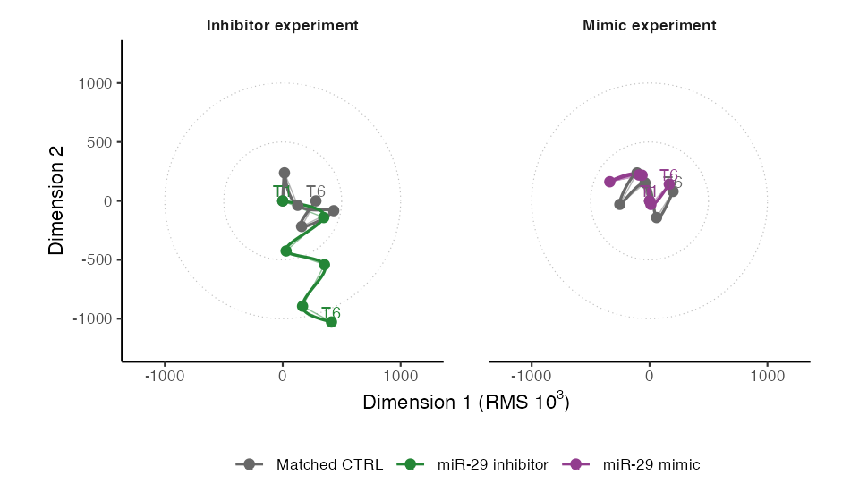

## o — Deviation from the fibroblast reference

### Left: external selection of 123 CpGs

The adopted set is defined by probe-level criteria in external reference cohorts.
The initial dataset contains 485,512 measured probes; 384,494 autosomal,
platform-compatible sites enter the initial screen. The selection proceeds
hierarchically, not as three parallel signatures:

1. GSE77135 paired dura/scalp fibroblasts: adequate detection, absolute
   tissue effect ≤0.05 beta, age slope ≤0.001 beta/year, and sex contrast
   ≤0.05 beta yield **222,344** sites. Donor-level covariates use donor means,
   avoiding pseudoreplication of paired tissue samples. The reference centroid
   is the per-CpG median in this fibroblast reference.
2. GSE179847 normal/control fibroblast culture series: detection ≥90% and
   predicted full-range culture change within ±0.05 beta in both unadjusted
   and batch-adjusted models yield **169,861** culture-filtered sites.
3. Cell-type association: a balanced fibroblast-versus-epithelial/SMC contrast
   in GSE31848, with gender-adjusted BH q ≤0.20, adequate detection, concordant
   adjusted/unadjusted signs, and absolute effect ≥0.10 beta in both fits.
   The same effect direction and ≥0.10 magnitude are required against purified
   immune cells in GSE110554. This yields **123 CpGs** (36 fibroblast-high and
   87 fibroblast-low). The complete probe list,
   external medians, selection statistics and gene annotations are supplied
   in `data/fidelity123/HGF123_reference.tsv` and Supplementary Data 4.

The immune cohort contributes to selection and is not held-out validation.
The comparator scope is epithelial, SMC/perivascular and immune cells, not
every human lineage. “Stable” denotes the stated effect-size bounds, not a
formal equivalence test or proof of independence from every covariate. Sex
robustness is especially limited by the reference cohort's sex imbalance.
The term **fibroblast-associated reference** is therefore more precise than
an unrestricted claim of fibroblast-specific lineage identity.


```r
# Pure selection functions. Inputs are external cohort-level probe audits.
# The current replay applies the adopted q <= 0.20 bound without re-searching
# thresholds. Bound-based stability is not an equivalence test.
stable_reference_sites <- function(audit) {
  keep <- with(audit, detection_fraction >= .90 & site_abs <= .05 &
                 age_abs <= .001 & sex_abs <= .05)
  audit$cg[which(keep)]
}
culture_stable_sites <- function(audit) {
  keep <- with(audit, detection_fraction >= .90 &
    is.finite(delta_beta_full_range_unadjusted) &
    is.finite(delta_beta_full_range_batch_adjusted) &
    abs(delta_beta_full_range_unadjusted) <= .05 &
    abs(delta_beta_full_range_batch_adjusted) <= .05)
  audit$probe[which(keep)]
}
fibroblast_associated_sites <- function(audit, q_threshold = .20) {
  keep <- with(audit, q_gender_adjusted <= q_threshold & detection_gse31848 >= .90 &
    sign(delta_fibroblast_vs_nonfibro_unadjusted) ==
      sign(delta_fibroblast_vs_nonfibro_gender_adjusted) &
    abs(delta_fibroblast_vs_nonfibro_unadjusted) >= .10 &
    abs(delta_fibroblast_vs_nonfibro_gender_adjusted) >= .10 &
    abs(delta_fibroblast_vs_immune_external) >= .10 &
    sign(delta_fibroblast_vs_nonfibro_gender_adjusted) ==
      sign(delta_fibroblast_vs_immune_external))
  audit$probe[which(keep)]
}
# The discovery effect gives equal weight to epithelial and SMC/perivascular
# comparators, not to their unequal sample counts. Repeated arrays are averaged
# by cell line before this function. Both methylation directions are eligible.
fit_identity_contrast <- function(beta, metadata, adjust_gender = TRUE) {
  metadata$lineage_group <- factor(metadata$lineage_group,
    levels = c("Epithelial", "SMC_perivascular", "Fibroblast"))
  design <- model.matrix(if (adjust_gender) ~ 0 + lineage_group + gender else
                          ~ 0 + lineage_group, metadata)
  contrast <- limma::makeContrasts(
    lineage_groupFibroblast - .5 * lineage_groupEpithelial - .5 * lineage_groupSMC_perivascular,
    levels = design)
  limma::eBayes(limma::contrasts.fit(limma::lmFit(beta, design), contrast), robust = TRUE)
}
```
The left-hand cell/selection schematic is editorial artwork; its updated
123-CpG label is visible in the approved full Figure 4 at the end of this document.

### Center and right: score, pairing and uncertainty

For sample `s`, the score is the **unweighted mean absolute distance** to the
frozen fibroblast centroid across the same 123 CpGs:

\[
D_s=\frac{1}{123}\sum_{j=1}^{123}|\beta_{js}-r_j|,\qquad
\Delta D_{b,t}=100\,[D_{\mathrm{treated},b,t}-D_{\mathrm{CTRL},b,t}].
\]

The historical object calls this raw WAR. In this implementation it is an
unweighted absolute-residual score, not a directional mean beta difference.
A positive delta means **greater distance from the reference than the matched
control**. One percentage point is a 0.01 increase in mean absolute beta
distance; it is neither “1% of lineage lost” nor necessarily +0.01 beta at every
site. A global methylation shift can contribute to this distance, so the result
does not alone establish transdifferentiation or loss of transcriptional identity.

The center shows the mean of three within-run cycle means and their SEM.
A quadratic is fitted through the three mean values and the interpolated SEM
is placed around that descriptive curve. The right panel shows T5 and T6 for
each run, with lines joining the two observations and diamonds at the run mean.
No extra methylation-level batch correction is applied to the accepted score;
same-run control subtraction supplies the pairing.

For inference, the **arithmetic mean over T1–T6 is first calculated within
each experiment** and the three experiment means are tested against zero.
The displayed global q values are 0.0253 (INH) and 0.895 (MIM). These assess
mean displacement from matched controls, not whether displacement grows
significantly with time. The late endpoint uses the three T5–T6 experiment
means and yields q = 0.0132 (INH) and q = 0.424 (MIM). BH correction is applied
across the two arms separately for each endpoint. Timepoints and CpGs are
not counted as additional experimental replicates.


```r
# Figure 4o: current 123-CpG external reference, raw-beta scoring and matched inference.
# The displayed global q tests the arithmetic mean matched displacement over
# T1-T6, not a temporal slope, an interaction, or a duration-weighted AUC.
read_fidelity123 <- function(name) {
  d <- read.delim(file.path("data/fidelity123", paste0(name, ".tsv")),
                 check.names = FALSE, stringsAsFactors = FALSE,
                 na.strings = c("NA", "\\N"))
  d[, !names(d) %in% c("", "\\N"), drop = FALSE]
}
reference123 <- read_fidelity123("HGF123_reference")
stopifnot(nrow(reference123) == 123L, !anyDuplicated(reference123$probe),
          all(is.finite(reference123$reference)))
ref <- setNames(reference123$reference, reference123$probe)

# Require all 123 probes, exactly once, in every scored sample. No imputation,
# recentering, batch correction or redefinition of the centroid is performed.
score_fidelity123 <- function(name, samples) {
  b <- read_fidelity123(name)
  stopifnot(setequal(b$probe, names(ref)), setequal(b$sample, samples),
            !anyDuplicated(b[c("probe", "sample")]), all(is.finite(b$beta)),
            all(table(b$sample) == 123L), all(b$beta >= 0 & b$beta <= 1))
  b$absolute_distance <- abs(b$beta - ref[b$probe])
  b %>% group_by(sample) %>%
    summarise(reference_distance_beta = mean(absolute_distance),
              n_reference_CpGs = n(), .groups = "drop")
}
one_sample <- function(v) {
  stopifnot(length(v) == 3L, all(is.finite(v)))
  test <- t.test(v, mu = 0, alternative = "two.sided")
  data.frame(n_experiments = length(v), mean_pp = mean(v),
             sem_pp = sd(v) / sqrt(length(v)), ci_low_pp = test$conf.int[1],
             ci_high_pp = test$conf.int[2], t = unname(test$statistic),
             df = unname(test$parameter), p = test$p.value)
}
test_run_summaries <- function(d) {
  d %>% group_by(endpoint, arm) %>% group_modify(~one_sample(.x$value)) %>%
    ungroup() %>% group_by(endpoint) %>%
    mutate(q = p.adjust(p, "BH"),
           test = "Two-sided one-sample t-test of matched run summaries against zero",
           q_family = "BH across INH and MIM, separately for this endpoint") %>% ungroup()
}
validate_reference_tests <- function(observed, expected, label) {
  if ("metric" %in% names(expected))
    expected <- expected[expected$metric == "reference_distance", , drop = FALSE]
  idx <- match(paste(observed$arm, observed$endpoint), paste(expected$arm, expected$endpoint))
  stopifnot(!anyNA(idx))
  for (nm in c("mean_pp", "sem_pp", "ci_low_pp", "ci_high_pp", "p"))
    assert_close(observed[[nm]], expected[[nm]][idx], paste(label, nm), 1e-10)
  assert_close(observed$q, expected$q_two_arms[idx], paste(label, "BH q"), 1e-10)
}
q_caption <- function(d, prefix = "Global q") {
  paste0(prefix, ": INH = ", formatC(d$q[match("INH", d$arm)], digits = 3, format = "f"),
         "; MIM = ", formatC(d$q[match("MIM", d$arm)], digits = 3, format = "f"))
}

fidelity_samples <- read_fidelity123("HGF_samples")
fidelity_samples <- fidelity_samples %>%
  left_join(score_fidelity123("HGF123_beta", fidelity_samples$sample), by = "sample")
stopifnot(nrow(fidelity_samples) == 72L, !anyNA(fidelity_samples$reference_distance_beta))
controls <- fidelity_samples %>% filter(GROUP == "CTRL") %>%
  select(EXPERIMENT, BATCH, TIME, control_sample = sample,
         control_distance_beta = reference_distance_beta)
stopifnot(!anyDuplicated(controls[c("EXPERIMENT", "BATCH", "TIME")]))
fidelity_delta <- fidelity_samples %>% filter(GROUP != "CTRL") %>%
  left_join(controls, by = c("EXPERIMENT", "BATCH", "TIME")) %>%
  mutate(arm = as.character(GROUP),
         delta_pp = 100 * (reference_distance_beta - control_distance_beta),
         cycle = ceiling(TIME / 2), hours = time_hours)
stopifnot(nrow(fidelity_delta) == 36L, !anyNA(fidelity_delta$delta_pp),
          !anyDuplicated(fidelity_delta[c("arm", "BATCH", "TIME")]))
cycle_exp <- fidelity_delta %>% group_by(arm, BATCH, cycle) %>%
  summarise(value = mean(delta_pp), n_timepoints = n(), .groups = "drop") %>%
  mutate(hours = c(84, 180, 276)[cycle])
stopifnot(all(cycle_exp$n_timepoints == 2))
cycle_summary <- cycle_exp %>% group_by(arm, cycle, hours) %>%
  summarise(mean = mean(value), sem = sd(value) / sqrt(n()), n = n(), .groups = "drop")
stopifnot(all(cycle_summary$n == 3))
full_means <- fidelity_delta %>% group_by(arm, BATCH) %>%
  summarise(value = mean(delta_pp), n_timepoints = n(), .groups = "drop") %>%
  mutate(endpoint = "all_T1_T6")
late_means <- fidelity_delta %>% filter(cycle == 3) %>% group_by(arm, BATCH) %>%
  summarise(value = mean(delta_pp), n_timepoints = n(), .groups = "drop") %>%
  mutate(endpoint = "late_T5_T6")
stopifnot(all(full_means$n_timepoints == 6), all(late_means$n_timepoints == 2))
run_means <- bind_rows(full_means, late_means)
primary_tests <- test_run_summaries(run_means)
global_tests <- filter(primary_tests, endpoint == "all_T1_T6")
late_tests <- filter(primary_tests, endpoint == "late_T5_T6")
validate_reference_tests(primary_tests, read_fidelity123("HGF_tests"), "123-CpG HGF")
cycle_average <- cycle_exp %>% group_by(arm, BATCH) %>%
  summarise(value = mean(value), .groups = "drop")
idx <- match(paste(full_means$arm, full_means$BATCH), paste(cycle_average$arm, cycle_average$BATCH))
assert_close(full_means$value, cycle_average$value[idx], "HGF full mean equals equal cycle mean")

# Quadratic interpolation and pointwise SEM are descriptive, not inferential.
cycle_fit <- cycle_summary %>% group_by(arm) %>% group_modify(~ {
  model <- lm(mean ~ poly(hours, 2, raw = TRUE), .x)
  grid <- seq(min(.x$hours), max(.x$hours), length.out = 300)
  data.frame(hours = grid, mean = predict(model, data.frame(hours = grid)),
             sem = approx(.x$hours, .x$sem, grid)$y)
}) %>% ungroup()
p_center <- ggplot(cycle_summary, aes(hours, mean, color = arm, group = arm)) +
  geom_hline(yintercept = 0, linetype = 2, color = "grey65", linewidth = .35) +
  geom_ribbon(data = cycle_fit, aes(ymin = mean - sem, ymax = mean + sem, fill = arm),
              color = NA, alpha = .14) +
  geom_line(data = cycle_fit, linewidth = .85) +
  geom_errorbar(aes(ymin = mean - sem, ymax = mean + sem), width = 8, linewidth = .4) +
  geom_point(size = 3) + scale_color_manual(values = COLORS) +
  scale_fill_manual(values = COLORS, guide = "none") +
  scale_x_continuous(breaks = c(84, 180, 276), labels = c("T1–T2", "T3–T4", "T5–T6")) +
  labs(x = NULL, y = "Deviation vs matched CTRL (beta percentage points)",
       title = "Deviation from fibroblast reference (123 CpGs)",
       subtitle = q_caption(global_tests)) + theme_figure()
save_panel(p_center, "4o_center_fibroblast_deviation", 5.1, 3.8)

late <- fidelity_delta %>% filter(cycle == 3) %>%
  group_by(arm) %>% mutate(batch_index = match(BATCH, sort(unique(BATCH))),
                         x = match(arm, c("INH", "MIM")) + .19 * (batch_index - 2) +
                           ifelse(TIME == 5, -.035, .035)) %>% ungroup()
late_plot_means <- late %>% group_by(arm, BATCH, batch_index) %>%
  summarise(value = mean(delta_pp), .groups = "drop") %>%
  mutate(x = match(arm, c("INH", "MIM")) + .19 * (batch_index - 2))
late_group <- late_plot_means %>% group_by(arm) %>%
  summarise(value = mean(value), .groups = "drop") %>% mutate(x = match(arm, c("INH", "MIM")))
p_right <- ggplot(late, aes(x, delta_pp, color = arm)) +
  geom_hline(yintercept = 0, color = "grey65", linetype = 2) +
  geom_line(aes(group = interaction(arm, BATCH)), linewidth = .4, alpha = .4) +
  geom_point(aes(shape = factor(TIME)), size = 2.5, alpha = .8) +
  geom_point(data = late_plot_means, aes(y = value, fill = arm), shape = 23, size = 4) +
  geom_segment(data = late_group, aes(x = x - .32, xend = x + .32, y = value, yend = value)) +
  scale_shape_manual(values = c("5" = 1, "6" = 0), labels = c("T5", "T6"), name = NULL) +
  scale_color_manual(values = COLORS, guide = "none") +
  scale_fill_manual(values = COLORS, guide = "none") +
  scale_x_continuous(breaks = 1:2, labels = c("INH", "MIM"), limits = c(.55, 2.45)) +
  labs(x = NULL, y = "Deviation vs matched CTRL (beta percentage points)",
       title = "Late response: T5 + T6", subtitle = q_caption(late_tests, "Late q")) + theme_figure()
save_panel(p_right, "4o_right_late_response", 4.2, 3.8)
save_panel(plot_grid(p_center, p_right, nrow = 1, rel_widths = c(5.1, 4.2)),
           "4o_center_and_right", 9.3, 3.8)
save_table(fidelity_samples, "4o_sample_reference_distances")
save_table(fidelity_delta, "4o_matched_deltas")
save_table(cycle_exp, "4o_cycle_means_per_experiment")
save_table(cycle_summary, "4o_cycle_mean_SEM")
save_table(run_means, "4o_run_means_all_and_late")
save_table(primary_tests, "4o_123CpG_primary_tests")
save_table(global_tests, "4o_global_tests")
save_table(late_tests, "4o_late_tests")
save_table(reference123, "4o_123CpG_reference_annotation")

# Retain the existing alternative trajectory summaries as diagnostics only;
# neither AUC is used for the current central-panel q.
normalized_auc <- function(x, y) {
  o <- order(x); x <- x[o]; y <- y[o]
  sum(diff(x) * (head(y, -1) + tail(y, -1)) / 2) / diff(range(x))
}
cycle_auc <- cycle_exp %>% group_by(arm, BATCH) %>%
  summarise(value = normalized_auc(hours, value), .groups = "drop") %>%
  mutate(endpoint = "cycle_mean_AUC")
full_auc <- fidelity_delta %>% group_by(arm, BATCH) %>%
  summarise(value = normalized_auc(hours, delta_pp), .groups = "drop") %>%
  mutate(endpoint = "full_trajectory_AUC")
cycle_tests <- test_run_summaries(cycle_auc)
full_tests <- test_run_summaries(full_auc)
validate_reference_tests(bind_rows(cycle_tests, full_tests),
                         read_fidelity123("HGF_tests"), "123-CpG HGF AUC diagnostics")
save_table(cycle_tests, "4o_cycle_AUC_tests")
save_table(full_tests, "4o_full_trajectory_AUC_sensitivity")

# Reconstruct selection from independent-cohort audit tables. The final bound
# is q <= 0.20 for the sex-adjusted fibroblast contrast; other filters are fixed.
source("code/upstream/reference_selection.R")
selection <- input("fidelity/selection_checkpoint.rds")
culture <- input("fidelity/culture_checkpoint.rds")
selected123 <- fibroblast_associated_sites(selection$identity_probe_audit)
stopifnot(length(selected123) == 123L, setequal(selected123, names(ref)),
          all(selected123 %in% culture$probes),
          all(culture$probes %in% selection$probes))
assert_close(unname(ref), unname(selection$centroid[names(ref)]), "123-CpG external centroid")
selected_audit <- as.data.frame(selection$identity_probe_audit)
selected_audit <- selected_audit[match(names(ref), selected_audit$probe), ]
# Historical membership flags refer to q <= 0.05; do not export them as the
# membership rule for the adopted q <= 0.20 reference.
selected_audit <- selected_audit[, !grepl("^identity_candidate_", names(selected_audit)), drop = FALSE]
selected_audit$reference_beta <- unname(ref)
save_table(selected_audit, "4o_123CpG_selection_audit")

# Independent donor-derived hTERT support: same fixed probes and centroid,
# matched within arm, experiment and collection. These are supplementary-data
# results, not a replacement or relabelling of an official S4 figure panel.
htert_reference_samples <- read_fidelity123("hTERT_samples") %>%
  left_join(score_fidelity123("hTERT123_beta", read_fidelity123("hTERT_samples")$sample), by = "sample")
stopifnot(nrow(htert_reference_samples) == 36L, !anyNA(htert_reference_samples$reference_distance_beta))
hc <- htert_reference_samples %>% filter(GROUP == "CTRL") %>%
  select(EXPERIMENT, BATCH, TP2, control_sample = sample,
         control_distance_beta = reference_distance_beta)
stopifnot(!anyDuplicated(hc[c("EXPERIMENT", "BATCH", "TP2")]))
htert_reference_delta <- htert_reference_samples %>% filter(GROUP != "CTRL") %>%
  left_join(hc, by = c("EXPERIMENT", "BATCH", "TP2")) %>%
  mutate(arm = GROUP, round = as.integer(TP2),
         delta_pp = 100 * (reference_distance_beta - control_distance_beta))
stopifnot(nrow(htert_reference_delta) == 18L, !anyNA(htert_reference_delta$delta_pp),
          !anyDuplicated(htert_reference_delta[c("arm", "BATCH", "round")]))
htert_reference_runs <- bind_rows(
  htert_reference_delta %>% group_by(arm, BATCH) %>%
    summarise(value = mean(delta_pp), n_timepoints = n(), .groups = "drop") %>%
    mutate(endpoint = "mean_three_rounds_pp"),
  htert_reference_delta %>% filter(round == 3) %>%
    transmute(arm, BATCH, value = delta_pp, n_timepoints = 1L, endpoint = "third_cycle_96h"))
stopifnot(all(htert_reference_runs$n_timepoints[htert_reference_runs$endpoint == "mean_three_rounds_pp"] == 3L))
htert_reference_tests <- test_run_summaries(htert_reference_runs)
validate_reference_tests(htert_reference_tests, read_fidelity123("hTERT_tests"), "123-CpG hTERT")
htert_reference_summary <- htert_reference_delta %>% group_by(arm, round) %>%
  summarise(mean_pp = mean(delta_pp), sem_pp = sd(delta_pp) / sqrt(n()),
            n_experiments = n(), .groups = "drop")
stopifnot(all(htert_reference_summary$n_experiments == 3L))
save_table(htert_reference_samples, "hTERT_123CpG_sample_reference_distances")
save_table(htert_reference_delta, "hTERT_123CpG_matched_deltas")
save_table(htert_reference_runs, "hTERT_123CpG_run_means_all_and_late")
save_table(htert_reference_summary, "hTERT_123CpG_cycle_mean_SEM")
save_table(htert_reference_tests, "hTERT_123CpG_reference_tests")

# HPF transfer remains descriptive (one matched pair per timepoint).
save_table(read_fidelity123("HPF_descriptive"), "HPF_123CpG_reference_distance_descriptive")
```
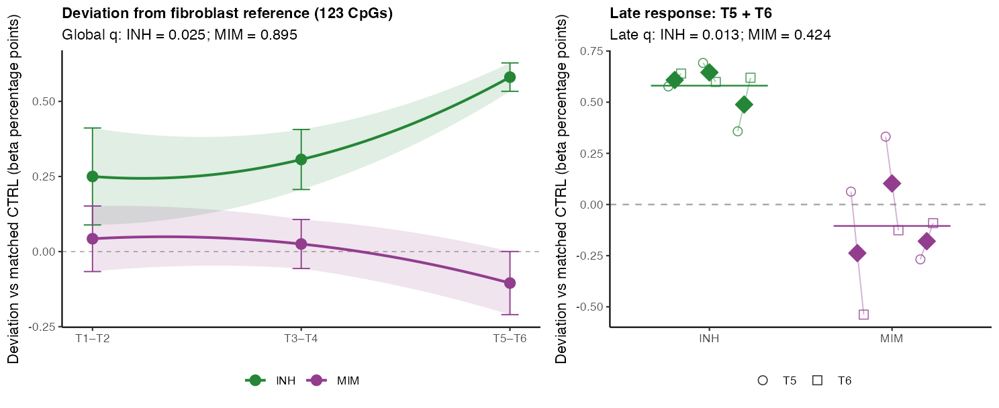

|endpoint   |arm | n_experiments| mean_pp| sem_pp| ci_low_pp| ci_high_pp|       t| df|      p|      q|test                                                              |q_family                                            |
|:----------|:---|-------------:|-------:|------:|---------:|----------:|-------:|--:|------:|------:|:-----------------------------------------------------------------|:---------------------------------------------------|
|late_T5_T6 |INH |             3|  0.5807| 0.0473|     0.377|     0.7845| 12.2658|  2| 0.0066| 0.0132|Two-sided one-sample t-test of matched run summaries against zero |BH across INH and MIM, separately for this endpoint |
|late_T5_T6 |MIM |             3| -0.1048| 0.1051|    -0.557|     0.3475| -0.9969|  2| 0.4238| 0.4238|Two-sided one-sample t-test of matched run summaries against zero |BH across INH and MIM, separately for this endpoint |


|endpoint  |arm | n_experiments| mean_pp| sem_pp| ci_low_pp| ci_high_pp|       t| df|      p|      q|test                                                              |q_family                                            |
|:---------|:---|-------------:|-------:|------:|---------:|----------:|-------:|--:|------:|------:|:-----------------------------------------------------------------|:---------------------------------------------------|
|all_T1_T6 |INH |             3|  0.3791| 0.0430|    0.1940|     0.5642|  8.8131|  2| 0.0126| 0.0253|Two-sided one-sample t-test of matched run summaries against zero |BH across INH and MIM, separately for this endpoint |
|all_T1_T6 |MIM |             3| -0.0123| 0.0827|   -0.3679|     0.3433| -0.1488|  2| 0.8954| 0.8954|Two-sided one-sample t-test of matched run summaries against zero |BH across INH and MIM, separately for this endpoint |

### The same reference in hTERT HGF and the HPF series

The **same 123 CpGs and the same external medians** are applied to independently
sourced, donor-distinct hTERT gingival fibroblasts, without reselecting the
signature in that model. Treatment is compared with its contemporaneous
same-run control. At 96 h after the third cycle, INH shows increased distance
with q = 0.0409; MIM q = 0.406. These are final-cycle endpoint tests on three
matched experimental differences, not primary-HGF T5–T6 tests and not tests
of a temporal increase. The mean over all three hTERT cycles gives q = 0.0777
(INH) and q = 0.294 (MIM), reported separately for completeness.


|endpoint             |arm | n_experiments| mean_pp| sem_pp| ci_low_pp| ci_high_pp|      t| df|      p|      q|test                                                              |q_family                                            |
|:--------------------|:---|-------------:|-------:|------:|---------:|----------:|------:|--:|------:|------:|:-----------------------------------------------------------------|:---------------------------------------------------|
|mean_three_rounds_pp |INH |             3|  0.1330| 0.0270|    0.0168|     0.2491| 4.9247|  2| 0.0388| 0.0777|Two-sided one-sample t-test of matched run summaries against zero |BH across INH and MIM, separately for this endpoint |
|mean_three_rounds_pp |MIM |             3|  0.0793| 0.0562|   -0.1626|     0.3212| 1.4099|  2| 0.2940| 0.2940|Two-sided one-sample t-test of matched run summaries against zero |BH across INH and MIM, separately for this endpoint |
|third_cycle_96h      |INH |             3|  0.1221| 0.0177|    0.0458|     0.1985| 6.8829|  2| 0.0205| 0.0409|Two-sided one-sample t-test of matched run summaries against zero |BH across INH and MIM, separately for this endpoint |
|third_cycle_96h      |MIM |             3|  0.0570| 0.0545|   -0.1777|     0.2916| 1.0445|  2| 0.4059| 0.4059|Two-sided one-sample t-test of matched run summaries against zero |BH across INH and MIM, separately for this endpoint |

The SV40-HPF reference-distance series is descriptive: one treated/control
pair is available per observation and no p or q value is assigned. It is
distinct from the genome-wide persistence projections in S4m/n.


|timepoint |phase      |control_sample      |treated_sample      | n_signature| n_global| control_distance_pp| treated_distance_pp| distance_difference_pp| global_shift_pp| uniform_shift_predicted_distance_pp| observed_minus_uniform_pp| uniform_clipped_sites| fibroblast_high_signed_delta_pp| fibroblast_low_signed_delta_pp| fibroblast_high_distance_delta_pp| fibroblast_low_distance_delta_pp| n_pairs_per_timepoint|inference                                          |
|:---------|:----------|:-------------------|:-------------------|-----------:|--------:|-------------------:|-------------------:|----------------------:|---------------:|-----------------------------------:|-------------------------:|---------------------:|-------------------------------:|------------------------------:|---------------------------------:|--------------------------------:|---------------------:|:--------------------------------------------------|
|T1        |treatment  |208404170037_R01C01 |208404170037_R02C01 |         123|   930480|             45.7054|             45.8340|                 0.1286|          0.1325|                              0.0657|                    0.0629|                     0|                          0.4090|                        -0.0542|                            0.2525|                           0.0773|                     1|Descriptive only; no biological replication or P/q |
|T2        |treatment  |208404170037_R03C01 |208404170037_R04C01 |         123|   930480|             47.1676|             47.3131|                 0.1455|         -0.0099|                             -0.0049|                    0.1504|                     0|                          0.2216|                         0.9755|                           -0.8501|                           0.5575|                     1|Descriptive only; no biological replication or P/q |
|T3        |treatment  |208404170037_R05C01 |208404170037_R06C01 |         123|   930480|             46.9031|             47.1064|                 0.2033|          0.0346|                              0.0172|                    0.1861|                     0|                          0.4674|                         1.0352|                           -0.8440|                           0.6366|                     1|Descriptive only; no biological replication or P/q |
|T4        |treatment  |208404170037_R07C01 |208404170037_R08C01 |         123|   930480|             47.1994|             47.9236|                 0.7243|         -0.0041|                             -0.0022|                    0.7264|                     0|                          0.2190|                         1.3030|                           -0.2843|                           1.1416|                     1|Descriptive only; no biological replication or P/q |
|T5        |treatment  |208404170067_R01C01 |208404170067_R02C01 |         123|   930480|             46.9494|             47.0283|                 0.0788|          0.1334|                              0.0766|                    0.0022|                     0|                          0.3807|                         0.4362|                           -0.2698|                           0.2231|                     1|Descriptive only; no biological replication or P/q |
|T6        |treatment  |208404170067_R03C01 |208404170067_R04C01 |         123|   930480|             47.3472|             47.6006|                 0.2534|          0.1017|                              0.0571|                    0.1964|                     0|                          0.5327|                         0.6615|                           -0.7329|                           0.6615|                     1|Descriptive only; no biological replication or P/q |
|T7        |withdrawal |208404170067_R05C01 |208404170067_R06C01 |         123|   930480|             47.0228|             47.2078|                 0.1849|          0.0624|                              0.0340|                    0.1510|                     0|                          0.5967|                         0.9056|                           -0.8496|                           0.6130|                     1|Descriptive only; no biological replication or P/q |
|T8        |withdrawal |208404170067_R07C01 |208404170067_R08C01 |         123|   930480|             46.9635|             47.6557|                 0.6922|          0.0765|                              0.0429|                    0.6493|                     0|                          0.4145|                         1.2017|                           -0.0683|                           1.0069|                     1|Descriptive only; no biological replication or P/q |

# Figure S4 — control resolution and complementary models

## a — Global methylation with separate controls

This is the same raw-beta, own-T1, mixed-model estimand as Figure 4d, now with
separate INH and MIM control curves and ordinal display positions 1,2,4,5,7,8.
Intervals remain model-based 90% confidence intervals, not SEM. Changing the
display axis does not refit the historical genome-wide temporal models.
The annotated q values compare each treatment with its matched-control arm,
using the treatment-by-categorical-time interaction; Figure 4d instead shows
the corresponding pooled-control tests.


```r
# S4a: model-estimated own-T1 contrasts, retaining separate CTRL arms.
fit <- input("primary/global_mean_mixed_model.rds")
grid <- as.data.frame(fit$emm_full)
contrasts <- list()
for (group in unique(grid$mGROUP)) for (tp in unique(grid$TIME_factor)) {
  w <- numeric(nrow(grid))
  w[grid$mGROUP == group & grid$TIME_factor == tp] <- 1
  w[grid$mGROUP == group & grid$TIME_factor == 72] <-
    w[grid$mGROUP == group & grid$TIME_factor == 72] - 1
  contrasts[[paste(group, tp, sep = "__")]] <- w
}
est <- as.data.frame(summary(emmeans::contrast(fit$emm_full, contrasts), infer = TRUE, level = .90, adjust = "none"))
key <- strsplit(as.character(est$contrast), "__", fixed = TRUE)
est$group <- vapply(key, `[`, character(1), 1)
est$hours <- as.numeric(vapply(key, `[`, character(1), 2))
est$series <- c(inh_CTRL = "inhCTRL", inh_INH = "INH", mim_CTRL = "mimCTRL", mim_MIM = "MIM")[est$group]
est$x <- ORDINAL_X[match(est$hours, HOURS)]
save_table(est, "S4a_global_methylation_own_T1_contrasts")
p <- ggplot(est, aes(x, 1000 * estimate, color = series, group = series)) +
  geom_hline(yintercept = 0, color = "grey65", linetype = 2) +
  geom_ribbon(aes(ymin = 1000 * lower.CL, ymax = 1000 * upper.CL, fill = series), alpha = .12, color = NA) +
  geom_smooth(aes(linetype = series), method = "lm", formula = y ~ poly(x, 2, raw = TRUE), se = FALSE, linewidth = .8) +
  geom_errorbar(aes(ymin = 1000 * lower.CL, ymax = 1000 * upper.CL), width = .14, linewidth = .4) +
  geom_point(aes(shape = series), size = 2.6) + scale_color_manual(values = CS) +
  scale_fill_manual(values = CS, guide = "none") +
  scale_linetype_manual(values = c(INH = 1, MIM = 1, inhCTRL = 2, mimCTRL = 2), guide = "none") +
  scale_shape_manual(values = c(INH = 16, MIM = 16, inhCTRL = 1, mimCTRL = 1), guide = "none") +
  scale_x_continuous(breaks = ORDINAL_X, labels = paste0("T", 1:6)) +
  labs(x = NULL, y = "Delta mean beta from own T1 (x 1000)") + theme_figure()
save_panel(p, "S4a_global_methylation_separate_controls", 5.5, 4.6)
```
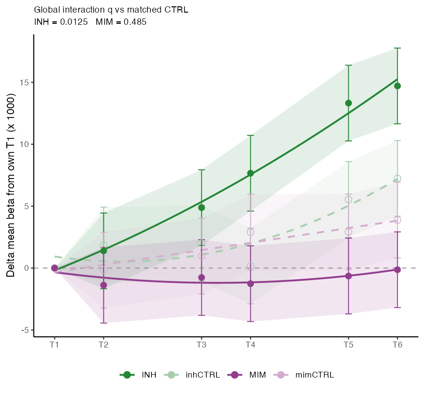

## b — Entropy and FAE relative to matched controls

Each sample's own same-run, same-timepoint control value is subtracted from
the treatment value: **treatment minus control**. Means and SEM are
then calculated across three independent runs per arm/timepoint. FAE deltas
are in percentage points; entropy deltas retain natural-log units. Controls
are represented by zero rather than additional curves. These are changes in
sample-level distribution metrics, not averages of paired probe-level entropy.


```r
# S4b: subtract the same experiment/timepoint control BEFORE averaging.
metrics <- input("primary/hgf_compartment_metrics_adjusted_verified_annotation.rds")
delta_panels <- list()
for (metric_name in c("entropy", "FAE")) {
  d <- subset(metrics, comp == "All_CpGs")
  d$value <- d[[metric_name]]
  controls <- d %>% filter(GROUP == "CTRL") %>% select(EXPERIMENT, BATCH, TP2, control = value)
  z <- d %>% filter(GROUP != "CTRL") %>% left_join(controls, by = c("EXPERIMENT", "BATCH", "TP2")) %>%
    mutate(score = (value - control) * ifelse(metric_name == "FAE", 100, 1), series = as.character(GROUP))
  stopifnot(nrow(z) == 36, !anyNA(z$score))
  delta_panels[[metric_name]] <- trajectory(z, ifelse(metric_name == "FAE", "Delta FAE (pp)", "Delta entropy"),
                                           title = metric_name) + geom_hline(yintercept = 0, linetype = 2, color = "grey60")
  save_table(z, paste0("S4b_", metric_name, "_matched_deltas"))
}
save_panel(plot_grid(plotlist = delta_panels, nrow = 1), "S4b_entropy_FAE_deltas", 9.5, 4.5)
```
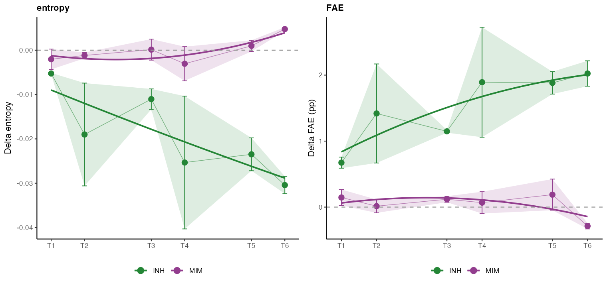

## c–e — Epigenetic clocks with resolved control arms

S4c shows Skin & Blood; S4d shows CausAge, DamAge and AdaptAge; S4e shows
RetroAge. All use the shared ordinal-axis display and their own controls.
Only matched-control global average-shift q values are annotated, with BH
adjustment across two arms separately within each clock; no individual-TP
asterisks are drawn.
CausAge is shown on its original score scale. DamAge and AdaptAge retain the
historical pooled-CTRL-T1 display baseline, which is a constant display shift,
not a change to the underlying scores or statistical tests.

The additional models use fixed supplied coefficient tables. Available CpGs
are 496/585 for CausAge, 1,016/1,089 for DamAge and 938/999 for AdaptAge.
Missing features are omitted without renormalizing the remaining weights,
and missing matrix entries use the source probe-mean rule. These are
**available-feature scores**, not fully covered externally validated ages.
Coverage and missing absolute coefficient weight are included in the table.

The complete scoring checks and drawing loop are shared with Figure 4i/j;
they are included here as executable source, not merely as linked figures.


```r
# Shared epigenetic clocks: frozen calibrated inputs; original scoring recipes.
clock_bundle <- input("clocks/primary_clocks.rds")
clock_scores <- as.data.frame(clock_bundle$scores)
clock_labels <- c(SkinBlood = "Skin & Blood DNAm age (years)", RetroAge = "RetroAge score",
                  CausAge = "CausAge score", DamAge = "Delta DamAge score", AdaptAge = "Delta AdaptAge score")
for (clock_name in names(clock_labels)) {
  d <- subset(clock_scores, clock == clock_name)
  d$score <- d$display_score
  d$series <- ifelse(d$GROUP == "CTRL", paste0(tolower(d$EXPERIMENT), "CTRL"), as.character(d$GROUP))
  panel_id <- c(SkinBlood = "S4c", RetroAge = "S4e", CausAge = "S4d_CausAge",
                DamAge = "S4d_DamAge", AdaptAge = "S4d_AdaptAge")[[clock_name]]
  save_panel(trajectory(d, clock_labels[clock_name], title = clock_name), panel_id, 5.3, 4.7)
  if (clock_name %in% c("SkinBlood", "RetroAge")) {
    d$series <- as.character(d$GROUP)
    save_panel(trajectory(d, clock_labels[clock_name], title = clock_name),
               ifelse(clock_name == "SkinBlood", "4i_right_SkinBlood", "4j_right_RetroAge"), 5.3, 4.7)
  }
}
save_panel(plot_grid(plotlist = panels[c("S4d_CausAge", "S4d_DamAge", "S4d_AdaptAge")], nrow = 1),
           "S4d_causal_clocks", 12, 4.5)
save_table(clock_scores, "epigenetic_clock_scores")
save_table(clock_bundle$coefficient_audit, "epigenetic_clock_coverage")

# Available-CpG linear predictors exactly preserve the historical missingness rule.
for (nm in names(clock_bundle$coefficients)) {
  co <- as.data.frame(clock_bundle$coefficients[[nm]])
  ids <- intersect(co$term, rownames(clock_bundle$small_beta_input))
  x <- clock_bundle$small_beta_input[ids, , drop = FALSE]
  w <- co$estimate[match(ids, co$term)]
  predicted <- as.numeric(co$estimate[co$term == "(Intercept)"] + crossprod(w, x))
  expected <- subset(clock_scores, clock == nm)
  assert_close(predicted, expected$score[match(colnames(x), expected$sample)], paste(nm, "linear predictor"))
}
```
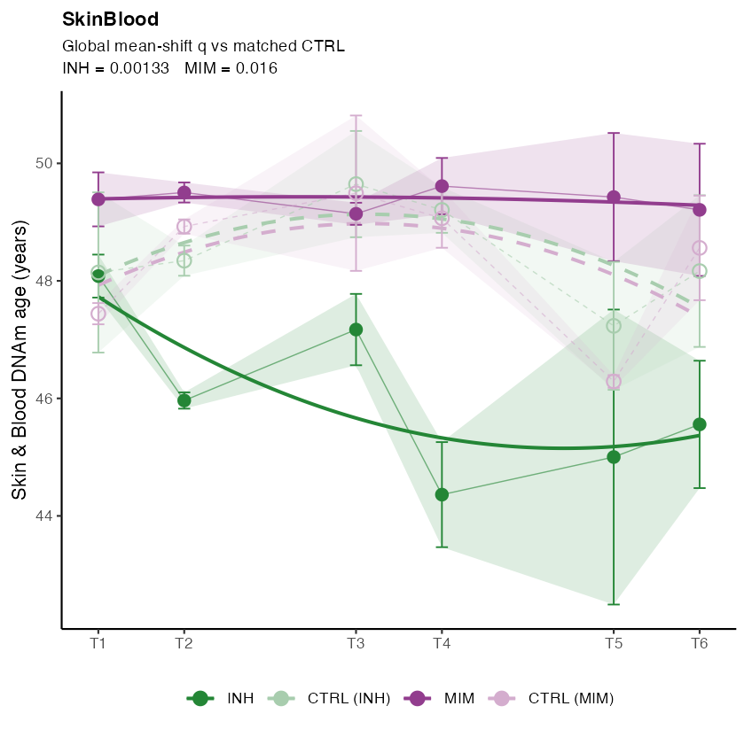
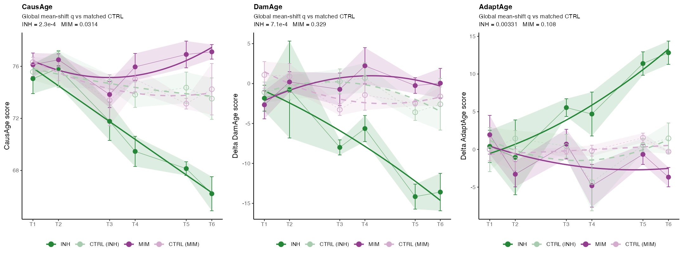

|clock    | n_required| n_present| missing_absolute_weight_fraction|
|:--------|----------:|---------:|--------------------------------:|
|CausAge  |        585|       496|                           0.1376|
|DamAge   |       1089|      1016|                           0.0677|
|AdaptAge |        999|       938|                           0.0157|
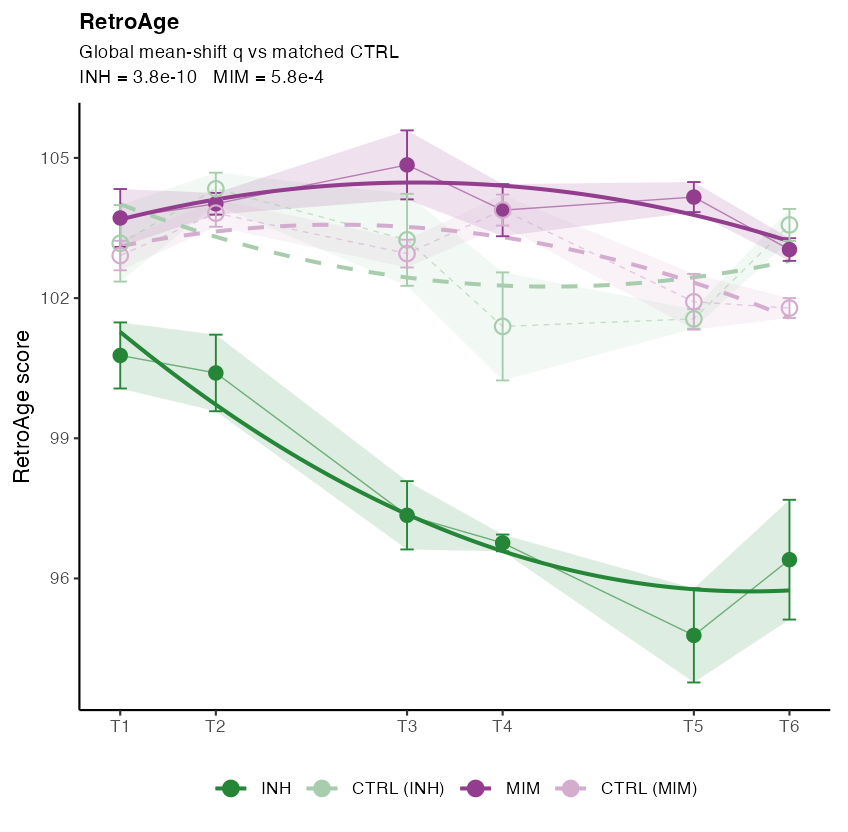

## f — Temporal trajectory outcome classes

DNAm and RNA are analyzed separately, using the union of significant temporal
features within each treatment/control pair. Nominal p < 0.05 supports an
individual temporal direction. A supported CTRL trajectory without support in
the treatment is classified as **attenuated/lost support**, not automatically
as a smaller estimated slope. Supported same-direction slopes are compared
using a 20% relative-magnitude band; opposite directions or newly supported
trajectories contribute to the rewired categories. The full decision hierarchy
is defined by the `pair()` function shown in Figure 4m.

These labels are descriptive, support-aware categories; they are not a test
of significant differences between slopes. In particular, a nonsignificant
treated slope does not prove a zero biological effect.


```r
standardize <- function(x, type = "DNAm") {
  x <- as.data.frame(x)
  if (type == "DNAm") data.frame(id = rownames(x), slope = x$logFC, p = x$P.Value, q = x$adj.P.Val)
  else data.frame(id = rownames(x), slope = x$log2FoldChange, p = x$pvalue, q = x$padj)
}
pair <- function(ctrl, trt, type, treatment) {
  x <- merge(standardize(ctrl, type), standardize(trt, type), by = "id", suffixes = c("_ctrl", "_trt"))
  sig <- function(x) is.finite(x) & x < .05
  x <- x[(sig(x$q_ctrl) | sig(x$q_trt)) & is.finite(x$slope_ctrl) & is.finite(x$slope_trt), ]
  x$layer <- type; x$treatment <- treatment
  support_c <- sig(x$p_ctrl) & abs(x$slope_ctrl) > 1e-12
  support_t <- sig(x$p_trt) & abs(x$slope_trt) > 1e-12
  same <- sign(x$slope_ctrl) == sign(x$slope_trt)
  larger <- abs(x$slope_trt) > abs(x$slope_ctrl) + 1e-12
  x$change <- (abs(x$slope_trt) - abs(x$slope_ctrl)) / pmax(abs(x$slope_trt), abs(x$slope_ctrl), 1e-12)
  x$detailed_class <- case_when(
    support_c & !support_t ~ "Attenuation_lost",
    !support_c & support_t & same & larger ~ "Amplification_emergent_concordant",
    !support_c & support_t ~ "Recruitment",
    support_c & support_t & !same ~ "Rerouting",
    support_c & support_t & same & x$change < -.2 ~ "Attenuation_weaker",
    support_c & support_t & same & x$change > .2 ~ "Amplification_shared",
    support_c & support_t & same & abs(x$change) <= .2 ~ "Preserved_shared",
    TRUE ~ "Unclassified")
  x$class <- case_when(grepl("^Attenuation", x$detailed_class) ~ "Attenuated",
                       grepl("^Amplification", x$detailed_class) ~ "Amplified",
                       grepl("^Preserved", x$detailed_class) ~ "Preserved",
                       x$detailed_class %in% c("Recruitment", "Rerouting") ~ "Rewired", TRUE ~ "Unclassified")
  x
}
```

```r
summary$class <- factor(summary$class, c("Attenuated", "Preserved", "Rewired", "Amplified"))
p <- ggplot(summary, aes(percent, factor(treatment, c("MIM", "INH")), fill = class)) +
  geom_col(width = .6, position = position_stack(reverse = TRUE)) +
  geom_text(aes(label = ifelse(percent >= 5, round(percent), "")),
            position = position_stack(vjust = .5, reverse = TRUE), size = 3, color = "white") +
  geom_text(data = unique(summary[, c("layer", "treatment", "total")]),
            aes(x = 102, y = factor(treatment, c("MIM", "INH")),
                label = format(total, big.mark = ",")), inherit.aes = FALSE, hjust = 0, size = 3) +
  scale_x_continuous(limits = c(0, 124), breaks = c(0, 50, 100)) +
  facet_wrap(~layer, ncol = 1) + scale_fill_manual(values = c(Attenuated = "#6F809F", Preserved = "#E7E7E7", Rewired = "#989C9D", Amplified = "#A73558")) +
  labs(x = "Temporal trajectory outcomes (%)", y = NULL) + theme_figure()
save_panel(p, "S4f_trajectory_outcomes", 5.2, 3.0)
```
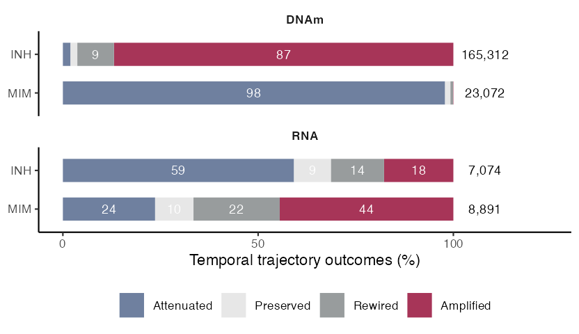

## g — CHIR-responsive regions

The WNT/CHIR experiment is distinct from the classic primary-HGF timecourse.
CTRL is scramble; INH is miR-29 inhibitor; CHIR is scramble plus CHIR; COMBO
is **INH+CHIR**, not a separate drug. Biological experiment is determined by
the verified `BATCH` field, not potentially inconsistent short sample labels.

Historical DMRcate discovery uses all available samples, including incomplete
EXP65, with biological experiment included in the design. The original
`CHIR vs CTRL` output contains four DMRs. Applying the fixed absolute regional
mean beta-change threshold ≥0.10 retains three loci: DKK2, HOXB3/HOXB-AS3,
and the C1QTNF3/AMACR locus. PHLDB2 is below this effect-size threshold.
Two genes assigned to one region do not constitute two independent DMRs.

The Circos uses hg38 cytobands and true region-midpoint coordinates; enlarged
markers are pointers, not genomic widths or whole-genome assay coverage.
Labels use native `min_smoothed_fdr`, the **minimum smoothed evidence within
the region**, not a whole-region BH q-value. DKK2 is highlighted for its
mechanistic relevance to the WNT question, not because it has the largest
mean methylation change. All selected loci remain disclosed.


```r
# S4g: three effect-size-selected regions among four native CHIR-vs-CTRL calls.
# Marker sizes are visual pointers, not genomic region widths or assay coverage.
suppressPackageStartupMessages(library(grid))
wnt <- input("wnt/dmrcate_display_data.rds")
calls <- as.data.frame(input("wnt/historical_DMRCATE_calls.rds")[["CHIR.vs.CTRL"]])
calls$retained <- abs(calls$meandiff) >= .10
calls$locus <- c("PHLDB2", "DKK2", "C1QTNF3 / AMACR", "HOXB3 / HOXB-AS3")[match(calls$seqnames, c("chr3", "chr4", "chr5", "chr17"))]
stopifnot(nrow(calls) == 4, sum(calls$retained) == 3)
save_table(calls, "S4g_complete_CHIR_discovery_and_selection")
selected <- subset(calls, retained)
cyto <- as.data.frame(input("wnt/hg38_cytobands.rds"))
names(cyto) <- c("chromosome", "start0", "end0", "band", "stain")
ci <- read.delim("data/wnt/chromosome_geometry.tsv")
selected$angle <- ci$start_degrees[match(selected$seqnames, ci$chromosome)] -
  ((selected$start - 1 + selected$end) / 2) / ci$length_bp[match(selected$seqnames, ci$chromosome)] *
  ci$span_degrees[match(selected$seqnames, ci$chromosome)]
draw_circos <- function() {
  xy <- function(angle, radius) cbind(.5 + radius * cos(angle * pi / 180),
                                     .5 + radius * sin(angle * pi / 180))
  text <- function(label, x, y, size = 10, col = "#263D4C", just = "center", face = "plain")
    grid.text(label, x, y, just = just, gp = gpar(fontfamily = "Helvetica", fontsize = size, col = col, fontface = face))
  arc <- function(a1, a2, fill, border = NA) {
    angles <- seq(a1, a2, length.out = max(3, ceiling(abs(a2 - a1) * 4)))
    pts <- rbind(xy(angles, .30), xy(rev(angles), .266))
    grid.polygon(pts[, 1], pts[, 2], gp = gpar(fill = fill, col = border, lwd = .4))
  }
  band_colors <- c(gneg = "#F1F4F5", gpos25 = "#D6DFE3", gpos50 = "#B9C7CE", gpos75 = "#9BAFB9",
                   gpos100 = "#829AA7", acen = "#A8B5BE", gvar = "#DDE4E8", stalk = "#E7ECEF")
  for (j in seq_len(nrow(ci))) {
    chromosome <- ci[j, ]
    bands <- subset(cyto, chromosome == ci$chromosome[j])
    for (k in seq_len(nrow(bands))) {
      a1 <- chromosome$start_degrees - bands$start0[k] / chromosome$length_bp * chromosome$span_degrees
      a2 <- chromosome$start_degrees - bands$end0[k] / chromosome$length_bp * chromosome$span_degrees
      arc(a1, a2, band_colors[bands$stain[k]])
    }
    arc(chromosome$start_degrees, chromosome$start_degrees - chromosome$span_degrees, NA, "#A7B8C1")
    p <- xy(chromosome$start_degrees - chromosome$span_degrees / 2, .33)
    text(sub("chr", "", chromosome$chromosome), p[1], p[2], 8, "#7F95A0")
  }
  positions <- data.frame(locus = c("DKK2", "C1QTNF3 / AMACR", "HOXB3 / HOXB-AS3"),
                          x = c(.86, .84, .17), y = c(.63, .17, .88), just = c("center", "center", "center"))
  for (i in seq_len(nrow(selected))) {
    row <- selected[i, ]; loc <- positions[positions$locus == row$locus, ]
    color <- ifelse(row$locus == "DKK2", "#B17629", "#4E8CA6")
    p <- xy(row$angle, .306)
    q <- xy(row$angle, .355)
    endpoint_y <- loc$y + ifelse(loc$y < .5, .11, -.10)
    grid.lines(c(p[1], q[1], loc$x), c(p[2], q[2], endpoint_y), gp = gpar(col = color, lwd = .7))
    grid.points(p[1], p[2], pch = 21, size = unit(3.4, "mm"), gp = gpar(fill = color, col = "white"))
    label <- gsub(" / ", " /\n", row$locus, fixed = TRUE)
    text(label, loc$x, loc$y + .035, 10, color, loc$just, "bold")
    text(sprintf("min. smoothed FDR\n%.2e", row$min_smoothed_fdr), loc$x, loc$y - .035, 7.5, color, loc$just)
  }
  text("3", .5, .55, 30, face = "bold")
  text("CHIR-responsive DMRs", .5, .49, 10)
  text("|mean delta beta| >= 0.10", .5, .45, 8)
  text("hg38", .5, .415, 8)
}
circos_grob <- grid.grabExpr(draw_circos(), width = 7.5, height = 6.5, wrap = TRUE)
save_panel(cowplot::ggdraw(circos_grob), "S4g_CHIR_responsive_loci", 7.5, 6.5)
```
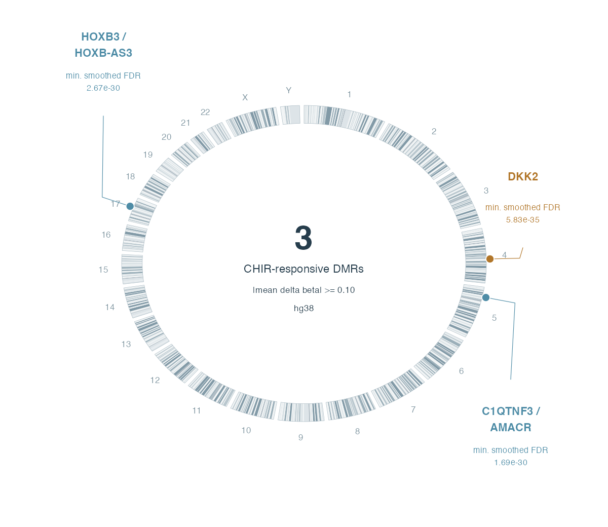

|locus            |seqnames |     start|       end| no.cpgs| meandiff|min_smoothed_fdr |retained |
|:----------------|:--------|---------:|---------:|-------:|--------:|:----------------|:--------|
|PHLDB2           |chr3     | 111961471| 111961949|       2|  -0.0661|3.732e-47        |FALSE    |
|DKK2             |chr4     | 107035130| 107035399|       3|   0.1196|5.829e-35        |TRUE     |
|C1QTNF3 / AMACR  |chr5     |  34043035|  34043619|       7|   0.1387|1.691e-30        |TRUE     |
|HOXB3 / HOXB-AS3 |chr17    |  48581657|  48581956|       2|   0.1948|2.668e-30        |TRUE     |

## h — DKK2: regional calls, profile and heatmap

The upper tracks show native DMRcate intervals in the fixed order INH vs CTRL,
CHIR vs CTRL, and INH+CHIR vs CTRL. The shaded CHIR-defined core contains
three CpGs. “No overlapping DMR” means that no region was called in that
comparison; it does **not** establish that every inhibitor-alone beta
difference is zero.

Discovery intervals use the all-sample historical analysis. In contrast, the
profile and heatmap use only the complete matched experiments EXP66–68.
For each CpG, `100 × (treated beta − same-experiment CTRL beta)` is displayed.
The profile summarizes those three paired differences by mean ± SEM; the
heatmap retains individual experiments. Connectors map true genomic positions
to equally spaced heatmap columns. The core is outlined within the full 16-CpG
interval. Excluding incomplete EXP65 for a paired display is not an independent
validation of regions discovered partly from the same experiments.


```r
# S4h: original DMR calls, matched response and aligned CpG heatmap.
COL <- COLORS
th <- theme_figure()
mini <- th + theme(text=element_text(size=8), axis.title=element_text(size=8),
  axis.text=element_text(size=7), plot.title=element_text(size=9,face='bold'),
  legend.text=element_text(size=7), legend.key.size=unit(.27,'cm'),
  legend.title=element_text(size=7), plot.margin=margin(5,7,5,4))

wd <- input("wnt/dmrcate_display_data.rds")
cores <- as.data.table(wd$cores)
LOC <- 'DKK2'
original_orders <- c('CHIR.vs.CTRL','INH.vs.CTRL','COMBO.vs.INH','COMBO.vs.CHIR','COMBO.vs.CTRL')
orders <- c('INH.vs.CTRL', 'CHIR.vs.CTRL', 'COMBO.vs.CTRL')
labels <- c('INH vs CTRL', 'CHIR vs CTRL', 'INH+CHIR vs CTRL')
stacks <- list()
audit <- list()

for (i in seq_along(LOC)) {
  gene <- LOC[i]
  core <- cores[locus==gene & anchor_source=='CHIR.vs.CTRL']
  stopifnot(nrow(core)==1)
  pp <- as.data.table(wd$profiles[[gene]])[BATCH %in% c('EXP66','EXP67','EXP68')]
  cc <- pp[GROUP=='CTRL', .(BATCH, position, control=beta)]
  dd <- merge(pp[GROUP!='CTRL'], cc, by=c('BATCH','position'))
  dd[, delta:=100*(beta-control)]
  dd[, GROUP:=factor(GROUP,c('INH','CHIR','COMBO'))]
  original_calls <- as.data.table(wd$calls)[locus==gene & contrast %in% original_orders]
  cl <- copy(original_calls[contrast %in% orders])
  stopifnot(setequal(cl$contrast, orders))
  # Retain the original full genomic window even though two tracks are hidden.
  xr <- range(c(pp$position,original_calls$start,original_calls$end),na.rm=TRUE)
  normx <- function(v) (v-xr[1])/diff(xr)
  sites <- data.table(position=sort(unique(pp$position)))
  sites[, `:=`(x=normx(position), hx=(seq_len(.N)-.5)/.N,
               core=position>=core$start & position<=core$end)]
  dd <- merge(dd,sites,by='position')
  cl[, `:=`(x=normx(start), xe=normx(end), y=length(orders)+1-match(contrast,orders))]
  br <- pretty(xr,n=3); br <- br[br>=xr[1] & br<=xr[2]]
  xs <- scale_x_continuous(limits=c(0,1),expand=c(0,0),breaks=normx(br),
    labels=format(br,scientific=FALSE,big.mark=',',trim=TRUE))
  a <- ggplot()+annotate('rect',xmin=normx(core$start),xmax=normx(core$end),
    ymin=-Inf,ymax=Inf,fill='#DAE5EB',alpha=.8)+
    geom_segment(data=cl,aes(x=0,xend=1,y=y,yend=y),colour='#DCE3E7',linewidth=.3)+
    geom_segment(data=cl[called==TRUE],aes(x=x,xend=xe,y=y,yend=y),colour='#CD6253',linewidth=2.5)+
    geom_text(data=cl[called==FALSE],aes(x=.52,y=y,label='No overlapping DMR'),size=2,colour='#6F8190')+
    xs+scale_y_continuous(breaks=seq_along(orders),labels=rev(labels),
      limits=c(.4,length(orders)+.6),expand=c(0,0))+
    labs(x=paste0(core$seqnames,' position (hg38)'),y=NULL,title='Original DMRcate calls')+
    mini+theme(axis.line.y=element_blank(),axis.ticks.y=element_blank(),axis.text.y=element_text(size=6.8))
  sm <- dd[,.(delta=mean(delta),sem=sd(delta)/sqrt(.N)),by=.(position,x,GROUP)]
  b <- ggplot(sm,aes(x,delta,colour=GROUP,group=GROUP))+
    annotate('rect',xmin=normx(core$start),xmax=normx(core$end),ymin=-Inf,ymax=Inf,fill='#DAE5EB',alpha=.5)+
    geom_hline(yintercept=0,colour='grey65',linetype='dashed')+
    geom_errorbar(aes(ymin=delta-sem,ymax=delta+sem),width=.009,linewidth=.3)+
    geom_line(linewidth=.5)+geom_point(size=1.4)+xs+
    scale_colour_manual(values=COL,labels=c(INH='INH',CHIR='CHIR',COMBO='INH+CHIR'))+
    labs(x=NULL,y='Delta beta (pp)',colour=NULL,title='Matched-control profile: mean +/- SEM')+
    mini+theme(axis.text.x=element_blank(),axis.ticks.x=element_blank(),legend.position='bottom')
  con <- ggplot(sites)+geom_segment(aes(x=x,xend=hx,y=1,yend=0),colour='#91A7B4',linewidth=.3)+
    scale_x_continuous(limits=c(0,1),expand=c(0,0))+
    scale_y_continuous(limits=c(0,1),expand=c(0,0))+
    theme_void()+theme(plot.margin=margin(0,7,0,4))
  dd[,row:=paste(ifelse(GROUP=='COMBO','INH+CHIR',as.character(GROUP)),BATCH)]
  ro <- as.vector(t(outer(c('INH','CHIR','INH+CHIR'),c('EXP66','EXP67','EXP68'),paste)))
  dd[,row:=factor(row,rev(ro))]
  lim <- max(5,ceiling(max(abs(dd$delta))/5)*5)
  h <- ggplot(dd,aes(hx,row,fill=delta))+geom_tile(width=.97/nrow(sites),height=.94)+
    geom_tile(data=dd[core==TRUE],width=.97/nrow(sites),height=.94,fill=NA,colour='#7B91A0',linewidth=.3)+
    scale_fill_gradient2(low='#427DB5',mid='white',high='#CF654E',limits=c(-lim,lim),
      breaks=c(-lim,0,lim),name='Delta beta (pp)')+
    scale_x_continuous(limits=c(0,1),expand=c(0,0),breaks=sites$hx,labels=seq_len(nrow(sites)))+
    labs(x='CpGs in genomic order; CHIR core outlined',y=NULL)+mini+
    theme(axis.line=element_blank(),axis.ticks=element_blank(),axis.text.y=element_text(size=6.8),
      axis.text.x=element_text(size=5.5))
  body <- plot_grid(a,b,con,h,ncol=1,rel_heights=c(1.08,1.3,.27,1.4),align='v',axis='lr')
  title <- ggdraw()+draw_label(gene,size=13,fontface='bold',colour='#263D4C')
  stacks[[gene]] <- plot_grid(title,body,ncol=1,rel_heights=c(.26,4.05))
  audit[[gene]] <- list(genomic_window=xr,sites=sites,profile=sm,heatmap=dd,tracks=cl,
    lower_plots=list(profile=b,connectors=con,heatmap=h))
}

save_panel(stacks[["DKK2"]], "S4h_DKK2_aligned_locus", 6.8, 8.0)
save_table(audit[["DKK2"]]$profile, "S4h_DKK2_profile")
```
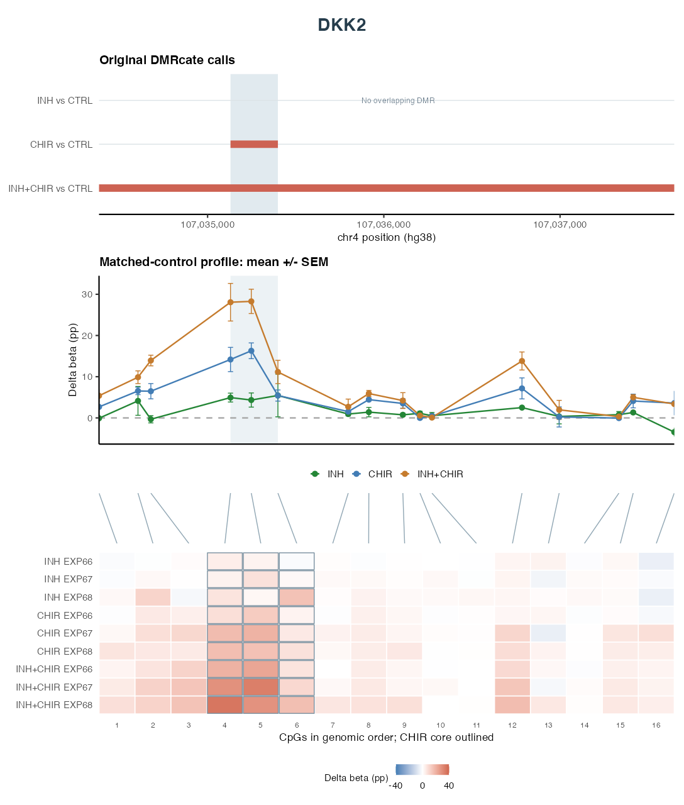

## i — DKK2 paired responses and beta-scale interaction

The left and right summaries use the same samples but different nested regions:
the three-CpG CHIR core and the extended 16-CpG interval. Beta is first averaged
across the selected CpGs **within each sample**, then the matched control is
subtracted. Circles are biological experiments, gray lines preserve pairing,
diamonds are group means and bars are SEM across three experiments. CpGs are
not treated as independent biological replicates.

The forest plot tests `100 × [(COMBO − CHIR) − (INH − CTRL)]` separately for
the two regions. It reports a mean paired interaction and 95% t interval
(df=2), with BH correction across the two nested DKK2 tests. This is evidence
about nonadditivity on the **beta scale**, conditional on the selected loci;
it is not a genome-wide interaction discovery or independent validation.
M-scale interactions answer a different question and are not interchanged
with these tests according to significance. Native DMRcate evidence and
regional paired inference are reported as distinct analyses.


```r
# S4i: same probes in every sample, three complete biological experiments.
w <- input("wnt/dmrcate_display_data.rds")
groups <- c('INH','CHIR','COMBO')
batches <- c('EXP66','EXP67','EXP68')
p <- as.data.table(w$profiles[['DKK2']])[BATCH %in% batches & GROUP %in% c('CTRL',groups)]
core <- as.data.table(w$cores)[locus=='DKK2' & anchor_source=='CHIR.vs.CTRL']
stopifnot(nrow(core)==1,!anyDuplicated(p[,.(BATCH,GROUP,position)]),all(is.finite(p$beta)))
sites <- sort(unique(p$position))
regions <- list('Selected core'=sites[sites>=core$start & sites<=core$end],
                'Entire region'=sites)
stopifnot(length(regions[[1]])==3L,length(regions[[2]])==16L,
          all(regions[[1]] %in% regions[[2]]))
dat <- rbindlist(lapply(names(regions),function(region){
  a <- p[position %in% regions[[region]],
         .(mean_beta=mean(beta),n_cpg=.N),by=.(BATCH,GROUP)]
  stopifnot(nrow(a)==12L,all(a$n_cpg==length(regions[[region]])))
  cc <- a[GROUP=='CTRL',.(BATCH,control_beta=mean_beta)]
  d <- merge(a[GROUP!='CTRL'],cc,by='BATCH')
  d[,`:=`(delta_pp=100*(mean_beta-control_beta),feature=region)]
  d
}))
sm <- dat[,.(mean_pp=mean(delta_pp),sem_pp=sd(delta_pp)/sqrt(.N),n=.N),by=.(feature,GROUP)]
stopifnot(nrow(dat)==18L,all(sm$n==3L))
dat[,feature:=factor(feature,levels=names(regions))]
sm[,feature:=factor(feature,levels=names(regions))]
dat[,xgroup:=match(GROUP,groups)]
dat[,xpoint:=xgroup+c(EXP66=-.055,EXP67=0,EXP68=.055)[BATCH]]
sm[,xgroup:=match(GROUP,groups)]

cols <- c(INH='#248636',CHIR='#3F7FB5',COMBO='#D28A32')
labels <- c(INH='INH',CHIR='CHIR',COMBO='INH+CHIR')
ink <- '#263D4C'
facet_labels <- c('Selected core'='DKK2\n3-CpG core',
                  'Entire region'='DKK2\n16-CpG extended region')
upper <- ceiling(max(c(dat$delta_pp,sm$mean_pp+sm$sem_pp))/5)*5
plot <- ggplot(dat,aes(x=xpoint,y=delta_pp))+
  geom_hline(yintercept=0,linetype='dashed',colour='#A5B2B9',linewidth=.4)+
  geom_line(aes(group=BATCH),colour='#B5C3CA',linewidth=.6,alpha=.85)+
  geom_point(aes(fill=GROUP),colour='white',shape=21,size=2.8,stroke=.35)+
  geom_errorbar(data=sm,aes(x=xgroup,y=mean_pp,ymin=mean_pp-sem_pp,ymax=mean_pp+sem_pp,
                          colour=GROUP),width=.14,linewidth=.7,inherit.aes=FALSE)+
  geom_point(data=sm,aes(x=xgroup,y=mean_pp,fill=GROUP),shape=23,colour='white',
             stroke=.6,size=4.6,inherit.aes=FALSE)+
  facet_wrap(~feature,nrow=1,labeller=as_labeller(facet_labels))+
  scale_fill_manual(values=cols,breaks=groups,labels=labels)+
  scale_colour_manual(values=cols,breaks=groups,labels=labels)+
  scale_x_continuous(limits=c(.65,3.4),breaks=1:3,labels=labels[groups],expand=c(0,0))+
  scale_y_continuous(limits=c(-1,upper),breaks=seq(0,upper,5),expand=c(0,0))+
  labs(x=NULL,y='Methylation change vs matched CTRL\n(percentage points)')+
  theme_classic(base_size=11,base_family='Helvetica')+
  theme(text=element_text(colour=ink),axis.text=element_text(colour=ink),
        axis.line=element_line(colour='#8C9BA4',linewidth=.35),
        axis.ticks=element_line(colour='#8C9BA4',linewidth=.35),
        legend.position='none',plot.margin=margin(12,16,10,10),
        strip.background=element_rect(fill='#F0F5F6',colour=NA),
        strip.text=element_text(size=10,colour=ink,lineheight=1.15),
        panel.spacing=grid::unit(6,'mm'),axis.text.x=element_text(size=9.5))

save_panel(plot, "S4i_DKK2_paired_responses", 8.8, 5.3)
save_table(dat, "S4i_DKK2_paired_responses")
```

```r
# S4i: paired beta-scale factorial contrast in each complete experiment.
# The extended region includes the core. BH adjustment covers these two tests.
w <- input("wnt/dmrcate_display_data.rds")
profile <- as.data.frame(w$profiles$DKK2)
profile <- subset(profile, BATCH %in% c("EXP66", "EXP67", "EXP68"))
core <- subset(w$cores, locus == "DKK2" & anchor_source == "CHIR.vs.CTRL")
all_sites <- sort(unique(profile$position))
regions <- list(`3-CpG core` = all_sites[all_sites >= core$start & all_sites <= core$end],
                `16-CpG extended` = all_sites)
interaction_runs <- bind_rows(lapply(names(regions), function(region) {
  d <- profile %>% filter(position %in% regions[[region]]) %>%
    group_by(BATCH, GROUP) %>% summarise(beta = mean(beta), .groups = "drop") %>%
    pivot_wider(names_from = GROUP, values_from = beta)
  data.frame(region, BATCH = d$BATCH,
             interaction_pp = 100 * ((d$COMBO - d$CHIR) - (d$INH - d$CTRL)))
}))
interaction_tests <- interaction_runs %>% group_by(region) %>% group_modify(~ {
  tt <- t.test(.x$interaction_pp, mu = 0)
  data.frame(n = nrow(.x), estimate_pp = mean(.x$interaction_pp),
             lower95 = tt$conf.int[1], upper95 = tt$conf.int[2], p = tt$p.value)
}) %>% ungroup() %>% mutate(q = p.adjust(p, "BH"),
                           region = factor(region, levels = rev(names(regions))))
p <- ggplot(interaction_tests, aes(estimate_pp, region)) +
  geom_vline(xintercept = 0, color = "grey55", linetype = 2) +
  geom_errorbar(aes(xmin = lower95, xmax = upper95), orientation = "y", width = .15,
                color = "#C57B2D", linewidth = .7) +
  geom_point(shape = 23, fill = "#C57B2D", color = "white", size = 4) +
  geom_text(aes(x = upper95, label = sprintf("q = %.4f", q)), hjust = -.15, size = 3) +
  scale_x_continuous(expand = expansion(mult = c(.1, .38))) +
  labs(x = "Interaction (Delta beta, percentage points)", y = NULL,
       title = "DKK2: paired interaction") + theme_figure()
save_panel(p, "S4i_DKK2_interaction_forest", 6.6, 2.6)
save_table(interaction_runs, "S4i_interactions_per_experiment")
save_table(interaction_tests, "S4i_interaction_tests")
expected <- as.data.frame(input("wnt/interaction_statistics_by_gene.rds"))
expected <- subset(expected, gene == "DKK2")
assert_close(sort(interaction_tests$p), sort(expected$paired_t_p), "DKK2 paired interaction p values")
```
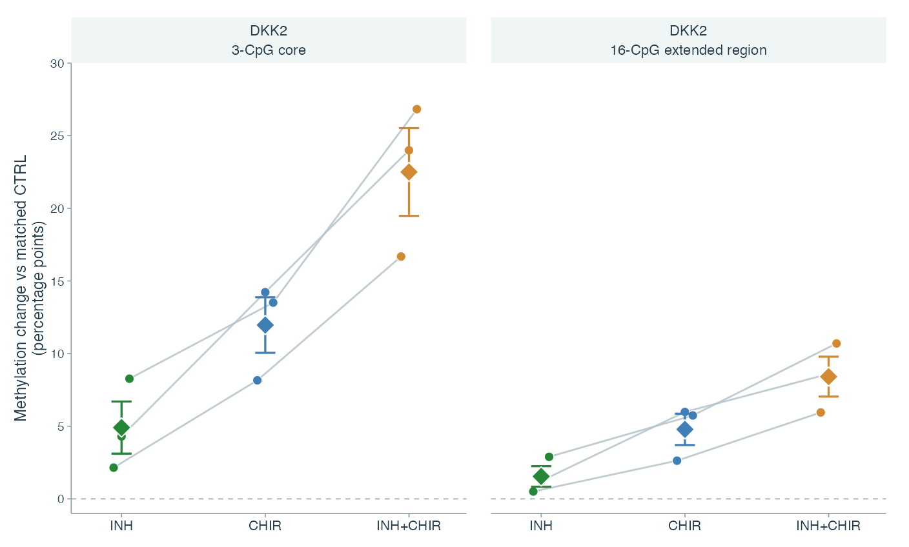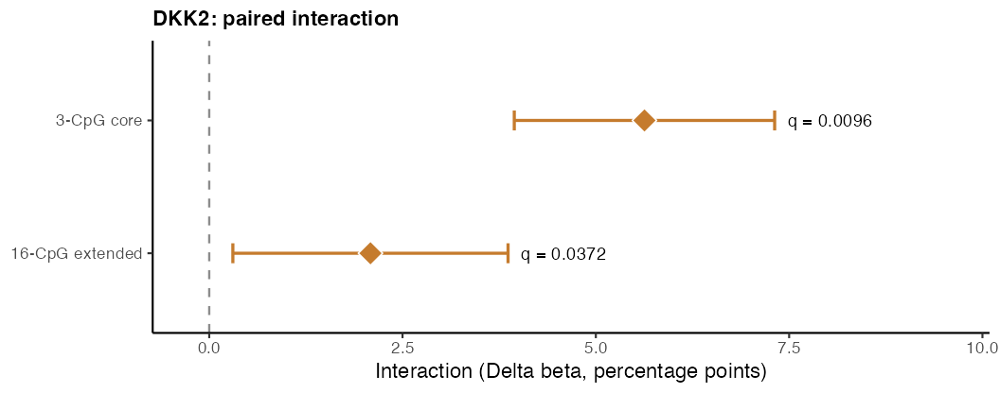

|region          |  n| estimate_pp| lower95| upper95|      p|      q|
|:---------------|--:|-----------:|-------:|-------:|------:|------:|
|16-CpG extended |  3|      2.0851|  0.3056|  3.8647| 0.0372| 0.0372|
|3-CpG core      |  3|      5.6290|  3.9453|  7.3126| 0.0048| 0.0096|

## j — hTERT HGF temporal methylation and CAMERA

hTERT HGF are a complementary immortalized model, not additional replicates
of the primary-HGF donor. The temporal inhibitor analysis contains 937,687
assay features and identifies 3,632 DMPs: 3,207 hyper and 425 hypo (88%/12%).
No temporal DMPs pass the same cutoff in the CTRL or mimic tables. The count
axis is in thousands, not the 0–150k scale of primary HGF.

All probes are ranked by the inhibitor temporal moderated t statistic.
Only the dense gray background is thinned for display; every significant
probe remains plotted. The INH-derived hyper/hypo probe sets are projected
onto CTRL and mimic temporal statistics using **limma `cameraPR`**, with
`use.ranks=FALSE` and inter-probe correlation 0.01. The bars show
`−log10(BH FDR)`, adjusting the two sets within each target. Red/blue encode
CAMERA Up/Down direction; they are not NES values. The code independently
reproduces the stored p/q values and their bar lengths.


```r
# S4j, m and n: independent reconstruction and numerical checks.
hp_input <- function(name) input(paste0("htert_hpf/", name, ".rds"))
hp_check <- function(name, observed, reference, tolerance = 1e-10) assert_close(observed, reference, name, tolerance)
retention <- function(delta) {
  stopifnot(all(is.finite(delta)), "T6" %in% colnames(delta))
  ref <- delta[, "T6"]
  as.numeric(crossprod(ref, delta) / sum(ref^2))
}
scatter_stats <- function(d) data.frame(n = nrow(d),
  retention = sum(d$effect_T6 * d$effect_T8) / sum(d$effect_T6^2),
  pearson_r = cor(d$effect_T6, d$effect_T8),
  spearman_r = cor(d$effect_T6, d$effect_T8, method = "spearman"))

temporal <- hp_input("htert_temporal_tables")
historical_camera <- hp_input("htert_historical_enrichment")
counts <- do.call(rbind, lapply(names(temporal), function(condition) {
  tab <- temporal[[condition]]
  data.frame(condition, hyper = sum(tab$q < .05 & tab$slope > 0),
             hypo = sum(tab$q < .05 & tab$slope < 0), n_tested = nrow(tab))
}))
counts$total <- counts$hyper + counts$hypo
counts$hyper_percent <- ifelse(counts$total > 0, 100 * counts$hyper / counts$total, NA)
hp_check("hTERT inhibitor hyper/hypo", unlist(counts[counts$condition == "Inhibitor", c("hyper", "hypo")]), c(3207, 425))
hp_check("hTERT CTRL and Mimic significant DMP counts", counts$total[counts$condition != "Inhibitor"], c(0, 0))
save_table(counts, "panel_p_DMP_counts")

common <- Reduce(intersect, lapply(temporal, `[[`, "probe_id"))
tables_common <- lapply(temporal, function(x) x[x$probe_id %in% common, ])
inh <- tables_common$Inhibitor
sets <- list(Hypo = inh$probe_id[inh$q < .05 & inh$slope < 0],
             Hyper = inh$probe_id[inh$q < .05 & inh$slope > 0])
stopifnot(setequal(sets$Hyper, historical_camera$signatures$Hyper),
          setequal(sets$Hypo, historical_camera$signatures$Hypo))
camera <- do.call(rbind, lapply(c("CTRL", "Mimic"), function(target) {
  tab <- tables_common[[target]]
  stats <- setNames(tab$statistic, tab$probe_id)
  result <- limma::cameraPR(stats, index = sets, use.ranks = FALSE,
                           inter.gene.cor = .01, sort = FALSE)
  data.frame(target, signature = rownames(result), n = result$NGenes,
             direction = result$Direction, p = result$PValue, q = p.adjust(result$PValue, "BH"))
}))
old <- historical_camera$results$projection_results
idx <- match(paste(camera$target, camera$signature), paste(old$target, old$signature))
hp_check("CAMERA p matches historical", camera$p, old$camera_p_value[idx])
hp_check("CAMERA within-target BH matches historical", camera$q, old$FDR[idx])
camera$minus_log10_q <- -log10(camera$q)
save_table(camera, "panel_p_CAMERA_statistics")
rank <- temporal$Inhibitor[order(temporal$Inhibitor$statistic, decreasing = TRUE), ]
rank$rank <- seq_len(nrow(rank))
rank$direction <- ifelse(rank$q < .05, ifelse(rank$slope > 0, "Hyper", "Hypo"), "Other")
hp_check("hTERT rank universe", nrow(rank), 937687)
save_table(rank[rank$direction != "Other", ], "panel_p_significant_CpGs")
htert_panel <- list(counts = counts, rank = rank, camera = camera, signatures = sets,
             settings = list(q_cutoff = .05, camera_inter_probe_correlation = .01,
                             camera_use_ranks = FALSE, BH_family = "Hyper/Hypo within each target"))
```

```r
colors <- c(Hyper = "#D9483B", Hypo = "#3F6FB6", RNA = "#248636", DNAm = "#3F7099")
theme_panel <- function() theme_classic(base_size = 10, base_family = "Helvetica") +
  theme(axis.line = element_line(linewidth = .4), axis.ticks = element_line(linewidth = .35),
        axis.text = element_text(color = "black"), plot.title = element_text(size = 11, hjust = .5),
        plot.margin = margin(7, 10, 7, 7), legend.title = element_blank())
p <- htert_panel
c <- p$counts
c$y <- match(c$condition, c("Mimic", "Inhibitor", "CTRL"))
bars <- rbind(data.frame(y = c$y, xmin = 0, xmax = c$hyper, direction = "Hyper"),
              data.frame(y = c$y, xmin = c$hyper, xmax = c$total, direction = "Hypo"))
bars <- bars[bars$xmax > bars$xmin, ]
counts <- ggplot() + geom_rect(data = bars, aes(xmin = xmin, xmax = xmax, ymin = y - .27,
                                               ymax = y + .27, fill = direction), color = NA) +
  scale_fill_manual(values = colors[c("Hyper", "Hypo")], guide = "none") +
  geom_text(data = c[c$total == 0, ], aes(x = 100, y = y, label = "0"), hjust = 0, size = 3.6) +
  annotate("text", x = 3207 / 2, y = 2, label = "88%", color = "white", size = 4.1) +
  annotate("text", x = 3207 + 425 / 2, y = 2.62, label = "12%", size = 3.8) +
  annotate("segment", x = 3207 + 425 / 2, xend = 3207 + 425 / 2, y = 2.4, yend = 2.09, linewidth = .35) +
  annotate("text", x = 3750, y = 2, label = "3,632", hjust = 0, size = 3.7) +
  scale_y_continuous(breaks = 1:3, labels = c("Mimic", "Inhibitor", "CTRL"), limits = c(.5, 3.5)) +
  scale_x_continuous(breaks = seq(0, 4000, 1000), labels = c("0", "1k", "2k", "3k", "4k"),
                     limits = c(0, 4650), expand = expansion(mult = 0)) +
  labs(x = "Temporal DMPs (FDR < 0.05)", y = NULL, title = "hTERT HGF") + theme_panel() +
  theme(axis.line.y = element_blank(), axis.ticks.y = element_blank())

d <- p$rank
background <- d[d$direction == "Other", ]
# Uniform rank thinning affects only the dense grey visual background.
# The complete ranked input and every significant CpG are retained in data/.
background <- background[unique(round(seq(1, nrow(background), length.out = 5000))), ]
selected <- d[d$direction != "Other", ]
thresholds <- c(min(selected$statistic[selected$direction == "Hyper"]),
                max(selected$statistic[selected$direction == "Hypo"]))
ranking <- ggplot() +
  geom_hline(yintercept = 0, color = "grey65", linewidth = .35) +
  geom_point(data = background, aes(rank, statistic), shape = 16, stroke = 0, size = .45, color = "grey70") +
  geom_point(data = selected, aes(rank, statistic, color = direction), shape = 16, stroke = 0, size = .85) +
  geom_hline(yintercept = thresholds[1], color = colors["Hyper"], linetype = "dashed", linewidth = .35) +
  geom_hline(yintercept = thresholds[2], color = colors["Hypo"], linetype = "dashed", linewidth = .35) +
  scale_color_manual(values = colors[c("Hyper", "Hypo")], guide = "none") +
  annotate("text", x = nrow(d) * .10, y = max(d$statistic) * .85, label = "Hyper", hjust = 0, size = 3.5) +
  annotate("text", x = nrow(d) * .9, y = min(d$statistic) * .85, label = "Hypo", hjust = 1, size = 3.5) +
  scale_x_continuous(breaks = c(1, 500000, nrow(d)), labels = c("1", "500k", "938k"),
                     expand = expansion(mult = c(.03, .03))) +
  labs(x = "CpG rank", y = "Inhibitor ~ time (moderated t)", title = "Temporal CpG signatures") + theme_panel()

e <- p$camera
e$y <- c(CTRL_Hyper = 4, CTRL_Hypo = 3, Mimic_Hyper = 1.6, Mimic_Hypo = .6)[paste(e$target, e$signature, sep = "_")]
e$color <- ifelse(e$q < .05, ifelse(e$direction == "Up", colors["Hyper"], colors["Hypo"]), "#D0D0D0")
e$label <- ifelse(e$q < .05, sprintf("q = %.3f", e$q), "n.s.")
enrichment <- ggplot(e, aes(x = minus_log10_q, y = y)) +
  geom_col(aes(fill = color), orientation = "y", width = .62, color = NA) +
  scale_fill_identity() +
  geom_vline(xintercept = -log10(.05), linetype = "dashed", linewidth = .4, color = "grey55") +
  geom_hline(yintercept = 2.3, linewidth = .4) +
  geom_text(aes(x = minus_log10_q + .12, label = label), hjust = 0, size = 3.6) +
  scale_y_continuous(breaks = c(.6, 1.6, 3, 4), labels = c("hypo", "hyper", "hypo", "hyper"),
                     limits = c(0, 4.9), expand = expansion(mult = 0)) +
  scale_x_continuous(breaks = c(0, 1, 2), limits = c(0, 3.3), expand = expansion(mult = 0)) +
  annotate("text", x = .02, y = 4.65, label = "CTRL", hjust = 0, size = 3.3, color = "grey35") +
  annotate("text", x = .02, y = 2.02, label = "Mimic", hjust = 0, size = 3.3, color = "#923D8E") +
  labs(x = expression(-log[10]("BH FDR")), y = NULL, title = "Probe-set enrichment (CAMERA)") + theme_panel() +
  theme(axis.ticks.y = element_blank(), axis.line.y = element_blank())
panel_p <- plot_grid(counts, ranking, enrichment, nrow = 1, rel_widths = c(1.0, 1.15, 1.3),
                     labels = c("", "", ""), label_size = 15, align = "h")
save_panel(counts, "S4j_hTERT_DMP_counts", 3.5, 2.15)
save_panel(ranking, "S4j_hTERT_CpG_ranking", 3.0, 4.0)
save_panel(enrichment, "S4j_hTERT_CAMERA", 4.4, 3.3)
save_panel(panel_p, "S4j_hTERT", 11.0, 3.75)
```
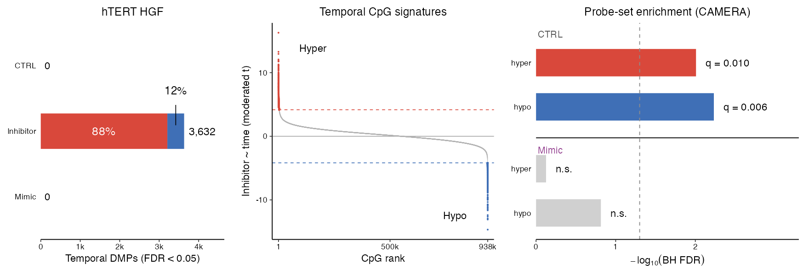

|target |signature |    n|direction |      p|      q| minus_log10_q|
|:------|:---------|----:|:---------|------:|------:|-------------:|
|CTRL   |Hypo      |  425|Down      | 0.0029| 0.0058|        2.2329|
|CTRL   |Hyper     | 3207|Up        | 0.0098| 0.0098|        2.0090|
|Mimic  |Hypo      |  425|Up        | 0.0767| 0.1534|        0.8142|
|Mimic  |Hyper     | 3207|Down      | 0.7489| 0.7489|        0.1256|

## k — Transcriptomic clocks in hTERT HGF

The 42 RNA samples comprise four INH/control runs and three MIM/control runs,
each measured at three timepoints. RNAAgeCalc uses frozen gene lengths,
FPKM, sequential design-protected experiment/batch adjustment, zero-clipping
of negative adjusted expression, and the historical all-tissue Caucasian model.
PASTA uses the official model-gene filtering and rank normalization **once**,
followed by its frozen predictor and calibration multiplier.

tAge uses the human-inclusive YuGene model, tAge 1.1.0 preprocessing, and
control subtraction within each experimental arm. The exact prediction
environment uses scikit-learn 1.3.2 and the checksum-verified serialized model.
The display removes run offsets while preserving arm means, subtracts own-arm
CTRL at T1, and applies the historical 122.5 multiplier. This plotted delta is
identified as a **relative model-scaled tAge score**, not an independently
validated chronological age of a cell line.

These are newly computed hTERT predictions, not inherited primary-HGF ages or
p-values. Historical global inference uses ML likelihood-ratio tests for shift
and interaction, with four-test BH adjustment per clock. Kenward–Roger
average-shift and run-mean paired sensitivities are retained transparently.
Only the matched-control global shift q values are drawn on these curves;
individual-timepoint significance symbols are not displayed.
The display and raw inference inputs are separate. The frozen input matrices,
prediction recipes and model assets are bundled; normal knitting need not
reinstall the historical prediction environment.


```r
# Optional upstream recipes. Rendering starts from the frozen predictions.
# These functions are not called merely by sourcing this file.

predict_rnaagecalc <- function(counts, metadata, gene_annotation) {
  genes <- intersect(rownames(counts), rownames(gene_annotation)[
    is.finite(gene_annotation$length) & gene_annotation$length > 0])
  fpkm <- RNAAgeCalc::count2FPKM(counts[genes, , drop = FALSE],
    genelength = gene_annotation[genes, "length"], idtype = "ENSEMBL")
  design <- model.matrix(~ 0 + reGROUP + TIME, metadata)
  adjusted <- limma::removeBatchEffect(as.matrix(fpkm), batch = metadata$EXPERIMENT, design = design)
  adjusted <- limma::removeBatchEffect(adjusted, batch = metadata$BATCH, design = design)
  adjusted[adjusted < 0] <- 0
  RNAAgeCalc::predict_age(adjusted, exprtype = "FPKM", stype = "caucasian",
                         idtype = "ENSEMBL", signature = NULL, tissue = "all")
}
predict_pasta <- function(counts) {
  # Official model-gene filtering and rank normalization are applied ONCE.
  ranked <- pasta::filtering_age_model_genes_and_rank_norm(counts)
  pasta::predicting_age_score(t(ranked), model_type = "Pasta")
}
prepare_tage <- function(counts, metadata) {
  stopifnot(as.character(packageVersion("tAge")) == "1.1.0")
  eset <- tAge::make_ExpressionSet(counts, metadata, verbose = FALSE)
  processed <- tAge::tAge_preprocessing(eset, species = "human", gene_mapping_type = "Ensembl",
    control_group_column = "is_control", control_group_label = "CTRL", verbose = FALSE)
  centered <- processed$yugene
  for (arm in c("INH", "MIM")) {
    ix <- which(metadata$arm == arm)
    current <- tAge::control_subtraction(processed$yugene[, ix], "is_control", "CTRL", verbose = FALSE)
    Biobase::exprs(centered)[, ix] <- Biobase::exprs(current)
  }
  # Write this matrix and run code/upstream/replay_htert_tage.py in the locked
  # historical Python environment. Display centering/scaling is separate.
  Biobase::exprs(centered)
}
```

```r
suppressPackageStartupMessages({library(data.table);library(lme4);library(emmeans)})
htert_bundle <- input("clocks/htert_clocks.rds")
htert_meta <- htert_bundle$predictions
# New inference on the NEW hTERT scores; no inherited primary-HGF P values.
rows<-posts<-paired<-diagnostics<-list()
for(clock in c('RNAAgeCalc','tAge','PASTA')) for(armname in c('INH','MIM')) {
 dd<-htert_meta[htert_meta$arm==armname,,drop=FALSE]
 dd$score<-dd[[clock]];dd$y<-as.numeric(scale(dd$score));sdy<-sd(dd$score)
 dd$condition<-factor(ifelse(dd$is_control=='CTRL','control','treated'),c('control','treated'))
 dd$tp<-factor(dd$TIME);dd$run<-factor(dd$BATCH)
 stopifnot(all(table(dd$run,dd$condition,dd$tp)==1))
 fits<-list(null=lmer(y~tp+(1|run),dd,REML=FALSE),
            shift=lmer(y~condition+tp+(1|run),dd,REML=FALSE),
            full=lmer(y~condition*tp+(1|run),dd,REML=FALSE))
 # Three TPs: a quadratic interaction spans exactly the categorical interaction.
 pshift<-anova(fits$null,fits$shift)$`Pr(>Chisq)`[2]
 pint<-anova(fits$shift,fits$full)$`Pr(>Chisq)`[2]
 kr<-pbkrtest::KRmodcomp(update(fits$shift,REML=TRUE),update(fits$null,REML=TRUE))$stats$p.value
 means<-as.data.table(dd)[,.(score=mean(score)),by=.(run,condition)]
 bw<-dcast(means,run~condition,value.var='score');bw[,delta:=treated-control]
 tt<-t.test(bw$delta)
 rows[[paste(clock,armname)]]<-data.table(clock,arm=armname,n_runs=nlevels(dd$run),n_samples=nrow(dd),
   estimate_shift=fixef(fits$shift)['conditiontreated']*sdy,p_global_shift=pshift,
   p_interaction=pint,p_KR_average_shift=kr,p_runmean_paired=tt$p.value,
   runmean_difference=mean(bw$delta),runmean_lower95=tt$conf.int[1],runmean_upper95=tt$conf.int[2])
 post<-as.data.table(as.data.frame(contrast(emmeans(fits$full,~condition|tp,lmer.df='kenward-roger'),'revpairwise')))
 post[,`:=`(clock=clock,arm=armname,estimate=estimate*sdy,SE=SE*sdy,p_Holm_3TP=p.adjust(p.value,'holm'))]
 posts[[paste(clock,armname)]]<-post
 bw[,`:=`(clock=clock,arm=armname)];paired[[paste(clock,armname)]]<-bw
 diagnostics[[paste(clock,armname)]]<-rbindlist(lapply(names(fits),function(n)
  data.table(clock,arm=armname,fit=n,singular=isSingular(fits[[n]]),
   messages=paste(fits[[n]]@optinfo$conv$lme4$messages,collapse='; '))))
}
global<-rbindlist(rows);post<-rbindlist(posts)
global[,`:=`(q_global_BH4=NA_real_,q_interaction_BH4=NA_real_)]
for(n in unique(global$clock)) {
 ix<-which(global$clock==n);q<-p.adjust(c(global$p_global_shift[ix],global$p_interaction[ix]),'BH')
 global$q_global_BH4[ix]<-q[1:2];global$q_interaction_BH4[ix]<-q[3:4]
}
global[,q_runmean_BH2:=p.adjust(p_runmean_paired,'BH'),by=clock]
post[,q_BH_6TP:=p.adjust(p.value,'BH'),by=clock]

save_table(global, "S4k_clock_global_statistics")
save_table(post, "S4k_clock_timepoint_statistics")
save_table(rbindlist(diagnostics), "S4k_model_diagnostics")
old <- as.data.table(htert_bundle$global)
ch <- merge(global, old, by = c("clock", "arm"), suffixes = c("_new", "_old"))
assert_close(ch$q_global_BH4_new, ch$q_global_BH4_old, "hTERT global clock q values", 1e-5)
display <- as.data.frame(htert_bundle$display)
display$TP2 <- display$TIME
display$series <- as.character(display$GROUP)
clock_plots <- lapply(c("RNAAgeCalc", "tAge", "PASTA"), function(nm) trajectory(subset(display, clock == nm), ifelse(nm == "tAge", "Relative tAge (model-scaled units)", paste(nm, "score")), xpos = 1:3, title = nm))
save_panel(plot_grid(plotlist = clock_plots, nrow = 1), "S4k_hTERT_transcriptomic_clocks", 12, 4.5)
save_table(display, "S4k_clock_display_values")
```
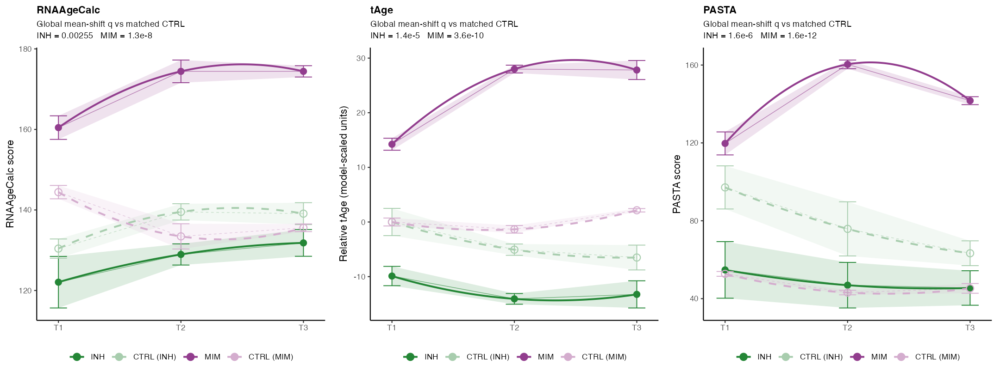

|clock      |arm | n_runs|p_global_shift |q_global_BH4 |p_interaction |q_interaction_BH4 |p_KR_average_shift | q_runmean_BH2|
|:----------|:---|------:|:--------------|:------------|:-------------|:-----------------|:------------------|-------------:|
|RNAAgeCalc |INH |      4|1.909e-03      |2.546e-03    |8.629e-01     |8.629e-01         |5.929e-03          |        0.0332|
|RNAAgeCalc |MIM |      3|3.257e-09      |1.303e-08    |3.890e-06     |7.779e-06         |9.115e-07          |        0.0005|
|tAge       |INH |      4|1.021e-05      |1.361e-05    |6.844e-01     |6.844e-01         |8.359e-05          |        0.0174|
|tAge       |MIM |      3|8.904e-11      |3.562e-10    |9.944e-07     |1.989e-06         |8.261e-08          |        0.0002|
|PASTA      |INH |      4|1.192e-06      |1.589e-06    |5.151e-02     |5.151e-02         |9.914e-06          |        0.0067|
|PASTA      |MIM |      3|3.913e-13      |1.565e-12    |7.954e-09     |1.591e-08         |2.256e-09          |        0.0001|

## l — HPF treatment and withdrawal design

The SV40 HPF series contains repeated inhibitor/scramble treatment and
reseeding, followed by withdrawal after T6. T1–T6 are the retained 96-hour
post-treatment samples. T7 and T8 represent the recorded post-withdrawal
observations. The diagram below is the approved editorial schematic, not a
plot generated by the retention model. The actual sample metadata, rather
than distances in this illustration, define the analytical ordering.

<div class="figure" style="text-align: center">

<p class="caption">Editorial HPF design schematic preserved from the approved Figure S4.</p>
</div>

## m — Persistence of the T6-responsive state

For a fixed feature universe, the observed paired treatment effect at each
time is projected onto the observed T6 effect vector:

\[
R_t=\frac{\sum_j\Delta_{j,T6}\Delta_{j,t}}
           {\sum_j\Delta_{j,T6}^{2}}.
\]

T6 is therefore exactly one. Zero means no component along the T6 vector;
negative values indicate an opposite component, not “negative methylation”.
RNA uses observed VST differences and a 419-gene T6 core selected by nominal
p < 0.05. DNAm uses observed M-value differences and the 1,809-CpG core
selected by the saved T6-offset BH FDR < 0.05. Selection criteria are not
interchanged between omics.

The envelope spans seven nested feature universes. It is a **feature-set
sensitivity range**, not a confidence interval or uncertainty across seven
biological replicates. The timecourse is not a replicated withdrawal experiment.
At T8, the projection is approximately −6% for RNA and 63% for DNAm.
The RNA curves are recomputed from their observed-effect matrix; DNAm curves
are cross-checked against the verified collapsed-CpG decision checkpoint.


```r
rna <- hp_input("hpf_rna_inputs")
sel <- rna$selection
ids <- sel$gene_id[is.finite(sel$pvalue) & sel$pvalue < .05]
stopifnot(setequal(ids, rna$exact$core_ids))
rna_curves <- do.call(rbind, lapply(names(rna$exact$universe_ids), function(universe) {
  ids <- rna$exact$universe_ids[[universe]]
  data.frame(universe, timepoint = 1:8, n_features = length(ids),
             retention = retention(rna$delta[ids, , drop = FALSE]))
}))
idx <- match(paste(rna_curves$universe, rna_curves$timepoint),
             paste(rna$exact$nested_curves$universe, rna$exact$nested_curves$timepoint))
hp_check("RNA all seven nested-universe curves", rna_curves$retention, rna$exact$nested_curves$retention[idx])
rna_scatter <- data.frame(feature_id = rna$exact$core_ids,
                          effect_T6 = rna$delta[rna$exact$core_ids, "T6"],
                          effect_T8 = rna$delta[rna$exact$core_ids, "T8"])
idx <- match(rna_scatter$feature_id, rna$exact$scatter_data$feature_id)
hp_check("RNA observed T6 coordinates", rna_scatter$effect_T6, rna$exact$scatter_data$effect_T6[idx])
hp_check("RNA observed T8 coordinates", rna_scatter$effect_T8, rna$exact$scatter_data$effect_T8[idx])

dnam <- hp_input("hpf_dnam_inputs")
dnam_sel <- hp_input("hpf_dnam_selection_audit")
ids <- dnam_sel$probe[is.finite(dnam_sel$T6_offset_FDR) & dnam_sel$T6_offset_FDR < .05]
stopifnot(setequal(ids, dnam$exact$exact_core_ids))
dnam_curves <- dnam$exact$nested_curves[, c("universe", "timepoint", "n_features", "retention")]
dec <- dnam$decision$curves$nested_responsive
dec <- dec[dec$method == "RAW_T6_UNWEIGHTED", ]
idx <- match(paste(dnam_curves$universe, dnam_curves$timepoint), paste(dec$universe, dec$timepoint))
hp_check("DNAm curves match the final collapsed-CpG checkpoint", dnam_curves$retention, dec$retention[idx])
dnam_scatter <- dnam$exact$scatter_data
# These are two historical exports, not bit-identical numerical objects.
# Preserve both: their T8 retention differs by 4.505e-6 (0.00045 percentage points).
hp_check("DNAm T8 curve/scatter checkpoint agreement within 1e-5", scatter_stats(dnam_scatter)$retention,
              dnam$exact$exact_core_curve$retention[dnam$exact$exact_core_curve$timepoint == 8], tolerance = 1e-5)

make_envelope <- function(curves) do.call(rbind, lapply(1:8, function(timepoint) {
  v <- curves$retention[curves$timepoint == timepoint]
  data.frame(timepoint, minimum = min(v), maximum = max(v), median = median(v), n_universes = length(v))
}))
rna_envelope <- make_envelope(rna_curves)
dnam_envelope <- make_envelope(dnam_curves)
hp_check("RNA envelope minima/maxima", c(rna_envelope$minimum, rna_envelope$maximum),
              c(rna$exact$envelope_curve$minimum_retention, rna$exact$envelope_curve$maximum_retention))
hp_check("DNAm envelope minima/maxima", c(dnam_envelope$minimum, dnam_envelope$maximum),
              c(dnam$exact$envelope_curve$minimum_retention, dnam$exact$envelope_curve$maximum_retention))
core_curves <- rbind(transform(rna_curves[rna_curves$universe == "EXACT_CORE", ], omic = "RNA"),
                     transform(dnam_curves[dnam_curves$universe == "PANEL_P_CORE_EXACT", ], omic = "DNAm"))
stats <- rbind(cbind(omic = "RNA", scatter_stats(rna_scatter)), cbind(omic = "DNAm", scatter_stats(dnam_scatter)))
stats$retention_percent <- 100 * stats$retention
save_table(core_curves, "panel_r_core_curves")
save_table(rbind(transform(rna_envelope, omic = "RNA"), transform(dnam_envelope, omic = "DNAm")), "panel_r_envelopes")
save_table(rbind(transform(rna_curves, omic = "RNA"), transform(dnam_curves, omic = "DNAm")), "panel_r_all_universe_curves")
save_table(stats, "panel_s_statistics")
save_table(rna_scatter, "panel_s_RNA_observed")
save_table(dnam_scatter, "panel_s_DNAm_observed")
hpf_panel <- list(core = core_curves, RNA_envelope = rna_envelope, DNAm_envelope = dnam_envelope,
             RNA_scatter = rna_scatter, DNAm_scatter = dnam_scatter, statistics = stats,
             RNA_universes = rna$exact$universe_ids, DNAm_universes = dnam$decision$universe_ids)
```

```r
hp <- hpf_panel
retention_plot <- function(omic) {
  data <- hp$core[hp$core$omic == omic, ]
  data <- data[order(data$timepoint), ]
  env <- hp[[paste0(omic, "_envelope")]]
  clr <- colors[omic]
  labs_end <- data[data$timepoint > 6, ]
  labs_end$label <- sprintf("%d%%", round(100 * labs_end$retention))
  ggplot(data, aes(timepoint, retention)) +
    annotate("rect", xmin = .55, xmax = 6, ymin = -Inf, ymax = Inf, fill = "#E4F3E1") +
    annotate("rect", xmin = 6, xmax = 8.55, ymin = -Inf, ymax = Inf, fill = "#EFEFEF") +
    geom_ribbon(data = env, aes(x = timepoint, ymin = minimum, ymax = maximum),
                fill = clr, alpha = .19, inherit.aes = FALSE) +
    geom_hline(yintercept = c(0, 1), color = "grey60", linetype = "dotted", linewidth = .4) +
    geom_vline(xintercept = 6, linetype = "dashed", color = "grey40", linewidth = .4) +
    geom_line(data = data[data$timepoint <= 6, ], color = clr, linewidth = .7) +
    geom_line(data = data[data$timepoint >= 6, ], color = "grey30", linetype = "dashed", linewidth = .6) +
    geom_point(data = data[data$timepoint <= 6, ], fill = clr, color = "white", shape = 21, size = 2.4, stroke = .35) +
    geom_point(data = data[data$timepoint == 6, ], fill = clr, color = "grey25", shape = 21, size = 2.5, stroke = .4) +
    geom_point(data = data[data$timepoint > 6, ], fill = "white", color = "grey30", shape = 21, size = 2.9, stroke = .6) +
    geom_text(data = labs_end, aes(label = label), nudge_y = if (omic == "RNA") .09 else .13, size = 3.5) +
    scale_x_continuous(breaks = 1:8, labels = paste0("T", 1:8), limits = c(.55, 8.55), expand = c(0, 0)) +
    scale_y_continuous(breaks = c(0, .5, 1), limits = c(-.25, 1.18), expand = c(0, 0)) +
    labs(x = "treated                          withdrawal", y = paste("Retention of the", omic, "state"),
          title = paste("T6 responsive core (", omic, ")", sep = "")) +
    theme_panel() + theme(axis.title.x = element_text(size = 9), panel.border = element_rect(fill = NA, color = "grey55", linewidth = .35))
}
panel_r <- plot_grid(retention_plot("RNA"), retention_plot("DNAm"), nrow = 1,
                     labels = c("", ""), label_size = 15, align = "hv", axis = "tblr")
save_panel(panel_r, "S4m_HPF_retention", 7.0, 3.05)
```
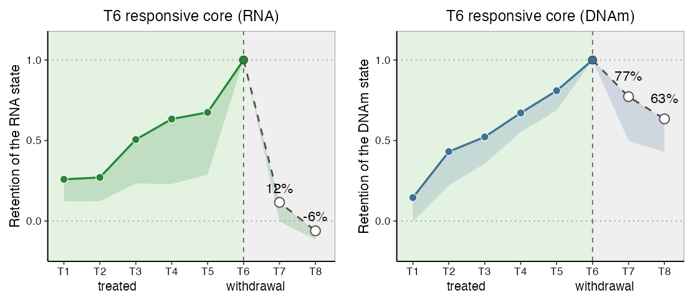

## n — Observed residual effects at T8

The scatter coordinates are the **observed** matched effects at T6 and T8,
not model-predicted coefficients. Pearson correlation and the through-origin
projection ratio summarize complementary aspects of retention. Correlation
does not equal the fraction of effect retained. The RNA correlation is about
−0.12; the DNAm correlation is about 0.90.

Two historical DNAm exports differ in T8 retention by approximately 4.5×10⁻⁶
(0.00045 percentage points). Their accepted curve and scatter values are
preserved and explicitly checked within 10⁻⁵; they are not described as
bit-identical. This does not affect the displayed 63% value.


```r
scatter_plot <- function(omic) {
  data <- hp[[paste0(omic, "_scatter")]]
  stats <- hp$statistics[hp$statistics$omic == omic, ]
  clr <- colors[omic]
  lim <- 1.08 * max(abs(c(data$effect_T6, data$effect_T8)))
  ggplot(data, aes(effect_T6, effect_T8)) +
    geom_hline(yintercept = 0, linetype = "dotted", color = "grey50", linewidth = .35) +
    geom_vline(xintercept = 0, linetype = "dotted", color = "grey50", linewidth = .35) +
    geom_abline(intercept = 0, slope = 1, linetype = "dashed", color = "grey35", linewidth = .5) +
    geom_point(shape = 16, stroke = 0, size = if (omic == "RNA") .75 else .55,
               color = clr, alpha = if (omic == "RNA") .68 else .50) +
    geom_abline(intercept = 0, slope = stats$retention, color = clr, linewidth = .7) +
    annotate("text", x = -.91 * lim, y = .81 * lim,
             label = sprintf("r = %.2f", stats$pearson_r), color = clr, hjust = 0, fontface = "italic", size = 3.8) +
    annotate("text", x = .9 * lim, y = -.83 * lim,
             label = sprintf("res = %d%%", round(stats$retention_percent)), color = clr, hjust = 1, size = 3.5) +
    coord_equal(xlim = c(-lim, lim), ylim = c(-lim, lim), expand = FALSE) +
    labs(title = paste0("Residual effect (", omic, ")"), subtitle = paste0("n = ", format(stats$n, big.mark = ",")),
          x = if (omic == "RNA") expression("Observed effect at T6 ("*Delta*"VST)") else expression("Observed effect at T6 ("*Delta*"M)"),
          y = if (omic == "RNA") expression("Observed effect at T8 ("*Delta*"VST)") else expression("Observed effect at T8 ("*Delta*"M)")) +
    theme_panel() + theme(plot.title = element_text(hjust = 0), plot.subtitle = element_text(face = "italic", size = 10))
}
panel_s <- plot_grid(scatter_plot("RNA"), scatter_plot("DNAm"), nrow = 1,
                     labels = c("", ""), label_size = 15, align = "hv", axis = "tblr")
save_panel(panel_s, "S4n_HPF_residual_effect", 7.0, 3.35)
```
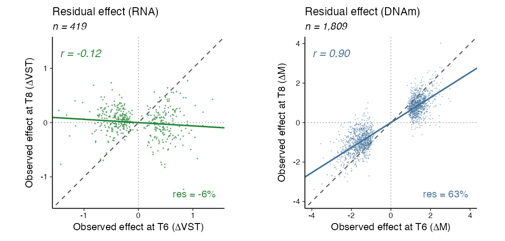

|omic |    n| retention| pearson_r| spearman_r| retention_percent|
|:----|----:|---------:|---------:|----------:|-----------------:|
|RNA  |  419|   -0.0605|   -0.1186|    -0.1214|           -6.0465|
|DNAm | 1809|    0.6345|    0.8965|     0.8328|           63.4515|

# Statistical results and executable inference

## Primary own-control tests

The following table uses final panel names. In the internal historical
checkpoints, `h` corresponds to current 4i-right and `i-right` to current
4j-right. The displayed table resolves that mapping rather than propagating
old panel letters into the paper.


|final_panel    |endpoint           |arm |hypothesis         | n_runs|p         |q_BH_panel |singular |
|:--------------|:------------------|:---|:------------------|------:|:---------|:----------|:--------|
|4d / S4a       |Global methylation |INH |time_interaction   |      3|6.274e-03 |1.255e-02  |FALSE    |
|4d / S4a       |Global methylation |MIM |time_interaction   |      3|4.851e-01 |4.851e-01  |FALSE    |
|4f             |entropy            |INH |T6_mean_difference |      3|4.130e-03 |1.189e-02  |FALSE    |
|4f             |entropy            |MIM |T6_mean_difference |      3|7.653e-03 |1.189e-02  |FALSE    |
|4f             |FAE                |INH |T6_mean_difference |      3|8.915e-03 |1.189e-02  |FALSE    |
|4f             |FAE                |MIM |T6_mean_difference |      3|2.196e-02 |2.196e-02  |FALSE    |
|4i-right / S4c |Skin & Blood       |INH |average_shift      |      3|6.634e-04 |1.327e-03  |TRUE     |
|4i-right / S4c |Skin & Blood       |MIM |average_shift      |      3|1.601e-02 |1.601e-02  |TRUE     |
|4j-right / S4e |RetroAge           |INH |average_shift      |      3|1.898e-10 |3.795e-10  |TRUE     |
|4j-right / S4e |RetroAge           |MIM |average_shift      |      3|5.833e-04 |5.833e-04  |TRUE     |
|4l             |Hypo CTRL movers   |INH |time_interaction   |      3|9.076e-01 |9.076e-01  |TRUE     |
|4l             |Hypo CTRL movers   |MIM |time_interaction   |      3|3.797e-04 |5.063e-04  |TRUE     |
|4l             |Hyper CTRL movers  |INH |time_interaction   |      3|1.929e-08 |7.718e-08  |TRUE     |
|4l             |Hyper CTRL movers  |MIM |time_interaction   |      3|4.297e-07 |8.595e-07  |TRUE     |

The code below re-fits the small panel-level models. Both pooled-control and matched-control outputs are retained. The current main pooled displays use pooled-control statistics, whereas the control-resolved supplementary displays use matched-control statistics. Figure 4l remains unchanged. The random run intercept adjusts for experimental batch; it does not imply that the plotted raw input has been batch-corrected.


```r
# Requested main-panel statistics only: d, f, h, i-right, and l.
# Run from the reconstruction bundle root. Cached scores and figures are unchanged.
suppressPackageStartupMessages({
  library(lme4)
  library(pbkrtest)
  library(emmeans)
})

# Planned hypotheses, fixed before examining the resulting p-values:
# d/l: treatment-by-time interaction (5 df), allowing a baseline group offset.
# h/i: average treatment shift controlling categorical time (1 df), as in the
#      transcriptomic clocks. This is NOT a test of curve-shape equality.
# f: two-sided treatment contrasts against one pooled CTRL group at T6.
# Primary p-values use Kenward-Roger small-sample inference. Historical-style
# ML likelihood-ratio p-values are saved separately, never substituted post hoc.
# BH families: d=2, f=4, h=2, i-right=2, l=4. An all-14 BH audit is also saved.

meta <- metadata()
meta$bio_rep <- stringr::str_extract(meta$SHORT_ID, "P\\d+|exp\\d+")
stopifnot(!anyNA(meta$bio_rep), !anyDuplicated(meta$sample))
rep_map <- unique(meta[, c("bio_rep", "BATCH", "EXPERIMENT")])
stopifnot(nrow(rep_map) == 6L, !anyDuplicated(rep_map$bio_rep),
          !anyDuplicated(rep_map$BATCH))

models <- inputs <- diagnostics <- checks <- primary <- audit <- list()
fit_one <- function(formula, dd, key, reml = TRUE) {
  messages <- character()
  run_fit <- function(optimizer) withCallingHandlers(
      lmer(formula, data = dd, REML = reml,
           control = lmerControl(optimizer = optimizer,
             optCtrl = if (optimizer == "bobyqa") list(maxfun = 200000) else list(maxeval = 200000))),
      warning = function(w) { messages <<- c(messages, conditionMessage(w)); invokeRestart("muffleWarning") },
      message = function(w) { messages <<- c(messages, conditionMessage(w)); invokeRestart("muffleMessage") })
  fit <- run_fit("bobyqa")
  converged <- function(f) all(f@optinfo$conv$opt == 0) &&
    all(grepl("boundary.*singular", f@optinfo$conv$lme4$messages))
  retried <- !converged(fit)
  if (retried) {
    messages <- c(messages, paste("Retrying", key, "with nloptwrap after convergence warning."))
    fit <- run_fit("nloptwrap")
  }
  conv <- fit@optinfo$conv$lme4$messages
  nonboundary <- conv[!grepl("boundary.*singular", conv)]
  xx <- model.matrix(nobars(formula), data = dd)
  stopifnot(qr(xx)$rank == ncol(xx), length(nonboundary) == 0L,
            all(fit@optinfo$conv$opt == 0), is.finite(sigma(fit)), sigma(fit) > 0)
  vv <- as.data.frame(VarCorr(fit))
  diagnostics[[key]] <<- data.frame(model = key, REML = reml, n = nrow(dd),
    n_runs = nlevels(dd$run), fixed_rank = qr(xx)$rank, singular = isSingular(fit),
    optimizer = fit@optinfo$optimizer, retried = retried,
    run_variance = vv$vcov[vv$grp == "run"], residual_variance = sigma(fit)^2,
    messages = paste(unique(c(messages, conv)), collapse = " | "))
  models[[key]] <<- fit
  fit
}

prepare <- function(z, field, key, arm) {
  dd <- z[z$EXPERIMENT == tolower(arm), , drop = FALSE]
  dd$score <- dd[[field]]
  dd$condition <- factor(ifelse(dd$GROUP == arm, "treated", "control"),
                         levels = c("control", "treated"))
  dd$run <- droplevels(factor(dd$BATCH))
  dd$time <- factor(dd$TP2, levels = 1:6)
  dd <- dd[order(dd$run, dd$time, dd$condition), ]
  counts <- with(dd, table(run, time, condition))
  stopifnot(nrow(dd) == 36L, nlevels(dd$run) == 3L, all(counts == 1L),
            all(is.finite(dd$score)), !anyDuplicated(dd$sample),
            all(dd$GROUP %in% c("CTRL", arm)))
  # Scale only for numerical conditioning; linear rescaling leaves tests invariant.
  dd$score_center <- mean(dd$score)
  dd$score_scale <- sd(dd$score)
  dd$y <- (dd$score - dd$score_center) / dd$score_scale
  inputs[[key]] <<- dd[, c("sample", "BATCH", "GROUP", "EXPERIMENT", "TP2",
                           "score", "score_center", "score_scale", "y", "condition", "run", "time")]
  checks[[key]] <<- data.frame(endpoint_arm = key, n = nrow(dd), n_runs = nlevels(dd$run),
    n_times = 6L, n_control = sum(dd$condition == "control"),
    n_treated = sum(dd$condition == "treated"), matched_cells_complete = all(counts == 1L))
  dd
}

curve_test <- function(z, field, panel, endpoint, hypothesis) {
  for (arm in c("INH", "MIM")) {
    key <- paste(endpoint, arm, sep = "__")
    message("Testing ", key)
    dd <- prepare(z, field, key, arm)
    null <- y ~ time + (1 | run)
    shift <- y ~ condition + time + (1 | run)
    interaction <- y ~ condition * time + (1 | run)
    full_formula <- if (hypothesis == "average_shift") shift else interaction
    reduced_formula <- if (hypothesis == "average_shift") null else shift
    full <- fit_one(full_formula, dd, paste0(key, "__full_REML"))
    reduced <- fit_one(reduced_formula, dd, paste0(key, "__reduced_REML"))
    kr <- KRmodcomp(full, reduced)
    ks <- kr$stats
    models[[paste0(key, "__KR")]] <<- kr
    p <- unname(ks$p.value)
    expected_df <- if (hypothesis == "average_shift") 1L else 5L
    stopifnot(is.finite(p), p >= 0, p <= 1, ks$ndf == expected_df)

    # Compatibility audit with the former ML-LRT inference convention.
    full_ml <- fit_one(full_formula, dd, paste0(key, "__full_ML"), FALSE)
    reduced_ml <- fit_one(reduced_formula, dd, paste0(key, "__reduced_ML"), FALSE)
    lr <- anova(reduced_ml, full_ml, refit = FALSE)
    stopifnot(lr$Df[2] == expected_df, lr$Chisq[2] >= -1e-8)
    shift_value <- if (hypothesis == "average_shift")
      unname(fixef(full)["conditiontreated"]) * dd$score_scale[1] else NA_real_

    # An arbitrary condition-specific baseline shift must leave the interaction
    # hypothesis invariant. This validates use of the cached delta-beta data in l.
    invariant <- NA_real_
    if (hypothesis == "time_interaction") {
      X <- model.matrix(nobars(full_formula), dd)
      X0 <- model.matrix(nobars(reduced_formula), dd)
      shifted <- dd$y + ifelse(dd$condition == "treated", .731, -.426)
      invariant <- max(abs(qr.resid(qr(X), dd$y) - qr.resid(qr(X), shifted)),
                       abs(qr.resid(qr(X0), dd$y) - qr.resid(qr(X0), shifted)))
      stopifnot(invariant < 1e-10)
    }
    primary[[key]] <<- data.frame(panel = panel, endpoint = endpoint, comparison = paste0(arm, " vs own CTRL"),
      arm = arm, hypothesis = hypothesis, test = "Kenward-Roger F", n_treated = 18L,
      n_control = 18L, n_runs = 3L, n_timepoints = 6L, estimate = shift_value,
      statistic = unname(ks$Fstat), numerator_df = unname(ks$ndf), denominator_df = unname(ks$ddf),
      p = p, singular = isSingular(full) || isSingular(reduced),
      input_state = if (panel == "d") "raw collapsed beta, sample means" else
        if (panel == "l") "adjusted noncollapsed beta, fixed CTRL-selected probes, condition T1 centered" else
          "frozen clock predictions from adjusted beta")
    audit[[key]] <<- data.frame(endpoint = endpoint, arm = arm, hypothesis = hypothesis,
      ML_LRT_chisq = lr$Chisq[2], ML_LRT_df = lr$Df[2], ML_LRT_p = lr$`Pr(>Chisq)`[2],
      baseline_shift_residual_invariance_error = invariant)
  }
}

global <- readRDS("data/primary/global_raw_collapsed_metrics.rds")
curve_test(global, "mean_beta", "d", "Global methylation", "time_interaction")
clocks <- readRDS("data/primary/clock_predictions.rds")
curve_test(clocks, "SkinBlood", "h", "Skin & Blood", "average_shift")
curve_test(clocks, "RetroAge", "i-right", "RetroAge", "average_shift")

movers <- readRDS("data/primary/ctrl_mover_trajectories.rds")$replicate_means
movers <- left_join(movers, rep_map, by = "bio_rep")
key_meta <- paste(meta$BATCH, meta$GROUP, meta$TP2, sep = "__")
key_movers <- paste(movers$BATCH, movers$GROUP, movers$TP2, sep = "__")
stopifnot(!anyDuplicated(key_meta), !anyNA(match(key_movers, key_meta)))
movers$sample <- meta$sample[match(key_movers, key_meta)]
for (direction in c("Hypo", "Hyper"))
  curve_test(movers[movers$direction == direction, ], "rep_mean", "l",
             paste(direction, "CTRL movers"), "time_interaction")

# T6: all six CTRL samples are a single fixed-effect group. Run intercepts retain
# the known pairing of each treatment with three of those controls; this avoids
# pretending partially paired observations are independent Welch-test samples.
metrics <- readRDS("data/primary/hgf_compartment_metrics_adjusted_verified_annotation.rds")
t6 <- subset(metrics, comp == "All_CpGs" & TP2 == 6)
stopifnot(nrow(t6) == 12L, all(table(t6$GROUP) == c(6L, 3L, 3L)))
for (field in c("entropy", "FAE")) {
  key <- paste0("f__", field)
  dd <- t6
  dd$score <- dd[[field]]
  dd$group <- factor(dd$GROUP, levels = c("CTRL", "INH", "MIM"))
  dd$run <- droplevels(factor(dd$BATCH))
  dd$y <- as.numeric(scale(dd$score))
  scale_sd <- sd(dd$score)
  stopifnot(all(table(dd$run) == 2L), !anyDuplicated(dd$sample), all(is.finite(dd$y)))
  fit <- fit_one(y ~ group + (1 | run), dd, paste0(key, "__REML"))
  inputs[[key]] <- dd[, c("sample", "BATCH", "GROUP", "EXPERIMENT", "TP2", "score", "y", "group", "run")]
  em <- emmeans(fit, ~ group, lmer.df = "kenward-roger")
  contrasts <- contrast(em, method = list("INH vs pooled CTRL" = c(-1, 1, 0),
                                          "MIM vs pooled CTRL" = c(-1, 0, 1)), adjust = "none")
  cc <- as.data.frame(summary(contrasts, infer = c(TRUE, TRUE), adjust = "none"))
  models[[paste0(key, "__contrasts")]] <- contrasts
  for (i in seq_len(nrow(cc))) {
    arm <- c("INH", "MIM")[i]
    primary[[paste(key, arm, sep = "__")]] <- data.frame(panel = "f", endpoint = field,
      comparison = cc$contrast[i], arm = arm, hypothesis = "T6_mean_difference",
      test = "Two-sided mixed-model t, Kenward-Roger df", n_treated = 3L, n_control = 6L,
      n_runs = 6L, n_timepoints = 1L, estimate = cc$estimate[i] * scale_sd,
      statistic = cc$t.ratio[i], numerator_df = 1, denominator_df = cc$df[i],
      p = cc$p.value[i], singular = isSingular(fit),
      input_state = "adjusted noncollapsed beta, sample entropy/FAE, all CTRL pooled")
  }
}

out <- bind_rows(primary)
out <- out[order(match(out$panel, c("d", "f", "h", "i-right", "l")),
                 match(out$endpoint, c("Global methylation", "entropy", "FAE", "Skin & Blood", "RetroAge", "Hypo CTRL movers", "Hyper CTRL movers")),
                 match(out$arm, c("INH", "MIM"))), ]
out$q_BH_panel <- ave(out$p, out$panel, FUN = function(p) p.adjust(p, "BH"))
out$BH_family_n <- ave(out$p, out$panel, FUN = length)
out$q_BH_all14_audit <- p.adjust(out$p, "BH")
stars <- function(p) ifelse(p < .0001, "****", ifelse(p < .001, "***",
                   ifelse(p < .01, "**", ifelse(p < .05, "*", "ns"))))
out$stars_q_BH_panel <- stars(out$q_BH_panel)
stopifnot(nrow(out) == 14L, all(is.finite(out$p)), all(out$q_BH_panel >= out$p - 1e-14),
          all(out$BH_family_n == c(2, 2, rep(4, 4), 2, 2, 2, 2, rep(4, 4))))
# Verify the nested-model hypotheses against explicitly selected coefficients,
# independently of the null-model formula construction above.
verification <- bind_rows(lapply(which(out$hypothesis != "T6_mean_difference"), function(i) {
  key <- paste(out$endpoint[i], out$arm[i], sep = "__")
  fit <- models[[paste0(key, "__full_REML")]]
  cn <- names(fixef(fit))
  selected <- if (out$hypothesis[i] == "average_shift") which(cn == "conditiontreated") else
    grep("^conditiontreated:time", cn)
  stopifnot(length(selected) == out$numerator_df[i])
  L <- diag(length(cn))[selected, , drop = FALSE]
  explicit_p <- KRmodcomp(fit, L)$stats$p.value
  err <- abs(log(explicit_p) - log(out$p[i]))
  stopifnot(err < 1e-6)
  data.frame(endpoint = out$endpoint[i], arm = out$arm[i], explicit_contrast_p = explicit_p,
             absolute_log_p_difference = err)
}))
save_table(out, "main_panel_statistics_primary")
save_table(verification, "main_panel_statistics_hypothesis_validation")
save_table(bind_rows(audit), "main_panel_statistics_ML_LRT_audit")
save_table(bind_rows(diagnostics), "main_panel_statistics_diagnostics")
save_table(bind_rows(checks), "main_panel_statistics_input_checks")
saveRDS(list(primary = out, ML_audit = bind_rows(audit), models = models, inputs = inputs,
             checks = checks, diagnostics = diagnostics, hypothesis_validation = verification),
        "validation/main_panel_statistics.rds")
capture.output(sessionInfo(), file = "validation/main_panel_statistics_sessionInfo.txt")
print(as.data.frame(out[, c("panel", "endpoint", "arm", "p", "q_BH_panel", "stars_q_BH_panel", "singular")]),
      row.names = FALSE, digits = 6)
```

```r
# Main Figure 4 only: compare own-arm and pooled-control inference.
# Run from the bundle root, after 15_main_panel_statistics.R.
# Frozen scores, beta inputs, probe selection, clock predictions and figures
# remain unchanged. This is a control-definition sensitivity, not raw-vs-adjusted.
suppressPackageStartupMessages({library(lme4); library(pbkrtest); library(emmeans)})
previous <- readRDS("validation/main_panel_statistics.rds")

models <- model_inputs <- diagnostics <- validation <- new_rows <- list()
fit_one <- function(formula, dd, key) {
  messages <- character()
  do_fit <- function(optimizer) withCallingHandlers(
    lmer(formula, data = dd, REML = TRUE, control = lmerControl(optimizer = optimizer,
      optCtrl = if (optimizer == "bobyqa") list(maxfun = 200000) else list(maxeval = 200000))),
    warning = function(w) {messages <<- c(messages, conditionMessage(w)); invokeRestart("muffleWarning")},
    message = function(w) {messages <<- c(messages, conditionMessage(w)); invokeRestart("muffleMessage")})
  ok <- function(f) all(f@optinfo$conv$opt == 0) &&
    all(grepl("boundary.*singular", f@optinfo$conv$lme4$messages))
  fit <- do_fit("bobyqa")
  retry <- !ok(fit)
  if (retry) fit <- do_fit("nloptwrap")
  X <- model.matrix(nobars(formula), dd)
  stopifnot(ok(fit), qr(X)$rank == ncol(X), is.finite(sigma(fit)), sigma(fit) > 0)
  v <- as.data.frame(VarCorr(fit))
  models[[key]] <<- fit
  diagnostics[[key]] <<- data.frame(model = key, n = nrow(dd), runs = nlevels(dd$run),
    singular = isSingular(fit), run_variance = v$vcov[v$grp == "run"],
    residual_variance = sigma(fit)^2, optimizer = fit@optinfo$optimizer, retried = retry,
    messages = paste(unique(messages), collapse = " | "))
  fit
}

endpoints <- unique(previous$primary$endpoint[previous$primary$panel != "f"])
for (endpoint in endpoints) {
  all_data <- bind_rows(previous$inputs[[paste0(endpoint, "__INH")]],
                        previous$inputs[[paste0(endpoint, "__MIM")]])
  stopifnot(nrow(all_data) == 72L, !anyDuplicated(all_data$sample))
  for (arm in c("INH", "MIM")) {
    key <- paste(endpoint, arm, "pooled", sep = "__")
    message("Testing ", key)
    reference <- previous$primary[previous$primary$endpoint == endpoint & previous$primary$arm == arm, ]
    stopifnot(nrow(reference) == 1L)
    dd <- all_data[all_data$GROUP %in% c("CTRL", arm), ]
    # The other treatment is excluded: the only additional observations relative
    # to the own-control test are the 18 controls from the other experiment arm.
    dd$condition <- factor(ifelse(dd$GROUP == arm, "treated", "control"),
                           levels = c("control", "treated"))
    dd$run <- droplevels(factor(dd$BATCH))
    dd$time <- factor(dd$TP2, levels = 1:6)
    dd <- dd[order(dd$run, dd$time, dd$condition), ]
    dd$score_center <- mean(dd$score)
    dd$score_scale <- sd(dd$score)
    dd$y <- (dd$score - dd$score_center) / dd$score_scale
    counts <- with(dd, table(run, time, condition))
    stopifnot(nrow(dd) == 54L, nlevels(dd$run) == 6L,
              all(table(dd$condition) == c(control = 36L, treated = 18L)),
              all(counts[, , "control"] == 1L),
              all(rowSums(counts[, , "treated"]) %in% c(0L, 6L)),
              sum(rowSums(counts[, , "treated"]) == 6L) == 3L,
              all(is.finite(dd$score)), !anyDuplicated(dd$sample))
    model_inputs[[key]] <- dd
    full_formula <- if (reference$hypothesis == "time_interaction")
      y ~ condition * time + (1 | run) else y ~ condition + time + (1 | run)
    reduced_formula <- if (reference$hypothesis == "time_interaction")
      y ~ condition + time + (1 | run) else y ~ time + (1 | run)
    full <- fit_one(full_formula, dd, paste0(key, "__full"))
    reduced <- fit_one(reduced_formula, dd, paste0(key, "__reduced"))
    kr <- KRmodcomp(full, reduced)
    ks <- kr$stats
    cn <- names(fixef(full))
    selected <- if (reference$hypothesis == "time_interaction")
      grep("^conditiontreated:time", cn) else which(cn == "conditiontreated")
    L <- diag(length(cn))[selected, , drop = FALSE]
    explicit_p <- KRmodcomp(full, L)$stats$p.value
    stopifnot(ks$ndf == reference$numerator_df, length(selected) == ks$ndf,
              is.finite(ks$p.value), abs(log(explicit_p) - log(ks$p.value)) < 1e-6)
    validation[[key]] <- data.frame(test = key, explicit_contrast_p = explicit_p,
      nested_model_p = ks$p.value, log_p_difference = abs(log(explicit_p) - log(ks$p.value)))
    row <- reference
    row$comparison <- paste0(arm, " vs pooled CTRL")
    row$n_control <- 36L
    row$n_runs <- 6L
    row$estimate <- if (reference$hypothesis == "average_shift")
      unname(fixef(full)["conditiontreated"]) * dd$score_scale[1] else NA_real_
    row$statistic <- unname(ks$Fstat)
    row$numerator_df <- unname(ks$ndf)
    row$denominator_df <- unname(ks$ddf)
    row$p <- unname(ks$p.value)
    row$singular <- isSingular(full) || isSingular(reduced)
    row$control_definition <- "pooled"
    new_rows[[key]] <- row
  }
}

# f was already pooled. Add own-arm T6 contrasts so all endpoints can be read
# in the same paired comparison table. The original pooled f results are reused.
for (endpoint in c("entropy", "FAE")) {
  all_data <- previous$inputs[[paste0("f__", endpoint)]]
  for (arm in c("INH", "MIM")) {
    key <- paste(endpoint, arm, "own", sep = "__")
    message("Testing ", key)
    reference <- previous$primary[previous$primary$endpoint == endpoint & previous$primary$arm == arm, ]
    dd <- all_data[all_data$EXPERIMENT == tolower(arm), ]
    dd$group <- factor(dd$GROUP, levels = c("CTRL", arm))
    dd$run <- droplevels(factor(dd$BATCH))
    dd$y <- as.numeric(scale(dd$score))
    stopifnot(nrow(dd) == 6L, nlevels(dd$run) == 3L, all(table(dd$run, dd$group) == 1L))
    fit <- fit_one(y ~ group + (1 | run), dd, key)
    model_inputs[[key]] <- dd
    emm <- emmeans(fit, ~ group, lmer.df = "kenward-roger")
    ct <- contrast(emm, method = list("treated vs own CTRL" = c(-1, 1)), adjust = "none")
    cc <- as.data.frame(summary(ct, infer = c(TRUE, TRUE), adjust = "none"))
    row <- reference
    row$comparison <- paste0(arm, " vs own CTRL")
    row$n_control <- 3L
    row$n_runs <- 3L
    row$estimate <- cc$estimate * sd(dd$score)
    row$statistic <- cc$t.ratio
    row$denominator_df <- cc$df
    row$p <- cc$p.value
    row$singular <- isSingular(fit)
    row$input_state <- "adjusted noncollapsed beta, sample entropy/FAE, own-arm CTRL"
    row$control_definition <- "own"
    new_rows[[key]] <- row
  }
}

old <- previous$primary
old$control_definition <- ifelse(old$panel == "f", "pooled", "own")
out <- bind_rows(old, bind_rows(new_rows))
out <- out[order(match(out$endpoint, unique(previous$primary$endpoint)),
                 match(out$arm, c("INH", "MIM")), match(out$control_definition, c("own", "pooled"))), ]
families <- interaction(out$panel, out$control_definition, drop = TRUE)
out$q_BH_panel <- ave(out$p, families, FUN = function(x) p.adjust(x, "BH"))
out$BH_family_n <- ave(out$p, families, FUN = length)
out$q_BH_all14_audit <- ave(out$p, out$control_definition, FUN = function(x) p.adjust(x, "BH"))
out$stars_q_BH_panel <- ifelse(out$q_BH_panel < .0001, "****", ifelse(out$q_BH_panel < .001, "***",
  ifelse(out$q_BH_panel < .01, "**", ifelse(out$q_BH_panel < .05, "*", "ns"))))
out$batch_model <- "random intercept for experimental run/BATCH"
stopifnot(nrow(out) == 28L, all(is.finite(out$p)), all(out$p >= 0 & out$p <= 1),
          all(out$q_BH_panel >= out$p - 1e-14), all(table(out$control_definition) == 14L))
# No previously delivered P or panel-wise q is silently changed.
kk <- function(x) paste(x$endpoint, x$arm, x$control_definition, sep = "__")
ix <- match(kk(old), kk(out))
stopifnot(!anyNA(ix), identical(out$p[ix], old$p),
          max(abs(out$q_BH_panel[ix] - old$q_BH_panel)) < 1e-14)

wide <- out %>% select(panel, endpoint, arm, hypothesis, control_definition,
                      p, q_BH_panel, stars_q_BH_panel, estimate, n_control, singular) %>%
  pivot_wider(names_from = control_definition,
              values_from = c(p, q_BH_panel, stars_q_BH_panel, estimate, n_control, singular))
save_table(out, "main_statistics_own_vs_pooled_long")
save_table(wide, "main_statistics_own_vs_pooled_comparison")
save_table(bind_rows(diagnostics), "main_statistics_own_vs_pooled_diagnostics")
save_table(bind_rows(validation), "main_statistics_own_vs_pooled_validation")
# Descriptive check of the control arms, without new significance tests.
controls <- bind_rows(lapply(endpoints, function(endpoint) {
  z <- bind_rows(previous$inputs[[paste0(endpoint, "__INH")]],
                 previous$inputs[[paste0(endpoint, "__MIM")]])
  z$endpoint <- endpoint
  z[z$GROUP == "CTRL", ]
})) %>% group_by(endpoint, EXPERIMENT, TP2) %>%
  summarise(n = n(), mean = mean(score), sd = sd(score), .groups = "drop")
save_table(controls, "main_statistics_control_arm_descriptives")
saveRDS(list(results = out, comparison = wide, models = models, inputs = model_inputs,
             diagnostics = diagnostics, validation = validation), "validation/main_statistics_own_vs_pooled.rds")
capture.output(sessionInfo(), file = "validation/main_statistics_own_vs_pooled_sessionInfo.txt")
print(as.data.frame(wide[, c("panel", "endpoint", "arm", "p_own", "q_BH_panel_own", "p_pooled", "q_BH_panel_pooled")]),
      row.names = FALSE, digits = 6)
```

## Epigenetic clock global and timepoint tests

Use the global average-shift q values for current epigenetic-clock curve annotations, with the comparator specified in CURRENT_STATISTICAL_LABELS.tsv. The stored q_BH_two_arms values refer to matched-control tests. Do not substitute time-interaction q values for this hypothesis. Current curves display global q values only; historical timepoint tests, adjusted across 12 comparisons within each clock, are retained below but not displayed as timepoint stars.


```r
suppressPackageStartupMessages({library(data.table);library(lme4);library(pbkrtest);library(emmeans)})
d <- as.data.table(input("clocks/primary_clocks.rds")$scores)
# Use own controls and a biological-run random intercept. The primary clock
# test is the average treatment offset adjusted for categorical TP, as in main.
# A separate interaction test is retained, not substituted according to P.
rows <- tp_rows <- diag_rows <- list()
for(n in unique(d$clock)) for(arm in c('INH','MIM')) {
 dd<-copy(d[clock==n & tolower(as.character(EXPERIMENT))==tolower(arm)])
 dd[,`:=`(condition=factor(ifelse(GROUP=='CTRL','control','treated'),c('control','treated')),
          time=factor(TP2,levels=1:6),run=droplevels(run))]
 stopifnot(nrow(dd)==36,all(table(dd$run,dd$time,dd$condition)==1))
 dd[,y:=as.numeric(scale(score))]
 fit<-lmer(y~condition+time+(1|run),dd,REML=TRUE)
 null<-lmer(y~time+(1|run),dd,REML=TRUE)
 full<-lmer(y~condition*time+(1|run),dd,REML=TRUE)
 global<-KRmodcomp(fit,null)$stats; inter<-KRmodcomp(full,fit)$stats
 rows[[paste(n,arm)]]<-data.table(clock=n,arm=arm,n_experiments=3,
   p_average_shift=global$p.value,p_time_interaction=inter$p.value,
   estimate_shift=fixef(fit)['conditiontreated']*sd(dd$score),
   df_average=global$ddf,df_interaction=inter$ddf,
   singular_average=isSingular(fit),singular_interaction=isSingular(full))
 em<-emmeans(full,~condition|time,lmer.df='kenward-roger')
 ct<-as.data.frame(contrast(em,'revpairwise'))
 ct$clock<-n;ct$arm<-arm;ct$estimate<-ct$estimate*sd(dd$score);ct$SE<-ct$SE*sd(dd$score)
 tp_rows[[paste(n,arm)]]<-ct
}
stats<-rbindlist(rows); stats[,q_BH_two_arms:=p.adjust(p_average_shift,'BH'),by=clock]
stats[,q_interaction_two_arms:=p.adjust(p_time_interaction,'BH'),by=clock]
stats[,q_BH_all_clocks:=p.adjust(p_average_shift,'BH')]
tp<-rbindlist(tp_rows);tp[,q_BH_12_TP_tests:=p.adjust(p.value,'BH'),by=clock]

save_table(stats, "S4_epigenetic_clock_global_statistics")
save_table(tp, "S4_epigenetic_clock_timepoint_statistics")
```

|clock     |arm |p_average_shift |q_BH_two_arms | p_time_interaction| q_interaction_two_arms|singular_average |
|:---------|:---|:---------------|:-------------|------------------:|----------------------:|:----------------|
|CausAge   |INH |1.156e-04       |2.312e-04     |             0.0233|                 0.0466|TRUE             |
|CausAge   |MIM |3.141e-02       |3.141e-02     |             0.4336|                 0.4336|TRUE             |
|DamAge    |INH |3.575e-04       |7.149e-04     |             0.1454|                 0.2318|TRUE             |
|DamAge    |MIM |3.295e-01       |3.295e-01     |             0.2318|                 0.2318|TRUE             |
|AdaptAge  |INH |1.657e-03       |3.314e-03     |             0.0518|                 0.1036|TRUE             |
|AdaptAge  |MIM |1.084e-01       |1.084e-01     |             0.3170|                 0.3170|TRUE             |
|SkinBlood |INH |6.634e-04       |1.327e-03     |             0.4688|                 0.4688|TRUE             |
|SkinBlood |MIM |1.601e-02       |1.601e-02     |             0.2014|                 0.4029|TRUE             |
|RetroAge  |INH |1.898e-10       |3.795e-10     |             0.0545|                 0.0935|TRUE             |
|RetroAge  |MIM |5.833e-04       |5.833e-04     |             0.0935|                 0.0935|TRUE             |

|clock     |arm | time| estimate|p.value   |q_BH_12_TP_tests |
|:---------|:---|----:|--------:|:---------|:----------------|
|CausAge   |INH |    1|  -0.5255|7.522e-01 |9.339e-01        |
|CausAge   |INH |    2|   0.0458|9.780e-01 |9.780e-01        |
|CausAge   |INH |    3|  -3.0313|7.870e-02 |1.574e-01        |
|CausAge   |INH |    4|  -4.3600|1.455e-02 |5.822e-02        |
|CausAge   |INH |    5|  -6.2190|1.022e-03 |6.133e-03        |
|CausAge   |INH |    6|  -7.3044|2.043e-04 |2.451e-03        |
|CausAge   |MIM |    1|  -0.2038|8.958e-01 |9.772e-01        |
|CausAge   |MIM |    2|   0.7238|6.425e-01 |9.339e-01        |
|CausAge   |MIM |    3|   0.4384|7.783e-01 |9.339e-01        |
|CausAge   |MIM |    4|   0.9503|5.430e-01 |9.309e-01        |
|CausAge   |MIM |    5|   3.7793|2.235e-02 |6.705e-02        |
|CausAge   |MIM |    6|   2.8730|7.514e-02 |1.574e-01        |
|DamAge    |INH |    1|  -0.7499|8.311e-01 |9.066e-01        |
|DamAge    |INH |    2|  -0.2584|9.414e-01 |9.414e-01        |
|DamAge    |INH |    3|  -8.2588|2.655e-02 |1.062e-01        |
|DamAge    |INH |    4|  -6.3351|8.181e-02 |2.261e-01        |
|DamAge    |INH |    5| -10.5654|5.988e-03 |3.593e-02        |
|DamAge    |INH |    6| -10.9981|4.475e-03 |3.593e-02        |
|DamAge    |MIM |    1|  -3.7458|1.053e-01 |2.261e-01        |
|DamAge    |MIM |    2|  -0.7069|7.529e-01 |9.034e-01        |
|DamAge    |MIM |    3|   2.5365|2.649e-01 |4.541e-01        |
|DamAge    |MIM |    4|   3.6597|1.130e-01 |2.261e-01        |
|DamAge    |MIM |    5|   2.2076|3.302e-01 |4.953e-01        |
|DamAge    |MIM |    6|   1.6679|4.599e-01 |6.131e-01        |
|AdaptAge  |INH |    1|   0.4368|9.029e-01 |9.029e-01        |
|AdaptAge  |INH |    2|  -2.4967|4.878e-01 |5.854e-01        |
|AdaptAge  |INH |    3|   5.1055|1.631e-01 |3.262e-01        |
|AdaptAge  |INH |    4|   9.0422|1.803e-02 |7.212e-02        |
|AdaptAge  |INH |    5|  10.8404|5.686e-03 |3.411e-02        |
|AdaptAge  |INH |    6|  11.3574|4.036e-03 |3.411e-02        |
|AdaptAge  |MIM |    1|   1.9168|4.021e-01 |5.361e-01        |
|AdaptAge  |MIM |    2|  -1.9227|4.007e-01 |5.361e-01        |
|AdaptAge  |MIM |    3|   0.9178|6.864e-01 |7.488e-01        |
|AdaptAge  |MIM |    4|  -4.6510|5.008e-02 |1.502e-01        |
|AdaptAge  |MIM |    5|  -2.2047|3.364e-01 |5.361e-01        |
|AdaptAge  |MIM |    6|  -3.3822|1.459e-01 |3.262e-01        |
|SkinBlood |INH |    1|  -0.0618|9.687e-01 |9.687e-01        |
|SkinBlood |INH |    2|  -2.3804|1.405e-01 |2.810e-01        |
|SkinBlood |INH |    3|  -2.4757|1.260e-01 |2.810e-01        |
|SkinBlood |INH |    4|  -4.8447|5.079e-03 |3.047e-02        |
|SkinBlood |INH |    5|  -2.2325|1.656e-01 |2.839e-01        |
|SkinBlood |INH |    6|  -2.6092|1.079e-01 |2.810e-01        |
|SkinBlood |MIM |    1|   1.9455|6.071e-02 |2.429e-01        |
|SkinBlood |MIM |    2|   0.5795|5.619e-01 |7.004e-01        |
|SkinBlood |MIM |    3|  -0.3503|7.253e-01 |7.912e-01        |
|SkinBlood |MIM |    4|   0.5474|5.837e-01 |7.004e-01        |
|SkinBlood |MIM |    5|   3.1381|4.243e-03 |3.047e-02        |
|SkinBlood |MIM |    6|   0.6476|5.174e-01 |7.004e-01        |
|RetroAge  |INH |    1|  -2.3997|4.503e-02 |6.755e-02        |
|RetroAge  |INH |    2|  -3.9419|2.068e-03 |4.135e-03        |
|RetroAge  |INH |    3|  -5.8951|3.091e-05 |1.236e-04        |
|RetroAge  |INH |    4|  -4.6335|4.684e-04 |1.405e-03        |
|RetroAge  |INH |    5|  -6.7736|4.885e-06 |2.931e-05        |
|RetroAge  |INH |    6|  -7.1644|2.195e-06 |2.634e-05        |
|RetroAge  |MIM |    1|   0.8044|2.015e-01 |2.418e-01        |
|RetroAge  |MIM |    2|   0.2003|7.461e-01 |8.139e-01        |
|RetroAge  |MIM |    3|   1.8979|5.144e-03 |8.818e-03        |
|RetroAge  |MIM |    4|  -0.0017|9.978e-01 |9.978e-01        |
|RetroAge  |MIM |    5|   2.2415|1.347e-03 |3.233e-03        |
|RetroAge  |MIM |    6|   1.2519|5.255e-02 |7.006e-02        |

## Current annotation code and panel mapping

The analytical reconstructions use `CURRENT_STATISTICAL_LABELS.tsv`, with
pooled and matched comparisons identified. The annotation module executes
after the statistical modules and checks the q values against their numerical
outputs. Current clock curves display global q values only; Figure 4l remains
unchanged.


```r
# Current curve/endpoint labels, applied after all statistical replay modules.
# This changes reconstruction annotations only: no scores, fitted curves,
# comparison families, reference-distance analyses or Figure 4l are changed.
# Clock curves display global q values, never individual-timepoint stars.

current_labels <- read.delim("CURRENT_STATISTICAL_LABELS.tsv", check.names = FALSE,
                             stringsAsFactors = FALSE)
main_stats <- read.delim("tables/main_statistics_own_vs_pooled_long.tsv",
                         check.names = FALSE, stringsAsFactors = FALSE)
epigenetic_stats <- read.delim("tables/S4_epigenetic_clock_global_statistics.tsv",
                               check.names = FALSE, stringsAsFactors = FALSE)
htert_stats <- read.delim("tables/S4k_clock_global_statistics.tsv",
                         check.names = FALSE, stringsAsFactors = FALSE)
primary_reference_stats <- read.delim("tables/4o_123CpG_primary_tests.tsv",
                                      check.names = FALSE, stringsAsFactors = FALSE)
htert_reference_stats <- read.delim("tables/hTERT_123CpG_reference_tests.tsv",
                                    check.names = FALSE, stringsAsFactors = FALSE)

# Match by endpoint, treatment and comparator, not by a historical panel letter.
# Old statistical tables call the current Skin & Blood panel h and RetroAge
# i-right. CURRENT_STATISTICAL_LABELS.tsv supplies the final artwork mapping.
handled_panels <- c("4d", "S4a", "4f", "4f legend matched comparator",
                    "4i right", "S4c", "4j right", "S4e", "S4d", "S4k",
                    "4o centre", "4o right", "hTERT reference-distance support")
annotation_validation <- list()
for (i in which(current_labels$panel %in% handled_panels)) {
  label <- current_labels[i, , drop = FALSE]
  if (label$panel %in% c("4o centre", "4o right", "hTERT reference-distance support")) {
    stopifnot(label$controls == "matched", label$endpoint == "123-CpG reference distance")
    if (label$panel == "hTERT reference-distance support") {
      endpoint <- switch(label$hypothesis,
        "Final-cycle 96-h displacement" = "third_cycle_96h",
        "Run-mean displacement over three cycles" = "mean_three_rounds_pp",
        stop("Unknown hTERT reference-distance hypothesis: ", label$hypothesis))
      source_stats <- htert_reference_stats
      source_name <- "hTERT_123CpG_reference_tests"
    } else {
      endpoint <- if (label$panel == "4o centre") "all_T1_T6" else "late_T5_T6"
      expected_hypothesis <- if (label$panel == "4o centre")
        "Run-mean displacement T1-T6" else "Run-mean displacement T5-T6"
      stopifnot(label$hypothesis == expected_hypothesis)
      source_stats <- primary_reference_stats
      source_name <- "4o_123CpG_primary_tests"
    }
    found <- source_stats[source_stats$endpoint == endpoint &
                            source_stats$arm == label$treatment, , drop = FALSE]
    stopifnot(nrow(found) == 1L, found$n_experiments == 3L, found$df == 2)
    replay_p <- found$p
    replay_q <- found$q
  } else if (label$panel == "S4k") {
    found <- htert_stats[htert_stats$clock == label$endpoint &
                          htert_stats$arm == label$treatment, , drop = FALSE]
    stopifnot(nrow(found) == 1L, label$controls == "matched")
    replay_p <- found$p_global_shift
    replay_q <- found$q_global_BH4
    source_name <- "S4k_clock_global_statistics"
  } else if (label$panel == "S4d") {
    found <- epigenetic_stats[epigenetic_stats$clock == label$endpoint &
                               epigenetic_stats$arm == label$treatment, , drop = FALSE]
    stopifnot(nrow(found) == 1L, label$controls == "matched")
    replay_p <- found$p_average_shift
    replay_q <- found$q_BH_two_arms
    source_name <- "S4_epigenetic_clock_global_statistics"
  } else {
    comparator <- if (label$controls == "matched") "own" else "pooled"
    found <- main_stats[main_stats$endpoint == label$endpoint &
                          main_stats$arm == label$treatment &
                          main_stats$control_definition == comparator, , drop = FALSE]
    stopifnot(nrow(found) == 1L, found$hypothesis == label$hypothesis)
    replay_p <- found$p
    replay_q <- found$q_BH_panel
    source_name <- "main_statistics_own_vs_pooled_long"
  }
  stopifnot(all(is.finite(c(replay_p, replay_q, label$P_value, label$q_value))),
            all(c(replay_p, replay_q, label$P_value, label$q_value) > 0))
  key <- paste(label$panel, label$endpoint, label$treatment, label$controls)
  # Log-scale comparison also detects errors in very small P/q values.
  assert_close(log(c(replay_p, replay_q)), log(c(label$P_value, label$q_value)),
               paste("Current statistical annotation:", key), tolerance = 1e-5)
  annotation_validation[[length(annotation_validation) + 1L]] <- data.frame(
    panel = label$panel, endpoint = label$endpoint, treatment = label$treatment,
    controls = label$controls, hypothesis = label$hypothesis,
    annotation_p = label$P_value, replay_p = replay_p,
    annotation_q = label$q_value, replay_q = replay_q,
    source_table = source_name, stringsAsFactors = FALSE)
}
save_table(bind_rows(annotation_validation), "current_annotation_validation")

format_annotation_q <- function(q) {
  if (!is.finite(q) || q < 0 || q > 1) stop("Invalid q value for annotation.")
  if (q < .001) {
    sub("e([+-])0+", "e\\1", formatC(q, format = "e", digits = 1))
  } else {
    format(signif(q, 3), scientific = FALSE, trim = TRUE)
  }
}
annotation_q <- function(panel, endpoint, arm, comparator) {
  z <- current_labels[current_labels$panel == panel &
                        current_labels$endpoint == endpoint &
                        current_labels$treatment == arm &
                        current_labels$controls == comparator, , drop = FALSE]
  stopifnot(nrow(z) == 1L)
  z$q_value
}
q_pair <- function(panel, endpoint, comparator) {
  paste0("INH = ", format_annotation_q(annotation_q(panel, endpoint, "INH", comparator)),
         "   MIM = ", format_annotation_q(annotation_q(panel, endpoint, "MIM", comparator)))
}
add_global_q <- function(plot, panel, endpoint, comparator,
                         hypothesis = "Global mean-shift") {
  plot + labs(subtitle = paste0(hypothesis, " q vs ", comparator, " CTRL\n",
                                q_pair(panel, endpoint, comparator))) +
    theme(plot.subtitle = element_text(size = 8.5, lineheight = 1.1,
                                       margin = margin(b = 7)),
          plot.margin = margin(6, 8, 6, 6))
}

# Main pooled curves and supplementary matched curves retain the same plotted
# data and uncertainty bands. Only subtitles are added outside the data area.
curve_spec <- data.frame(
  plot = c("4d_global_methylation", "S4a_global_methylation_separate_controls",
           "4i_right_SkinBlood", "S4c", "4j_right_RetroAge", "S4e"),
  panel = c("4d", "S4a", "4i right", "S4c", "4j right", "S4e"),
  endpoint = c("Global methylation", "Global methylation", "Skin & Blood",
               "Skin & Blood", "RetroAge", "RetroAge"),
  comparator = c("pooled", "matched", "pooled", "matched", "pooled", "matched"),
  width = c(5.5, 5.5, 5.3, 5.3, 5.3, 5.3),
  height = c(3.2, 5.1, 5.2, 5.2, 5.2, 5.2), stringsAsFactors = FALSE)
for (i in seq_len(nrow(curve_spec))) {
  spec <- curve_spec[i, ]
  stopifnot(spec$plot %in% names(panels))
  hypothesis <- if (spec$endpoint == "Global methylation")
    "Global interaction" else "Global mean-shift"
  annotated <- add_global_q(panels[[spec$plot]], spec$panel, spec$endpoint,
                            spec$comparator, hypothesis)
  save_panel(annotated, spec$plot, spec$width, spec$height)
}

# Causal-clock panels have matched controls and their own two-arm BH families.
for (clock in c("CausAge", "DamAge", "AdaptAge")) {
  name <- paste0("S4d_", clock)
  stopifnot(name %in% names(panels))
  save_panel(add_global_q(panels[[name]], "S4d", clock, "matched"), name, 5.3, 5.2)
}
save_panel(plot_grid(plotlist = panels[c("S4d_CausAge", "S4d_DamAge", "S4d_AdaptAge")],
                     nrow = 1), "S4d_causal_clocks", 13.5, 5.1)

# hTERT RNA clocks: display inputs are unchanged. The inference remains the
# established ML-LRT global shift, BH across two shifts plus two interactions
# within each clock. Rebuild individual panels to annotate the combined view.
htert_display <- as.data.frame(input("clocks/htert_clocks.rds")$display)
htert_display$TP2 <- htert_display$TIME
htert_display$series <- as.character(htert_display$GROUP)
htert_annotated <- lapply(c("RNAAgeCalc", "tAge", "PASTA"), function(clock) {
  plot <- trajectory(htert_display[htert_display$clock == clock, , drop = FALSE],
                     if (clock == "tAge") "Relative tAge (model-scaled units)" else
                       paste(clock, "score"), xpos = 1:3, title = clock)
  add_global_q(plot, "S4k", clock, "matched")
})
save_panel(plot_grid(plotlist = htert_annotated, nrow = 1),
           "S4k_hTERT_transcriptomic_clocks", 13.5, 5.1)

# Figure 4f is a T6 endpoint, not a global curve. Put q values in each facet
# heading, with matched-control values in the caption as in the figure legend.
stopifnot("4f_entropy_FAE" %in% names(panels))
endpoint_labels <- setNames(vapply(c("entropy", "FAE"), function(endpoint) {
  paste0(if (endpoint == "entropy") "Entropy" else "FAE", "\n",
         "q(INH) = ", format_annotation_q(annotation_q("4f", endpoint, "INH", "pooled")),
         "\nq(MIM) = ", format_annotation_q(annotation_q("4f", endpoint, "MIM", "pooled")))
}, character(1)), c("entropy", "FAE"))
matched_caption <- paste0(
  "Matched CTRL q: entropy ", q_pair("4f legend matched comparator", "entropy", "matched"),
  "\nFAE ", q_pair("4f legend matched comparator", "FAE", "matched"))
endpoint_plot <- panels[["4f_entropy_FAE"]] +
  facet_wrap(~name, scales = "free_y", nrow = 1,
             labeller = as_labeller(endpoint_labels)) +
  labs(title = "T6 vs pooled CTRL", caption = matched_caption) +
  theme(strip.text = element_text(size = 8.5, face = "plain", lineheight = 1.1),
        plot.caption = element_text(size = 7.5, hjust = 0, margin = margin(t = 7)),
        plot.margin = margin(6, 8, 6, 6))
save_panel(endpoint_plot, "4f_entropy_FAE", 5.5, 3.6)

# No loop above includes Figure 4l or any reference-distance panel. Their
# existing reconstructions are preserved by this annotation-only module.
```


- Figure 4d uses pooled-control global interaction q values; S4a shows the corresponding matched-control results.
- Skin & Blood and RetroAge main curves use pooled-control global average-shift q values, and S4c/e use matched-control q values. No clock timepoint stars are displayed.
- The 123-CpG centre-panel q tests the mean T1–T6 displacement, and the right
  panel tests the T5–T6 mean; neither annotation is a slope-test result.
- S4g labels must identify **minimum smoothed FDR**, not an unspecified
  whole-region corrected p-value. S4h discovery and matched display populations
  differ as described above.
- S4j CAMERA bars match the reproduced q values. The analytical count axis is
  0–4k. Any duplicated thumbnail in the Illustrator composition is editorial,
  not an extra analysis to reproduce.
- S4m shading is a nested-universe range. S4n uses observed, not fitted, effects.

# The 123-CpG reference and annotation table

`data/fidelity123/HGF123_reference.tsv` contains all 123 unique CpGs, the
external-reference medians and available genomic, gene and selection
annotations. It is the same reference as Supplementary Data 4. Coordinates
and nearest-gene annotations are descriptive; proximity does not establish
a causal regulatory target. Raw collapsed beta values are retained for each
CpG/sample; multiple array designs for one CpG are not independent signature
members.

Historical 43-CpG annotation exports and their optional replay scripts are
retained only under `provenance/`; they are not used to score or annotate the
current 123-CpG analysis. No new supplementary workbook is created here.


|probe      |chr   |       pos|nearest_tss_symbols | nearest_tss_distance_bp|fibroblast_direction |
|:----------|:-----|---------:|:-------------------|-----------------------:|:--------------------|
|cg14711108 |chr1  |  44347491|ERI3                |                    7570|Lower methylation    |
|cg13206932 |chr1  |  85582228|CCN1                |                     765|Lower methylation    |
|cg03943115 |chr1  | 153041891|SPRR2D              |                      37|Lower methylation    |
|cg03701795 |chr1  | 158353692|CD1E                |                       4|Lower methylation    |
|cg02633729 |chr1  | 172144366|DNM3OS              |                     202|Lower methylation    |
|cg25214966 |chr1  | 172144616|DNM3OS              |                       3|Lower methylation    |
|cg24002149 |chr1  | 172144780|DNM3OS              |                      39|Lower methylation    |
|cg21450888 |chr1  | 172144907|DNM3OS              |                      67|Lower methylation    |
|cg16729555 |chr1  | 206970188|FCAMR               |                     272|Lower methylation    |
|cg14585167 |chr2  |    709329|NA                  |                   16094|Lower methylation    |
|cg11902863 |chr2  |   3040965|LINC01250           |                   39515|Lower methylation    |
|cg23180780 |chr2  |  12120360|MIR3681HG           |                   13896|Lower methylation    |
|cg21206147 |chr2  |  23526217|LOC105374325        |                    1873|Higher methylation   |
|cg03514843 |chr2  |  27078327|EMILIN1             |                     288|Lower methylation    |
|cg14021880 |chr2  |  27078501|EMILIN1             |                     114|Lower methylation    |
|cg15135286 |chr2  |  33134214|LTBP1               |                     192|Lower methylation    |
|cg04003883 |chr2  |  37742643|NA                  |                    1690|Lower methylation    |
|cg07622521 |chr2  |  85765499|ATOH8               |                    4750|Higher methylation   |
|cg18368599 |chr2  | 127193889|CYP27C1             |                   11878|Lower methylation    |
|cg04793527 |chr2  | 162243371|FAP                 |                      42|Lower methylation    |
|cg11066033 |chr2  | 241617443|THAP4               |                      47|Higher methylation   |
|cg12477452 |chr3  |  11196253|NA                  |                   12397|Lower methylation    |
|cg23067317 |chr3  |  16174587|GALNT15             |                      93|Lower methylation    |
|cg18789887 |chr3  |  16174593|GALNT15             |                      87|Lower methylation    |
|cg06620117 |chr3  |  23776659|UBE2E1              |                   29296|Lower methylation    |
|cg19630681 |chr3  |  64443931|PRICKLE2-DT         |                    1300|Lower methylation    |
|cg14212012 |chr3  |  82811474|NA                  |                    3453|Lower methylation    |
|cg26188543 |chr3  | 148947052|NA                  |                   13060|Higher methylation   |
|cg04776445 |chr4  |   4791365|NA                  |                   29040|Lower methylation    |
|cg12925881 |chr4  |  26048785|LINC02357           |                   21969|Lower methylation    |
|cg03374148 |chr4  |  53682503|LOC100506444        |                   13398|Lower methylation    |
|cg15976883 |chr4  |  54094805|GSX2                |                    4718|Higher methylation   |
|cg02124022 |chr4  |  54108719|GSX2                |                    8546|Higher methylation   |
|cg08528970 |chr4  |  75715395|G3BP2               |                    4228|Lower methylation    |
|cg26126295 |chr4  | 118174085|NA                  |                   20666|Lower methylation    |
|cg10900313 |chr4  | 151226238|SH3D19              |                     172|Lower methylation    |
|cg03477332 |chr5  |  16178675|MARCHF11            |                     846|Lower methylation    |
|cg08899442 |chr5  | 157971810|NA                  |                    5146|Lower methylation    |
|cg00380780 |chr6  |   3759882|NA                  |                    5783|Lower methylation    |
|cg16421157 |chr6  |   5036363|LYRM4-AS1           |                    6287|Higher methylation   |
|cg22370716 |chr6  |  33165761|COL11A2             |                    1753|Lower methylation    |
|cg17759095 |chr6  |  56890768|NA                  |                   19577|Lower methylation    |
|cg18196453 |chr6  | 125013409|RNF217              |                    4654|Higher methylation   |
|cg00892324 |chr7  |   2525941|MIR4648             |                    1133|Higher methylation   |
|cg05427639 |chr7  |  33040884|NT5C3A              |                      16|Higher methylation   |
|cg05998930 |chr7  |  50781588|GRB10               |                      88|Higher methylation   |
|cg15036867 |chr7  |  93622106|GNGT1               |                   30533|Lower methylation    |
|cg16568084 |chr7  |  94182251|NA                  |                  105094|Lower methylation    |
|cg13451242 |chr7  | 134619774|BPGM                |                   27037|Lower methylation    |
|cg04037707 |chr7  | 154913205|PAXIP1-AS2          |                   15255|Lower methylation    |
|cg08951403 |chr7  | 158167728|PTPRN2              |                   37549|Lower methylation    |
|cg20305578 |chr8  |   1960135|NA                  |                    2996|Higher methylation   |
|cg01761595 |chr8  |   9964213|NA                  |                   44980|Lower methylation    |
|cg20543645 |chr8  |  13065771|NA                  |                   21421|Higher methylation   |
|cg13126206 |chr8  |  23072676|NA                  |                    1812|Higher methylation   |
|cg25540871 |chr8  |  38703707|NA                  |                    1148|Lower methylation    |
|cg04771100 |chr8  |  38974816|HTRA4               |                     588|Higher methylation   |
|cg00672936 |chr8  |  38975209|HTRA4               |                     981|Higher methylation   |
|cg03263337 |chr8  |  61286523|CLVS1               |                    1432|Lower methylation    |
|cg26793720 |chr8  |  97519780|NA                  |                  105299|Lower methylation    |
|cg19726712 |chr8  |  97778099|LAPTM4B             |                    2250|Higher methylation   |
|cg16675872 |chr8  | 129241372|NA                  |                      84|Lower methylation    |
|cg24377133 |chr8  | 143088958|LY6L                |                    8328|Lower methylation    |
|cg26207380 |chr8  | 143140598|LY6H                |                   19442|Lower methylation    |
|cg14979482 |chr10 |  48275657|FRMPD2              |                     961|Lower methylation    |
|cg12498395 |chr10 |  64011988|LOC105378333        |                   25292|Lower methylation    |
|cg14557288 |chr10 |  70694270|ADAMTS14            |                   21467|Lower methylation    |
|cg01142721 |chr10 |  84225692|LRIT2               |                     148|Lower methylation    |
|cg05221455 |chr11 |    829616|CRACR2B             |                     309|Higher methylation   |
|cg01114033 |chr11 |  45704638|MIR7154             |                   12862|Lower methylation    |
|cg22827986 |chr11 |  48262697|OR4X1               |                    1164|Lower methylation    |
|cg21667998 |chr11 |  55825989|OR5L2               |                    1230|Lower methylation    |
|cg12738765 |chr11 |  56577878|OR5M10              |                     157|Lower methylation    |
|cg11052535 |chr11 |  56700872|OR9G1               |                    1777|Lower methylation    |
|cg15911165 |chr11 |  58440894|NA                  |                     721|Lower methylation    |
|cg04948284 |chr11 |  65546137|LTBP3               |                     367|Higher methylation   |
|cg24392577 |chr11 |  65547085|LTBP3               |                     326|Higher methylation   |
|cg05330472 |chr11 |  66868820|PC                  |                    3219|Higher methylation   |
|cg05207943 |chr11 |  82384446|MIR4300HG           |                   19299|Lower methylation    |
|cg09938664 |chr11 | 119792173|NA                  |                   29956|Lower methylation    |
|cg19008371 |chr11 | 126356871|ST3GAL4             |                     597|Lower methylation    |
|cg25719851 |chr12 |   6946289|PTPN6               |                     179|Higher methylation   |
|cg03935116 |chr12 |  31323631|SINHCAF             |                     531|Higher methylation   |
|cg07284190 |chr12 |  78194674|NAV3                |                    4402|Lower methylation    |
|cg10940023 |chr12 | 118983122|SRRM4               |                    1161|Lower methylation    |
|cg12475590 |chr13 |  20713923|NA                  |                    1492|Lower methylation    |
|cg10925729 |chr13 |  38980132|STOML3              |                   10699|Lower methylation    |
|cg19444859 |chr13 | 109127336|MYO16-AS2           |                   25417|Lower methylation    |
|cg22731513 |chr13 | 110799625|LINC00567           |                   13459|Lower methylation    |
|cg06997226 |chr13 | 110799693|LINC00567           |                   13391|Lower methylation    |
|cg11360522 |chr13 | 112725514|ATP11A              |                   22227|Higher methylation   |
|cg13199429 |chr14 |  63203993|RHOJ                |                     121|Lower methylation    |
|cg07157030 |chr14 |  63204638|RHOJ                |                      47|Lower methylation    |
|cg18771300 |chr14 |  63205019|RHOJ                |                     160|Lower methylation    |
|cg00971695 |chr14 |  64702946|NA                  |                     445|Higher methylation   |
|cg11115622 |chr14 |  64703240|NA                  |                     151|Higher methylation   |
|cg05206120 |chr14 |  69263412|GALNT16-AS1         |                    2845|Lower methylation    |
|cg01866805 |chr14 |  99660404|HHIPL1              |                   15261|Higher methylation   |
|cg10044470 |chr14 | 104399947|NA                  |                    1101|Lower methylation    |
|cg25406989 |chr15 |  48644138|FBN1                |                     694|Lower methylation    |
|cg18650670 |chr15 |  65396814|IGDCC4              |                     385|Higher methylation   |
|cg01724917 |chr16 |  17469171|XYLT1               |                    1789|Lower methylation    |
|cg09031790 |chr16 |  24118627|NA                  |                   20388|Lower methylation    |
|cg16591159 |chr16 |  31476492|TGFB1I1             |                    3052|Higher methylation   |
|cg05984244 |chr16 |  31476917|TGFB1I1             |                    3477|Higher methylation   |
|cg05877550 |chr16 |  85335432|NA                  |                   17529|Higher methylation   |
|cg26680989 |chr16 |  85527133|GSE1                |                   28834|Higher methylation   |
|cg04416111 |chr16 |  87201289|LOC101928708        |                   10833|Lower methylation    |
|cg04861974 |chr17 |    401842|LOC105371430        |                    8189|Lower methylation    |
|cg06965839 |chr17 |   3399854|OR1E1               |                    1444|Lower methylation    |
|cg10334489 |chr17 |  27471852|KSR1                |                     153|Higher methylation   |
|cg00956759 |chr17 |  31696380|NA                  |                   13188|Lower methylation    |
|cg03390416 |chr17 |  49588879|NA                  |                   10245|Lower methylation    |
|cg00130342 |chr17 |  74270478|DNAI2               |                    3756|Lower methylation    |
|cg14018141 |chr17 |  74484505|CD300A              |                   17643|Lower methylation    |
|cg11328541 |chr19 |  14800077|OR7C1               |                     134|Lower methylation    |
|cg03965138 |chr19 |  51631140|SIGLEC5             |                     739|Lower methylation    |
|cg15006828 |chr20 |  46452721|ZNF663P             |                    4364|Lower methylation    |
|cg10187713 |chr20 |  50729150|PARD6B              |                    2430|Higher methylation   |
|cg15768226 |chr20 |  57390189|RBM38               |                    1207|Higher methylation   |
|cg17367078 |chr22 |  34993512|LINC02885           |                    4243|Lower methylation    |
|cg15477144 |chr22 |  45309153|FAM118A             |                     112|Higher methylation   |
|cg06635946 |chr22 |  46074136|MIRLET7BHG          |                    1847|Lower methylation    |

# Validation, software and approved layouts

## Numerical checks

The checks below compare regenerated quantities against the frozen accepted
analyses, including component shares, DKK2 interactions, CAMERA, HPF curves,
reference selection, clock predictors and panel-level statistics. Agreement
with a historical result is a reproducibility check, not proof that its
scientific assumptions are universally valid.


```r
# Independent scoring and selection checks using bundled compact source inputs.
source("code/upstream/reference_selection.R")
s <- input("fidelity/selection_checkpoint.rds")
culture <- input("fidelity/culture_checkpoint.rds")
a <- input("fidelity/initial_stability_audit.rds")
adopted_reference <- read.delim("data/fidelity123/HGF123_reference.tsv", check.names = FALSE,
                              na.strings = c("NA", "\\N"))
selected123 <- fibroblast_associated_sites(s$identity_probe_audit)
stopifnot(setequal(stable_reference_sites(a), s$probes),
          setequal(culture_stable_sites(culture$audit), culture$probes),
          length(selected123) == 123L,
          setequal(selected123, adopted_reference$probe),
          all(selected123 %in% culture$probes))
assert_close(s$centroid[adopted_reference$probe], adopted_reference$reference,
             "123-CpG centroid equals independent external reference")
cat("Three external-reference selection filters; adopted 123 CpGs\tPASS\t0\n",
    file = "validation/numeric_checks.tsv", append = TRUE)

model <- input("models/PASTA_linear_predictor.rds")
pasta <- input("clocks/htert_PASTA_inputs.rds")
stopifnot(setequal(names(model$weights), rownames(pasta$rank_matrix)))
pasta_prediction <- as.numeric(model$intercept + model$weights[rownames(pasta$rank_matrix)] %*% pasta$rank_matrix) * model$scale
assert_close(pasta_prediction, pasta$prediction, "hTERT PASTA frozen predictor")

horvath <- input("models/horvath_calibrated_input.rds")
models <- input("clocks/auc_inputs.rds")$models
for (nm in c("SkinBlood", "Horvath2013")) {
  model <- models[[nm]]
  x <- horvath$beta[names(model$w), , drop = FALSE]
  if (anyNA(x)) {
    missing <- which(is.na(x), arr.ind = TRUE)
    x[missing] <- rowMeans(x, na.rm = TRUE)[missing[, 1]]
  }
  predictor <- as.numeric(model$intercept + model$w %*% x)
  age <- ifelse(predictor < 0, 21 * exp(predictor) - 1, 21 * predictor + 20)
  expected <- if (nm == "SkinBlood") {
    scores <- input("primary/clock_predictions.rds")
    scores$SkinBlood[match(colnames(x), scores$sample)]
  } else horvath$age[colnames(x)]
  assert_close(age, expected, paste(nm, "all-sample calibrated predictor"))
}
retro <- input("primary/retroage_model_and_input.rds")
weights <- setNames(retro$coefficients$estimate, retro$coefficients$term)
predicted <- as.numeric(weights["(Intercept)"] + weights[rownames(retro$input)] %*% retro$input)
assert_close(predicted, retro$score[colnames(retro$input)], "RetroAge all-sample predictor")

# Primary statistics: own-control values keep the historical test families.
current <- readRDS("validation/main_statistics_own_vs_pooled.rds")$results
expected <- input("primary/main_statistics_own_vs_pooled.rds")$results
key <- function(x) paste(x$endpoint, x$arm, x$control_definition)
assert_close(current$p, expected$p[match(key(current), key(expected))], "Main-panel p values", 1e-5)
current$final_panel <- c(d = "4d / S4a", f = "4f", h = "4i-right / S4c",
                        `i-right` = "4j-right / S4e", l = "4l")[current$panel]
save_table(current, "final_main_statistics_all_control_definitions")
save_table(subset(current, control_definition == "own"), "final_main_statistics_own_controls")
```

|check                                                                                                   |status |maximum_absolute_error |
|:-------------------------------------------------------------------------------------------------------|:------|:----------------------|
|CausAge linear predictor                                                                                |PASS   |0.000e+00              |
|DamAge linear predictor                                                                                 |PASS   |0.000e+00              |
|AdaptAge linear predictor                                                                               |PASS   |0.000e+00              |
|Five-clock AUC route shares                                                                             |PASS   |4.619e-14              |
|123-CpG HGF mean_pp                                                                                     |PASS   |2.776e-16              |
|123-CpG HGF sem_pp                                                                                      |PASS   |1.249e-15              |
|123-CpG HGF ci_low_pp                                                                                   |PASS   |6.550e-15              |
|123-CpG HGF ci_high_pp                                                                                  |PASS   |6.051e-15              |
|123-CpG HGF p                                                                                           |PASS   |5.163e-15              |
|123-CpG HGF BH q                                                                                        |PASS   |5.163e-15              |
|HGF full mean equals equal cycle mean                                                                   |PASS   |5.551e-17              |
|123-CpG HGF AUC diagnostics mean_pp                                                                     |PASS   |3.886e-16              |
|123-CpG HGF AUC diagnostics sem_pp                                                                      |PASS   |1.242e-15              |
|123-CpG HGF AUC diagnostics ci_low_pp                                                                   |PASS   |4.885e-15              |
|123-CpG HGF AUC diagnostics ci_high_pp                                                                  |PASS   |5.662e-15              |
|123-CpG HGF AUC diagnostics p                                                                           |PASS   |1.332e-15              |
|123-CpG HGF AUC diagnostics BH q                                                                        |PASS   |1.533e-15              |
|123-CpG external centroid                                                                               |PASS   |4.996e-16              |
|123-CpG hTERT mean_pp                                                                                   |PASS   |1.839e-15              |
|123-CpG hTERT sem_pp                                                                                    |PASS   |3.268e-15              |
|123-CpG hTERT ci_low_pp                                                                                 |PASS   |1.266e-14              |
|123-CpG hTERT ci_high_pp                                                                                |PASS   |1.621e-14              |
|123-CpG hTERT p                                                                                         |PASS   |1.082e-14              |
|123-CpG hTERT BH q                                                                                      |PASS   |1.082e-14              |
|DKK2 paired interaction p values                                                                        |PASS   |3.469e-18              |
|hTERT inhibitor hyper/hypo                                                                              |PASS   |0.000e+00              |
|hTERT CTRL and Mimic significant DMP counts                                                             |PASS   |0.000e+00              |
|CAMERA p matches historical                                                                             |PASS   |0.000e+00              |
|CAMERA within-target BH matches historical                                                              |PASS   |0.000e+00              |
|hTERT rank universe                                                                                     |PASS   |0.000e+00              |
|RNA all seven nested-universe curves                                                                    |PASS   |3.442e-15              |
|RNA observed T6 coordinates                                                                             |PASS   |0.000e+00              |
|RNA observed T8 coordinates                                                                             |PASS   |0.000e+00              |
|DNAm curves match the final collapsed-CpG checkpoint                                                    |PASS   |0.000e+00              |
|DNAm T8 curve/scatter checkpoint agreement within 1e-5                                                  |PASS   |4.505e-06              |
|RNA envelope minima/maxima                                                                              |PASS   |3.442e-15              |
|DNAm envelope minima/maxima                                                                             |PASS   |0.000e+00              |
|hTERT global clock q values                                                                             |PASS   |0.000e+00              |
|123-CpG centroid equals independent external reference                                                  |PASS   |4.996e-16              |
|Three external-reference selection filters; adopted 123 CpGs                                            |PASS   |0.000e+00              |
|hTERT PASTA frozen predictor                                                                            |PASS   |1.208e-13              |
|SkinBlood all-sample calibrated predictor                                                               |PASS   |0.000e+00              |
|Horvath2013 all-sample calibrated predictor                                                             |PASS   |0.000e+00              |
|RetroAge all-sample predictor                                                                           |PASS   |0.000e+00              |
|Main-panel p values                                                                                     |PASS   |0.000e+00              |
|Current statistical annotation: 4d Global methylation INH pooled                                        |PASS   |0.000e+00              |
|Current statistical annotation: S4a Global methylation INH matched                                      |PASS   |0.000e+00              |
|Current statistical annotation: 4d Global methylation MIM pooled                                        |PASS   |0.000e+00              |
|Current statistical annotation: S4a Global methylation MIM matched                                      |PASS   |0.000e+00              |
|Current statistical annotation: 4f entropy INH pooled                                                   |PASS   |0.000e+00              |
|Current statistical annotation: 4f legend matched comparator entropy INH matched                        |PASS   |0.000e+00              |
|Current statistical annotation: 4f entropy MIM pooled                                                   |PASS   |0.000e+00              |
|Current statistical annotation: 4f legend matched comparator entropy MIM matched                        |PASS   |0.000e+00              |
|Current statistical annotation: 4f FAE INH pooled                                                       |PASS   |0.000e+00              |
|Current statistical annotation: 4f legend matched comparator FAE INH matched                            |PASS   |0.000e+00              |
|Current statistical annotation: 4f FAE MIM pooled                                                       |PASS   |0.000e+00              |
|Current statistical annotation: 4f legend matched comparator FAE MIM matched                            |PASS   |0.000e+00              |
|Current statistical annotation: 4i right Skin & Blood INH pooled                                        |PASS   |0.000e+00              |
|Current statistical annotation: S4c Skin & Blood INH matched                                            |PASS   |0.000e+00              |
|Current statistical annotation: 4i right Skin & Blood MIM pooled                                        |PASS   |0.000e+00              |
|Current statistical annotation: S4c Skin & Blood MIM matched                                            |PASS   |0.000e+00              |
|Current statistical annotation: 4j right RetroAge INH pooled                                            |PASS   |0.000e+00              |
|Current statistical annotation: S4e RetroAge INH matched                                                |PASS   |0.000e+00              |
|Current statistical annotation: 4j right RetroAge MIM pooled                                            |PASS   |0.000e+00              |
|Current statistical annotation: S4e RetroAge MIM matched                                                |PASS   |0.000e+00              |
|Current statistical annotation: S4d CausAge INH matched                                                 |PASS   |0.000e+00              |
|Current statistical annotation: S4d CausAge MIM matched                                                 |PASS   |0.000e+00              |
|Current statistical annotation: S4d DamAge INH matched                                                  |PASS   |0.000e+00              |
|Current statistical annotation: S4d DamAge MIM matched                                                  |PASS   |0.000e+00              |
|Current statistical annotation: S4d AdaptAge INH matched                                                |PASS   |0.000e+00              |
|Current statistical annotation: S4d AdaptAge MIM matched                                                |PASS   |0.000e+00              |
|Current statistical annotation: S4k RNAAgeCalc INH matched                                              |PASS   |0.000e+00              |
|Current statistical annotation: S4k RNAAgeCalc MIM matched                                              |PASS   |0.000e+00              |
|Current statistical annotation: S4k tAge INH matched                                                    |PASS   |0.000e+00              |
|Current statistical annotation: S4k tAge MIM matched                                                    |PASS   |0.000e+00              |
|Current statistical annotation: S4k PASTA INH matched                                                   |PASS   |0.000e+00              |
|Current statistical annotation: S4k PASTA MIM matched                                                   |PASS   |0.000e+00              |
|Current statistical annotation: 4o centre 123-CpG reference distance INH matched                        |PASS   |4.752e-14              |
|Current statistical annotation: 4o centre 123-CpG reference distance MIM matched                        |PASS   |0.000e+00              |
|Current statistical annotation: 4o right 123-CpG reference distance INH matched                         |PASS   |2.576e-14              |
|Current statistical annotation: 4o right 123-CpG reference distance MIM matched                         |PASS   |1.177e-14              |
|Current statistical annotation: hTERT reference-distance support 123-CpG reference distance INH matched |PASS   |1.465e-13              |
|Current statistical annotation: hTERT reference-distance support 123-CpG reference distance MIM matched |PASS   |2.709e-14              |
|Current statistical annotation: hTERT reference-distance support 123-CpG reference distance INH matched |PASS   |1.776e-14              |
|Current statistical annotation: hTERT reference-distance support 123-CpG reference distance MIM matched |PASS   |1.021e-14              |

## Optional upstream work

`code/upstream/README.md` distinguishes optional large-matrix regeneration,
reference-selection functions and predictor replay from the routine panel
reconstruction. The verified HPF server pipeline is retained in
`code/upstream/hpf/`; it requires the original `hpf_beta_all`,
`hpf_beta_all.collapsed`, `hpf_mval_all.collapsed` and `hpf_samples_all` inputs.
The bundle does not claim that those large server objects or the IDAT pipeline
were regenerated during this document build.

For exact tAge predictor replay, the frozen model and centered YuGene matrix
are supplied along with a Python entry point. Use the recorded scikit-learn
1.3.2 environment. Published clocks are not re-trained or tuned here.

## Software environment


```
## R version 4.2.3 (2023-03-15)
## Platform: x86_64-apple-darwin17.0 (64-bit)
## Running under: macOS Big Sur ... 10.16
## 
## Matrix products: default
## BLAS:   /Library/Frameworks/R.framework/Versions/4.2/Resources/lib/libRblas.0.dylib
## LAPACK: /Library/Frameworks/R.framework/Versions/4.2/Resources/lib/libRlapack.dylib
## 
## locale:
## [1] C.UTF-8/C.UTF-8/C.UTF-8/C/C.UTF-8/C.UTF-8
## 
## attached base packages:
## [1] grid      stats4    stats     graphics  grDevices utils     datasets  methods   base     
## 
## other attached packages:
##  [1] pbkrtest_0.5.2       lme4_1.1-33          Matrix_1.5-3         data.table_1.14.8   
##  [5] emmeans_1.8.5        GenomicRanges_1.50.2 GenomeInfoDb_1.34.9  IRanges_2.32.0      
##  [9] S4Vectors_0.36.2     BiocGenerics_0.44.0  mgcv_1.8-42          nlme_3.1-162        
## [13] cowplot_1.1.1        tidyr_1.3.0          dplyr_1.1.4          ggplot2_3.5.1       
## 
## loaded via a namespace (and not attached):
##  [1] sass_0.4.9             jsonlite_1.8.4         viridisLite_0.4.1      splines_4.2.3         
##  [5] bslib_0.9.0            highr_0.10             GenomeInfoDbData_1.2.9 yaml_2.3.7            
##  [9] pillar_1.9.0           backports_1.4.1        lattice_0.20-45        glue_1.6.2            
## [13] limma_3.54.2           digest_0.6.31          RColorBrewer_1.1-3     XVector_0.38.0        
## [17] minqa_1.2.5            sandwich_3.0-2         htmltools_0.5.9        pkgconfig_2.0.3       
## [21] broom_1.0.4            zlibbioc_1.44.0        purrr_1.0.1            xtable_1.8-4          
## [25] mvtnorm_1.1-3          scales_1.4.0           tibble_3.2.1           generics_0.1.3        
## [29] farver_2.1.1           TH.data_1.1-2          cachem_1.1.0           withr_2.5.0           
## [33] cli_3.6.1              survival_3.5-3         magrittr_2.0.3         estimability_1.4.1    
## [37] evaluate_0.20          fansi_1.0.4            MASS_7.3-58.2          textshaping_1.0.1     
## [41] tools_4.2.3            lifecycle_1.0.3        multcomp_1.4-25        stringr_1.5.0         
## [45] compiler_4.2.3         jquerylib_0.1.4        systemfonts_1.2.3      rlang_1.1.4           
## [49] RCurl_1.98-1.12        nloptr_2.0.3           bitops_1.0-7           labeling_0.4.2        
## [53] rmarkdown_2.21         boot_1.3-28.1          gtable_0.3.6           codetools_0.2-19      
## [57] R6_2.5.1               zoo_1.8-12             knitr_1.42             fastmap_1.2.0         
## [61] utf8_1.2.3             ragg_1.2.5             scico_1.5.0            stringi_1.7.12        
## [65] parallel_4.2.3         Rcpp_1.0.10            vctrs_0.6.5            tidyselect_1.2.0      
## [69] xfun_0.41              coda_0.19-4
```

## Approved reference layouts

These are the unchanged supplied figures for visual comparison. They are
separate from the reconstructed plots above; manual layout differences do
not change the underlying numerical results.

<div class="figure" style="text-align: center">

<p class="caption">Approved Figure 4 Illustrator layout, preserved unchanged.</p>
</div>
<div class="figure" style="text-align: center">

<p class="caption">Approved Figure S4 Illustrator layout, preserved unchanged.</p>
</div>
