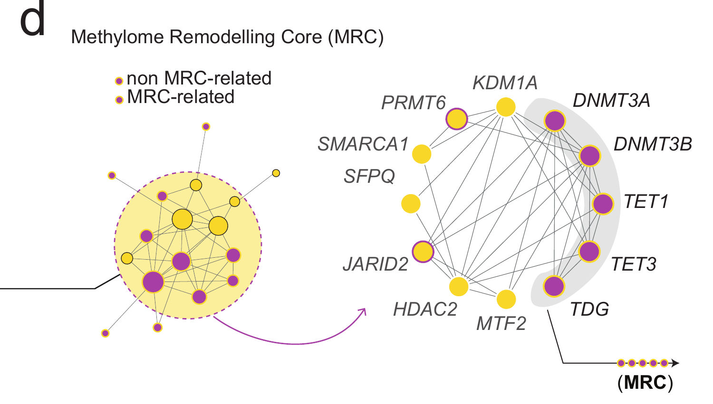
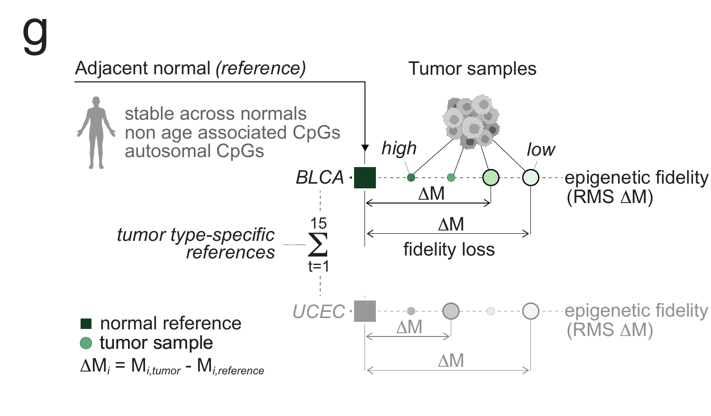
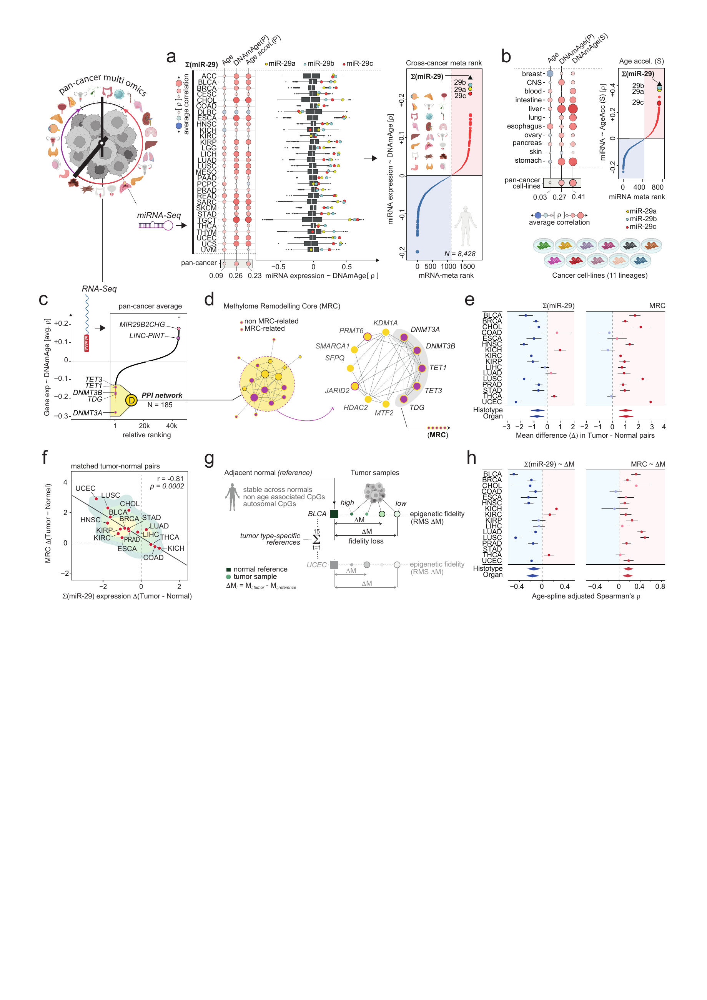
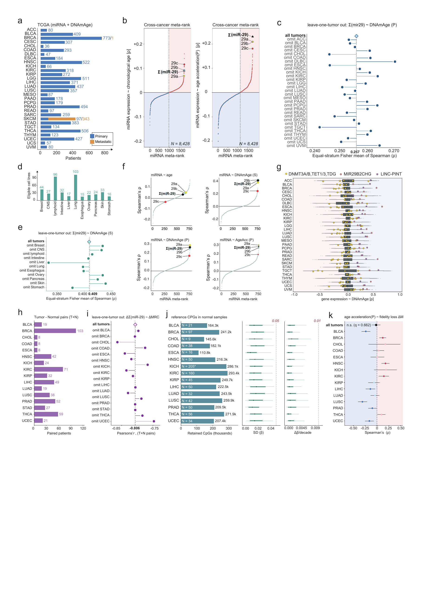

> **External inputs — restricted Zenodo draft.** The five input packages have been uploaded to an unpublished Zenodo draft with reserved DOI [10.5281/zenodo.23266285](https://doi.org/10.5281/zenodo.23266285). The DOI becomes active on publication; draft access is granted separately. Extract the matching ZIP into the repository root. Individual GTEx donor ages are withheld, and full-notebook execution boundaries remain documented in the [module instructions](README.md). Scientific code and recorded results below are unchanged.

```{r setup, include=FALSE}
knitr::opts_chunk$set(echo=TRUE,message=FALSE,warning=FALSE,fig.align="center",
  dev="png",dpi=160,fig.retina=1,out.width="100%")
options(width=100,scipen=4,stringsAsFactors=FALSE)
source("code/load_all.R",local=FALSE)
code_excerpt <- function(file,from=NULL,until=NULL) {
  lines <- readLines(file,warn=FALSE)
  first <- if(is.null(from)) 1L else which(startsWith(lines,from))[1]
  last <- if(is.null(until)) length(lines) else which(startsWith(lines,until))[1]-1L
  stopifnot(is.finite(first),is.finite(last),first<=last)
  lines[first:last]
}
table_show <- function(x,digits=4) {
  for(name in names(x)) if(is.numeric(x[[name]])) {
    tiny <- is.finite(x[[name]]) & x[[name]]!=0 & abs(x[[name]])<10^(-digits)
    if(any(tiny)) x[[name]] <- format(x[[name]],digits=min(digits,6),scientific=TRUE,trim=TRUE)
  }
  knitr::kable(x,digits=digits,row.names=FALSE)
}
read_table <- function(name) read.delim(file.path("tables",paste0(name,".tsv")),check.names=FALSE)
show_panel <- function(name) knitr::include_graphics(file.path("figures/reconstructed",paste0(name,".png")))
```

# Scope and execution

This document accompanies the final **Figure 5 and Figure S5**. It reconstructs
the associations linking miR-29 expression, DNA methylation age, the methylome
remodelling core (MRC), and deviation from normal-tissue methylation references
in human cancers and cancer cell lines. Figure S5 documents cohort sizes,
alternative age readouts, leave-one-stratum-out sensitivity, and reference
selection. These observational associations do not establish causal direction.

The final Illustrator pages are preserved unchanged in `reference/`.
Every analytical plot below is regenerated from the bundled numerical inputs.
The Cytoscape network in Figure 5d and the conceptual schematic in Figure 5g
are explicitly identified as retained artwork. Page geometry, organ icons and
other manually arranged decorations are not analytical outputs.

Open `Figure5_main_plus_supplementary.Rproj` in RStudio and knit this file, or run:

```{r execution, eval=FALSE}
source("render_figure5_and_s5.R")
# Rebuild numerical summaries, statistical tests and plots without HTML:
source("run_all.R")
```

Setup executes the clean modules once. Every displayed code block is read
directly from those executable files. Supplementary sections contain analysis
and plotting code, not just images. Paths are relative to the bundle root;
knitting does not download data, install software, recompute genome-wide
preprocessing or require the original server.

## Reproduction boundary and provenance

The supported starting point is the **verified processed-data checkpoint**.
The bundle includes per-cancer resampled correlations and annotations,
CCLE results and metadata, RNA correlation matrices, per-sample paired
expression scores, tumor-level fidelity scores, and the selected-reference
CpG vectors and selection metrics. Independent historical outputs are also
included as numerical regression checks.

The reconstruction recalculates meta-ranks, the 185-gene selection, strict
patient matching, paired tests, Pearson associations, residual-Spearman
associations, random-effects summaries, leave-one-out results, FDR values,
boxplot statistics and reference-QC summaries. It preserves, rather than
refits, upstream VST normalization, the 100 resampling iterations, clock
predictions, and tumor-versus-reference RMS scores.

Raw count matrices and genome-wide tumor/normal beta matrices are **not**
bundled. Original server scripts are retained in
`provenance/upstream_archive/`; they are not the clean executable entry
point and may require their original server inputs. The matrix-level
reference algorithm is separately extracted in clean form below. A successful
render certifies processed-data reconstruction, not a new raw-data/server
run or recreation of Cytoscape's exact edge layout.

`provenance/input_sources.tsv` records original paths, transformations,
sizes and MD5 checksums. Unused VST matrices were removed from the portable
miRNA cache without changing correlations or annotations. Reference vectors
were collected into `data/reference_selection_metrics.rds` without changing
their values. Source-page checksums and artwork crop coordinates are recorded
in `provenance/reference_sources.json`.

## Analysis map and conventions

Here **P** denotes Horvath's pan-tissue clock and **S** denotes Skin & Blood.
The word "acceleration" must not be used to interchange these clocks.
Acceleration is the residual of a linear DNAmAge-versus-chronological-age
model fitted within the relevant cancer or cell-line lineage.

| Panels | Units / strata | Readout and aggregation |
|:--|:--|:--|
| 5a; S5a–c | 8,428 tumor patients; 30 cancers | Resampled Spearman correlations; equal-cancer Fisher aggregation |
| 5b; S5d–f | 429 cell lines; 11 lineages | Resampled Spearman correlations; equal-lineage Fisher aggregation |
| 5c; S5g | RNA features within 30 cancers | Equal-cancer Fisher rank; native within-cancer distributions |
| 5e–f; S5h–i | 580 strict tumor–normal pairs; 16 cancers | Paired score differences; cancer-mean Pearson association |
| 5g–h; S5j–k | 15 reference-compatible histotypes | RMS deviation in M values; age-spline residual correlations |

For correlations \(r_j\), the equal-stratum Fisher summary is
\[
\bar r=\tanh\!\left[\frac{1}{K}\sum_{j=1}^{K}\operatorname{atanh}(r_j)\right].
\]
Each eligible cancer or lineage has equal weight. This is not a correlation
obtained by pooling all patients, nor an inverse-variance random-effects
meta-analysis. Finite available entries are used for feature ranks; their
numbers of contributing strata are retained in the tables.

Random-effects pooling is used separately for the paired expression and
fidelity forests, using REML with Knapp–Hartung inference. The two
organ-aggregation procedures remain distinct: paired expression uses an
initial within-organ random-effects summary; fidelity combines histotypes
within organ by inverse-variance Fisher weighting before between-organ
pooling.

All tests are two-sided. Nominal \(p\), BH-adjusted \(q\), correlation
intervals, CpG-distribution quantiles and descriptive leave-one-out connectors
are distinguished explicitly. The 185-gene three-SD threshold is an
operational tail selection, **not an FDR threshold**.

## Shared setup and plotting functions

The modules stop if inputs are absent or a numerical check fails.
Historical names such as `ERC` do not change the biological definition:
MRC comprises **DNMT3A, DNMT3B, TET1, TET3 and TDG** throughout.

```{r setup-code, eval=FALSE, code=code_excerpt('code/00_setup.R')}
```

```{r plotting-helpers, eval=FALSE, code=code_excerpt('code/02_main_plots.R',until='# a:')}
```

# Figure 5 — main

## a — miR-29 and methylation age across human cancers

The analysis uses primary and metastatic TCGA tumors with matched miRNA,
chronological age and Horvath DNAmAge. One sample is retained per patient,
preferring primary tumor when both types are available. Adjacent normals
are excluded. There are **8,428 unique patients in 30 cancers**; ovarian
cancer is not part of the retained analysis.

The upstream workflow sums duplicated sample IDs at the raw-count level.
The two miR-29b loci are summed into a combined b feature; pan-miR-29 is
the sum of miR-29a, miR-29b-1, miR-29b-2 and miR-29c before DESeq2 variance
stabilization. The preserved implementation uses a blind VST with fallback
fitting when required. Within each cancer, 100 random 80% subsamples
produce correlations with age, DNAmAge and acceleration, averaged on the
Fisher-z scale. The upstream minimum cohort size is 25. The exact
processed output is replayed here.

Left: pan-miR-29 correlations within each cancer and their equal-cancer
summary. Center: native-miRNA DNAmAge correlation distributions with the
three family members highlighted. Redundant b-locus entries and the
auxiliary AC composite are excluded from this display. Right: the
cross-cancer rank, including pan-miR-29, contains 1,764 entries.
Points are ranked observations, not a fitted curve.

```{r main-a-analysis, eval=FALSE, code=code_excerpt('code/01_main_analysis.R',until='b_final <-')}
```

```{r main-a-draw, eval=FALSE, code=code_excerpt('code/02_main_plots.R',from='# a:',until='# b:')}
```

```{r main-a-plot, echo=FALSE}
show_panel('Figure5a_TCGA_miRNA_age')
```

```{r main-a-numbers, echo=FALSE}
table_show(a_summary,6)
```

## b — miR-29 and age readouts in cancer cell lines

The CCLE checkpoint contains **429 eligible lines from 11 lineages**.
Eligibility requires complete age, Horvath and Skin & Blood values and
at least 15 lines per lineage; the historical filename contains "N20",
but the saved setting and final cohort use **MIN_N = 15**.
Chronological age is donor age, not culture duration.

Native miRNA values come from the processed NanoString input. Within each
lineage, the three miR-29 measurements are individually standardized and
averaged to form pan-miR-29. This differs from the TCGA raw-count sum.
The saved 100 × 80% repeated-subsampling analysis is aggregated equally
across lineages.

Bubbles show chronological age, Horvath pan-tissue age and Skin & Blood
age. The main rank uses **Skin & Blood acceleration**, not Horvath
acceleration. Figure S5f shows the other retained readouts.

```{r main-b-analysis, eval=FALSE, code=code_excerpt('code/01_main_analysis.R',from='b_final <-',until='c_final <-')}
```

```{r main-b-draw, eval=FALSE, code=code_excerpt('code/02_main_plots.R',from='# b:',until='# c:')}
```

```{r main-b-plot, echo=FALSE}
show_panel('Figure5b_CCLE_miRNA_age')
```

```{r main-b-numbers, echo=FALSE}
table_show(b_summary,6)
```

## c — RNA age associations and the 185-gene lower tail

RNA counts were processed upstream with DESeq2 variance stabilization,
and nonvariable features removed within cancer. Repeated-subsample
Spearman associations with Horvath DNAmAge were computed within each
cancer. This section rebuilds the equal-cancer Fisher mean from the
saved complete 30-cancer correlation matrix, rather than reading the
final rank alone.

The 44,398 ranked features are ordered by their meta-correlation.
The selected set is defined by
\[
r_g < \operatorname{mean}(r)-3\,\operatorname{SD}(r).
\]
Exactly **185 Ensembl features** satisfy this rule. Their IDs are checked
against the original selection and exported with symbols and the full
rank. Association with this epigenetic-age readout is not proof of
repression during chronological aging or of a causal role.

```{r main-c-analysis, eval=FALSE, code=code_excerpt('code/01_main_analysis.R',from='c_final <-',until='message("Preparing paired')}
```

```{r main-c-draw, eval=FALSE, code=code_excerpt('code/02_main_plots.R',from='# c:',until='# Generic')}
```

```{r main-c-plot, echo=FALSE}
show_panel('Figure5c_RNA_age_ranking')
```

```{r main-c-checks, echo=FALSE}
table_show(data.frame(Ranked_features=nrow(c_rank),Cancers=ncol(c_final$rhoCancerMatrix),
  Cutoff=recalculated_cutoff,Selected_features=nrow(c_185)),6)
```

The complete annotated selection is in `tables/Figure5c_185_genes.tsv`;
exact network input IDs are in `data/panel_c_185_ensembl_ids.txt`.

## d — network context and the methylome remodelling core

The approved Cytoscape network was assembled from the selected 185-gene
set. The final diagram highlights the five MRC genes: DNMT3A, DNMT3B,
TET1, TET3 and TDG. The analytical input list is reproducible in panel c.
Exact interaction retrieval, edge filtering and Cytoscape layout are
not certified by this R reconstruction. The vector artwork is therefore
preserved directly, without substituting an inferred network.

```{r main-d-code, eval=FALSE}
MRC_GENES <- c('DNMT3A','DNMT3B','TET1','TET3','TDG')
network_input <- readLines('data/panel_c_185_ensembl_ids.txt')
stopifnot(length(network_input)==185L)
# Approved artwork: reference/Figure5d_Cytoscape_artwork.pdf
```

```{r main-d-artwork, echo=FALSE}

```

## e — paired tumor–normal expression differences

Within each cancer, primary tumor (01) and adjacent normal (11) samples
are matched by patient. A patient is retained only if both tissue states
are available for **both miRNA and RNA**. This yields 580 strict pairs
from 16 histotypes, not the 8,428 tumor-only patients in panel a.

Upstream pan-miR-29 VST values are standardized over the combined
tumor-plus-normal universe within cancer. For MRC, each of the five
gene VST measurements is standardized, their sample-wise mean is
calculated, and the composite is standardized again. The cached name
`ERC_Z` refers to this MRC score.

The effect is the mean paired difference
\(\Delta=Z_{\mathrm{tumor}}-Z_{\mathrm{normal}}\). A one-sample t test of
these patient differences is equivalent to a paired t test. Intervals
are 95% t intervals. BH correction is applied across 16 cancers
**separately for each readout**. The effect is in the underlying
standardized-score units, not Cohen's \(d_z\).

Bottom diamonds show REML/Knapp–Hartung summaries over 16 histotypes
and 13 organs. For the organ analysis, kidney and lung histotypes are
first pooled within organ using the preserved random-effects procedure.

```{r paired-helpers, eval=FALSE, code=code_excerpt('code/helpers/paired_expression_and_density.R')}
```

```{r main-e-f-analysis, eval=FALSE, code=code_excerpt('code/01_main_analysis.R',from='message("Preparing paired',until='message("Rebuilding')}
```

```{r main-e-draw, eval=FALSE, code=code_excerpt('code/02_main_plots.R',from='# Generic',until='# f:')}
```

```{r main-e-plot, echo=FALSE}
show_panel('Figure5e_paired_expression')
```

```{r main-e-meta, echo=FALSE}
z <- e_meta;z$Readout[z$Readout=='ERC'] <- 'MRC';table_show(z,5)
```

Full per-cancer effects, nominal p values, q values and patient-level
differences are exported in the `Figure5e_*` and
`Figure5ef_paired_patients.tsv` tables.

## f — association of paired miR-29 and MRC changes

Each labeled point is the mean paired effect for one of the 16 cancers,
using the same patients as panel e. The statistic is **Pearson correlation
across the 16 cancer means**, not a patient-level or Spearman correlation.

The background is a two-dimensional density of all 580 patient pairs.
Each pair has weight \(1/n_c\), so each cancer contributes the same total
weight despite unequal numbers of pairs. Contours show density, not a
confidence region. The line is a descriptive ordinary least-squares fit
to the cancer means. Figure S5i examines omission of each cancer.
The calculation and density helper are displayed in panel e.

```{r main-f-draw, eval=FALSE, code=code_excerpt('code/02_main_plots.R',from='# f:',until='# h:')}
```

```{r main-f-plot, echo=FALSE}
show_panel('Figure5f_paired_scatter_Pearson')
```

```{r main-f-statistics, echo=FALSE}
table_show(data.frame(Cancers=nrow(f_means),Paired_patients=nrow(ef_pairs),
  Pearson_r=unname(f_test$estimate),CI_low=f_test$conf.int[1],
  CI_high=f_test$conf.int[2],P=f_test$p.value),6)
```

## g — stable normal references and fidelity loss

The reference is defined separately for each eligible tumor histotype
using adjacent-normal methylation. The upstream pipeline restricts to
autosomal probes, removes probes exceeding 5% missing values and applies
KNN imputation as implemented in the archived workflow. CpGs must satisfy
all three normal-sample conditions:

- beta standard deviation \(\leq0.05\);
- absolute Pearson correlation with chronological age \(\leq0.25\);
- absolute linear beta change per decade \(\leq0.01\).

These are **stability-selected, tissue-matched references**, not
tissue-specific marker CpGs. Passing cutoffs in the same normal samples
does not establish independent age invariance. CpG counts and normal
sample numbers appear in S5j.

KICH uses a shared normal-kidney reference from **160 KIRC plus 45 KIRP
normal samples**. KIRC and KIRP use their own normal references in the
final analysis. CHOL uses its recovered reference with nine normal
samples. STAD is not included in the final fidelity analysis.

Beta values are clipped to \([10^{-6},1-10^{-6}]\), then converted to
\(M=\log_2[\beta/(1-\beta)]\). Each reference M value is the median of
the normal-sample M values. For tumor \(s\),
\[
\mathrm{FidelityLoss}_s =
\sqrt{\frac{1}{P}\sum_{i=1}^{P}
 (M_{is}-\operatorname{median}_{n\in\mathrm{normal}}M_{in})^2}.
\]
Higher RMS deviation means greater reference deviation, or lower
operational epigenetic fidelity. It is not DNAmAge, a percentage,
a signed methylation change or the 43-CpG fibroblast score in Figure 4.
Cellular composition and other tumor-associated changes can contribute
to bulk-tissue reference deviation.

These extracted functions specify matrix-level selection and scoring.
They are **not executed during knitting**, because full normal/tumor
beta matrices are not included. The reconstruction starts from saved
sample scores and checks selected-reference metrics. The prerequisite
`BN` is already QC-filtered, imputed and autosomal; these functions
do not perform that preprocessing.

```{r reference-algorithm, eval=FALSE, code=code_excerpt('code/upstream/reference_algorithms.R')}
```

```{r main-g-artwork, echo=FALSE}

```

This schematic is preserved artwork. The numerical score and selection
rules, not the cartoon geometry, define the method.

## h — miR-29, MRC and age-adjusted reference deviation

The forests have different assay-overlap cohorts. The miRNA analysis
requires primary-tumor fidelity, pan-miR-29, age and a finite Horvath
prediction. Horvath availability is an **inclusion rule**, not an
adjustment covariate here. The MRC analysis requires MRC, fidelity and
age but not miRNA or Horvath. One primary sample per patient is retained.
Original sample counts are checked separately; the cohorts are not
silently replaced by their intersection.

The fidelity miRNA checkpoint uses DESeq2 size-factor-normalized counts:
the miR-29a, combined miR-29b and miR-29c abundances are summed, then
transformed with log2(x + 1). This is not the VST composite used for the
paired expression scores. The MRC scores retain their five-gene
standardization described in panel e.

Within cancer, each variable is regressed on a three-degree-of-freedom
natural spline of age; Spearman correlation is then calculated between
the residual vectors. This is correlation of residualized values, not
a rank-first partial correlation. The historical nominal p value is
the asymptotic `cor.test(..., exact=FALSE)` result. Fisher intervals use
\(SE_z=1/\sqrt{N-6}\), accounting approximately for the three spline
degrees of freedom. These are preserved approximation conventions,
not an exact finite-sample permutation test.

Pooling uses REML/Knapp–Hartung on Fisher-z correlations, with
**15-histotype and 12-organ** summaries. Unlike panel e, the first stage
for the fidelity organ summary is inverse-variance weighting within organ.

```{r fidelity-mirna-helpers, eval=FALSE, code=code_excerpt('code/helpers/fidelity_mirna.R')}
```

```{r fidelity-mrc-helpers, eval=FALSE, code=code_excerpt('code/helpers/fidelity_mrc.R')}
```

```{r main-h-analysis, eval=FALSE, code=code_excerpt('code/01_main_analysis.R',from='message("Rebuilding',until='PANELS <-')}
```

```{r main-h-draw, eval=FALSE, code=code_excerpt('code/02_main_plots.R',from='# h:')}
```

```{r main-h-plot, echo=FALSE}
show_panel('Figure5h_fidelity_associations')
```

```{r main-h-meta, echo=FALSE}
table_show(rbind(data.frame(Readout='pan-miR-29',hl_meta),data.frame(Readout='MRC',hr_meta)),6)
table_show(data.frame(Cancer=h_left$Cancer,N_miRNA=h_left$N,
  N_MRC=h_right$N[match(h_left$Cancer,h_right$Cancer)]),0)
```

Per-cancer cohorts and nominal p values are saved in `tables/`.
The association does not itself establish direct maintenance of fidelity
by miR-29, or demonstrate lineage conversion.

# Figure S5 — supplementary

## a — TCGA cohort sizes and sample types

These are the exact tumor samples used for Figure 5a: 8,428 samples,
all from unique patients, comprising 8,084 primary and 344 metastatic
tumors without matched normals. BRCA has 773 primary plus 1 metastatic
sample; SKCM has 97 primary plus 343 metastatic samples. Other cancers
contribute primary tumors only. Slash labels mean **primary / metastatic**,
not samples / unique patients.

```{r supp-validation-inputs, eval=FALSE, code=code_excerpt('code/03_supplementary_analysis.R',until='# ---- S5a:')}
```

```{r supp-plot-helpers, eval=FALSE, code=code_excerpt('code/04_supplementary_plots.R',until='# ---- S5a')}
```

```{r s5a-analysis, eval=FALSE, code=code_excerpt('code/03_supplementary_analysis.R',from='# ---- S5a:',until='# ---- S5b:')}
```

```{r s5a-draw, eval=FALSE, code=code_excerpt('code/04_supplementary_plots.R',from='# ---- S5a',until='# ---- S5b')}
```

```{r s5a-plot, echo=FALSE}
show_panel('S5a_TCGA_cohort')
table_show(tcga_counts,0)
```

## b — TCGA chronological-age and acceleration meta-ranks

The same per-cancer results and feature rules as Figure 5a are applied
to chronological age (left) and Horvath pan-tissue acceleration (right).
Each panel has 1,764 entries. All marks are individual ranked
observations, without an interpolating or smoothing curve.
Colors indicate correlation sign; the vertical line marks its zero crossing.

```{r s5b-analysis, eval=FALSE, code=code_excerpt('code/03_supplementary_analysis.R',from='# ---- S5b:',until='# ---- S5c/e:')}
```

```{r s5b-draw, eval=FALSE, code=code_excerpt('code/04_supplementary_plots.R',from='# ---- S5b',until='# ---- S5c/e/i:')}
```

```{r s5b-plot, echo=FALSE}
show_panel('S5b_TCGA_age_and_acceleration')
```

## c — TCGA leave-one-cancer-out sensitivity

The pan-miR-29 versus Horvath DNAmAge summary is recomputed after omitting
each of 30 cancers. The full estimate is approximately 0.25661.
This examines dependence of the equal-cancer summary on one cancer;
it does not resample patients or provide external validation.

Horizontal segments connect omission estimates to the full estimate:
they are **not confidence intervals**. The same calculation is used for S5e.

```{r s5c-e-analysis, eval=FALSE, code=code_excerpt('code/03_supplementary_analysis.R',from='# ---- S5c/e:',until='# ---- S5d/f:')}
```

```{r s5c-draw, eval=FALSE, code=code_excerpt('code/04_supplementary_plots.R',from='# ---- S5c/e/i:',until='# ---- S5d')}
```

```{r s5c-plot, echo=FALSE}
show_panel('S5c_TCGA_leave_one_out')
```

## d — eligible CCLE lineages

Counts come from the complete-case metadata used in the final analysis,
not all available CCLE lines. They sum to 429 across 11 lineages.
The eligibility threshold is 15, irrespective of the "N20" filename.

```{r s5d-f-analysis, eval=FALSE, code=code_excerpt('code/03_supplementary_analysis.R',from='# ---- S5d/f:',until='# ---- S5g:')}
```

```{r s5d-draw, eval=FALSE, code=code_excerpt('code/04_supplementary_plots.R',from='# ---- S5d',until='# ---- S5e')}
```

```{r s5d-plot, echo=FALSE}
show_panel('S5d_CCLE_cohort')
table_show(ccle_counts,0)
```

## e — CCLE leave-one-lineage-out sensitivity

This concerns **pan-miR-29 versus Skin & Blood DNAmAge**, not
acceleration. One eligible lineage is removed at a time from the
equal-lineage Fisher summary. The full estimate is approximately 0.40883.
The 12 estimates are in `tables/S5e_CCLE_leave_one_out.tsv`.
These are cell-line lineages, not individual tumors. Segment interpretation
is the same as S5c; its shared calculation is displayed there.

```{r s5e-draw, eval=FALSE, code=code_excerpt('code/04_supplementary_plots.R',from='# ---- S5e',until='# ---- S5f')}
```

```{r s5e-plot, echo=FALSE}
show_panel('S5e_CCLE_leave_one_out')
```

## f — four complementary CCLE age ranks

Top row: donor chronological age and Skin & Blood DNAmAge.
Bottom row: Horvath pan-tissue DNAmAge and its acceleration.
Each plot has 735 entries with the miR-29 members and pan-miR-29
highlighted, using equal-lineage Fisher aggregation as in Figure 5b.
Rank calculations are shown in S5d.

No fitted line is drawn through ranks. To keep Illustrator responsive,
only the dense background point layer is rasterized at 600 dpi.
Axes, highlights and text remain vector objects in the PDF.
All coordinates are retained: rasterization is not subsampling.

```{r s5f-draw, eval=FALSE, code=code_excerpt('code/04_supplementary_plots.R',from='# ---- S5f',until='# ---- S5g')}
```

```{r s5f-plot, echo=FALSE}
show_panel('S5f_CCLE_four_ranks')
```

## g — within-cancer RNA correlation distributions

Horizontal boxplots summarize **all eligible RNA features** within 30
cancers, using resampled Spearman correlations with Horvath DNAmAge.
These are distributions over features, not uncertainty intervals for
a pooled correlation. There are 1,673,475 feature-by-cancer observations;
feature counts can differ across cancers.

Boxes show median and first/third quartiles; whiskers reach the most
extreme observations within 1.5 interquartile ranges. All 33,264
outliers are plotted. The five MRC genes, MIR29B2CHG and LINC-PINT
produce 210 highlighted gene–cancer pairs. MRC markers are yellow,
matching the final montage.

Only the gray outlier layer is rasterized at 600 dpi. Boxes, highlights,
labels and axes remain editable vectors, reducing Illustrator object
counts without dropping outliers or changing boxplot statistics.

```{r s5g-analysis, eval=FALSE, code=code_excerpt('code/03_supplementary_analysis.R',from='# ---- S5g:',until='# ---- S5h/i:')}
```

```{r s5g-draw, eval=FALSE, code=code_excerpt('code/04_supplementary_plots.R',from='# ---- S5g',until='# ---- S5h')}
```

```{r s5g-plot, echo=FALSE}
show_panel('S5g_TCGA_RNA_distributions')
```

Box summaries and highlighted values are exported as
`S5g_RNA_box_statistics.tsv` and `S5g_RNA_highlighted_genes.tsv`.

## h — strict paired tumor–normal cohort

Counts refer to the patients used in both Figure 5e and 5f.
Each must have primary-tumor and adjacent-normal data for both miRNA
and RNA. The 16 cancer counts sum to 580. Reference-normal counts
in S5j are a different cohort and cannot replace these paired counts.

```{r s5h-i-analysis, eval=FALSE, code=code_excerpt('code/03_supplementary_analysis.R',from='# ---- S5h/i:',until='# ---- S5j:')}
```

```{r s5h-draw, eval=FALSE, code=code_excerpt('code/04_supplementary_plots.R',from='# ---- S5h',until='# ---- S5i')}
```

```{r s5h-plot, echo=FALSE}
show_panel('S5h_paired_cohort')
table_show(pair_counts,0)
```

## i — paired-effect association after omitting one cancer

The Pearson association between cancer-mean paired pan-miR-29 and MRC
effects is recalculated after removing each cancer. The full estimate is
\(r=-0.80635\). Only Pearson is retained in the final S5. Each omission
leaves 15 cancer means; patients in remaining cancers are not rematched.

The calculation is shown in S5h. Segments indicate movement from the
full correlation, **not confidence intervals**. Nominal p values are
exported without treating this descriptive sensitivity display as a
new discovery family.

```{r s5i-draw, eval=FALSE, code=code_excerpt('code/04_supplementary_plots.R',from='# ---- S5i',until='# ---- S5j')}
```

```{r s5i-plot, echo=FALSE}
show_panel('S5i_paired_leave_one_out')
```

## j — normal reference size and retained-CpG properties

Left: retained CpGs and normal sample counts for each reference.
KICH's asterisk means **205 shared kidney normals (160 KIRC + 45 KIRP)**,
not 205 KICH donors.

Right: the retained CpGs' beta variability and **absolute** age slope.
The point is the median, thick interval the 25th–75th percentiles,
and thin interval the 5th–95th percentiles. These are CpG-distribution
ranges, not standard errors or confidence intervals. Dashed cutoffs:
SD(beta) = 0.05 and \(|\Delta\beta|/\mathrm{decade}=0.01\).

The absolute age-correlation cutoff of 0.25 remains in selection even
though its diagnostic panel is omitted from the final montage.
All three cutoffs are checked for every selected CpG. This documents
selection properties, not independent validation of age invariance.
Large retained sets are compatible with broadly stable loci rather
than uniquely tissue-specific markers.

```{r s5j-analysis, eval=FALSE, code=code_excerpt('code/03_supplementary_analysis.R',from='# ---- S5j:',until='# ---- S5k:')}
```

```{r s5j-draw, eval=FALSE, code=code_excerpt('code/04_supplementary_plots.R',from='# ---- S5j',until='# ---- S5k')}
```

```{r s5j-plot, echo=FALSE}
show_panel('S5j_reference_QC')
table_show(reference_qc,0)
```

## k — age acceleration and reference deviation

The retained forest tests Horvath pan-tissue acceleration versus
fidelity loss. Acceleration is recalculated as the residual of Horvath
DNAmAge on age in each exact primary-tumor overlap cohort. Both
acceleration and fidelity are then residualized against a three-df
age spline before Spearman correlation. This is explicitly an
**age-adjusted** association.

The historical residual-correlation approximation and REML/Knapp–Hartung
pooling are preserved. The pooled result is approximately
\(\rho=-0.02078\), 95% CI \([-0.10881,0.06756]\), with
**p = q = 0.6220752**. This nonsignificant summary does not establish
equivalence or rule out cancer-specific relationships; heterogeneity
between cancers is substantial.

FDR retains the original analysis family: 45 cancer-level tests
(three models × 15 cancers), and separately three pooled tests.
Displaying only one forest does not remove the other models from
correction. The two miR-29 models are recalculated and tabulated for
provenance, not reintroduced as supplementary panels.

```{r s5k-analysis, eval=FALSE, code=code_excerpt('code/03_supplementary_analysis.R',from='# ---- S5k:')}
```

```{r s5k-draw, eval=FALSE, code=code_excerpt('code/04_supplementary_plots.R',from='# ---- S5k')}
```

```{r s5k-plot, echo=FALSE}
show_panel('S5k_acceleration_fidelity')
table_show(fidelity_age_meta,6)
```

The per-cancer results for all 45 tests are in
`tables/fidelity_age_all_45_tests.tsv`.

# Validation, source pages and software

## Numerical validation

The reconstruction stops on a failed check. Checks cover cohort sizes,
feature selection, paired scores/tests, Fisher ranks, fidelity cohorts,
leave-one-out estimates, full RNA box statistics, reference cutoffs and
the original three-model fidelity FDR family. Floating-point comparisons
use explicit tolerances. Historical outputs serve as regression checks;
an unexecuted raw-data pipeline is not certified.

```{r validation-summary, echo=FALSE}
table_show(data.frame(Checks=length(CHECKS),
  Passed=sum(vapply(CHECKS,`[[`,logical(1),'pass')),
  Main_analytical_exports=6,Supplementary_analytical_exports=11,
  Retained_artwork_panels=2),0)
```

```{r execution-module, eval=FALSE, code=code_excerpt('code/load_all.R')}
```

## Montage notes

Submitted PDF pages remain unchanged. Reconstructed plots and this
document use the verified analytical labels and values:

| Panel | Clarification |
|:--|:--|
| 5a | miRNA meta-rank, not mRNA; TCGA abbreviations LIHC and PCPG |
| S5e | Leave-one-lineage-out for CCLE, not leave-one-tumor-out |
| S5j | Absolute beta change per decade; ranges are CpG quantiles |
| S5k | Pooled q = 0.622, not the montage's 0.662; age adjustment explicit |

These are transcription/label clarifications, not changes to the
analysis or its significance.

## Approved main and supplementary layouts

These full pages are reference images of the supplied final PDFs,
not the analytical reconstructions displayed above.

```{r final-main-reference, echo=FALSE}

```

```{r final-supplement-reference, echo=FALSE}

```

## Software and files

The tested environment is recorded below and in `validation/sessionInfo.txt`.
The bundle contains the RStudio project, source R Markdown, expanded
Markdown and HTML, executable modules, checkpoints, tables, PDFs/PNGs,
unchanged source pages and validation/provenance records.

HTML is self-contained for reading. Re-execution requires the full
bundle, not the HTML or downloaded Rmd alone. Reconstructed PDFs are in
`figures/reconstructed/`. The two dense supplementary layers identified
above use 600-dpi raster backgrounds; other elements remain vectors.

```{r session-info, echo=FALSE}
cat(capture.output(sessionInfo()),sep='\n')
```
